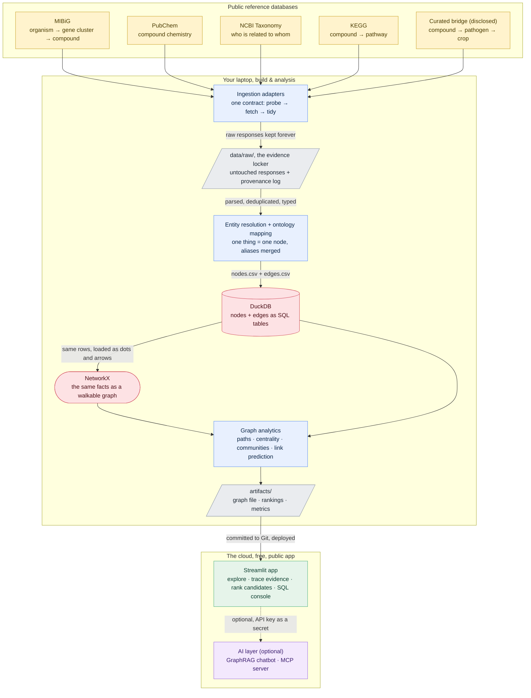

# MicrobeGraph

**▶ Live app, coming after the deployment phase** · **v0.1.0 (in development)** ·


[](https://github.com/akannan2987/microbegraph/actions/workflows/ci.yml)


-informational)


> ### New here? Start with the [Handbook](docs/HANDBOOK.md)
> It's a single document that walks through the whole build in order, from day 0
> to the finished product, and explains *why* at each step. It links to the
> specialised guides at the point where you need them, so you don't have to hunt
> through the repository.

MicrobeGraph takes scattered public facts (which microbe makes which molecule,
and which molecule acts against which crop disease) and joins them into one
graph you can walk, query and ask questions of in plain English. I'm building it
from scratch, in public, and explaining each step as I go.

> **In one sentence:** an open, reproducible knowledge graph that connects curated
> biosynthetic gene cluster data to crop disease outcomes, with evidence
> provenance on every relationship, including a transparently hand-curated bridge
> for the literature-derived links that no public database provides.
>
> *What the sentence leaves out, and my reasons for leaving it out, are in*
> [`docs/PRIOR-ART.md`](docs/PRIOR-ART.md).

> Every term used in this repo, biological or technical, has a beginner-friendly
> definition in [`docs/GLOSSARY.md`](docs/GLOSSARY.md). If a word you need isn't
> there, please treat that as a documentation bug.

---

## Contents

- [**The Handbook**](docs/HANDBOOK.md): read this first, it covers day 0 to the finished product
- [What is a knowledge graph? (start here)](#what-is-a-knowledge-graph-start-here)
- [The problem this project tackles](#the-problem-this-project-tackles)
- [How it works](#how-it-works)
- [The data at a glance](#the-data-at-a-glance)
- [Results, phase by phase](#results-phase-by-phase): filled in as each phase is finished
- [Build log](#build-log): every phase with its guide and status
- [The tutorial, in order](#the-tutorial-in-order): the documents that teach every step, starting from a blank laptop
- [Pictures and interactive pages](#pictures-and-interactive-pages): a diagram for each big idea
- [Roadmap](#roadmap): three releases and nineteen phases, with a reason for each tool
- [How this differs from existing work](#how-this-differs-from-existing-work)
- [About the data (honesty notes)](#about-the-data-honesty-notes)
- [Repository map](#repository-map): every file, annotated
- [How to run](#how-to-run)
- [How I work on this repo (branch model)](#how-i-work-on-this-repo-branch-model)
- [Why the documentation is so detailed](#why-the-documentation-is-so-detailed)

---

## What is a knowledge graph? (start here)

The easiest way in has no science in it at all: a **city transport map**.

A transport map doesn't give you facts as sentences; it draws dots and lines.
The dots are places (stations), and the lines are relationships between places
("you can travel directly from here to there"). With that picture in front of
you, you can answer questions that no single sentence contains, such as *what is
the shortest route from Baker Street to Waterloo?* or *which station would break
the most journeys if it closed?*, just by **walking the map**.

A **knowledge graph** applies the same idea to facts instead of stations.

- A **node** is a thing: a microbe, a molecule, a plant disease, a crop.
- An **edge** is a relationship between two things, with a direction and a name:
  *produces*, *inhibits*, *infects*.
- So a **fact** is a tiny three-part sentence, subject → relationship → object,
  and the graph is thousands of those sentences drawn as dots and arrows.

Here's one chain of real-world biology written that way:

```
Bacillus velezensis  --produces-->  surfactin  --inhibits-->  Botrytis cinerea  --infects-->  strawberry
```

Read left to right, that says: *a soil bacterium makes a soapy molecule; that
molecule suppresses grey-mould fungus; grey mould rots strawberries.* That's
three facts, four dots and three arrows. Drawn like this, the chain lets you do
something four separate spreadsheets can't: start at *strawberry* and walk
backwards to find every microbe that might protect it, even though no table
anywhere has a "microbe → crop" column.

Making that backwards walk possible is what this project is for.

### Why a graph and not a spreadsheet?

A spreadsheet (a table) is a grid with fixed columns and one row per thing.
Tables are very good at counting and filtering ("how many compounds are
antifungal?"), and this project keeps a table version for exactly that job.

Where tables struggle is with **chains of unknown length**. To ask
"microbe → ? → ? → crop" in a spreadsheet, you have to know in advance how many
hops the answer needs and build a column for each one. A graph has no such
requirement: you keep following arrows until you get there.

Your phone shows the same contrast. Its contact list is a table (name, number,
email), which is ideal for looking up one person. A social network is a graph of
who knows whom, which is what you need for "friends of friends who live in my
city". MicrobeGraph builds both shapes from the same facts, and the docs explain
when to reach for each.

### Three more words you'll meet immediately

- **Microbe**: a living thing too small to see, such as a bacterium, a fungus or
  a yeast. Some are harmful, many are harmless, and a few are actively *useful*
  to plants.
- **Metabolite** (or "compound"): a small chemical that a microbe makes and
  releases. If the microbe is a tiny factory, the metabolite is what it ships.
  Some of those products happen to be poisonous to plant diseases.
- **Biological (crop protection)**: using a living organism or a natural
  molecule to protect a crop, instead of a synthetic pesticide. The question
  behind the whole field, commercial and scientific, is *out of the thousands of
  natural candidates, which ones are actually worth developing?*

---

## The problem this project tackles

The knowledge needed to answer "*which microbes plausibly act against this crop
disease, and what is the evidence chain?*" already exists. The trouble is that
it's split across databases that don't talk to each other, and each one holds
only one link of the chain:

- **MIBiG** knows which organism carries which gene cluster, and what compound
  that cluster produces, but not what the compound attacks in a field.
- **PubChem** knows the compound's chemistry (formula, weight, structure,
  synonyms) but not which microbe made it.
- **NCBI Taxonomy** knows how organisms are related to each other, and nothing
  about chemistry.
- **KEGG** knows which biochemical pathway a compound belongs to.
- The last link is the most valuable one (*this compound suppresses that
  pathogen on that crop*), and it mostly lives in the text of scientific papers
  rather than in any downloadable table.

Even once you have all the pieces, three specific problems make joining them
hard. Each of them is a documented, taught phase in this repo:

1. **The same thing has different names in different places.** One molecule may
   be "surfactin" in one record, "surfactin A" in another, and
   `npatlas:NPA018495` in a third.
   Deciding that all three are one dot on the map is a skill with its own name,
   **entity resolution**, and it's the step most tutorials quietly skip.
2. **Nothing records how confident it is.** A fact hand-checked by a curator
   from a published experiment and a fact auto-guessed by an algorithm look
   identical once they're in a table. For a graph to be trustworthy, every arrow
   has to carry that difference.
3. **The interesting questions are multi-hop.** "Which microbes might protect
   strawberries?" is four arrows long and crosses four separate databases, none
   of which can answer it alone.

Why does this matter? In developing biological crop protection, the bottleneck
is narrowing thousands of candidate microbes down to a short-list *before*
running slow, expensive greenhouse trials. A map that lets you start from a
disease and walk backwards to plausible microbes, showing the evidence for each
arrow along the way, turns what would be a literature review into a query.
Problems of the same shape turn up well beyond agriculture, too: drug
repurposing, food-safety microbiology and gut-microbiome research all involve
connecting scattered facts and walking the chain.

MicrobeGraph is an open, end-to-end workflow for building that map with care.
An ingestion framework pulls real records from public reference databases and
keeps every raw response as evidence. An ontology (a written rulebook for what
may be a dot and what may be an arrow) governs what enters the graph, and an
entity-resolution step merges the aliases. The facts are then stored twice, on
purpose: as SQL tables in DuckDB and as a real graph in NetworkX, so you learn
when each shape is the better tool. Graph analytics finds paths, hubs,
communities and *predicted* missing links. Finally, a Streamlit app lets anyone
explore the map, trace an evidence chain and rank candidate microbes for a
chosen disease. Two optional extras sit on top of the app: a GraphRAG layer
that answers questions in plain English by walking the graph, and an MCP server
so an AI assistant can query the project directly.

Every step is documented so that a complete beginner can rebuild all of it and
understand what they've built. The repository is the tutorial.

---

## How it works



Put into words: collect real records from public databases and never throw the
raw copies away; decide what counts as one thing and merge its aliases; store
the resulting facts twice, as tables for counting and as a graph for walking;
analyse the graph to find routes, hubs and plausible missing links; save small
result files; and serve everything in a public app, with optional AI on top.
The heavy work happens once, on your laptop. The app only reads the small
results, and that's what keeps the public deployment fast and free.

---

## The data at a glance

*MicrobeGraph is built on real records from public databases, plus one small,
clearly labelled curated bridge layer for the compound → pathogen → crop links,
which no public database publishes as a downloadable table. Every arrow in the
graph carries its source and how strong its evidence is, so real and curated
facts can't be mixed up. More in [About the data](#about-the-data-honesty-notes).*

This is the planned shape of the graph. The final counts are printed by the
build step and recorded in the provenance log, and I don't state any of them here
before they exist.

| Fact | Value |
|---|---|
| Primary real source | **MIBiG 4.0**: thousands of manually curated biosynthetic gene clusters, each linking an organism to the compound it produces ([Zenodo, CC-BY](https://doi.org/10.5281/zenodo.14169073)) |
| Chemistry source | **PubChem** (NIH): formula, molecular weight, canonical name and synonyms for each compound |
| Taxonomy source | **NCBI Taxonomy / Datasets**: the lineage of every organism, so "all *Bacillus*" is one query |
| Protein source | **UniProt**: the enzymes encoded by each gene cluster, which turns two molecular layers into three |
| Pathway source | **KEGG**: compound → pathway membership (attributed; academic use) |
| Bridge layer (curated, disclosed) | compound → *inhibits* → pathogen → *infects* → crop, hand-assembled from published literature with a citation on every edge |
| Node types | 9. Organism, GeneCluster, **Protein**, Compound, CompoundClass, Activity, Pathogen, Crop, Pathway ([full spec](docs/02-ontology-and-data-model.md)) |
| Edge types | 10. HARBORS, **ENCODES**, **CATALYZES**, PRODUCES, BELONGS_TO, HAS_ACTIVITY, INHIBITS, INFECTS, PARTICIPATES_IN, MEMBER_OF |
| Molecular layers | 3: genomics (gene clusters) → proteomics (enzymes) → metabolomics (compounds), joined into one walkable structure |
| Evidence on every edge | `source`, `source_record_id`, `retrieved_at`, `evidence_level`, `confidence`; no anonymous facts |
| Stored twice, on purpose | DuckDB (SQL tables: counting, filtering, joining) **and** NetworkX (a walkable graph: paths, hubs, communities) |
| Reproducibility | every fetch logged with a timestamp; raw responses kept untouched; one command rebuilds the whole graph from them; dependencies bounded in `requirements.txt` and pinned exactly in `requirements.lock.txt` |

---

## Results, phase by phase

*Each phase leaves something you can look at: a table, a chart, the app. As
phases are finished, one figure per phase appears here with a note on what it
means, matching the build log below. Nothing is shown before it exists.*

- **Phase 0. Architecture, setup & data model:** ✅ the full design was written
  before any pipeline code: how the pieces fit
  ([`00-architecture.md`](docs/00-architecture.md)), how a blank laptop becomes a
  working workshop ([`01-setup.md`](docs/01-setup.md)), the rulebook that governs
  what may enter the graph
  ([`02-ontology-and-data-model.md`](docs/02-ontology-and-data-model.md)), and the
  nineteen-phase plan with every tool justified ([`ROADMAP.md`](docs/ROADMAP.md)).
  I designed the schema *first* because a graph assembled without a written
  contract turns into an unqueryable tangle within a week.
- **Phase 1. Ingestion, the MIBiG backbone:** ✅ a single command,
  `python -m microbegraph.fetch --source mibig`, downloads the pinned MIBiG 4.0
  release from Zenodo and refuses it unless its checksum matches the publisher's.
  It then files the archive untouched in the evidence locker, logs a provenance
  row, and turns every active entry into node and edge rows that pass the twelve
  rules of the rulebook. Retired entries and recorded *negative* results are
  counted rather than silently dropped, and they never become arrows. On MIBiG
  4.0 that means 3,013 records read, 2,437 active entries kept, and 10,023 arrows,
  each with its evidence level. 73 offline tests run on Windows, macOS, Linux and
  a RHEL 8 container at every push
  ([`03-ingestion-mibig.md`](docs/03-ingestion-mibig.md)).

  
- **Phases 2-9 (Release 1.0, the science):** *(pending)* more sources, the
  proteomics layer, entity resolution, graph analytics, statistical validation in
  R, graph machine learning, the app, GraphRAG.
- **Phases 10-13 (Release 2.0, the platform):** *(pending)* dbt, PostgreSQL +
  Apache AGE + pgvector, Airflow, Snowflake portability.
- **Phases 14-19 (Release 3.0, the product):** *(pending)* FastAPI, React +
  TypeScript, MCP server, literature mining, the containerized stack, published
  images.

---

## Build log

The plan has nineteen phases across three releases, plus two optional
sub-phases (8b and 9b) and the design work in Phase 0. **Each release is complete
and publishable on its own.** [`ROADMAP.md`](docs/ROADMAP.md) explains why each
tool is there, and says openly which one is the weakest fit.

### Phase 0, design

| # | Document | Status |
|---|---|---|
|  | [**Handbook, day 0 to the finished product**](docs/HANDBOOK.md) | 🔨 living document |
|  | [Glossary: every term, explained simply](docs/GLOSSARY.md) | 🔨 living document |
|  | [Changelog, what changed in each version](CHANGELOG.md) | 🔨 living document |
|  | [Git workflow, commit messages and the branch flow](docs/GIT-WORKFLOW.md) | ✅ |
|  | [Prior art, related work, and what this does not claim](docs/PRIOR-ART.md) | ✅ |
| 0 | [Architecture, how it all fits together](docs/00-architecture.md) | ✅ |
| 0 | [Environment setup from a blank laptop](docs/01-setup.md) | ✅ |
| 0 | [The ontology & data model, the rulebook](docs/02-ontology-and-data-model.md) | ✅ |
| 0 | [Roadmap, nineteen phases, every tool justified](docs/ROADMAP.md) | ✅ |
|  | [Containers: Docker, Podman and Prefect compared](docs/CONTAINERS.md) | ✅ |

### Release 1.0, the science

| # | Document | Adds | Status |
|---|---|---|---|
| 1 | [Ingestion: the MIBiG backbone](docs/03-ingestion-mibig.md) | `requests`, `tenacity`, checksums, evidence locker, provenance, tests, CI | ✅ |
| 2 | More sources: PubChem · NCBI · KEGG | secrets handling, licence terms | ⬜ |
| 3 | The proteomics layer: UniProt | `Protein` nodes, three molecular layers | ⬜ |
| 4 | Entity resolution & building the graph | DuckDB, NetworkX, the resolution ledger | ⬜ |
| 5 | Graph analytics: paths, hubs, communities | `plotly`, `pyvis` | ⬜ |
| 6 | Statistical validation in R | R, `igraph`, `renv`, permutation tests | ⬜ |
| 7 | Graph machine learning | `scikit-learn`, node2vec, honest evaluation | ⬜ |
| 8 | The Streamlit app | Streamlit, read-only SQL console | ⬜ |
| 8b | The same app in R Shiny (optional) | Shiny, reactivity, `ggplot2`, `visNetwork`, one database, two frontends | ⬜ |
| 9 | Deployment, GraphRAG & release 1.0 | LLM layer, public URL, v1.0 tag | ⬜ |
| 9b | One container (optional) | Docker/Podman image of the app, one command, no Python needed | ⬜ |

### Release 2.0, the platform

| # | Document | Adds | Status |
|---|---|---|---|
| 10 | dbt: the ontology becomes tested SQL | dbt Core, data tests, lineage docs | ⬜ |
| 11 | PostgreSQL + Apache AGE + pgvector | server database, Cypher, vector search | ⬜ |
| 12 | Airflow orchestration | Airflow, Astro CLI, containers | ⬜ |
| 13 | Snowflake portability & release 2.0 | cloud warehouse, dbt targets, v2.0 tag | ⬜ |

### Release 3.0, the product

| # | Document | Adds | Status |
|---|---|---|---|
| 14 | FastAPI service layer | REST API, OpenAPI docs | ⬜ |
| 15 | React + TypeScript frontend | TypeScript, components, npm | ⬜ |
| 16 | MCP server over the graph | Model Context Protocol, tool schemas | ⬜ |
| 17 | Databricks: literature mining at scale | Spark, LLM extraction, human review | ⬜ |
| 18 | Containerize the whole application | compose: Postgres + API + Streamlit + React, one command | ⬜ |
| 19 | Published images, CD & release 3.0 | multi-platform builds, GHCR, scanning, v3.0 tag | ⬜ |

*Legend: ✅ done · 🔨 in progress · ⬜ planned. Each phase's guide is linked here once it exists.*

---

## The tutorial, in order

The `docs/` folder teaches every step of this project, from an empty laptop to a
deployed product. It's written for a complete beginner, so every term is defined
([glossary](docs/GLOSSARY.md)) and every command is shown with its expected
output.

Read them in this order:

| # | Guide | What it teaches |
|---|---|---|
| ★ | [**Handbook**](docs/HANDBOOK.md) | The whole journey in order, day 0 to the finished product, with the why at every step and a link to each guide below |
| 00 | [Architecture](docs/00-architecture.md) | How all the pieces fit together; frontend, backend, database and graph explained from scratch |
| 01 | [Setup](docs/01-setup.md) | Blank laptop → working workshop on Windows, macOS or RHEL 8 (Python, Git, `.venv`, GitHub, the `master`/`beta`/`develop` model) |
| 02 | [Ontology & data model](docs/02-ontology-and-data-model.md) | What an ontology is; nine node types, ten edge types; CURIE identifiers; evidence on every arrow |
| 03 | [Ingestion: the MIBiG backbone](docs/03-ingestion-mibig.md) | APIs, checksums, retries, the evidence locker, provenance, the twelve rules as code, tests, CI |
|  | [Roadmap](docs/ROADMAP.md) | The nineteen phases and three releases, the reason for each tool, and what "finished" means |
|  | [Prior art](docs/PRIOR-ART.md) | What already exists, how this differs, and what it does not claim |
|  | [Git workflow](docs/GIT-WORKFLOW.md) | The commit message convention, the branch flow, and what to do when something goes wrong |
|  | [R setup](docs/R-SETUP.md) | R, RStudio and `renv` alongside Python; reading the same DuckDB file from both languages |
|  | [Containers](docs/CONTAINERS.md) | Docker vs Podman vs no containers at all, choosing a runtime |
|  | [Containerization](docs/CONTAINERIZATION.md) | Packaging the whole application in a box: images, layers, volumes, networks, compose |
|  | [Glossary](docs/GLOSSARY.md) | Every term in everyday language, grouped by section |

Phase guides 04-21 arrive with their phases and are listed in the
[build log](#build-log) above.

---

## Pictures and interactive pages

Each of the big ideas comes with a picture. The diagrams are drawn by a script,
[`docs/img/make_illustrations.py`](docs/img/make_illustrations.py), so anyone can
regenerate them. The interactive pages are single files that open in any browser
without an internet connection, and they're made by
[`docs/interactive/make_interactive.py`](docs/interactive/make_interactive.py).

| Picture | What it explains | Used in |
|---|---|---|
| [The nine node types](docs/img/node_types.svg) | every kind of dot, each with an everyday comparison | ontology guide, Handbook |
| [The ontology map](docs/img/ontology_map.svg) | every allowed arrow, and which way it points | ontology guide, Handbook |
| [The evidence ladder](docs/img/evidence_ladder.svg) | the four evidence levels, strongest first | ontology guide, Handbook |
| [The adapter contract](docs/img/adapter_contract.svg) | one socket, many plugs: probe, fetch, tidy | architecture, Phase 1 |
| [Phase 1 flow](docs/img/ingestion_flow.svg) | Zenodo to staging tables, every file and check | Phase 1, Handbook |
| [Checksums](docs/img/checksum_fingerprint.svg) | how a file's fingerprint proves it arrived intact | Phase 1, glossary |
| [Setup, then the loop](docs/img/setup_flow.svg) | the one-time setup and the repeating session ritual | setup, Handbook |
| [The branch model](docs/img/git_branch_model.svg) | develop, beta and master, and the one push | setup, git workflow |
| [The journey](docs/img/journey_map.svg) | every phase, its hours and its status | Handbook, roadmap |

| Interactive page (download, then open) | What you can do |
|---|---|
| [`ontology_explorer.html`](docs/interactive/ontology_explorer.html) | hover any dot or arrow of the rulebook to see what it means and where it comes from |
| [`evidence_chain.html`](docs/interactive/evidence_chain.html) | follow one real chain, filter it by evidence level, and see the weakest link |
| [`roadmap_timeline.html`](docs/interactive/roadmap_timeline.html) | every phase on one timeline, with hours, status and what each adds |

---

## Roadmap

The full plan is in [`docs/ROADMAP.md`](docs/ROADMAP.md), which gives each
phase's reason, new concepts, effort estimate and checkpoint. In short:

**Release 1.0, the science.** Five public sources feed an ontology-governed,
three-layer multi-omics knowledge graph. Around it come entity resolution with a
written ledger, graph analytics, statistical validation against a null model in
R, graph machine learning with careful evaluation, and a deployed Streamlit app
with a GraphRAG answer layer. Optionally, the same app is rebuilt in R Shiny over
the same database. That's the clearest language comparison I could think of, and
it also tests whether the frontend/backend separation really holds. This release
is complete and publishable on its own.

**Release 2.0, the platform.** The same system, rebuilt on production data
infrastructure. With dbt, the ontology's validation rules become dbt tests
(`unique`, `relationships`, `accepted_values`, `not_null`), so the rulebook
literally becomes a `schema.yml`. PostgreSQL gets Apache AGE for Cypher graph
queries and pgvector for the RAG store, Airflow runs the monthly multi-source
refresh, and a Snowflake portability swap runs the same dbt models against a
cloud warehouse.

**Release 3.0, the product.** This one adds a FastAPI service layer (one API
with three consumers: Streamlit, React and MCP), a React + TypeScript frontend,
and an MCP server so an AI assistant can query the graph directly. A Databricks
batch job mines paper abstracts and proposes new edges for human review. The
whole stack is containerized, and multi-platform images are published
automatically. (Automated tests on Windows, macOS, Linux and RHEL 8 have run on
every push since Phase 1.)

**Running it in a box.** The whole application (database, API, Streamlit
workbench and React frontend) is containerized into one `compose.yaml`, so the
entire system starts with a single command on a machine that has no Python, R or
PostgreSQL installed. One set of files works under both Docker and Podman: the
recipe files are named `Containerfile`, only ports above 1024 are published, and
every volume has `:Z` for SELinux, so there's no separate Podman configuration
to maintain. A gentler single-container version of just the app comes earlier,
as optional Phase 9b. Containers are always an *additional* way to run
MicrobeGraph. The plain `.venv` path stays supported forever, so a fresh clone
still works for someone who doesn't want to install a container engine at all.
The full guide is [`docs/CONTAINERIZATION.md`](docs/CONTAINERIZATION.md).

**Considered and rejected, with reasons:** Neo4j (Apache AGE gives Cypher inside
a database the project needs anyway); Kubernetes (for four services on one
machine, `compose` covers it completely, and while *containers* are firmly in
the plan, the cluster orchestrator isn't); Kafka/streaming (the sources update
monthly, so batch processing is the right fit); and deep learning for the core
prediction (the graph is small, and I want predictions that can be explained).
The roadmap has the full reasoning.

Why publish a plan for work that isn't done yet? I think a deferral with its
reasons attached tells a reader more than a promise does. Each phase above says
what it adds and what it costs, and the tool with the weakest justification is
marked as the weakest.

---
## How this differs from existing work

This project sits on top of a mature ecosystem, so I want to be precise about
what's new here and what isn't. A full survey, with references, is in
[`docs/PRIOR-ART.md`](docs/PRIOR-ART.md).

Several tools already exist that are better at their own jobs. MIBiG curates
experimentally validated gene clusters, antiSMASH predicts them at genome scale,
BiG-SCAPE builds cluster similarity networks, and SocialGene builds large-scale
Neo4j knowledge graphs linking clusters, genomes, chemicals and
mass-spectrometry data across hundreds of thousands of genomes. If you want to
mine biosynthetic potential at scale, use those. MicrobeGraph consumes some of
them and doesn't compete with any.

What is less common here, as far as I can tell:

1. **The chain continues past the compound.** Every system above stops at
   chemistry. This one carries on to *pathogen* and *crop*. That's only possible
   because of a small, cited, hand-curated bridge, which is also why nobody else's
   system does it: the knowledge exists in abundance, but it lives in the text of
   papers rather than in any queryable table.
2. **Evidence level is a first-class, filterable property.** Every edge records how
   strongly it is known, the loader *refuses* curated facts that have no
   citation, and predicted edges live in their own layer, left out of evidence
   chains by default.
3. **It is open, reproducible, and taught.** Commercial platforms are closed, and
   academic tools assume you're already a bioinformatician. This repository is a
   working system and also a beginner's tutorial for rebuilding it.

**What it does not claim.** It isn't a new scientific method: knowledge graphs,
entity resolution, link prediction and GraphRAG are all established, and this
project applies them. It isn't a discovery, since no suggested organism has been
shown to control any disease. It isn't a comprehensive biocontrol database
either, because the bridge layer runs to dozens of rows rather than thousands.
And none of it has been validated in a greenhouse or a field.

That leaves this one-sentence claim: *an open, reproducible knowledge graph
that connects curated biosynthetic gene cluster data to crop disease outcomes,
with evidence provenance on every relationship, including a transparently
hand-curated bridge for the literature-derived links that no public database
provides.*

*I'd rather make a smaller claim that holds up under questioning than a bigger
one that doesn't. [`docs/PRIOR-ART.md`](docs/PRIOR-ART.md) goes through the
boundary clause by clause.*

---

## About the data (honesty notes)

- **Most of the graph is real, and every arrow says where it came from.** The
  organism → gene cluster → compound backbone comes from MIBiG, a manually
  curated public repository of experimentally characterised biosynthetic gene
  clusters. The chemistry comes from PubChem, the taxonomy from NCBI and the
  pathways from KEGG. Every edge stores its `source` and `source_record_id`, and
  every fetch is written to a provenance log with a timestamp.
- **One layer is curated by hand, and it is labelled as such.** The links that
  say *this compound suppresses that pathogen*, and *that pathogen infects that
  crop*, are assembled from published literature into a small, versioned file in
  this repository, with a citation on every row. They are not downloaded from
  any database, because no public database publishes them as one. Those edges
  carry `evidence_level = curated_literature`, are shown differently in the app,
  and are never presented as database facts.
- **Evidence levels are built into the schema.** Every edge is one
  of: `curated_experimental` (a curator recorded a published experiment),
  `database_assertion` (a public database states it), `curated_literature` (this
  project's own reading of a paper, cited), or `inferred` (produced by an
  algorithm in this repo, e.g. a predicted link). Filtering the graph by
  evidence level is a first-class feature, because a map that mixes measured and
  guessed facts without telling them apart is worse than no map at all.
- **Predictions are hypotheses.** Phase 7 scores plausible *missing* arrows. A
  high score means "this pairing resembles the pairings we already know about",
  which is a reason to take a closer look and never a claim that the microbe
  works. Every predicted edge is stored as `inferred`, kept in a separate layer,
  and labelled in the interface.
- **What it can't prove.** MicrobeGraph proves that the *workflow* is correct:
  the ingestion, the resolution, the evidence model, the analytics and the app.
  It does not prove that any suggested microbe would control any disease in a
  field. The docs state that boundary, and I think that's how this kind of work
  should be presented.
- **The test records are labelled test material.** `tests/fixtures/mibig/` holds
  four small records in the MIBiG 4.0 layout so the tests can run offline: a
  cut-down copy of the real surfactin entry from the MIBiG 4.0 archive, and three
  records invented to exercise edge cases. Each one says what it is in its own
  `comment` field. They are never part of the graph.
- **This project's own code and documentation are MIT-licensed** (see
  [`LICENSE`](LICENSE)). Anyone may use, modify and redistribute them, including
  commercially, provided the copyright notice is kept. I picked MIT because a
  repository written to teach isn't much use if people aren't clearly allowed to
  reuse it. The MIT licence covers *this repository's* work only; the upstream
  data carries its own terms, listed below.
- **Licences are respected and recorded.** MIBiG data is CC-BY (attributed here
  and in the app); KEGG is used under its academic-use terms with attribution;
  PubChem and NCBI are public-domain US government resources. Each source
  adapter records its licence in the provenance log.

---

## Repository map

The full tree, annotated with the phase that creates each piece (⬜ = created in
a later phase):

```
microbegraph/
├── README.md                        ← you are here                              ✅
├── CHANGELOG.md                     ← what changed in each version              ✅
├── LICENSE                          ← MIT, anyone may use this with attribution ✅
├── pyproject.toml                   ← makes the code an installable package (Phase 1) ✅
├── .gitattributes                   ← one line-ending rule for every computer   ✅
├── check-setup.py                   ← verifies your workshop, step by step       ✅
├── check-public-safe.sh             ← pre-push safety gate (run before every push) ✅
├── Containerfile                    ← the app in a box (Phase 9b)              ⬜
├── compose.yaml                     ← the whole stack, one command (Phase 18)  ⬜
├── .dockerignore                    ← what the image build must never receive  ✅
├── requirements.txt                 ← packages for Phases 1-6 (version ranges)    ✅
├── requirements-ml.txt              ← embedding libraries, only for Phase 7        ✅
├── requirements.lock.txt            ← exact versions known to work (pip freeze)    ✅
├── .env.example                     ← template for optional API keys (copy to .env) ✅
├── .gitignore                       ← what Git must never publish                 ✅
├── .github/workflows/ci.yml         ← tests on Windows, macOS, Linux, RHEL 8 at every push ✅
├── .streamlit/
│   ├── config.toml                  ← app appearance (committed)                  ⬜
│   └── secrets.toml                 ← API keys. GITIGNORED, never committed      ⬜
│
├── docs/                            ← the tutorial (the repo IS the tutorial)
│   ├── HANDBOOK.md                  ← START HERE: day 0 to the finished product   🔨
│   ├── 00-architecture.md           ← how it all fits together                    ✅
│   ├── 01-setup.md                  ← blank laptop → working workshop             ✅
│   ├── 02-ontology-and-data-model.md← the rulebook: nodes, edges, evidence        ✅
│   ├── ROADMAP.md               ← 19 phases + 2 optional, every tool justified ✅
│   ├── PRIOR-ART.md             ← related work + what this does NOT claim     ✅
│   ├── GIT-WORKFLOW.md          ← commit messages + the branch flow           ✅
│   ├── R-SETUP.md               ← R, RStudio, renv alongside Python           ✅
│   ├── CONTAINERS.md            ← Docker · Podman · Prefect compared          ✅
│   ├── CONTAINERIZATION.md      ← packaging the whole app in a box            ✅
│   ├── 03-ingestion-mibig.md    ← Phase 1: evidence locker, provenance, tests ✅
│   ├── 04..11                   ← Release 1.0: more sources, proteins, resolve,
│   │                              analytics, R validation, graph ML, app,
│   │                              GraphRAG                                    ⬜
│   ├── 12..15                   ← Release 2.0: dbt, Postgres+AGE+pgvector,
│   │                              Airflow, Snowflake                          ⬜
│   ├── 16..21                   ← Release 3.0: FastAPI, React, MCP,
│   │                              Databricks, the stack in containers,
│   │                              published images                            ⬜
│   ├── phases.csv               ← the plan as data: hours and status per phase ✅
│   ├── QUERY_COOKBOOK.md        ← tested SQL + Cypher + graph recipes         ⬜
│   ├── GLOSSARY.md              ← every term, plain language                  🔨
│   ├── img/                         ← teaching diagrams + make_illustrations.py   ✅
│   └── interactive/                 ← open-in-browser pages + make_interactive.py ✅
│
├── src/microbegraph/                ← the reusable backend code (Python)
│   ├── __init__.py                  ← marks this folder as an importable package  ✅
│   ├── ontology.py                  ← the data model in code (node/edge types)    ✅
│   ├── paths.py                     ← where every file lives, on any computer     ✅
│   ├── provenance.py                ← the append-only provenance log              ✅
│   ├── validate.py                  ← the twelve rules of the rulebook, as code   ✅
│   ├── fetch.py                     ← the ingestion command (probe / fetch / tidy) ✅
│   ├── sources/                     ← one socket, many plugs
│   │   ├── __init__.py              ← the list of plugged-in sources             ✅
│   │   ├── base.py                  ← the socket: probe · fetch · tidy, politely  ✅
│   │   ├── mibig.py                 ← Phase 1: MIBiG 4.0                          ✅
│   │   └── ...                      ← PubChem · NCBI · KEGG · curated bridge ·
│   │                                  UniProt (Phases 2-3)                        ⬜
│   ├── resolve.py                   ← entity resolution + the resolution ledger   ⬜
│   ├── build_graph.py               ← nodes/edges → DuckDB → NetworkX             ⬜
│   ├── analytics.py                 ← paths, centrality, communities              ⬜
│   ├── embed.py                     ← node2vec embeddings (Phase 7)               ⬜
│   ├── predict.py                   ← link prediction / candidate ranking         ⬜
│   ├── sql.py                       ← the read-only SQL console engine            ⬜
│   └── answer.py                    ← the GraphRAG answer layer (optional)        ⬜
│
├── curation/                        ← the hand-curated bridge layer (versioned)
│   └── compound_pathogen_crop.csv   ← one row = one cited literature fact         ⬜
│
├── artifacts/                       ← small precomputed outputs the app reads
│   ├── graph.graphml                ← the built graph, portable format            ⬜
│   ├── node_metrics.csv             ← centrality scores per node                  ⬜
│   └── candidate_rankings.csv       ← predicted links, with scores                ⬜
│
├── app/
│   └── streamlit_app.py             ← the Streamlit app (Phases 8-9)             ⬜
│
├── microbegraph.Rproj               ← RStudio project settings (Phase 6)         ⬜
├── renv.lock                        ← exact R package versions (Phase 6)         ⬜
│
├── R/                               ← the statistical validation layer
│   ├── explore.R                    ← read the project DuckDB file from R        ⬜
│   └── validate_graph.R             ← igraph cross-check + permutation tests     ⬜
│
├── shiny/                           ← the R frontend (Phase 8b, optional)
│   └── app.R                        ← the same app in Shiny: ui + server         ⬜
│
├── dbt/                             ← Release 2.0: the ontology as tested SQL
│   ├── models/                      ← staging → intermediate → nodes/edges       ⬜
│   └── models/schema.yml            ← the validation rules, as dbt tests         ⬜
│
├── airflow/                         ← Release 2.0: the orchestrated pipeline
│   └── dags/microbegraph_dag.py     ← 5 fetches → resolve → build → test         ⬜
│
├── api/                             ← Release 3.0: the shared service layer
│   └── main.py                      ← FastAPI: paths, ranking, query             ⬜
│
├── frontend/                        ← Release 3.0: React + TypeScript            ⬜
│
├── mcp/
│   └── server.py                    ← the MCP server (Phase 16)                  ⬜
│
├── tests/                           ← automated checks (pytest), grown each phase ✅
│   ├── conftest.py                  ← shared helpers: sample archive, fake server ✅
│   ├── fixtures/mibig/              ← four test records in the MIBiG 4.0 layout   ✅
│   └── test_*.py                    ← the promises the code makes, one test each  ✅
├── notebooks/                       ← optional exploratory notebooks              ⬜
│
├── data/                            ← NOT in Git; rebuilt by the pipeline
│   ├── raw/                         ← the evidence locker: untouched downloads
│   │   ├── provenance.csv           ← what was fetched, from where, when
│   │   └── mibig/                   ← mibig_json_4.0.tar.gz, exactly as published
│   └── processed/
│       ├── staging/                 ← per-source tables: mibig_nodes.csv, ...
│       └── ...                      ← nodes.csv, edges.csv, microbegraph.duckdb (Phase 4)
│
├── .venv/                           ← Python's sealed toolbox. NOT in Git
└── renv/library/                    ← R's sealed toolbox. NOT in Git
```

| Path | What lives here |
|---|---|
| root files | Release surface: README, LICENSE, the pre-push safety gate, the dependency receipts, the container recipes |
| `docs/` | The Handbook, the beginner tutorial, the glossary, and the pictures: the repo's teaching layer |
| `.github/` | The automated test runs (continuous integration) |
| `src/microbegraph/` | The reusable Python backend: fetch, resolve, build, analyse, predict, answer |
| `curation/` | The hand-curated, cited bridge facts: small, readable and version-controlled |
| `artifacts/` | Small precomputed outputs the app serves; the bridge from laptop to cloud |
| `app/` | The Streamlit app (the Python frontend) |
| `shiny/` | The Shiny app: the same interface in R, over the same database |
| `R/` | Statistical validation: an independent cross-check and the null-model tests, reading the same DuckDB file Python built |
| `dbt/` | Release 2.0: transformations as tested, documented SQL |
| `airflow/` | Release 2.0: the pipeline as a scheduled, retrying DAG |
| `api/` | Release 3.0: the FastAPI service layer all three clients share |
| `frontend/` | Release 3.0: the React + TypeScript public product |
| `mcp/` | The Model Context Protocol server (an AI assistant's door into the graph) |
| `tests/` | Automated checks that prove the code does what it claims |
| `data/` | Raw responses and the built database, **never in Git**; rebuilt on demand |

Two kinds of thing stay out of Git. `data/` stays out because the pipeline
rebuilds it, and being able to rebuild it is the proof that the pipeline works.
`.venv/`, `secrets.toml` and `.env` stay out because they're either rebuildable
or secret, and secrets never go into version control.

---

## How to run

*The commands marked Phase 1 work today. The others arrive with their phases,
so for now this shows the shape the finished project will take. The
[Handbook](docs/HANDBOOK.md) goes through each of them in order.*

**Quick start.** You need **Python 3.11 or 3.12**;
[`docs/01-setup.md`](docs/01-setup.md) shows how to install it on Windows, macOS
or Linux/RHEL 8. Python 3.14 isn't supported yet, because several scientific
packages don't have a build for it so far. Then, in a terminal:

```bash
git clone https://github.com/akannan2987/microbegraph.git
cd microbegraph
git switch develop                 # the working branch (creates it locally)

# Create the sealed toolbox, naming the Python version explicitly
python3.11 -m venv .venv           # or python3.12, whichever you have

# Activate it:
source .venv/bin/activate          # macOS / Linux
# .\.venv\Scripts\Activate.ps1     # Windows PowerShell

pip install -r requirements.txt        # Phases 1-6
pip install -e .                       # install MicrobeGraph itself (editable)
# pip install -r requirements-ml.txt   # only when you reach Phase 7

python check-setup.py                  # every line should say PASS
pytest                                 # the automated checks

# If anything misbehaves after a dependency update, install the exact
# versions this project was tested with, to isolate the cause:
# pip install -r requirements.lock.txt

# Build everything on your laptop
python -m microbegraph.fetch --probe        # Phase 1: see what's available, free
python -m microbegraph.fetch --all          # Phase 1: download, verify, tidy
python -m microbegraph.resolve              # Phase 4: merge aliases
python -m microbegraph.build_graph          # Phase 4: DuckDB + NetworkX
python -m microbegraph.analytics            # Phase 5: paths, hubs, communities
Rscript R/validate_graph.R                  # Phase 6: null-model validation
python -m microbegraph.predict              # Phase 7: graph ML + rankings

# Run an app locally, two frontends over the same database
streamlit run app/streamlit_app.py          # Phases 8-9 (Python)
Rscript -e 'shiny::runApp("shiny/")'        # Phase 8b (R, optional)
```

> **It runs the same on Windows, macOS and Linux (including RHEL 8 VMs).** The
> code uses platform-neutral file paths, and every tool in the stack is
> cross-platform and pure Python. Where a command differs between operating
> systems, the docs show each variant side by side. You set up once per machine,
> and after that, editing, committing and redeploying are the same short commands
> everywhere.

### Or: run it in a container (Phases 9b / 18)

For this route your machine doesn't need Python, R or PostgreSQL, only a
container engine. **The same commands work with Docker or Podman**; you swap one
word.

```bash
# Just the app (Phase 9b)
docker build -t microbegraph-app .        # or: podman build -t microbegraph-app .
docker run -p 8501:8501 microbegraph-app  # or: podman run -p 8501:8501 ...
# open http://localhost:8501

# The whole stack, database + API + Streamlit + React (Phase 18)
cp .env.example .env        # Windows: copy .env.example .env, then set a password
docker compose up           # or: podman compose up
# http://localhost:3000  the React product
# http://localhost:8501  the Streamlit workbench
# http://localhost:8000/docs  the API's interactive documentation

docker compose down         # stop; your data survives in a named volume
```

One set of files serves both engines. The recipe files are named
`Containerfile`, which both engines read. Only ports above 1024 are published,
because rootless Podman can't bind lower ones. Every volume carries `:Z`, which
Docker ignores and Podman on RHEL 8 needs for SELinux. As a result there's no
separate Podman configuration to maintain.
[`docs/CONTAINERIZATION.md`](docs/CONTAINERIZATION.md) explains all of it from
zero.

**Nothing above Release 1.0 is required to run the project.** DuckDB, NetworkX and
Streamlit need no accounts and no containers. PostgreSQL, Airflow, Snowflake and
Databricks arrive later as an additional production tier that sits alongside the
local path and never replaces it. I chose the two-tier design on purpose:
environment portability is a more transferable skill than knowing one database,
and it keeps a fresh clone runnable on any laptop without signing up for
anything.

Containers are an extra way to run MicrobeGraph, never a replacement for the
plain `.venv` path, which stays supported forever. A fresh clone works for
anyone who has no interest in installing a container engine.

For the guided path, with every step explained from a blank machine, start at
[`docs/01-setup.md`](docs/01-setup.md). If you're choosing a container runtime,
read [`docs/CONTAINERS.md`](docs/CONTAINERS.md); for how the application is
packaged, read [`docs/CONTAINERIZATION.md`](docs/CONTAINERIZATION.md).

---

## How I work on this repo (branch model)

I use three branches: **`master`** (the stable, official version), **`beta`** (a
release-candidate preview) and **`develop`** (where day-to-day work happens). I
make changes on `develop`, push `develop` up to all three at once, and then bring
my local `master` back in step. Every phase ends with exactly this:

```bash
git switch develop
git add -A                    # stage first, so the gate can see the new files

pytest -q                     # once tests exist (Phase 1 on)
ruff check .                  # once code exists (Phase 1 on)
./check-public-safe.sh        # must print "SAFE TO PUSH"

git commit -m "clear message describing the change"
git push origin develop develop:beta develop:master
## --tags is optional, only when a release tag was created

# bring local master in step with the remote master just updated
git switch master
git pull --ff-only origin master
git switch develop
```

Every push has to get past `./check-public-safe.sh` first. It inspects what Git
tracks and refuses the all-clear if a secret (an API key, a `.env`, a database
file) or a hard-coded local path would be published. If `.gitignore` is the lock
on the door, this script is the guard checking your bag on the way out.

The push line sends local `develop` to remote `develop` and fast-forwards remote
`beta` and `master` to match, so one command keeps all three branches in
lock-step. The `master` sync-back afterwards keeps your local copy consistent
with what was just pushed. `--ff-only` means "update only if it's clean,
otherwise stop and warn"; it's written into the command so it applies whatever
your Git configuration says. Tags are pushed with `--tags` only when a new
version is cut. The full reasoning, and what to do when something goes wrong,
are in [`docs/GIT-WORKFLOW.md`](docs/GIT-WORKFLOW.md) and
[`docs/01-setup.md`](docs/01-setup.md). Every push also starts the automated
tests on GitHub, and the badge at the top shows the latest result.

---

## Why the documentation is so detailed

I treat the documentation as part of the work itself, with the same care as the
code. A graph you can't trace back to its sources is a rumour with nice
graphics, so this repo is written so that a complete beginner can rebuild it
from scratch, check any arrow against its origin and pick up the concepts along
the way. The glossary rule at the top of this file comes from the same idea:
every term gets a simple definition, and a missing one counts as a bug.

---

<p align="center"></p>

*MicrobeGraph is a personal learning project, built in the open. Its real data
comes from public reference databases, with attribution. The one hand-curated
layer is labelled as such on every row, and the predictions are labelled as
hypotheses. What I'm after is a correct end-to-end workflow, open about its
limits, that others can learn from and reproduce.*
