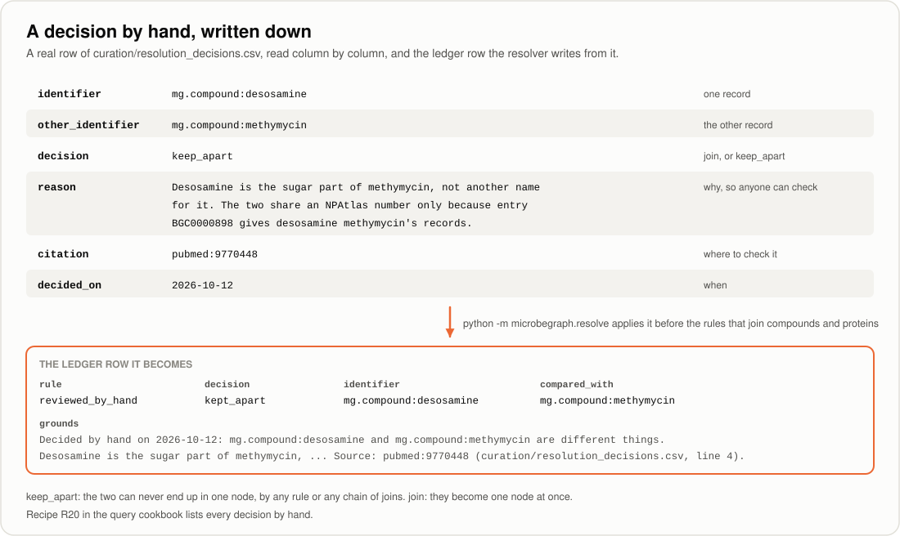

[← Handbook](../docs/HANDBOOK.md) · [Phase 2 guide](../docs/04-more-sources-secrets.md) · [Phase 4b guide](../docs/06b-closing-the-gaps.md) · [Glossary](../docs/GLOSSARY.md)

# The curated files

Three files in this folder are written by hand. Everything else in the graph
comes from public databases, so these are the places where a person's reading
of a paper or a record enters the project, and each row carries its source.

| File | What one row says | Since | Read by |
|---|---|---|---|
| [`compound_pathogen_crop.csv`](compound_pathogen_crop.csv) | A published finding: this compound acts against this pathogen, which causes this disease on this crop | Phase 2 | [`sources/curation.py`](../src/microbegraph/sources/curation.py) |
| [`resolution_decisions.csv`](resolution_decisions.csv) | A decision about two records: they are the same thing, or different things | Phase 4b | [`resolution/reviewed.py`](../src/microbegraph/resolution/reviewed.py) |
| [`activity_synonyms.csv`](activity_synonyms.csv) | An activity word that means the same as another | Phase 4b | [`resolution/activities.py`](../src/microbegraph/resolution/activities.py) |

Open them in VS Code, not a spreadsheet program, which can change the quoting or
the date format when it saves. Git's history is their provenance log: it records
who added each row, when and why.

---

## 1. The curated bridge

`compound_pathogen_crop.csv` is the only file here that adds facts to the
graph. Each row records one finding from a published paper: **this compound
was shown to act against this plant pathogen, which causes this disease on this
crop**, with the paper's DOI or PubMed number.

No public database publishes those links as a table, which is why the file
exists. The adapter that reads it is
[`src/microbegraph/sources/curation.py`](../src/microbegraph/sources/curation.py),
and the Phase 2 guide explains the idea in full:
[`docs/04-more-sources-secrets.md`](../docs/04-more-sources-secrets.md).

Every row becomes two arrows, both at evidence level `curated_literature` and
both carrying the row's citation:

```
mg.compound:surfactin --INHIBITS--> ncbitaxon:40559 --INFECTS--> mg.crop:jujube
     (from MIBiG)                    (Botrytis cinerea)          (grey mould)
```

### The columns

| Column | What goes in it | Example |
|---|---|---|
| `compound_name` | The compound's name, as MIBiG writes it | `surfactin` |
| `compound_curie` | Its identifier in MIBiG's table (must exist there) | `mg.compound:surfactin` |
| `pathogen_name` | NCBI's **current** scientific name for the pathogen | `Botrytis cinerea` |
| `pathogen_curie` | `ncbitaxon:` and NCBI's number | `ncbitaxon:40559` |
| `pathogen_type` | `fungus`, `oomycete`, `bacterium`, `virus`, `nematode` or `other` | `fungus` |
| `disease` | The disease's common name | `grey mould` |
| `crop_name` | The crop's common name | `jujube` |
| `crop_curie` | `mg.crop:` and the crop name in lowercase, spaces as hyphens | `mg.crop:jujube` |
| `crop_scientific_name` | The crop's scientific name | `Ziziphus jujuba` |
| `crop_category` | `cereal`, `fruit`, `vegetable`, `legume`, `fibre`, `oilseed` or `other` | `fruit` |
| `relationship` | Always `INHIBITS` | `INHIBITS` |
| `citation` | `doi:10.<...>` or `pmid:<number>`; several joined with `\|` | `doi:10.1186/s13568-023-01543-w` |
| `confidence` | A number from 0 to 1, from the scale below | `0.90` |
| `added_on` | The day you added the row, `YYYY-MM-DD` | `2026-10-12` |
| `notes` | Optional: the paper in a sentence, and any name the paper used that differs from NCBI's | `Xiao et al. 2023 (PMID 37118318): ...` |

### How confident is a row?

Confidence says how directly the paper shows the effect **on the crop**. I use
this scale, and the notes column says which step a row is on:

| Confidence | What the paper showed |
|---|---|
| 0.90 | The purified compound reduced the disease on the crop itself (plants, heads, harvested fruit) |
| 0.85 | As above, with a stated limit (for example, it worked as a seed treatment but broke down in soil) |
| 0.80 | Strong but indirect: a mutant that can't make the compound protects less, or the test used one tissue of the crop (corn silks rather than plants), or a study of a closely related set of compounds |
| 0.70 | Inhibition in the laboratory only (on a plate), not yet on the crop |

Below 0.70, I don't add the row yet.

### Adding a row, step by step

1. **Read the paper.** Note the compound, the pathogen, the crop and what was
   measured. Decide the confidence from the scale above.
2. **Find the compound in MIBiG's table.** From the project folder, with
   `.venv` active (replace `surfactin` with your compound):

   ```bash
   python -c "import pandas as pd; n = pd.read_csv('data/processed/staging/mibig_nodes.csv'); print(n[n.node_id.str.contains('surfactin')][['node_id', 'name']].to_string(index=False))"
   ```

   Copy the `node_id` exactly. If nothing is found, the compound isn't in
   MIBiG under that name, and the row can't be added yet.
3. **Find the pathogen's NCBI number.** Search for the name at
   <https://www.ncbi.nlm.nih.gov/taxonomy> and note the number and the name
   NCBI shows. Use NCBI's name in `pathogen_name`, even if the paper uses an
   older one; put the paper's name in `notes`.
4. **Add the row** in VS Code (not a spreadsheet program, which can re-save the
   file in a different format). Put any cell that contains a comma inside
   double quotes, for example `"2,4-diacetylphloroglucinol"`.
5. **Check it.** NCBI must know about a new pathogen before the bridge can
   check its name, so run both:

   ```bash
   python -m microbegraph.fetch --source ncbi_taxonomy --source curation
   ```

   The bridge checks every row (the thirteen checks are listed in
   `curation.py`) and names the line of anything wrong. Nothing is written
   until every row passes.
6. **Run the tests**, then commit the row on its own:

   ```bash
   pytest
   git add curation/compound_pathogen_crop.csv
   git commit -m "feat: add <compound> vs <disease> on <crop> to the bridge"
   ```

Git's history is this file's provenance log: it records who added each row,
when and why. That's why a row is never edited silently. If a row turns out to
be wrong, change it in its own commit that says so.

---

## 2. The review file: decisions made by a person



`resolution_decisions.csv` holds the decisions the resolver's rules can't make
correctly: two records the rules would join that are really different things,
or two they can't join that are really one. The resolver applies every decision
before the rules that join compounds and proteins, and the ledger records it
under the rule
`reviewed_by_hand`, so nobody mistakes a person's decision for a rule's. The
whole story, with the five real cases, is in
[`docs/06b-closing-the-gaps.md`, Step 7](../docs/06b-closing-the-gaps.md#11-step-7-the-review-file-decisions-made-by-a-person).

| Column | What goes in it | Example |
|---|---|---|
| `identifier` | One record, as the graph names it (`prefix:local`) | `mg.compound:desosamine` |
| `other_identifier` | The other record | `mg.compound:methymycin` |
| `decision` | `join` (the same thing) or `keep_apart` (different things) | `keep_apart` |
| `reason` | Why, in a sentence or two a reader can check | `Desosamine is the sugar part of methymycin, not another name for it. ...` |
| `citation` | Where to check it: `doi:`, `pubmed:`, or a database record such as `pubchem.compound:9237955` or `uniprot:P0CU77` | `pubmed:9770448` |
| `decided_on` | The day you decided, `YYYY-MM-DD` | `2026-10-12` |

**What a decision does.** `keep_apart` means the two records can never end up in
one node, by any rule or any chain of joins. `join` makes them one node at once;
it is refused if the node would hold two PubChem compounds or two UniProt
entries, because those databases say their own records are different things.

### Adding a decision, step by step

1. **Find the two records.** Recipe R5 in the
   [query cookbook](../docs/QUERY_COOKBOOK.md#r5-what-did-an-old-identifier-become)
   finds the node for any identifier, and the ledger rows for a node show what
   the rules decided and why (recipe R6).
2. **Read the source** that settles it, and note its DOI, PubMed number or
   database record. Without a source, don't add the row: an override nobody can
   check is worse than the gap it closes.
3. **Add the row** at the end of the file in VS Code. Put the reason in double
   quotes if it contains a comma.
4. **Run the resolver and the build:**

   ```bash
   python -m microbegraph.resolve
   python -m microbegraph.build_graph
   ```

   The resolver checks every row first and names the line of anything wrong: an
   empty cell, a decision other than `join` or `keep_apart`, a date not written
   `YYYY-MM-DD`, the same pair twice, or an identifier no source has (a typo,
   or a PubChem compound not fetched yet; the next
   `python -m microbegraph.fetch --source pubchem` asks about every PubChem
   number in this file). Nothing is written until every row passes.
5. **Look for your row** with recipe R20:

   ```bash
   python -m microbegraph.query --recipe 20
   ```

6. **Run the tests**, then commit the row on its own:

   ```bash
   pytest
   git add curation/resolution_decisions.csv
   git commit -m "feat: keep <record> apart from <record>, decided by hand"
   ```

---

## 3. Activity words that mean the same thing

`activity_synonyms.csv` lists activity words to fold into another word that
means the same, such as `antitumor` into `anticancer`. The resolver moves each
word's node into the other's, the way an old NCBI number moves to the current
one, and keeps the old word as another name of the node.

| Column | What goes in it | Example |
|---|---|---|
| `activity` | The word to fold away, exactly as MIBiG writes it | `antineoplastic` |
| `same_as` | The word it means the same as, exactly as MIBiG writes it | `anticancer` |
| `reason` | Why they mean the same thing | `Antineoplastic means acting against neoplasms (tumours), ...` |
| `citation` | Where to check it | `mesh:D000970` |
| `added_on` | The day you added the row, `YYYY-MM-DD` | `2026-10-12` |

**Only words that really mean the same.** Words that sound alike often don't:
"cytotoxic" (kills cells, any cells) isn't "anticancer", and "antiplasmodial"
(acts on the malaria parasite in a dish) isn't "antimalarial" (treats the
disease). When in doubt, leave the two words apart.

### Adding a synonym, step by step

1. **Check both spellings** against the activities in the graph:

   ```bash
   python -m microbegraph.query "SELECT name FROM nodes WHERE node_type = 'Activity' ORDER BY name"
   ```

2. **Add the row** in VS Code. Point every word straight at the word it means
   the same as: a chain (a to b, then b to c) is refused, and so is a word
   listed twice or mapped to itself.
3. **Run the resolver.** Near the end it says how many synonyms were applied; a
   word no source uses yet is named, and its row waits:

   ```
   [resolve] curation/: 4 of 4 activity synonyms applied, 5 decisions by hand
   ```

4. **Check the result** with recipe R22, run the tests, and commit the row on
   its own:

   ```bash
   python -m microbegraph.query --recipe 22
   pytest
   git add curation/activity_synonyms.csv
   git commit -m "feat: fold <activity> into <activity>"
   ```
