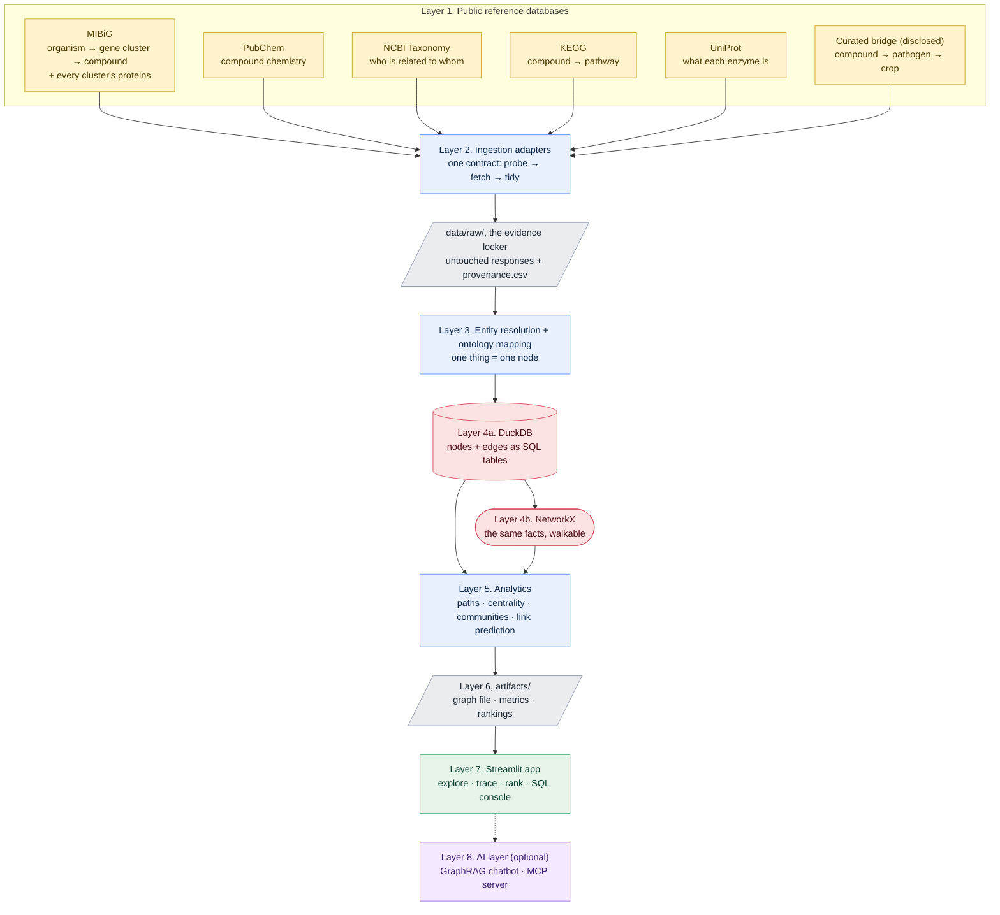
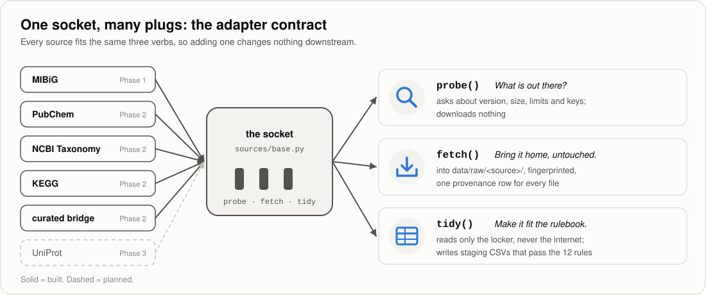

[← Handbook](HANDBOOK.md) · [README](../README.md) · [Glossary](GLOSSARY.md) · [Roadmap](ROADMAP.md) · [Ontology](02-ontology-and-data-model.md)

# 00. Architecture: how MicrobeGraph fits together

**Prerequisites:** none. This is the first document. You do not need to have
installed anything, and you do not need any background in biology, programming,
or databases.

**Learning goal:** after reading this you will be able to explain, in your own
words, what every piece of MicrobeGraph is, why it exists, and how information
travels from a public website into a map you can ask questions of. You will also
understand the four words that scare beginners most (*backend*, *frontend*,
*database* and *graph*), because each one is defined here with a comparison from
everyday life.

**Time:** 25-35 minutes of reading. There are no commands to run.

> Every term in this document is also in [`GLOSSARY.md`](GLOSSARY.md).

---

## Contents

1. [Why read an architecture document at all?](#1-why-read-an-architecture-document-at-all)
2. [The one-sentence version](#2-the-one-sentence-version)
3. [Four words, defined properly](#3-four-words-defined-properly)
4. [The full picture](#4-the-full-picture)
5. [Layer 1. The sources](#5-layer-1-the-sources-where-facts-come-from)
6. [Layer 2. Ingestion and the evidence locker](#6-layer-2-ingestion-and-the-evidence-locker)
7. [Layer 3. Entity resolution](#7-layer-3-entity-resolution-deciding-two-names-are-one-thing)
8. [Layer 4. Storage, twice on purpose](#8-layer-4-storage-twice-on-purpose)
9. [Layer 5. Analytics](#9-layer-5-analytics-what-you-can-ask-a-map)
10. [Layer 6. Artifacts: the bridge from laptop to cloud](#10-layer-6-artifacts-the-bridge-from-laptop-to-cloud)
11. [Layer 7. The app](#11-layer-7-the-app-the-part-humans-touch)
12. [Layer 8. The AI layer](#12-layer-8-the-ai-layer-optional-but-the-headline)
13. [Why this stack, and what we didn't pick](#13-why-this-stack-and-what-we-didnt-pick)
14. [How data actually flows: one fact's journey](#14-how-data-actually-flows-one-facts-journey)
15. [Design decisions, and the reasons behind them](#15-design-decisions-and-the-reasons-behind-them)
16. [Checkpoint](#16-checkpoint)

---

## 1. Why read an architecture document at all?

Imagine someone hands you a box of car parts and a very good instruction manual
for fitting each part. You could follow it perfectly and still have no idea what
a car *is*, what the engine is for, why there's a gearbox between it and the
wheels, why the fuel tank is at the back.

That's what happens when you start a software project by copying commands. You
get things working without understanding them, and the first time something
breaks you have nowhere to start.

This document is the picture on the jigsaw box. I put it first in the
tutorial, before any installation, because each later step only makes sense if
you already know which piece it is building.

**Read it once now, and again after Phase 3.** It will land differently the
second time, and that's normal.

---

## 2. The one-sentence version

> MicrobeGraph collects facts about microbes and molecules from public
> databases, decides which of those facts are about the same thing, stores them
> as a map of dots and arrows, and lets you walk the map to answer questions no
> single database can answer alone.

The rest of this document unpacks that sentence one piece at a time.

---

## 3. Four words, defined properly

These four words come up constantly, and the rest of the tutorial gets much
easier once you've learned them here.

### Database

A **database** is a program whose only job is to store information in an
organised way and answer questions about it quickly.

A library is a good comparison. The books sit on shelves in a defined order,
there's a catalogue, and a librarian can find "all books by this author published
after 2010" in seconds. A pile of books in a garage holds the same information,
but it can't answer any questions.

You ask a database questions in a language called **SQL** (say it "sequel" or
"ess-cue-ell"). SQL reads almost like English:

```sql
SELECT name FROM compounds WHERE activity = 'antifungal';
```

Read aloud, that's *give me the name column, from the compounds table, for rows
where the activity is antifungal.* SQL is one of the most durable skills in data
work (it was invented in the 1970s and is still everywhere), and you'll write
your first real SQL in Phase 4.

MicrobeGraph uses **DuckDB**, a database that is a single file sitting in your
project folder. There's no server to install, and no account, password or cost.

### Graph

A **graph** (in this sense, nothing to do with bar charts) is information
stored as dots connected by arrows.

The contacts in your phone are a table: one row per person, with columns for
phone and email. A social network is a graph, where people are dots and "knows"
is an arrow. The table is better for "what is Anna's number?", while the graph is
better for "who do Anna and I both know?"

MicrobeGraph uses **NetworkX**, a free Python library for building and walking
graphs in memory.

DuckDB and NetworkX hold the same facts.
[Section 8](#8-layer-4-storage-twice-on-purpose) explains why I store them twice
on purpose, and why that isn't as wasteful as it sounds.

### Backend

The **backend** is the part of a piece of software that does the real work,
where the user can't see it.

Think of a restaurant kitchen. It buys ingredients, prepares them, cooks, and
plates the food, and customers never go in there. If the kitchen is good and the
dining room is ugly, the food is still good.

In MicrobeGraph, the backend is everything in `src/microbegraph/`: the code that
downloads records, cleans them, builds the graph, and runs the analysis.

### Frontend

The **frontend** is the part the user sees and touches: the buttons, the boxes,
the charts.

In the restaurant, that's the dining room and the menu. Nothing gets cooked
there; its job is to let you say what you want and to present what comes back,
pleasantly.

In MicrobeGraph, the frontend is the Streamlit app in `app/`. It contains
almost no logic of its own; it calls the backend and draws the results.

**Why split them?** For three reasons, the same ones restaurants have. (1) You
can rebuild the dining room without touching the recipes. (2) The kitchen can
serve many tables at once. (3) When a dish is wrong, you know whether to blame
the cook or the waiter. In software, this separation is what lets you swap a
Streamlit app for a website later without rewriting any of the science.

---

## 4. The full picture



The shape to remember is that information flows *downward* and never loops
back: each layer only reads from the layer above it. That arrangement is called a
**pipeline**, and I'd rank it as the most useful structural idea in data work.

A coffee shop runs the same way: beans → grinder → espresso machine → cup. The
grinder doesn't care where the beans were bought, and the espresso machine
doesn't care which grinder was used. Each stage has one job, with one input and
one output, so if your coffee tastes wrong you can test each stage separately.

In practice, this means that when something is wrong in MicrobeGraph you don't
debug "the project". You ask *which layer* first, and you can inspect each
layer's output on its own.

---

## 5. Layer 1. The sources: where facts come from

A **source** is a place on the internet that publishes data. Five of them feed
this project.

### MIBiG, the backbone

MIBiG stands for *Minimum Information about a Biosynthetic Gene Cluster*. It is
a public, community-curated repository of gene clusters that
scientists have **experimentally shown** produce a particular molecule.

**What's a gene cluster?** Think of a microbe's genome as a very long cookbook.
Most recipes are for everyday living, but sometimes several related recipe
pages sit right next to each other, and together they describe how to build one
specific, specialised molecule, a "production line" written into the DNA. That
run of neighbouring pages is a **biosynthetic gene cluster** (BGC).

MIBiG is the backbone because it's the only place that reliably gives us the
two arrows at the start of every chain (*this organism harbours this cluster*
and *this cluster produces this compound*), with a human curator's sign-off
behind each one.

**Licence:** CC-BY (free to use with attribution). It's published on Zenodo with
a permanent DOI, so the exact version used is citable and reproducible.

**Which version:** MIBiG 4.0 (Zenodo record 14169073, about three thousand
entries), pinned by its checksum. Phase 1 covers how it is downloaded, checked
and turned into rows: [`03-ingestion-mibig.md`](03-ingestion-mibig.md).

### PubChem, the chemistry

PubChem is run by the US National Institutes of Health. Give it a compound's
number (a **CID**) and it returns the molecular formula, the weight, the
structure and a list of synonyms; give it a name and it can look the number up.
Phase 2 asks about the CIDs MIBiG already records, and Phase 4 uses the name
lookup for the rest.

We need it for two reasons. First, it makes compounds *comparable*: every
compound in the graph gets one canonical PubChem identity. Second, its synonym
lists are the raw material for entity resolution in Layer 3. PubChem is how we
learn that "surfactin" and "surfactin A" are the same molecule.

**Access:** free, no account, no key. At most 5 requests a second.

### NCBI Taxonomy, the family tree of life

Every named organism has a numeric **taxon ID** and a lineage: strain → species
→ genus → family → order → class → phylum → kingdom → domain.

This is what lets a question like "*show me everything from the genus
Bacillus*" work even when the graph contains a dozen different Bacillus species
spelled inconsistently, because the lineage is a ladder we can climb.

Postal addresses work the same way: street → city → region → country. If someone
asks "how many customers in Switzerland?", you don't need a Switzerland column;
you climb the ladder from each street address.

**Access:** free, no account needed. NCBI allows 3 requests a second, or 10 with
a free API key, which is the project's first secret: it lives in `.env`, never
in the repository ([`04-more-sources-secrets.md`](04-more-sources-secrets.md)).

### UniProt, the proteins in between

UniProt is the standard public reference for protein sequence and function, and
it's free and comprehensive (CC BY 4.0).

MIBiG tells you that a gene cluster produces a compound. For some clusters it
also lists the genes, each with the number of the protein it makes and the job
it does, which gives the enzymes in between. For every cluster it publishes a
second file, its protein file, listing every protein the cluster's DNA codes for,
without jobs. UniProt then says what each of those proteins is: its names,
length, the reaction it carries out and its function.
UniProt doesn't refer to MIBiG, so the two are joined through the protein's
sequence number, using UniProt's ID mapping service. Adding the enzymes makes the
chain

```
Organism → GeneCluster → Protein → Compound → Pathogen → Crop
  (genomics)    (proteomics)   (metabolomics)  (phenotype)
```

three different kinds of biological measurement joined into one structure that
a single query can walk. That is what **multi-omics integration** means in
practice; three tables sitting next to each other wouldn't qualify. The protein
layer arrived in Phase 3 for the clusters with gene records
([`05-proteomics-uniprot.md`](05-proteomics-uniprot.md)) and in Phase 3b for
every cluster, from MIBiG's protein file
([`05b-all-cluster-proteins.md`](05b-all-cluster-proteins.md)).

**Access:** free, no account, no key. ID mapping runs as a background job: you
hand in the numbers, get a job number, and collect the results when it's done.

### KEGG, the pathway context

KEGG maps compounds to the biochemical **pathways** they take part in. A pathway
is a chain of chemical reactions a cell performs, like a production line with
named stations.

It adds a layer of *biological meaning*: two unrelated compounds that turn out
to sit in the same pathway are connected in a way pure chemistry wouldn't show.

**Licence caution:** KEGG is not open data. Its API is provided for academic
use by academic users, non-academic use needs a commercial licence, and serving
KEGG data to others needs a licence too. The adapter asks four questions in all
(one of them is KEGG's own compound-to-pathway list, about 20,000 short lines),
stays under KEGG's limit of 3 requests a second, and records the terms in the
provenance log. KEGG rows stay on your machine and out of the public app and
data release. Respecting a data source's terms is part of doing this properly,
and it's a habit worth building early.

### The curated bridge, the honest gap

This is the weakest point of the project, so I'll be direct about it.

Nobody publishes a downloadable, machine-readable table saying *"compound X
suppresses pathogen Y on crop Z."* That knowledge lives in the prose of
scientific papers, which is awkward, because it's the link that makes the whole
chain useful.

There are three ways to handle that:

1. **Pretend the gap doesn't exist** and build a graph that stops at the
   compound. That's useless for the question we care about.
2. **Invent the links** and hope nobody checks. That's dishonest, and anyone who
   knows the field would spot it immediately.
3. **Build the links by hand, cite every one, label them differently from the
   database facts, and let users filter them out.** ← *This is what MicrobeGraph
   does.*

In practice that's a small CSV file in `curation/`, with one row per fact, a
literature citation on every row, and every row stamped
`evidence_level = curated_literature`. It's version-controlled like code, so its
history is visible. It's also small (dozens of rows, not thousands), and the
docs say so everywhere it appears.

> **Is this gap real?** Yes, and it's worth checking rather than taking on
> trust. The biocontrol literature is enormous, but it is written as prose for
> human readers; no public database publishes compound → pathogen → crop links as
> a queryable table. The survey of what does exist, and where it stops, is in
> [`PRIOR-ART.md`](PRIOR-ART.md).

I think this is the right choice. In real data work you constantly meet gaps
where the ideal data doesn't exist, and the professional move is to fill the gap
in the open, label the filling, and make it removable, instead of hiding it.
Being able to say *"here is exactly which part of my result rests on which kind
of evidence"* is worth more to me than a bigger graph nobody can audit.

---

## 6. Layer 2. Ingestion and the evidence locker

**Ingestion** means "getting data in". Two ideas make this layer worth designing
properly, instead of writing six ad-hoc download scripts.

### Idea 1: one socket, many plugs

Every source has a different website, a different response format, and different
rules. If each got its own bespoke script, adding a seventh source would mean
inventing a seventh way of doing things, and the project would get harder to
extend over time rather than easier.

Instead, every source adapter promises the same three functions:

| Function | What it does | Everyday equivalent |
|---|---|---|
| `probe()` | Asks "how much is there?" without downloading it | Checking a parcel's weight before paying for shipping |
| `fetch()` | Downloads the raw response and saves it, unchanged | Photographing a receipt before filing it |
| `tidy()` | Turns that raw response into rows matching our data model | Typing the receipt's numbers into your budget spreadsheet |

That shared shape is called an **interface** or **contract**.



It's the same idea as a wall socket. Your kettle, laptop charger and lamp are
completely different machines, but they all end in the same plug, and the socket
doesn't need to know anything about kettles. A new appliance works as long as it
has the right plug.

The payoff came in Phase 2: four sources were added (three web APIs and the
curated bridge) and *nothing written for Phase 1 had to change*. The only
addition to the socket itself was the ability to send POST requests. Phase 3
added a sixth plug, UniProt, and the socket only learned one more small thing: to
ask a question without following a redirect. Phase 3b gave the MIBiG plug a
second file to fetch, and the socket learned to check a download against a
fingerprint the project recorded itself. The contract is what made that
possible.

### Idea 2: the evidence locker

Every raw response is written to `data/raw/` and **never edited again**.
Everything downstream reads from that copy.

It works like a scientist's lab notebook, or the original receipts behind a tax
return. You keep the originals because if anyone ever asks "where did this
number come from?", you can show them, and because if you discover a mistake in
how you *interpreted* the receipts, you can redo the interpretation without
having to go shopping again.

Alongside the raw files sits `provenance.csv`: one row per fetch, recording
what was requested, from which source, when, how many records came back, and
under what licence. So when someone asks "is this graph current?", you can
answer by opening a file instead of guessing.

The rule that makes this work is **never edit in place**. Cleaning always
produces a new copy, so the evidence stays pristine. Every serious data pipeline
follows this rule, and every beginner is tempted to break it because editing in
place feels tidier, but that's how you lose the ability to check your own work.

---

## 7. Layer 3. Entity resolution: deciding two names are one thing

This layer is what separates a real knowledge graph from a toy one, so I'll take
it slowly.

### The problem, in everyday terms

Imagine merging the contact lists of three people who all know your friend
Robert. One has "Robert Smith", one has "Bob Smith", one has "R. Smith
(work)". Three entries, one human. If you merge the lists naively you get three
Roberts, and every "who knows Robert?" question gives a fragmented answer.

Now scale that to science. The same molecule may appear as:

- `surfactin` (a common name in a paper)
- `surfactin A` (a specific variant)
- `npatlas:NPA018495` (one chemistry database's number)
- `CHEBI:63863` (another database's number)

If these become four dots, the graph breaks without telling you. Every path
through "surfactin" splits four ways and every count comes out wrong, with
nothing to warn you.

**Entity resolution** is the process of deciding which records refer to the same
real-world thing, and merging them into one node.

### How MicrobeGraph does it

1. **Prefer an official identifier.** Where a source gives a stable ID (a
   PubChem CID, an NCBI taxon ID, a MIBiG accession), that ID *is* the identity.
   Numbers don't have spelling variants.
2. **Normalise text before comparing.** Lowercase, trim spaces, strip
   punctuation, so `Surfactin ` and `surfactin` stop being different.
3. **Use official synonym lists.** PubChem publishes them; matching a name
   against a synonym list is far safer than guessing from similarity.
4. **Write down every decision.** Each merge is recorded in a **resolution
   ledger**: what was merged, into what, and on what grounds.
5. **Refuse to guess.** If two names are similar but no source confirms they're
   the same, they stay separate and get flagged for review. A wrong merge is
   worse than a missed one, because a missed merge is visible (two dots where
   you expected one) while a wrong merge is invisible (one dot that quietly
   contains a lie).

I treat the ledger as one of the project's outputs, alongside the graph itself.
It answers the question "how do you know these are the same thing?", and people
need that answered before they can rely on the graph.

---

## 8. Layer 4. Storage, twice on purpose

The resolved facts are stored in two places: DuckDB (tables) and NetworkX (a
graph). A reasonable first question is whether that duplication is a mistake.
It isn't, and a train network shows why.

Think of the timetable and the route map for one railway. The timetable
is a table, fast for "when does the 08:14 leave?". The route map is a graph,
fast for "how do I get from here to there with the fewest changes?". Both
describe the same railway, and nobody thinks having both is wasteful, because
each answers questions the other is bad at.

| Question | Best shape | Why |
|---|---|---|
| How many antifungal compounds are in the graph? | **Table** (SQL) | Counting rows that match a filter |
| Which sources contributed the most edges? | **Table** (SQL) | Grouping and summing |
| What's the shortest evidence chain from jujube to a microbe? | **Graph** | Following arrows an unknown number of hops |
| Which compound, if removed, would disconnect the most chains? | **Graph** | Requires knowing the whole connection structure |
| Show every edge added since last month | **Table** (SQL) | Filtering by a date column |

One rule keeps the two in step: DuckDB is the **single source of truth**. The
NetworkX graph is *always* rebuilt from the DuckDB tables and never edited
directly, so there is one place facts live and one place they're re-shaped. If
the two ever disagreed you'd have two versions of reality (the classic way
projects like this rot), so the build script makes disagreement structurally
impossible.

**DuckDB in one line:** a complete analytics database that is one file on your
laptop, with no server, account or cost. It's also the local stand-in
professionals use for cloud warehouses like Snowflake, so the SQL you write here
transfers directly.

**NetworkX in one line:** a Python library that holds a graph in memory and
comes with decades of graph algorithms already written (shortest path,
centrality, community detection) so you don't implement them yourself.

---

## 9. Layer 5. Analytics: what you can ask a map

The analytics layer asks four families of question.

### Paths, "how do I get from A to B?"

This is the graph equivalent of route-finding: *"Show me the chain from
jujube back to a microbe."* The answer is a sequence of arrows, and because
each arrow carries its source and evidence level, the answer comes with its own
bibliography.

This is MicrobeGraph's headline capability, and it's something no single source
database can do.

### Centrality, "who are the important dots?"

On a city map, which junction would cause the most chaos if it closed? The
answer is the one that the most routes pass through, which isn't necessarily the
biggest.

You'll use two flavours:

- **Degree centrality**: how many arrows touch this dot. The "popularity"
  measure. A compound produced by many organisms scores high.
- **Betweenness centrality**: how many shortest paths pass *through* this dot.
  The "bridge" measure. A compound that is the only known link between a group
  of microbes and a group of diseases scores high even with few arrows.

Betweenness is often the more interesting one, because bridges are where
knowledge is thin and where a single missing fact does the most damage.

### Communities, "which dots cluster together?"

In a social network, groups of friends emerge without anyone labelling them:
school friends here, colleagues there. **Community detection** finds those clumps
automatically.

In MicrobeGraph, communities tend to correspond to biological themes: a cluster
of related organisms making chemically related compounds against related
diseases. A cluster the biology didn't predict is the kind of result worth
investigating.

### Link prediction, "which arrow is probably missing?"

You've seen this as "People you may know": the network notices you share eleven
mutual friends with someone you're not connected to, and guesses you probably
know them.

MicrobeGraph uses the same logic. If microbe A resembles microbes B and C in the compounds it
makes, and B and C both act on a pathogen that A has never been tested against,
that's a plausible missing arrow, a hypothesis worth a lab test.

**A predicted link is a *suggestion born of resemblance*, never a finding.**
Every predicted edge is stored with `evidence_level = inferred`, kept in a
separate layer, drawn differently in the app, and excluded by default from
evidence chains. Prediction is the most seductive part of this project and the
easiest to overstate, so I designed it to make overstating difficult.

---

## 10. Layer 6. Artifacts: the bridge from laptop to cloud

An **artifact** here means a small file produced by the heavy work and read by
the app.

This layer exists because free app hosting gives you a small machine with
limited memory and a short patience for slow pages. Downloading from four
databases and recomputing graph metrics on every page load would be slow, would
hammer public services that are doing us a favour, and would break the moment a
source has an outage.

Restaurants solve the same problem with *mise en place*. The kitchen chops,
portions and preps everything before service, and during service the cook
assembles each dish from prepped components in ninety seconds. The food is the
same; it comes out far faster because the slow work happened earlier, once.

So the heavy work runs on your laptop and writes:

- `artifacts/graph.graphml`, the built graph in a portable standard format
- `artifacts/node_metrics.csv`, centrality scores per node
- `artifacts/candidate_rankings.csv`, the predicted links, with scores

Because these files are small, they're committed to Git, so the deployed app
has them immediately. The app only has to *read*, which is why it can be free,
fast and reliable.

---

## 11. Layer 7. The app: the part humans touch

The app is built with **Streamlit**, a Python library that turns an ordinary
script into a web app with buttons, dropdowns and charts, without any web
development.

If you drive, Streamlit is the automatic gearbox. A manual gearbox (writing HTML,
CSS and JavaScript by hand) gives you total control and takes months to learn,
while an automatic gets you driving today. Both get you there, so pick based on
the journey.

The app has four planned areas:

1. **Explore**, see the map, filter by node type, source, or evidence level.
2. **Trace**, pick a disease or a microbe and see the evidence chains, with
   every arrow's source shown.
3. **Rank**, pick a pathogen and get candidate microbes, scored, with the
   "why" spelled out and the inferred edges clearly marked.
4. **Query**, a read-only SQL console, so anyone can ask their own question of
   the underlying tables. *Read-only* means the console can look but never
   change or delete, and that rule is enforced in code rather than promised in
   the docs.

Because the app is a thin frontend over a real backend, replacing Streamlit with
a full website later wouldn't touch any of the science code. That option is in
the roadmap; I chose not to start there.

---

## 12. Layer 8. The AI layer: optional, but the headline

This layer has two features. Both are built on the same graph, and each is
explained from zero when its phase arrives.

### GraphRAG, answering questions by walking the map

The problem comes first. A **large language model** (LLM), the technology
behind chat assistants, is excellent at language and unreliable at facts. Ask it
a specific scientific question and it may produce a confident, well-written,
entirely invented answer. That's called a **hallucination**, and in a scientific context
it is disqualifying.

**RAG** (Retrieval-Augmented Generation) is the standard fix, and it's simpler
than the acronym suggests: *before* the model answers, go and fetch the relevant
real information, hand it to the model, and instruct it to answer **only** from
what it was given.

Compare asking a well-read friend a question from memory with handing them the
exact page from the manual and asking them to explain what it says. It's the same
friend, but the second answer is far more reliable.

**GraphRAG** is RAG where the fetched information comes from walking a
knowledge graph rather than searching documents. Ask *"which microbes might
help against grey mould on jujube fruit?"* and the system:

1. finds the `Botrytis cinerea` node,
2. walks backwards along `INFECTS` ← `INHIBITS` ← `PRODUCES` ← `HARBORS`,
3. collects the chains it finds, with their sources and evidence levels,
4. hands only those chains to the language model,
5. asks it to write the answer in plain English, citing what it was given.

GraphRAG suits this project better than ordinary RAG because here the
relationships *are* the answer. Document search would return paragraphs that
each mention one link, whereas the graph returns the assembled chain. And because
every arrow carries its provenance, the answer arrives with its own footnotes.

**Graceful degradation** is designed in from the start: if no API key is
configured, the feature hides itself and everything else still works. The app
must never require a paid service to be useful.

### MCP server, a safe door for AI assistants

**MCP** (Model Context Protocol) is an open standard for letting an AI assistant
plug into an external tool or data source.

USB is the usual comparison. Before USB, every device needed its own connector
and its own driver; USB is one agreed shape, so any device works with any
computer. MCP is that agreement for AI assistants and tools.

Wrapping MicrobeGraph as a small MCP server means an assistant can ask the graph
real questions (*find the path*, *rank candidates for this pathogen*, *show the
evidence*) and get sourced answers instead of guesses.

The server will expose **read-only** tools with fixed, validated inputs, so it
can look things up but cannot alter, delete or fetch anything. Scope is a
security decision, and I kept this one narrow on purpose.

By the time the MCP server is built (Phase 16), the FastAPI service layer from
Phase 14 already exposes exactly these operations, so MCP becomes a thin wrapper
rather than a second implementation. That ordering is why the roadmap puts the API
first.

---

## 13. Why this stack, and what we didn't pick

Every tool here is free and cross-platform. For each one, the table gives what
it is, why it fits, and the alternative I passed over.

| Tool | What it is (plain language) | Why it wins here | What we didn't pick, and why |
|---|---|---|---|
| **Python** | A general-purpose programming language known for readable code | Every library this project needs exists in Python, and using it end to end means learning one language instead of four | R is superb for statistics but has thinner graph and app tooling; JavaScript is superb for interfaces but weaker for data work |
| **NetworkX** | A Python library that holds a graph in memory with the classic algorithms built in | Zero setup, runs identically on every OS, and graphs of this size fit comfortably in memory | **Neo4j** is a proper graph database with its own query language, better at scale, but it means installing and running a server before you've learned what a graph *is*. It was weighed for later and set aside in favour of Apache AGE (see below and the roadmap) |
| **DuckDB** | An analytics database that is a single file | Real SQL with no server, no account, no cost; the SQL transfers directly to cloud warehouses | **SQLite** is simpler but weaker at analytical queries; **PostgreSQL** is a full server, real setup burden for no benefit at this size |
| **requests** | The standard Python library for fetching things over the internet | Simple, universal, and does exactly one job well | Heavier HTTP frameworks add complexity we'd never use |
| **pandas** | A library for working with tables in Python, "programmable Excel that never gets tired" | The universal shape for tabular data in Python; every other library speaks it | Plain Python lists work but you'd rewrite pandas badly |
| **Streamlit** | Turns a Python script into a web app | The fastest route from analysis to something clickable, with free public hosting | **React** gives a polished custom interface at the cost of learning a second language and a build system, so it's on the roadmap rather than in the core |
| **R + igraph** | A language built by statisticians, and its graph library | Phase 6 asks "could this pattern have arisen by chance?". R's tooling for that is more direct and better documented. It also gives an independent second implementation to check the Python results against | Doing the statistics in Python would work; it would just mean one implementation checking itself, which validates nothing |
| **ggplot2** | R's plotting library, layer by layer | Excellent static, publication-quality figures for the docs | `matplotlib` is used for quick Python-side charts; both are kept, each where it's stronger |
| **pytest** | Runs small automated checks that prove your code does what you claim | Catches your mistakes before your users do; I wouldn't trust a graph built by untested code | Python's built-in `unittest` works but is clunkier |
| **Git + GitHub** | A save-game system for your work, and its online home | The universal standard; the branch model (`master`/`beta`/`develop`) is set up in Phase 0 | There's no real competitor here |
| **venv** | A sealed toolbox of packages belonging to this project only | Stops projects breaking each other; makes the setup reproducible on any machine | **conda** is heavier; **Docker** is a good answer to a problem we don't have yet |

### What arrives later, and what triggers it

Release 1.0 (above) uses the smallest stack that does the job well. Releases
2.0 and 3.0 add a production tier alongside it without replacing it, and each
tool arrives at the point where the project has a real need for it:

| Tool | Arrives at | The need that triggers it |
|---|---|---|
| **GitHub Actions (CI)** | Phase 1 | The first code that must run on Windows, macOS and RHEL 8. Checking that claim on every push costs nothing; discovering it was false at release time costs a lot |
| **dbt** | Phase 10 | The ontology's validation rules *are* dbt's built-in tests (`unique`, `relationships`, `accepted_values`, `not_null`). The rulebook becomes a `schema.yml` |
| **PostgreSQL + Apache AGE + pgvector** | Phase 11 | Three needs converge: a real graph database with Cypher, a vector store for RAG, and an application database for the API. One engine, three jobs |
| **Airflow** | Phase 12 | Six sources, strict dependency order, a monthly refresh, retries, alerts. That list is exactly what Airflow was built for |
| **Docker / Podman** | Phase 12 | Airflow is several cooperating services, the situation containers exist for. Three routes documented, including a container-free one |
| **Snowflake** | Phase 13 | This one is a *demonstration* rather than a need: the same dbt models running against a cloud warehouse with only a target change |
| **FastAPI** | Phase 14 | Streamlit, React and MCP all need the same query logic, and it's better written once than three times |
| **React + TypeScript** | Phase 15 | A public product distinct from the analyst's workbench, and there is finally an API to build against |
| **MCP server** | Phase 16 | A thin, standardised wrapper over an API that already exists, so it's hours of work |
| **Docker / Podman, whole stack** | Phase 18 | Four cooperating services (database, API, two frontends) that must start in order and find each other |
| **Container registry + scanning** | Phase 19 | Finished images, published so anyone can run the product without cloning or installing anything |
| **Databricks** | Phase 17 | The one compute-heavy job: mining thousands of paper abstracts. **It's the weakest-fit tool in the plan**, and placed last for that reason |

A few tools were considered and rejected. **Neo4j** lost because Apache AGE
gives Cypher inside a database the project needs anyway, and a second graph
server would mean a second data copy and a sync problem. **Kubernetes** has no
scale to justify it. **Kafka/streaming** doesn't fit sources that update monthly;
batch is the correct design here, and I don't see it as a compromise. **Deep
learning for the core prediction** is out because the graph is small and
explainability matters most for that part.

Choosing not to use a fashionable tool, and being able to say exactly why, is a
skill in its own right. The full reasoning for every phase is in
[`ROADMAP.md`](ROADMAP.md).

---

## 14. How data actually flows: one fact's journey

To see the whole architecture at work, follow a single fact through every
layer.

**The fact:** *Bacillus velezensis carries a gene cluster that produces
surfactin.*

| Step | Layer | What happens | Where it lands |
|---|---|---|---|
| 1 | Source | A curator publishes a MIBiG entry recording the experiment | mibig.secondarymetabolites.org |
| 2 | Ingestion, `probe()` | We ask Zenodo about the release (version, size, checksum) without downloading | Printed to your terminal, free |
| 3 | Ingestion, `fetch()` | The release archive is downloaded, its checksum verified, and saved **unchanged** | `data/raw/mibig/mibig_json_4.0.tar.gz` |
| 4 | Ingestion, provenance | A row records the source, version, time, fingerprints, record count, and licence | `data/raw/provenance.csv` |
| 5 | Ingestion, `tidy()` | The entry's JSON is read from the archive and turned into rows that pass the twelve rules | `data/processed/staging/mibig_*.csv` |
| 6 | Resolution | "Bacillus velezensis" → NCBI taxon ID; "surfactin" → PubChem CID; aliases merged | resolution ledger |
| 7 | Storage (truth) | Two nodes and two edges are written, each with source and evidence level | `microbegraph.duckdb` |
| 8 | Storage (shape) | The same rows are loaded as dots and arrows | NetworkX graph in memory |
| 9 | Analytics | Surfactin turns out to sit on many shortest paths, high betweenness | `artifacts/node_metrics.csv` |
| 10 | Artifacts | The graph and metrics are saved as small files | `artifacts/` |
| 11 | App | A user searching "grey mould" sees a chain passing through surfactin | the browser |
| 12 | AI layer | GraphRAG hands that chain to a language model, which explains it in plain English, citing the MIBiG accession | the browser |

At every step, **you can stop and look**: each layer's output is a file or a
table you can open. That's what makes a pipeline debuggable, and it's why the
layers exist in the first place.

---

## 15. Design decisions, and the reasons behind them

These are the decisions that shaped the architecture, each with its reason. I
find the *why* behind a design more useful to remember than the design itself.

1. **The ontology is written before any pipeline code.** A graph assembled
   without a written contract about what may be a node and what may be an arrow
   becomes an unqueryable tangle within a week. The rulebook is
   [`02-ontology-and-data-model.md`](02-ontology-and-data-model.md).

   I wrote the whole data model, and the rest of these design documents, before
   a single line of the pipeline. That felt slow at the time. The reason I did
   it anyway is that I have watched data work go the other way: you start
   pulling records because pulling records feels like progress, and three weeks
   later nothing joins to anything because two scripts spell the same organism
   differently and nobody wrote down which spelling wins. Deciding the shape up
   front took a few evenings. Changing it after four thousand rows are loaded is
   a different kind of job.
2. **Raw responses are never edited.** Cleaning always writes a new copy. This
   is what makes "where did this number come from?" answerable months later.
3. **Every edge carries its evidence level.** A graph that mixes measured and
   guessed facts without marking which is which is worse than no graph, because
   it looks authoritative.
4. **DuckDB is the single source of truth; the graph is rebuilt from it.** Facts
   live in one place and can be queried in two shapes, and the build makes
   disagreement between them structurally impossible.
5. **The heavy work runs on the laptop; the app reads small files.** This keeps
   the public deployment fast, free, resilient to source outages, and polite to
   public services.
6. **The AI layer is optional and degrades gracefully.** Without an API key
   everything else still works. A project that needs a paid service before it
   can demonstrate anything is fragile.
7. **Predicted links live in their own layer.** They can be shown, hidden, or
   exported separately, and are never silently mixed into evidence chains.
8. **Everything is cross-platform Python.** The project runs identically on
   Windows, macOS, and RHEL 8 Linux, with no compiled dependencies, no
   OS-specific tools, and platform-neutral file paths throughout.
9. **The data format is language-neutral, so the language is a per-task choice.**
   DuckDB has clients for Python and R, so both read the *same file* with no
   export step. That is why R can do the statistics without a second copy of the
   truth existing anywhere. When data lives in a shared, open format, choosing a
   language stops being a lock-in decision.
10. **Containers are an additional path, never a required one.** The whole
   application can be packaged and run with one command (Phases 9b and 18, under
   either Docker or Podman), but the plain `.venv` path stays supported forever,
   so a fresh clone works for someone who doesn't want a container engine at all.
   The container files are written once and work with both engines rather than
   maintaining two configurations: see
   [`CONTAINERIZATION.md`](CONTAINERIZATION.md).

---

## 16. Checkpoint

You've finished this document when you can answer these without scrolling up.
Write your answers down before you open the answers below.

1. What is the difference between a node and an edge?
2. Why does MicrobeGraph store the same facts in both DuckDB and NetworkX?
3. What is the evidence locker, and what rule protects it?
4. What is entity resolution, and why is a *wrong* merge worse than a *missed*
   one?
5. Which layer would you inspect first if the app showed a compound with no
   connections at all?
6. Why is a predicted link labelled `inferred` and kept in its own layer?
7. In one sentence each: backend, frontend, database, graph.

<details>
<summary>Answers (open after you've tried)</summary>

1. A node is a thing (a microbe, a compound); an edge is a directed, named
   relationship between two things (*produces*, *inhibits*).
2. Tables are best at counting, filtering, and grouping; graphs are best at
   following chains of unknown length. Same facts, two shapes, different
   questions. DuckDB stays the single source of truth.
3. `data/raw/`, the untouched original responses from every source, plus
   `provenance.csv`. The rule: never edit in place; cleaning always writes a new
   copy.
4. Deciding which records refer to the same real-world thing and merging them.
   A missed merge is visible (two dots where you expected one); a wrong merge is
   invisible (one dot quietly containing a falsehood).
5. Layer 3 (entity resolution), the most likely cause is that the compound's
   aliases weren't merged, so its arrows attached to a different copy of it.
   Second place: Layer 2, if a source's `tidy()` step dropped rows.
6. Because it comes from resemblance, not observation. Separating it means a
   user can always ask "show me only what is actually known", and predictions can
   never be mistaken for measurements.
7. Backend = the kitchen, where the work happens out of sight. Frontend = the
   dining room, where people order and receive. Database = the organised library
   with a fast librarian. Graph = the route map of dots and arrows.

</details>

If some answers were shaky, that's expected on a first read. Carry on to setup
anyway; the concepts land much better once you've run something, and this
document will read very differently when you come back to it after Phase 3.

---

## Committing this phase

Every phase in this tutorial ends by saving your work to GitHub. If you haven't
set up Git yet (that's the next document), skip this box for now and come back
to it later.

```bash
git switch develop
git add -A
git commit -m "docs: add architecture overview"
git push origin develop develop:beta develop:master

# bring local master back in step with the remote master just updated
git switch master
git pull --ff-only origin master
git switch develop
```

Every line of that block is explained in [`01-setup.md`](01-setup.md).

---

**Next:** [`01-setup.md`](01-setup.md), turning a blank laptop into a working
workshop, on Windows, macOS, or RHEL 8 Linux.
