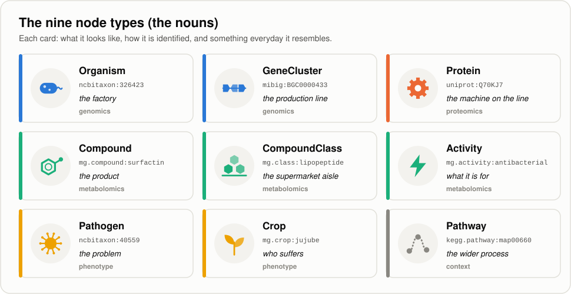
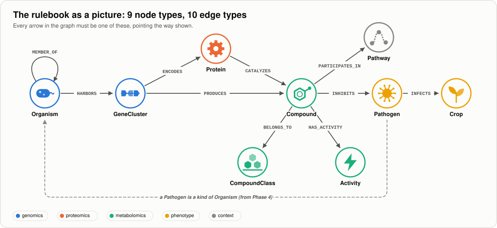
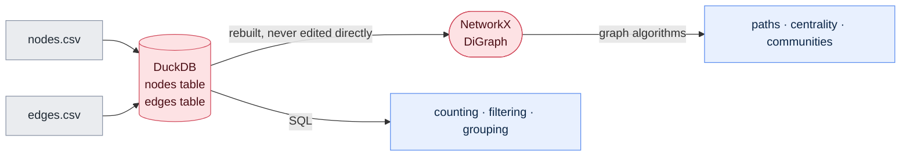

[← Handbook](HANDBOOK.md) · [README](../README.md) · [Glossary](GLOSSARY.md) · [Architecture](00-architecture.md) · [Phase 1](03-ingestion-mibig.md)

# 02. The ontology and data model: the rulebook

**Prerequisites:** [`00-architecture.md`](00-architecture.md) (you should know
what a node and an edge are) and [`01-setup.md`](01-setup.md) (a working
repository on the `develop` branch). No biology or database background needed.

**Learning goal:** you will understand what an *ontology* is, why writing one
before any pipeline code is the single most important decision in a graph
project, and you will be able to read the complete MicrobeGraph schema, every
node type, every edge type, every column, and the evidence system that makes the
graph trustworthy.

**Time:** 30-40 minutes reading, ~15 minutes writing the two files at the end.

> Every term here is also in [`GLOSSARY.md`](GLOSSARY.md).

---

## Contents

1. [Why a rulebook, and why now](#1-why-a-rulebook-and-why-now)
2. [What an ontology actually is](#2-what-an-ontology-actually-is)
3. [Identifiers: the CURIE convention](#3-identifiers-the-curie-convention)
4. [The node types](#4-the-node-types-the-nouns)
5. [The edge types](#5-the-edge-types-the-verbs)
6. [Evidence: the column that makes the graph honest](#6-evidence-the-column-that-makes-the-graph-honest)
7. [The physical schema: two CSV files](#7-the-physical-schema-two-csv-files)
8. [How it becomes SQL tables and a graph](#8-how-it-becomes-sql-tables-and-a-graph)
9. [Validation rules the loader enforces](#9-validation-rules-the-loader-enforces)
10. [A worked example: one chain, end to end](#10-a-worked-example-one-chain-end-to-end)
11. [Design decisions and their reasons](#11-design-decisions-and-their-reasons)
12. [Write the files](#12-write-the-files)
13. [Checkpoint](#13-checkpoint)

---

## 1. Why a rulebook, and why now

This document exists to prevent a very common way for graph projects to fail.

You start collecting facts. MIBiG gives you organisms and compounds, so you add
those. PubChem gives you molecular weights, so you add a "weight" thing. A paper
mentions a pathogen, so you add pathogens. Somewhere along the way, one script
writes organism names as `Bacillus velezensis` and another writes
`bacillus_velezensis`. One writes the relationship as `produces`, another as
`makes`. Compounds are sometimes nodes and sometimes just a text column on
another node.

Three weeks in, nothing joins to anything. Your counts can't be trusted, and you
can't walk a path because half the arrows have the wrong name. A bug fix won't
help at that point, because the problem lives in the *shape* of the data rather
than in the code, so you end up rebuilding.

Picture a shared address book where one person writes phone numbers as
`+41 79 123 45 67`, another as `0791234567`, and a third as `079-123-45-67`.
Each entry is fine on its own, yet the book as a whole is unsearchable, and more
careful typing won't change that. What fixes it is agreeing on the format first.

**So: decide the shape first, write it down, and make the loader refuse anything
that doesn't fit.** That written agreement is called the ontology, and this
document is it.

I'd call this the most professional habit in the whole project. Deciding your
data model before writing any pipeline code is what turns a pile of scripts into
a system.

---

## 2. What an ontology actually is

The word sounds forbidding, but the idea behind it is simple.

An **ontology** is a written agreement about what kinds of things exist in your
world, and what kinds of relationships are allowed between them.

Take a family tree. Before you can draw one, you need to agree what kinds of
things appear (people) and what relationships are allowed (*parent-of*,
*married-to*, *sibling-of*). You'd never draw an arrow labelled
"borrowed-a-lawnmower-from". It may well be true, but it isn't what a family
tree is *for*. An ontology is that kind of decision, written down.

A restaurant menu works the same way. It has categories (starters, mains,
desserts) and rules (a dessert has a price, a main has a description, a wine has
a vintage), and you can't order a "starter" that is secretly a wine. Those
categories and their rules are the menu's ontology.

A library catalogue is a third example. Its things are Book, Author, Publisher
and Subject. Its relationships: an Author *wrote* a Book; a Publisher
*published* a Book; a Book *is-about* a Subject. That small set of nouns and
verbs is what lets you ask "which subjects does this author cover?", a question
no single book contains the answer to.

So an ontology has two halves:

- **Node types** are the *nouns*: the kinds of things that can be a dot.
- **Edge types** are the *verbs*: the kinds of arrows that are allowed, and
  which nouns each one may connect.

One rule does most of the work: **if a fact doesn't fit the nouns and verbs, it
doesn't go in.** Either you extend the ontology on purpose, in a commit with a
reason attached, or you leave the fact out. What you shouldn't ever do is quietly
bend an existing type to hold something it wasn't meant for.

### Ontology vs schema vs data model

You'll hear all three words. In practice, for a project this size:

- **Ontology**: the conceptual agreement about which nouns, verbs and rules
  exist. It doesn't depend on any programming language.
- **Schema**: the concrete implementation, meaning the actual columns, types and
  constraints.
- **Data model**: used loosely for either or both.

This document covers all of it, which is why the filename says
"ontology-and-data-model".

---

## 3. Identifiers: the CURIE convention

Every node needs an **identifier**, a name that is unique across the whole
graph and never changes.

### Why names won't do

"Surfactin" is not a safe identifier, because it gets written `surfactin`,
`Surfactin`, `surfactin A` and `Surfactin C15`. Text drifts, while a number
issued by an authority stays the same.

Raw numbers have the opposite problem, though: `326423` is unique in NCBI Taxonomy
and meaningless everywhere else. Taxon `1390` and PubChem compound `1390` are
completely different things.

### The fix: prefix the number with where it came from

A **CURIE** (*Compact URI*, pronounced "curie") is just `prefix:localid`:

```
ncbitaxon:326423             ← the organism Bacillus velezensis FZB42, in NCBI's numbering
mibig:BGC0000433             ← a gene cluster, in MIBiG's numbering
mg.compound:surfactin        ← a compound with no external id yet (see below)
```

International phone numbers solve the same problem. `079 123 45 67` is
ambiguous worldwide; `+41 79 123 45 67` is not, because the country code says
whose numbering system it belongs to. The CURIE prefix plays the part of the
country code.

I didn't invent this. CURIEs are a widely used standard, and the same convention
runs through biological and linked-data systems.

### The prefixes MicrobeGraph uses

| Prefix | Authority | Example | Used for |
|---|---|---|---|
| `ncbitaxon` | NCBI Taxonomy | `ncbitaxon:326423` | Organisms and pathogens |
| `mibig` | MIBiG | `mibig:BGC0000433` | Gene clusters |
| `pubchem.compound` | PubChem | `pubchem.compound:<CID>` | Compounds, once resolved |
| `kegg.pathway` | KEGG | `kegg.pathway:map01110` | Pathways |
| `uniprot` | UniProt | `uniprot:P27206` | Proteins (enzymes) |
| `mg.class` | *this project* | `mg.class:lipopeptide` | Compound classes |
| `mg.activity` | *this project* | `mg.activity:antifungal` | Biological activities |
| `mg.crop` | *this project* | `mg.crop:strawberry` | Crops |
| `mg.compound` | *this project* | `mg.compound:surfactin` | Compounds not (yet) matched to PubChem |
| `mg.organism` | *this project* | `mg.organism:<name>` | Strains with no NCBI number |
| `mg.protein` | *this project* | `mg.protein:<name>` | Proteins with no UniProt entry |

> **A measured fact that shapes the whole pipeline.** MIBiG does not supply
> PubChem identifiers for most of its compounds. Counting across the current
> release, only 1,410 of 4,594 compound entries carry one, which is 31%. The
> rest give a name and sometimes an identifier from another chemistry database.
>
> So a compound arriving from MIBiG cannot be given a `pubchem.compound` identifier
> at ingestion time. It enters as `mg.compound:<name>` and gets resolved against
> PubChem by name in a later phase, if a match can be confirmed.
>
> This is why entity resolution is a phase of its own rather than a footnote.
> The identifiers really are missing, and making them up is not an option.

The prefixes also make the graph open about its own sources. `mg.` marks the
things *this project* invented because no public authority numbers them, so
anyone reading the graph can tell at a glance which identifiers come from an
external authority and which are ours. That tells a reader how much external
weight each identifier carries.

**Rule:** prefer an authority prefix wherever one exists. Only mint an `mg.`
identifier when nothing external covers the concept, and keep those to a short,
controlled list defined in this document.

---

## 4. The node types (the nouns)



There are nine node types. For each one you'll find a short definition, an
everyday comparison, its identifier scheme and its properties. The comparisons
all come from one picture, a factory, so they fit together as you read.

### 1. `Organism`

A microbe (a bacterium, fungus or yeast) that produces something interesting.
In the factory picture, this is *the factory* itself.

**Identifier:** `ncbitaxon:<taxid>`, or `mg.organism:<slug>` when a MIBiG record
names a strain that has no NCBI entry.

| Property | Type | Meaning |
|---|---|---|
| `name` | text | Scientific name, e.g. `Bacillus velezensis` |
| `rank` | text | `species`, `genus`, `strain` |
| `lineage` | text | `Bacteria; Firmicutes; Bacilli; ...`, the full ladder |
| `kingdom` | text | `Bacteria`, `Fungi`, `Other` |

### 2. `GeneCluster`

A run of neighbouring genes that together build one specialised molecule: *the
production line inside the factory*.

**Identifier:** `mibig:<accession>`

| Property | Type | Meaning |
|---|---|---|
| `name` | text | A readable label built from the compounds, e.g. `surfactin BGC` |
| `bgc_class` | text | The machinery type, as MIBiG writes it: `NRPS`, `PKS`, `ribosomal`, `saccharide`, `terpene`, `other`; hybrids joined with `\|`, e.g. `NRPS\|PKS` |
| `completeness` | text | `complete`, `partial` or `unknown`: how fully the cluster is characterised |
| `quality` | text | MIBiG's own grade for the entry: `high`, `medium`, `low` or `questionable` |
| `entry_version` | number | Which revision of the MIBiG entry was read |
| `loci` | text | The DNA record(s) the cluster sits in, e.g. `AJ575642.1` |

### 3. `Protein`

An enzyme encoded by the gene cluster. It's the actual molecular machine that
performs one chemical step, like *a machine standing on the production line*.

**Identifier:** `uniprot:<accession>`, or `mg.protein:<slug>` where UniProt has no
entry.

This node type matters because it turns MicrobeGraph from two molecular layers
into three. With `Protein` in place, the chain reads
genomics → proteomics → metabolomics → phenotype: three different kinds of
biological measurement, joined into one structure that a single query can walk.
That's what "multi-omics integration" means in practice, as opposed to three
tables sitting next to each other.

| Property | Type | Meaning |
|---|---|---|
| `name` | text | Protein name, e.g. `surfactin synthase SrfAA` |
| `ec_number` | text | Enzyme Commission number, the standard code for what reaction it performs |
| `length` | number | Number of amino acids |
| `function` | text | UniProt's short functional description |

### 4. `Compound`

The molecule produced, or *the product coming off the line*.

**Identifier:** `pubchem.compound:<CID>`, or `mg.compound:<slug>` if PubChem has
no entry (so the gap stays visible instead of being hidden).

| Property | Type | Meaning |
|---|---|---|
| `name` | text | Preferred name, e.g. `surfactin` |
| `synonyms` | text | Pipe-separated alternatives, the raw material for resolution |
| `formula` | text | e.g. `C52H91N7O13` |
| `mass` | number | The mass MIBiG records. For surfactin it is 1021.667, which is the *monoisotopic* mass of C52H91N7O13 (each element counted by its most common isotope), not the average molecular weight (about 1022.3) |
| `database_ids` | text | Identifiers in other chemistry databases, pipe-separated, e.g. `npatlas:NPA018495` |
| `pubchem_cid` | text | The PubChem number when MIBiG gives one (only about a third of compounds have one) |
| `smiles` | text | The structure written as a line of text, when MIBiG gives one |
| `activity_notes` | text | Curators' comments on what this compound does, pipe-separated, each starting with the activity it describes (for example `antifungal: ...`). They stay on the compound because they describe this molecule, not the activity in general |

### 5. `CompoundClass`

A family of chemically related compounds (*the product category*).

**Identifier:** `mg.class:<slug>`, e.g. `mg.class:lipopeptide`

In a supermarket, "surfactin" would be one product and "lipopeptide" the aisle
it sits in. Aisles let you ask "what else is like this?" without knowing every
product name.

| Property | Type | Meaning |
|---|---|---|
| `name` | text | e.g. `lipopeptide`, `polyketide`, `siderophore` |
| `description` | text | One plain-language line |

### 6. `Activity`

What a compound *does* biologically; in factory terms, *what the product is
for*.

**Identifier:** `mg.activity:<slug>`, e.g. `mg.activity:antifungal`

| Property | Type | Meaning |
|---|---|---|
| `name` | text | `antifungal`, `antibacterial`, `siderophore`, `surfactant` |
| `description` | text | One plain-language line |

### 7. `Pathogen`

An organism that causes plant disease. In the factory picture, this is *the
problem*.

**Identifier:** `ncbitaxon:<taxid>`

**Why separate from `Organism`?** Both are living things, and a purist would
model "pathogen" as a *role* rather than a *type*. I keep them as separate node
types for a practical reason: it makes every question in this project simpler to
ask and every diagram easier to read. The whole graph is oriented around
"helpful organism → molecule → harmful organism → crop", and collapsing the two
ends into one type would mean every query needs a role filter.

This has a cost. If an organism is both (and some are: several *Fusarium*
species make interesting molecules *and* attack crops), this model needs it
twice. When two sources give such an organism the same identifier, rule 1 below
(unique `node_id`) stops the build, and Phase 4 reconciles the pair explicitly,
recording why in the resolution ledger. I've written the decision down here so
that a future reader can see it was made knowingly. The limits of a model belong
in its documentation.

| Property | Type | Meaning |
|---|---|---|
| `name` | text | e.g. `Botrytis cinerea` |
| `common_name` | text | e.g. `grey mould` |
| `pathogen_type` | text | `fungus`, `oomycete`, `bacterium` |

### 8. `Crop`

A cultivated plant that gets infected, which makes it *the one who suffers*.

**Identifier:** `mg.crop:<slug>`, e.g. `mg.crop:strawberry`

| Property | Type | Meaning |
|---|---|---|
| `name` | text | Common name |
| `scientific_name` | text | e.g. `Fragaria × ananassa` |
| `category` | text | `fruit`, `cereal`, `vegetable` |

### 9. `Pathway`

A chain of biochemical reactions that a cell performs. Think of it as *the wider
production process the product belongs to*.

**Identifier:** `kegg.pathway:<id>`

| Property | Type | Meaning |
|---|---|---|
| `name` | text | Pathway name |
| `category` | text | KEGG's top-level grouping |

---

## 5. The edge types (the verbs)



To explore it interactively, open
[`interactive/ontology_explorer.html`](interactive/ontology_explorer.html) in a
browser: hover any dot or arrow to see what it means and which phase brings it in.

There are ten edge types, and **every edge has a direction**:
`A --produces--> B` is a different statement from `B --produces--> A`, just as
"Anna is Ben's mother" differs from the reverse.

| Edge type | From → To | Reads as | Where it comes from |
|---|---|---|---|
| `HARBORS` | Organism → GeneCluster | *this microbe carries this production line* | MIBiG |
| `ENCODES` | GeneCluster → Protein | *this production line specifies this enzyme* | UniProt |
| `CATALYZES` | Protein → Compound | *this enzyme performs a step making this molecule* | UniProt |
| `PRODUCES` | GeneCluster → Compound | *this production line makes this molecule* (the direct shortcut) | MIBiG |
| `BELONGS_TO` | Compound → CompoundClass | *this molecule is one of these* | MIBiG / curated |
| `HAS_ACTIVITY` | Compound → Activity | *this molecule does this* | MIBiG / curated |
| `INHIBITS` | Compound → Pathogen | *this molecule suppresses this pathogen* | **curated bridge** |
| `INFECTS` | Pathogen → Crop | *this pathogen attacks this crop* | **curated bridge** |
| `PARTICIPATES_IN` | Compound → Pathway | *this molecule takes part in this process* | KEGG |
| `MEMBER_OF` | Organism → Organism | *this species belongs to this genus* | NCBI Taxonomy |

### The chain this is all built for

```
Organism --HARBORS--> GeneCluster --PRODUCES--> Compound --INHIBITS--> Pathogen --INFECTS--> Crop
                           |                       ^
                       ENCODES                 CATALYZES
                           v                       |
                        Protein --------------------
```

The top row is the fast path: MIBiG states directly that a cluster produces a
compound, so traversal is short. The lower branch is the mechanistic path
through the enzymes, added in Phase 3 from UniProt.

I kept both because they answer different questions. The shortcut answers
"which microbe makes this?", and the protein path answers "*how*?". A redundant
shortcut comes with a cost (the two routes must stay consistent), so the
decision is written down here instead of being left for a future reader to
puzzle over.

Now take only the top row.

Read forwards, it says: *this microbe carries a production line that makes a
molecule that suppresses a pathogen that attacks this crop.*

Read **backwards**, which is the direction that makes the project useful, it
says: *start at a crop, find its diseases, find molecules that act on them, find
the production lines that make those molecules, find the microbes that carry
them.*

That walk covers four arrows from more than one source, and it is still a
single query.

### Why `MEMBER_OF` points organism → organism

This is the only edge whose two ends are the same type, and it's what makes
taxonomy work. *Bacillus velezensis* `MEMBER_OF` *Bacillus* (the genus). Chain
those and you get the full lineage as a walkable ladder, so "show me everything
from the genus *Bacillus*" becomes "walk down from the genus node". That needs no
special code and no lineage parsing, only the same arrow-following as everything
else.

Folders on a computer work the same way: a folder can contain a folder, and that
one rule gives you unlimited depth without any new concept.

---

## 6. Evidence: the column that makes the graph honest

**Every edge records where it came from and how strong that evidence is.** If I
had to defend only one part of the design, it would be this one.

### Why it's non-negotiable

A fact a curator verified from a published experiment, and a fact an algorithm
guessed from resemblance, look identical once they're arrows on a screen: both
are a line between two dots. If the graph doesn't distinguish them, it
*averages* them, and an average of "measured" and "guessed" is really "unknown"
dressed up with confidence.

A recipe has the same problem when it doesn't separate "I measured 200g" from "I
reckon about 200g". That's fine on the day you write it, but nobody else can
rely on it, and a year later you can't either.

### The four evidence levels


| Level | Meaning | Example | How to treat it |
|---|---|---|---|
| `curated_experimental` | A curator recorded a published experiment | A MIBiG entry whose cluster was tied to its compound by an experiment, such as a knock-out | Strongest available |
| `database_assertion` | A public database states it | PubChem's molecular formula; NCBI's lineage | Reliable reference data |
| `curated_literature` | **This project's own reading of a paper**, cited | An `INHIBITS` edge from the bridge layer | Trustworthy but ours, check the citation |
| `inferred` | Produced by an algorithm in this repo | A predicted link from Phase 7 | **A hypothesis. Never a finding.** |

### What the levels buy you

The level is stored in a column of its own (a footnote wouldn't do), and that
pays off in several ways:

- You can filter on it. "Show me only what is actually known" becomes a
  checkbox instead of a rewrite.
- Evidence chains can be audited. A path is only as strong as its weakest arrow,
  and the app can say which arrow that is.
- Predictions can never leak in. Inferred edges are excluded from evidence
  chains by default and drawn differently.
- You can measure your own graph. "62% of edges are `database_assertion`, 4%
  are `inferred`" is a real quality metric you can report and track over time.

### The other provenance columns

| Column | Why it exists |
|---|---|
| `source` | Which database or file this came from, `mibig`, `pubchem`, `curation` |
| `source_record_id` | The exact record, so anyone can go and look |
| `retrieved_at` | When. Databases change; "as of" is part of the fact |
| `confidence` | 0-1. Set by the source adapter; used for ranking, never for hiding |
| `citation` | For `curated_literature` edges: the DOI or reference. **Required** |

One rule here is strict: an edge with `evidence_level = curated_literature` and
an empty `citation` is **rejected by the loader**. It doesn't get a warning; the
loader refuses it. An uncited hand-added fact is exactly the thing that erodes
trust in a graph, so the schema makes it impossible instead of merely
discouraged.

---

## 7. The physical schema: two CSV files

The whole graph lives in two files. I chose that on purpose, because a graph you
can open in a text editor is a graph you can debug.

### `data/processed/nodes.csv`

One row per dot.

| Column | Type | Required | Meaning |
|---|---|---|---|
| `node_id` | text | ✅ | CURIE, unique across the entire file |
| `node_type` | text | ✅ | One of the nine types |
| `name` | text | ✅ | Human-readable label |
| `properties` | JSON text | | Type-specific extras, as `{"key": "value"}` |
| `source` | text | ✅ | Where this node came from |
| `retrieved_at` | date | ✅ | When |

Example rows:

```csv
node_id,node_type,name,properties,source,retrieved_at
ncbitaxon:326423,Organism,Bacillus velezensis FZB42,{},mibig,2026-10-10
mibig:BGC0000433,GeneCluster,surfactin BGC,"{""bgc_class"": ""NRPS"", ""completeness"": ""complete"", ""entry_version"": 5, ""loci"": ""AJ575642.1"", ""quality"": ""questionable""}",mibig,2026-10-10
mg.compound:surfactin,Compound,surfactin,"{""database_ids"": ""chemspider:391754|npatlas:NPA018495"", ""formula"": ""C52H91N7O13"", ""mass"": 1021.6674859720001, ""smiles"": ""[H][C@@]1(CCC(O)=O)NC(=O)CC(CCCCCCCCCCC)OC(=O)[C@]([H])(CC(C)C)NC(=O)[C@@]([H])(CC(C)C)NC(=O)[C@]([H])(CC(O)=O)NC(=O)[C@@]([H])(NC(=O)[C@@]([H])(CC(C)C)NC(=O)[C@]([H])(CC(C)C)NC1=O)C(C)C""}",mibig,2026-10-10
ncbitaxon:40559,Pathogen,Botrytis cinerea,"{""common_name"": ""grey mould""}",curation,2026-08-28
mg.crop:strawberry,Crop,strawberry,"{""category"": ""fruit""}",curation,2026-08-28
```

The first three rows are copied from the first real Phase 1 run, on 2026-10-10
([`03-ingestion-mibig.md`](03-ingestion-mibig.md)); your own run will show the
date of your download instead. The long `smiles` value is surfactin's structure
written as one line of text. The organism's
properties are empty at that point: its rank and family tree arrive from NCBI
Taxonomy in Phase 2. The doubled quotes (`""`) are how a CSV file writes a quote
mark inside a quoted cell.

**Why a JSON blob for `properties` instead of a column per property?** Because
the nine node types need different properties, and one wide table with a column
for every property of every type would be mostly empty. A JSON column keeps the
file narrow and readable, and DuckDB can query inside JSON when you need it.
The downside is that querying inside JSON is slightly more awkward than querying
a plain column, so Phase 4 promotes the handful of properties we filter on
frequently to real columns. Start simple, and promote a property once there's a
reason to.

### `data/processed/edges.csv`

One row per arrow.

| Column | Type | Required | Meaning |
|---|---|---|---|
| `source_id` | text | ✅ | CURIE of the node the arrow leaves |
| `target_id` | text | ✅ | CURIE of the node the arrow enters |
| `edge_type` | text | ✅ | One of the ten verbs |
| `evidence_level` | text | ✅ | One of the four levels |
| `source` | text | ✅ | Which database or file |
| `source_record_id` | text | | The exact record |
| `citation` | text | conditional | **Required** when `evidence_level = curated_literature` |
| `confidence` | number | | 0-1 |
| `retrieved_at` | date | ✅ | When |

Example rows:

```csv
source_id,target_id,edge_type,evidence_level,source,source_record_id,citation,confidence,retrieved_at
ncbitaxon:326423,mibig:BGC0000433,HARBORS,curated_experimental,mibig,BGC0000433,pubmed:14762003,0.50,2026-10-10
mibig:BGC0000433,mg.compound:surfactin,PRODUCES,curated_experimental,mibig,BGC0000433,pubmed:14762003,0.50,2026-10-10
mg.compound:surfactin,mg.activity:antibacterial,HAS_ACTIVITY,database_assertion,mibig,BGC0000433,,0.50,2026-10-10
mg.compound:surfactin,mg.activity:surfactant,HAS_ACTIVITY,database_assertion,mibig,BGC0000433,,0.50,2026-10-10
mg.compound:surfactin,ncbitaxon:40559,INHIBITS,curated_literature,curation,compound_pathogen_crop.csv,<doi of the paper>,0.70,2026-10-09
ncbitaxon:40559,mg.crop:strawberry,INFECTS,curated_literature,curation,compound_pathogen_crop.csv,<doi of the paper>,0.90,2026-10-09
```

The first four rows are what Phase 1 writes from the surfactin entry on its own,
and two details in them are worth pointing out. The `HAS_ACTIVITY` rows have an
**empty citation** (the two commas side by side): MIBiG gives no reference for
those activities, so they enter as `database_assertion` rather than as
experiments. And every confidence is 0.50, because MIBiG itself grades this
entry "questionable" and the adapter carries that grade through instead of
inventing its own (the full rules are in
[`03-ingestion-mibig.md`, section 15](03-ingestion-mibig.md#15-how-evidence-and-confidence-are-decided)).

The last two rows are the curated bridge. Their citation is **required**, so you
can see it at a glance and filter on it in one clause.

These rows also hold the clearest illustration of why the evidence model exists.
MIBiG records surfactin as antibacterial and a surfactant, and says nothing
about antifungal activity. The claim that surfactin suppresses *Botrytis
cinerea*, a fungus, comes from published experiments rather than from the
database, so it enters as an `INHIBITS` edge at `curated_literature` with a
citation attached.

That gives the graph two facts about the same molecule, from two kinds of
source, carrying two different weights. If both were recorded as plain arrows,
the difference between them would be lost.

*(The DOIs above are placeholders in this schema illustration. Real rows in
`curation/` carry real citations, and the loader rejects any row that doesn't.)*

---

## 8. How it becomes SQL tables and a graph

The same two files feed both stores, and neither store is written by hand.



**In DuckDB** the two CSVs become two tables, and SQL can then answer
table-shaped questions:

```sql
-- How many edges of each type, and how solid is the evidence?
SELECT edge_type, evidence_level, COUNT(*) AS n
FROM edges
GROUP BY edge_type, evidence_level
ORDER BY n DESC;
```

**In NetworkX** the same rows become a `DiGraph`, a *directed* graph, meaning
every arrow remembers which way it points. Node properties and edge properties
ride along, so a path result already carries its own evidence.

**One rule keeps the two in agreement:** DuckDB is the single source of truth,
and the NetworkX graph is *always* rebuilt from it, never edited in place. Facts
live in one place, and you get two shapes to ask questions in. If you could edit
the graph directly, the two would drift apart and you'd end up with two versions
of reality, which is the classic way projects like this rot.

---

## 9. Validation rules the loader enforces

An ontology that nothing enforces is only a suggestion. Phase 1 turns all twelve
rules into code, in [`src/microbegraph/validate.py`](../src/microbegraph/validate.py):
every source adapter checks its own rows before writing them, and Phase 4's graph
build runs the same checks on every source merged and **refuses to build** if any
fail.

**Node rules**

1. `node_id` is unique across the file. *(Duplicates mean resolution failed.)*
2. `node_id` matches `prefix:localid`.
3. `node_type` is one of the nine.
4. `name` is non-empty.
5. `source` and `retrieved_at` are present.

**Edge rules**

6. Both `source_id` and `target_id` exist in `nodes.csv`. *(An arrow to nowhere
   is the most common graph bug, and a silent one: the node just looks
   unconnected.)*
7. `edge_type` is one of the ten.
8. The types at each end are **allowed** for that edge type. `PRODUCES` must go
   GeneCluster → Compound; a Compound → Compound `PRODUCES` edge is rejected.
9. `evidence_level` is one of the four.
10. `citation` is non-empty whenever `evidence_level = curated_literature`.
11. `confidence`, if present, is between 0 and 1.
12. No duplicate edges: the same `(source_id, target_id, edge_type, source)`
    appearing twice is a bug rather than two facts.

> **Looking ahead (Release 2.0):** these twelve rules outlive Phase 1. In
> Phase 10 they move almost unchanged into dbt tests: rule 1 becomes `unique`,
> rule 6 becomes `relationships`, rules 3/7/9 become `accepted_values`, and
> rules 4/5 become `not_null`. The rulebook you are reading turns into a
> `schema.yml` file. The fit is close because dbt was built for exactly this
> kind of contract, and that's why it has a place in the roadmap
> ([`ROADMAP.md`](ROADMAP.md)).

**Why refuse rather than warn?** Because warnings get ignored. A build that
stops forces you to fix the data now, while you still remember what you were
doing, instead of discovering four phases later that 3% of your arrows point at
nothing and every centrality score is wrong.

Compare a spell-checker that highlights errors with a web form that won't submit
until the email address is valid. The form annoys you exactly once, while the
spell-checker's highlights annoy you forever.

---

## 10. A worked example: one chain, end to end

Follow the strawberry question through the whole model.

**The question:** *Which microbes might help against grey mould on strawberries?*

**Step 1, find the crop node.**
`mg.crop:strawberry`

**Step 2, walk `INFECTS` backwards.** Which pathogens attack it?
→ `ncbitaxon:40559` (*Botrytis cinerea*, grey mould)
*Evidence: `curated_literature`, cited.*

**Step 3, walk `INHIBITS` backwards.** Which compounds suppress it?
→ `mg.compound:surfactin`
*Evidence: `curated_literature`, cited.*

**Step 4, walk `PRODUCES` backwards.** Which production lines make it?
→ `mibig:BGC0000433`
*Evidence: `curated_experimental`.*

**Step 5, walk `HARBORS` backwards.** Which microbes carry it?
→ `ncbitaxon:326423` (*Bacillus velezensis* FZB42)
*Evidence: `curated_experimental`.*

**The answer, assembled:**

> *Bacillus velezensis* FZB42 carries the surfactin gene cluster
> (MIBiG BGC0000433), which produces surfactin, which has been reported to
> suppress *Botrytis cinerea*, which causes grey mould on strawberries.
>
> **Evidence chain:** experimental, experimental, literature (cited), literature
> (cited). **Weakest link: curated literature.** The two biological links come
> from this project's reading of published work, not from a database. MIBiG
> itself records surfactin only as antibacterial and a surfactant.

That last line is what makes the answer defensible instead of merely confident.
Along with the conclusion, the chain tells you how much weight to put on it and
where to look if you want to check.

No single database contains that sentence. It exists only because four arrows
from MIBiG and the cited bridge were joined, and that, in one example, is what the project is
for.

**A note on how I built this example.** I wrote an earlier version of it from
memory and got three things wrong. I had the organism as *Bacillus subtilis*
when MIBiG records *Bacillus velezensis* FZB42, I had the molecular formula
wrong, and I had surfactin listed as antifungal on the strength of the database.

MIBiG says no such thing. It records surfactin as antibacterial and a
surfactant, and nothing else. The antifungal claim is real, but it comes from
published experiments rather than from the database, which is exactly why it
sits in the curated layer with a citation attached instead of at
`database_assertion`.

I only found this by opening the actual record. Which is the argument for the
whole evidence model: a plausible fact and a checked fact look the same once
they are arrows on a screen.

---

## 11. Design decisions and their reasons

| Decision | Reason | What it costs |
|---|---|---|
| CURIE identifiers everywhere | Unique across sources; `mg.` visibly marks what we invented | Slightly verbose to type |
| `Pathogen` separate from `Organism` | Every query in this project is oriented helpful → harmful; one type would mean a role filter in every query | An organism that is both would need two nodes |
| Properties as a JSON column | Nine types with different properties; a wide table would be mostly empty | Querying inside JSON is more awkward; hot properties get promoted in Phase 4 |
| Evidence level on every edge, no default | Forces every adapter to state what it knows; no fact enters anonymously | Slightly more work per adapter, by design |
| Citation required for curated edges | An uncited hand-added fact is the thing that erodes trust fastest | Curation is slower; the bridge layer stays small and good rather than large and vague |
| Loader refuses instead of warns | Warnings get ignored; a broken graph is worse than no graph | Occasionally blocks you until you fix the data |
| DuckDB is truth, NetworkX is rebuilt | One source of truth; drift made structurally impossible | The graph must be rebuilt after every change (seconds) |
| Only ten edge types | A small, learnable vocabulary; every arrow means something specific | Some real-world facts don't fit and have to wait for a planned extension |

About that last row: every graph project tempts you to add an edge type
whenever a fact doesn't fit, and I'd resist it. Nobody can query a graph with
forty edge types, because nobody remembers the vocabulary. Adding a type should
be a decision with a paragraph of reasoning attached, made in a commit, and this
document is where that paragraph goes.

---

## 12. Write the files

There are two small files to write, and together they turn this document into
something the code can use.

### 1. `src/microbegraph/ontology.py`

This is the ontology written in Python, so the loader can check rows against it.

```python
"""
MicrobeGraph, the ontology, in code.

WHY THIS FILE EXISTS:
    docs/02-ontology-and-data-model.md is the rulebook written for people,
    and this file is the same rulebook written for the loader. Every
    validation rule imports its definitions from here, so the two can never
    drift apart.

    If you change the ontology, change it HERE and in the doc, in the
    same commit.
"""

from typing import Final

# --- The nine node types (the nouns) ---------------------------------
NODE_TYPES: Final[frozenset[str]] = frozenset({
    "Organism",       # a helpful microbe, the factory
    "GeneCluster",    # a run of genes that builds one molecule, the production line
    "Protein",        # an enzyme encoded by the cluster, the machine on the line
    "Compound",       # the molecule produced, the product
    "CompoundClass",  # a family of related molecules, the product category
    "Activity",       # what a molecule does, what it is for
    "Pathogen",       # an organism that causes plant disease, the problem
    "Crop",           # a cultivated plant, who suffers
    "Pathway",        # a chain of biochemical reactions, the wider process
})

# --- The ten edge types (the verbs) ---------------------------------
# Each maps to the (from_type, to_type) pair it is allowed to connect.
# The loader uses this to reject nonsense like Compound --PRODUCES--> Compound.
EDGE_TYPES: Final[dict[str, tuple[str, str]]] = {
    "HARBORS":         ("Organism", "GeneCluster"),
    "ENCODES":         ("GeneCluster", "Protein"),    # genomics -> proteomics
    "CATALYZES":       ("Protein", "Compound"),       # proteomics -> metabolomics
    "PRODUCES":        ("GeneCluster", "Compound"),   # the direct shortcut (MIBiG)
    "BELONGS_TO":      ("Compound", "CompoundClass"),
    "HAS_ACTIVITY":    ("Compound", "Activity"),
    "INHIBITS":        ("Compound", "Pathogen"),
    "INFECTS":         ("Pathogen", "Crop"),
    "PARTICIPATES_IN": ("Compound", "Pathway"),
    "MEMBER_OF":       ("Organism", "Organism"),   # species -> genus -> family ...
}

# --- The four evidence levels, strongest first ------------------------
# Order matters: a path's strength is the WEAKEST link in it, so the
# analytics code needs to know which of two levels is weaker.
EVIDENCE_LEVELS: Final[tuple[str,...]] = (
    "curated_experimental",   # a curator recorded a published experiment
    "database_assertion",     # a public database states it
    "curated_literature",     # this project's own cited reading of a paper
    "inferred",               # produced by an algorithm here, a HYPOTHESIS
)

# Levels that must carry a citation, or the loader rejects the row.
REQUIRES_CITATION: Final[frozenset[str]] = frozenset({"curated_literature"})

# Levels excluded from evidence chains unless the user explicitly opts in.
NOT_EVIDENCE: Final[frozenset[str]] = frozenset({"inferred"})

# --- Identifier prefixes ----------------------------------------------
# "mg." marks identifiers this project minted because no public authority
# numbers the concept. I keep them visibly separate so a reader can tell at a
# glance how much outside authority stands behind an identifier.
KNOWN_PREFIXES: Final[frozenset[str]] = frozenset({
    "ncbitaxon",          # NCBI Taxonomy
    "mibig",              # MIBiG gene clusters
    "pubchem.compound",   # PubChem compounds
    "kegg.pathway",       # KEGG pathways
    "uniprot",            # UniProt proteins
    "mg.class",           # ours: compound classes
    "mg.activity",        # ours: biological activities
    "mg.crop",            # ours: crops
    "mg.organism",        # ours: strains with no NCBI entry
    "mg.compound",        # ours: compounds with no PubChem entry
    "mg.protein",         # ours: proteins with no UniProt entry
})


def evidence_rank(level: str) -> int:
    """
    Return a level's position in EVIDENCE_LEVELS (0 = strongest).

    Used to find the weakest link in a path: the highest rank wins,
    because a chain is only as strong as its weakest arrow.
    """
    return EVIDENCE_LEVELS.index(level)


def is_valid_curie(node_id: str) -> bool:
    """
    Check that an identifier looks like 'prefix:localid' with a known prefix.

    The check is strict by design. An unknown prefix means either a typo or a
    new source that hasn't been registered above, and either one should fail
    loudly.
    """
    if ":" not in node_id:
        return False
    prefix, _, local = node_id.partition(":")
    return prefix in KNOWN_PREFIXES and bool(local)
```

### 2. `curation/compound_pathogen_crop.csv`

This file is where the bridge layer lives. Create it now with only its header,
so the shape is fixed before any rows arrive:

```csv
compound_name,compound_curie,pathogen_name,pathogen_curie,crop_name,crop_curie,relationship,citation,confidence,notes
```

It's correct to leave it empty at this stage. **Rows are only added when a real
citation is in hand.** That discipline is what makes this layer trustworthy, and
starting with an empty file makes it the default from the beginning instead of
something bolted on later.

---

## 13. Checkpoint

You've finished this document when you can answer these without scrolling up:

1. What is an ontology, in one sentence, with an everyday example?
2. Why is `326423` a bad identifier and `ncbitaxon:326423` a good one?
3. Name the four-arrow chain from a microbe to a crop, and the branch beside it.
4. What do the four evidence levels mean, and which one is a hypothesis?
5. Why does the loader *refuse* rather than *warn* on a bad row?
6. Why is DuckDB the source of truth and NetworkX rebuilt from it?
7. What does the `mg.` prefix tell a reader?

<details>
<summary>Answers (open after you've tried)</summary>

1. A written agreement about what kinds of things exist and what relationships
   are allowed between them, like a family tree, which allows *parent-of* and
   *married-to* but not *borrowed-a-lawnmower-from*.
2. `326423` is only unique inside NCBI Taxonomy; PubChem compound 326423 would
   be a different thing entirely. The prefix says whose numbering system it
   belongs to, like a country code on a phone number.
3. `Organism --HARBORS--> GeneCluster --PRODUCES--> Compound --INHIBITS-->
   Pathogen --INFECTS--> Crop`, with the mechanistic branch
   `GeneCluster --ENCODES--> Protein --CATALYZES--> Compound` running alongside.
4. `curated_experimental` (curator recorded a published experiment),
   `database_assertion` (a public database states it), `curated_literature`
   (our own cited reading), `inferred` (algorithm output, the hypothesis).
5. Because warnings get ignored, and a graph with arrows pointing at
   non-existent nodes is silently wrong: every count and every centrality score
   would be off, with nothing visible to alert you.
6. One place facts live, two shapes to query them. If the graph could be edited
   directly, the two would drift and you'd have two versions of reality.
7. That the identifier was minted by this project because no public authority
   numbers that concept, so it carries no external authority.

</details>

**Files that should now exist:**

- [ ] `docs/02-ontology-and-data-model.md` (this document)
- [ ] `src/microbegraph/ontology.py`
- [ ] `curation/compound_pathogen_crop.csv` (header only)

---

## Committing this phase

```bash
git switch develop
git add -A                    # stage first, so the gate can see the new files

./check-public-safe.sh        # must print "SAFE TO PUSH"

git commit -m "feat: add the ontology and data model (nodes, edges, evidence)"
git push origin develop develop:beta develop:master

# bring local master in step with the remote master just updated
git switch master
git pull --ff-only origin master
git switch develop
```

---

**Next:** `03-ingestion-mibig.md`, which covers the evidence locker, the
provenance log and the first real records arriving from MIBiG.
