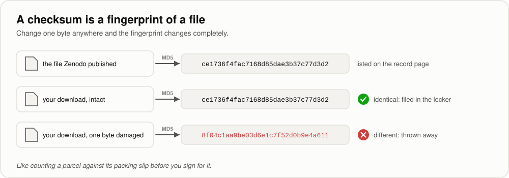

[← Handbook](HANDBOOK.md) · [README](../README.md) · [Glossary](GLOSSARY.md) · [Roadmap](ROADMAP.md) · [Git workflow](GIT-WORKFLOW.md)

# 03. Ingestion: the MIBiG backbone (Phase 1)

**Prerequisites:** [`01-setup.md`](01-setup.md) finished (every line of
`python check-setup.py` said PASS) and [`02-ontology-and-data-model.md`](02-ontology-and-data-model.md)
read (you know what a node, an edge and an evidence level are). You don't need
any biology or networking background.

**Learning goal:** after this phase you will understand how a careful pipeline
brings data in from the internet: how to ask a server politely, how to prove a
download arrived intact, why the original is never edited, how every fetch is
recorded, and how messy real records become rows that obey a rulebook. You will
also have your first automated tests, running on Windows, macOS, Linux and
RHEL 8 every time you push.

**Time:** about 7-9 hours, spread over two or three sessions. The download
itself is about 9.5 MB and takes under a minute.

> Every term here is also in [`GLOSSARY.md`](GLOSSARY.md). Where this guide
> says "see the Handbook", it means [`HANDBOOK.md`](HANDBOOK.md), Stage 4.

---

## Contents

1. [What this phase builds, in one picture](#1-what-this-phase-builds-in-one-picture)
2. [The science: what MIBiG is and why it comes first](#2-the-science-what-mibig-is-and-why-it-comes-first)
3. [The engineering ideas, in plain words](#3-the-engineering-ideas-in-plain-words)
4. [Step 0. Get into position](#4-step-0-get-into-position)
5. [Step 1. Make MicrobeGraph an installable package](#5-step-1-make-microbegraph-an-installable-package)
6. [Step 2. The plumbing: where files live, and the provenance log](#6-step-2-the-plumbing-where-files-live-and-the-provenance-log)
7. [Step 3. The socket: `sources/base.py`](#7-step-3-the-socket-sourcesbasepy)
8. [Step 4. The twelve rules, as code](#8-step-4-the-twelve-rules-as-code)
9. [Step 5. The MIBiG plug](#9-step-5-the-mibig-plug)
10. [Step 6. The command you will type](#10-step-6-the-command-you-will-type)
11. [Step 7. Tests: proving it works without the internet](#11-step-7-tests-proving-it-works-without-the-internet)
12. [Step 8. Run it for real](#12-step-8-run-it-for-real)
13. [Step 9. Continuous integration: tests on four systems](#13-step-9-continuous-integration-tests-on-four-systems)
14. [Step 10. Pictures, the Handbook and the changelog](#14-step-10-pictures-the-handbook-and-the-changelog)
15. [How evidence and confidence are decided](#15-how-evidence-and-confidence-are-decided)
16. [Upgrading MIBiG later](#16-upgrading-mibig-later)
17. [What could go wrong](#17-what-could-go-wrong)
18. [Checkpoint](#18-checkpoint)
19. [Committing this phase](#19-committing-this-phase)

---

## 1. What this phase builds, in one picture


Three commands do all of it:

| Command | What it does | Touches the internet? |
|---|---|---|
| `python -m microbegraph.fetch --probe` | Asks Zenodo about the MIBiG release: version, size, checksum, newer versions | Yes, a few small requests |
| `python -m microbegraph.fetch --source mibig` | Downloads the release, verifies it, files it in the locker, logs it, then tidies it | Yes, once (9.5 MB) |
| `python -m microbegraph.fetch --tidy-only --source mibig` | Rebuilds the tables from the file you already have | **No** |

**Files this phase creates or changes** (paths relative to the project folder):

| Path | New or changed | What it is |
|---|---|---|
| `pyproject.toml` | new | Makes `src/microbegraph/` an installable package; configures pytest and ruff |
| `.gitattributes` | new | Makes every computer agree on line endings, so shell scripts run on Windows too |
| `src/microbegraph/__init__.py` | new | Marks the folder as a package and holds the version number, `0.1.0` (Phase 0 made the folder but left this file out) |
| `src/microbegraph/ontology.py` | changed | Comments reworded only; the node and edge types are the same as in Phase 0 |
| `src/microbegraph/paths.py` | new | Where every data file lives, computed so it works on any computer |
| `src/microbegraph/provenance.py` | new | The append-only provenance log |
| `src/microbegraph/validate.py` | new | The twelve rules from the ontology guide, as code |
| `src/microbegraph/sources/__init__.py` | new | The list of plugged-in sources |
| `src/microbegraph/sources/base.py` | new | The socket: polite downloading, checksums, the shared table format |
| `src/microbegraph/sources/mibig.py` | new | The MIBiG 4.0 adapter |
| `src/microbegraph/fetch.py` | new | The command you type |
| `tests/conftest.py` | new | Shared test helpers: a sample archive and a fake server |
| `tests/fixtures/mibig/BGC0000433.json` | new | Test record: a cut-down copy of the real surfactin entry from the MIBiG 4.0 archive |
| `tests/fixtures/mibig/BGC9999901.json` | new | Test record: invented, to exercise edge cases (says so inside) |
| `tests/fixtures/mibig/BGC9999902.json` | new | Test record: invented, retired (says so inside) |
| `tests/fixtures/mibig/BGC9999903.json` | new | Test record: invented, evidence by prediction only (says so inside) |
| `tests/test_foundations.py` | new | Tests for the ontology, the rules, identifiers, the log, the command |
| `tests/test_mibig_tidy.py` | new | Tests for turning records into rows |
| `tests/test_mibig_fetch_probe.py` | new | Tests for downloading and probing, against a fake server |
| `.github/workflows/ci.yml` | new | Runs the tests on Windows, macOS, Linux and RHEL 8 at every push |
| `check-setup.py` | changed | Also checks the package is installed; no longer requires `data/` folders |
| `docs/03-ingestion-mibig.md` | new | This guide |
| `docs/HANDBOOK.md` | new | The one document to read first, day 0 to the finished product |
| `docs/phases.csv` | new | The plan as data: every phase, its hours and status |
| `docs/img/make_illustrations.py` and `docs/img/*.svg` | new | The teaching diagrams and the script that draws them |
| `docs/interactive/make_interactive.py` and `docs/interactive/*.html` | new | Three open-in-browser explorers |
| `CHANGELOG.md` | new | What changed in each version |
| `README.md`, `docs/ROADMAP.md`, `docs/GLOSSARY.md`, `docs/GIT-WORKFLOW.md`, `docs/00-architecture.md`, `docs/01-setup.md`, `docs/02-ontology-and-data-model.md`, `docs/R-SETUP.md`, `docs/PRIOR-ART.md`, `docs/CONTAINERS.md`, `docs/CONTAINERIZATION.md` | changed | Updated for this phase; each now links back to the Handbook |

**Files this phase writes on your computer that never go to GitHub** (all under
`data/`, which `.gitignore` excludes):

| Path | What it is |
|---|---|
| `data/raw/mibig/mibig_json_4.0.tar.gz` | The MIBiG release, exactly as published, never edited |
| `data/raw/provenance.csv` | One row per fetch |
| `data/processed/staging/mibig_nodes.csv` | MIBiG's dots, in the rulebook's format |
| `data/processed/staging/mibig_edges.csv` | MIBiG's arrows, each with its evidence |
| `data/processed/staging/mibig_summary.json` | The counts: how many entries, what was skipped and why |

---

## 2. The science: what MIBiG is and why it comes first

### Gene clusters, in plain words

Bacteria and fungi make thousands of small molecules. Most of the special ones
(antibiotics, antifungals, natural soaps) come from a team of genes sitting next
to each other on the DNA rather than from a single gene. Each gene holds the
instructions for one enzyme, and each enzyme does one step of the assembly. That
team of neighbouring genes is called a **biosynthetic gene cluster**, or **BGC**.

Think of how a car gets built: on an assembly line, a row of stations that each
do one job, rather than by one giant machine. A gene cluster is the blueprint for
that whole line, written out as a row of neighbouring instructions.

### MIBiG, in plain words

**MIBiG** (Minimum Information about a Biosynthetic Gene Cluster) is a public
catalogue of gene clusters **whose products are known**. Human curators write
each entry and check it against published experiments. An entry records which
organism carries the cluster, what kind of chemical machinery it is, which
molecules it makes, and what those molecules have been seen to do.

This project uses the **MIBiG 4.0** release. It holds about three thousand
entries (the archive has 3,013 files; its paper reports 3,059) and is published on Zenodo, a free archive for
research outputs run by CERN, under the CC BY 4.0 licence, which means anyone may
use it as long as they credit it. Here is the credit, which also appears in
[`src/microbegraph/sources/mibig.py`](../src/microbegraph/sources/mibig.py):

> Zdouc MM et al. (2025). MIBiG 4.0: advancing biosynthetic gene cluster curation
> through global collaboration. *Nucleic Acids Research* 53(D1):D678-D690.
> doi:10.1093/nar/gkae1115

### Why it comes first

The whole chain this project builds starts with two arrows that only MIBiG
supplies, both signed off by people rather than guessed by software:

```
Organism --HARBORS--> GeneCluster --PRODUCES--> Compound
```

Everything that comes later (chemistry from PubChem, family trees from NCBI,
enzymes from UniProt, the cited compound → pathogen → crop bridge) attaches to
those dots. That's why I load MIBiG first, the same way you pour a house's
foundations before anything else goes up.

### A real entry, read slowly

The public entry BGC0000433 describes the cluster in the soil bacterium
*Bacillus velezensis* FZB42 that makes **surfactin**, a soap-like molecule. Below
is what MIBiG 4.0 records for it, in MIBiG's own field names, cut down to the
parts this project reads:

```json
{
  "accession": "BGC0000433",
  "version": 5,
  "quality": "questionable",
  "status": "active",
  "completeness": "complete",
  "loci": [{"accession": "AJ575642.1",
            "evidence": [{"method": "Knock-out studies"}]}],
  "biosynthesis": {"classes": [{"class": "NRPS", "subclass": "Type I"}]},
  "compounds": [{
      "name": "surfactin",
      "evidence": [],
      "bioactivities": [
        {"name": "antibacterial", "observed": true, "references": []},
        {"name": "surfactant",    "observed": true, "references": []}
      ],
      "databaseIds": ["npatlas:NPA018495", "chemspider:391754"],
      "mass": 1021.6674859720001,
      "formula": "C52H91N7O13"
  }],
  "taxonomy": {"name": "Bacillus velezensis FZB42", "ncbiTaxId": 326423},
  "legacy_references": ["pubmed:14762003"]
}
```

Five details in it shape the code:

1. **`"Knock-out studies"`** under the locus evidence. Someone switched the
   cluster's genes off and the molecule disappeared, which counts as an
   experiment. So the organism → cluster → surfactin arrows are
   `curated_experimental`. An entry
   whose only evidence is a *prediction* ("Homology-based prediction") gets
   `database_assertion` instead ([section 15](#15-how-evidence-and-confidence-are-decided)).
2. **`quality: "questionable"`**. MIBiG grades its own entries (high, medium, low,
   questionable). We keep that grade and carry it through as the **confidence**
   on every arrow from this entry ([section 15](#15-how-evidence-and-confidence-are-decided)).
3. **`references: []`** on both activities. This entry doesn't record *which
   paper* showed surfactin is antibacterial, so that arrow is a
   `database_assertion` rather than a `curated_experimental` fact.
4. **`observed`** on every activity. MIBiG also records activities someone
   *tested for and did not find* (`"observed": false`). An arrow saying "has this
   activity" would state the opposite of the record, so those are counted but
   never drawn.
5. **No PubChem number.** Surfactin's identifiers here come from NPAtlas and
   ChemSpider, so compounds enter as `mg.compound:surfactin` and get matched to
   PubChem later, in Phase 4. Guessing an identifier now would mean inventing a
   fact.

> **The website and the archive can differ slightly.** The entry above was read
> from MIBiG's public website, which always shows the newest version of each
> entry. The 4.0 archive this project downloads is frozen at its release date,
> so a few values for some entries may differ. This is why we pin one release
> and record its checksum.

---

## 3. The engineering ideas, in plain words

### APIs and HTTP

An **API** (application programming interface) is a door a website leaves open for
programs rather than people. Your program sends a **request** ("give me record
14169073") over **HTTP**, the same language your browser speaks, and gets a
**response** back: some data plus a three-digit **status code**.

| Code | Meaning | What our code does |
|---|---|---|
| 200 | OK, here it is | Uses it |
| 404 | Not found | Stops at once and says which address failed: asking again will not help |
| 403 | Forbidden | Stops at once (often a proxy or firewall, see [section 17](#17-what-could-go-wrong)) |
| 429 | Too many requests, slow down | Waits, then tries again |
| 500-599 | The server is having a bad moment | Waits, then tries again |

Picture a shop counter. 200 is "here you go", 404 is "we have never stocked
that", 429 is "please wait, there's a queue", and 503 is "the till is broken,
come back in a minute".

### Being a polite guest: timeouts, retries and backoff

Public research databases are free and run on modest budgets, so our code tries
to behave like a good guest. It:

* names itself in every request (a "User-Agent" with the project's address), so
  the people running the server can see who is calling and why;
* gives up waiting after a sensible time (a **timeout**) instead of hanging;
* retries only problems that might be temporary (429, 5xx, a dropped
  connection), and waits longer each time: 2, 4, 8, then 16 seconds. That
  growing pause is called **exponential backoff**, and the `tenacity` package
  does it for us;
* never retries a clear refusal like 404.

It's the same as phoning a busy office. If the line is engaged, you try again in
a minute, then in five; if they tell you the person never worked there, you stop
ringing.

### Archives and JSON

MIBiG 4.0 arrives as a single file, `mibig_json_4.0.tar.gz`. A `.tar.gz` is a
**tarball**: many files bundled into one (`tar`) and then squeezed smaller
(`gz`, gzip compression). I think of it as a suitcase packed with vacuum bags,
one thing to carry with everything inside intact. Inside are about three thousand
**JSON** files, one per entry. JSON is a plain-text way of writing nested data,
with `{ }` for objects and `[ ]` for lists, and both people and programs can read
it.

We never unpack the tarball into folders. Python's `tarfile` module reads the
files straight out of it, so the locker keeps one pristine file.

> **A file name is a promise, not a proof.** Despite the `.gz` at the end of its
> name, the MIBiG 4.0 file is not gzip-compressed. I found that out on the first
> real run, which stopped with `not a gzip file` even though the file's MD5
> matched the published one exactly, so it was the file Zenodo publishes. My
> tests had only ever used archives I'd packed myself, with gzip, so they
> couldn't have caught it. The code now looks at the file's first few bytes and
> works out the compression itself (gzip, bzip2, xz or none), and the tests
> check every one of those under the `.tar.gz` name. You can look for yourself:
> `file data/raw/mibig/mibig_json_4.0.tar.gz` (macOS, Linux, RHEL 8) prints
> what the contents really are, whatever the name says. For MIBiG 4.0 it prints
> `POSIX tar archive (GNU)`: a plain archive, with no compression at all.

### Checksums: proving the file is the one that was published



A **checksum** is a short fingerprint calculated from every byte of a file. Zenodo
publishes the **MD5** checksum of each file. After downloading, we calculate the
fingerprint ourselves. If the two match, we have exactly what was published. If
they don't, something went wrong on the way, and the file is thrown away instead
of being filed. We also record a **SHA-256** fingerprint, a longer and stronger
one, so future comparisons don't depend on MD5 alone.

### The evidence locker and "never edit in place"

Everything downloaded goes into `data/raw/<source>/` and is **never changed again**.
Every later step reads that copy and writes new files. If you ever find a
mistake in how a record was *interpreted*, you fix the code and re-run the tidy.
The evidence is still there, untouched, and no server has to be bothered again.

It works like the original receipts behind a tax return. You keep them exactly as
they were, so any number can be checked against its source, and a mistake in your
adding-up can be redone without going shopping again.

### Provenance

**Provenance** is the record of where something came from. For a painting, it's
the chain of owners. In this project it's `data/raw/provenance.csv`: one row per
fetch, with the time (in UTC, so it means the same moment everywhere), the source, the
version, the address, the file's size and fingerprints, how many records it held,
the licence, and whether it was freshly downloaded or already present. Rows are
only ever added, like lines on a bank statement.

### One socket, many plugs


Every data source fits the same three verbs. That shared shape is called a
**contract** (or interface), and
[`00-architecture.md`, section 6](00-architecture.md#6-layer-2-ingestion-and-the-evidence-locker)
goes into the details. It pays off in Phase 2, when three more sources plug in
and nothing downstream has to change.

### Staging tables

`tidy()` writes **staging tables**: one pair of CSV files per source, already in
the exact column layout of the ontology guide. In Phase 4, every source's staging
tables are merged, aliases resolved, and the whole graph built. In Phase 10, dbt
calls the same idea its *staging layer*, so I use that one name for it all the way
through the project.

### Tests, fixtures and a fake server

A **test** is a small program that checks one promise the code makes ("a damaged
download is thrown away") and fails loudly if the promise breaks. **pytest** finds
and runs every test. **Fixtures** are prepared ingredients the tests share; here
they are four small records packed into a sample archive, plus a **fake server**
that answers from memory. Because the tests never touch the internet, they run in
a second, work offline, and never bother Zenodo.

---

## 4. Step 0. Get into position

1. Open your terminal (see [`01-setup.md`, Step 0](01-setup.md#2-step-0-the-terminal-explained) if you're unsure how).
2. Go to the project folder:

   ```bash
   cd ~/projects/microbegraph      # or wherever you cloned it
   ```

   Windows PowerShell: `cd $HOME\projects\microbegraph` (or wherever you cloned it)
3. Make sure you are on the working branch and up to date:

   ```bash
   git switch develop
   git pull --ff-only origin develop
   ```

4. Activate the toolbox:

   ```bash
   source .venv/bin/activate          # macOS / Linux / RHEL 8
   ```

   Windows PowerShell: `.\.venv\Scripts\Activate.ps1`

5. **Tidy-up (only if it applies).** An early version of the setup steps made two
   extra folders at the top of the project, `sources/` and `figures/`, each holding
   nothing but an empty `.gitkeep` placeholder. Nothing uses them: data sources
   live in `src/microbegraph/sources/`. Check whether you have them:

   ```bash
   git ls-files sources figures
   ```

   If that prints `figures/.gitkeep` and `sources/.gitkeep`, remove them through
   Git, so the removal is recorded in this phase's commit (same command on every
   system):

   ```bash
   git rm sources/.gitkeep figures/.gitkeep
   ```

   Git deletes the two placeholders, and the folders go with them because they
   are now empty. If the first command printed nothing, there's nothing to do.

   > Why not plain `rmdir`? It only removes folders that are completely empty,
   > and a `.gitkeep` file, hidden or not, still counts as something inside.

✅ **Checkpoint.** Your prompt starts with `(.venv)` and `git branch` shows
`* develop`.

---

## 5. Step 1. Make MicrobeGraph an installable package

**Why:** until now there was nothing to run. From this phase on there's a
command, `python -m microbegraph.fetch`, and for Python to find `microbegraph`
from anywhere, the package has to be **installed** into your `.venv`.

1. Put [`pyproject.toml`](../pyproject.toml) in the project folder (top level, next
   to `README.md`). It's the label on the box, giving the package's name, where
   the code lives (`src/`), and the settings for pytest and ruff.
2. Put [`src/microbegraph/__init__.py`](../src/microbegraph/__init__.py) in
   `src/microbegraph/`, next to `ontology.py`. Phase 0 made the folder but not
   this file, so you probably don't have it yet. It's four lines:

   ```python
   """MicrobeGraph, a knowledge graph of microbes, the molecules they make,
   and the crop diseases those molecules act on."""

   __version__ = "0.1.0"
   ```

   This small file does two jobs. Its presence tells Python "this folder is a
   package you can import", and `pyproject.toml` reads the version number from
   it. Without it, Python walks straight past the folder, the way you'd walk past
   a shop with no sign over the door. Check it's in place:

   ```bash
   ls src/microbegraph
   ```

   Windows PowerShell: `dir src\microbegraph`. The list should include
   `__init__.py`. Leave out this file and the next step fails with
   `ModuleNotFoundError: microbegraph`.
3. Install the package in **editable** mode, once:

   ```bash
   pip install -e .
   ```

   The `.` means "the project in this folder". The `-e` means **editable**:
   instead of a copy, Python gets a pointer to `src/microbegraph/`, so every edit
   you make is live straight away.

   A library catalogue card that says "the book is on shelf 4" is a good
   comparison. Unlike a photocopy of the book, the card still leads you to the
   current version after the book has been rewritten.

   Expected output ends with a line like:

   ```
   Successfully installed microbegraph-0.1.0
   ```

4. Check it:

   ```bash
   python -c "import microbegraph, sys; print(microbegraph.__file__)"
   ```

   It should print a path ending in `src/microbegraph/__init__.py` inside **your**
   project folder (on Windows the slashes point the other way: `src\microbegraph\__init__.py`).

> **Why are there no packages listed in `pyproject.toml`?** The install list
> already lives in `requirements.txt`, and two lists of the same thing tend to
> drift apart over time. Keeping a single list avoids that.

> **One change to remember for the lockfile.** This phase adds no packages, so
> `requirements.lock.txt` stays as it is. Whenever you *do* refresh it from now on,
> use `pip freeze --exclude-editable > requirements.lock.txt` (Windows PowerShell:
> `pip freeze --exclude-editable | Set-Content -Encoding utf8 requirements.lock.txt`).
> Plain `pip freeze` would now also write a line for MicrobeGraph itself, pointing
> at your own copy of the project, which no other computer can install from.

✅ **Checkpoint.** `python check-setup.py` shows
`[PASS]  package: microbegraph (editable install)`.

---

## 6. Step 2. The plumbing: where files live, and the provenance log

This step adds two small files that every later phase reuses.

**[`src/microbegraph/paths.py`](../src/microbegraph/paths.py)** works out the data
folders from where the file itself sits, so the same code works in any folder on
any operating system:

```python
REPO_ROOT: Path = Path(__file__).resolve().parents[2]   # src/microbegraph/paths.py -> repo
RAW_DIR: Path = REPO_ROOT / "data" / "raw"
STAGING_DIR: Path = REPO_ROOT / "data" / "processed" / "staging"
PROVENANCE_LOG: Path = RAW_DIR / "provenance.csv"
```

It also has `relative_to_repo()`, which writes paths as `data/raw/mibig/...`
rather than `/Users/<your-name>/...`, so the provenance log never leaks your
folder layout and makes sense on anyone's machine.

**[`src/microbegraph/provenance.py`](../src/microbegraph/provenance.py)** is kept
small on purpose. It can do three things:

| Function | Does |
|---|---|
| `append(row)` | Adds one row, creating the file and header if needed. Refuses a row with missing or unexpected columns |
| `read()` | Returns every row, oldest first |
| `latest(source, local_path)` | The newest **download** row for a file, used to stamp "retrieved on" dates |

There's no function to change or delete a row, because nobody can trust a log
that can be rewritten.

---

## 7. Step 3. The socket: `sources/base.py`

[`src/microbegraph/sources/base.py`](../src/microbegraph/sources/base.py) is the
largest new file, and most of it is comments. It holds everything the sources
have in common, so each adapter only needs to write what's specific to it.

**The contract.** `Source` is an *abstract base class*: a template that says
"anything calling itself a source must have `probe()`, `fetch()` and `tidy()`".
Python refuses to create a source that forgets one.

```python
class Source(ABC):
    name: str = "base"      # also the locker folder: data/raw/<name>/
    licence: str = ""       # written into every provenance row

    @abstractmethod
    def probe(self) -> ProbeReport: ...
    @abstractmethod
    def fetch(self) -> list[FetchResult]: ...
    @abstractmethod
    def tidy(self) -> TidyResult: ...
```

**Polite requests**, `http_get()`: retries only temporary trouble, with growing
waits, and reports a clear refusal at once (section 3 explains why). Two errors
that *look* like connection trouble are not retried, on purpose: a proxy refusing
the connection, and a replaced security certificate. On a given network these
fail the same way every time, so waiting and trying again wouldn't help.

**Safe downloads**, `download_to_locker()`, follows four rules, each with a reason:

1. **Already there and verified? Do nothing.** Re-running a fetch never costs a download.
2. **Already there but different? Stop.** The locker never overwrites; you decide.
3. **Download to `name.part`, rename only at the end.** A dropped connection can
   never leave a half-file that looks complete; the broken attempt is deleted and
   the download starts again, up to five tries.
4. **Check the fingerprint before the rename.** A wrong file is deleted, not filed.

**Shared helpers:** `iter_tar_json()` reads JSON files straight out of a tarball,
front to back, in one pass (a compressed archive can only be read efficiently
that way), working out the compression from the file's contents rather than its
name; `slugify()` turns names into identifier-safe text;
`write_files_together()` writes several output files so they change together or
not at all.

`slugify()` deserves a closer look, because once an identifier is made, it is
kept for good:

| Name in MIBiG | Identifier part | Why |
|---|---|---|
| `surfactin` | `surfactin` | already clean |
| `Bacillomycin D` | `bacillomycin-d` | lowercase, spaces become hyphens |
| `δ-cadinene` | `delta-cadinene` | Greek letters spelled out, so identifiers stay plain text |
| `(+)-menthol` / `(-)-menthol` | `plus-menthol` / `minus-menthol` | mirror-image molecules can behave differently; dropping the sign would merge two chemicals |

---

## 8. Step 4. The twelve rules, as code

[`src/microbegraph/validate.py`](../src/microbegraph/validate.py) turns the twelve
rules of [`02-ontology-and-data-model.md`, section 9](02-ontology-and-data-model.md#9-validation-rules-the-loader-enforces)
into one function, `check_tables(nodes, edges)`. It returns a list of problems
written as ordinary sentences, each starting with its rule number; an empty list
means every rule passed.

It stands guard at two doors:

* **Now**, every adapter's `tidy()` checks its own rows *before* writing them, so
  a parsing bug is caught at the source, with the source's name on it.
* **In Phase 4**, the graph build runs the same checks on all sources merged,
  and refuses to build if anything fails.

The same rulebook is enforced at both doors. That means if you ever change the
ontology, you should change `ontology.py`, the ontology guide and (if a rule
changes) `validate.py`, all in the same commit.

---

## 9. Step 5. The MIBiG plug

[`src/microbegraph/sources/mibig.py`](../src/microbegraph/sources/mibig.py) starts
with the four pinned facts about the release. I keep them together so that an
upgrade means editing one place, on purpose:

```python
ZENODO_RECORD = "14169073"
MIBIG_VERSION = "4.0"
FILENAME = "mibig_json_4.0.tar.gz"
EXPECTED_MD5 = "ce1736f4fac7168d85dae3b37c77d3d2"
```

**`probe()`** asks Zenodo's records API about the release and reports: title,
version, publication date, licence, the file's size, whether Zenodo's checksum
matches ours, whether a newer MIBiG exists, and whether you already have the file.
If Zenodo can't be reached, it reports that instead of crashing.

**`fetch()`** downloads, verifies, files and logs, using the socket's safe
download, then counts the records inside the archive for the provenance row.

**`tidy()`** reads every entry out of the archive and turns it into rows:

| From the MIBiG entry | Becomes | Identifier |
|---|---|---|
| `taxonomy.ncbiTaxId`, `taxonomy.name` | an `Organism` node | `ncbitaxon:<taxid>` (or `mg.organism:<slug>` if there is no number) |
| `accession` and its classes, quality, completeness | a `GeneCluster` node | `mibig:<accession>` |
| each compound's name, formula, mass, synonyms, identifiers | a `Compound` node | `mg.compound:<slug>` |
| each **observed** bioactivity | an `Activity` node | `mg.activity:<slug>` |
| a curator's comment on a bioactivity | part of the compound's `activity_notes` | |
| each compound class, when given | a `CompoundClass` node | `mg.class:<slug>` |
| organism → cluster | `HARBORS` edge | |
| cluster → compound | `PRODUCES` edge | |
| compound → activity | `HAS_ACTIVITY` edge | |
| compound → class | `BELONGS_TO` edge | |

**Two ways of writing one activity.** MIBiG 4.0 doesn't write an activity's name
the same way in every entry. Some entries use a small object,
`{"activity": "antibacterial"}`, sometimes with a curator's comment added
(`{"activity": "antialgal", "comment": "..."}`). Others use plain text,
`"antibacterial"`. The first version of `tidy()` only expected plain text, so it
turned each object into text and the graph ended up with
`mg.activity:activity-antibacterial` sitting next to `mg.activity:antibacterial`:
one activity split into two dots. My test copy of the surfactin record used plain
text, so the tests couldn't see it. The record I opened from the real archive
uses the object style. Now both styles land on the same `mg.activity:antibacterial`,
the test copy of surfactin is a cut-down copy of the real record, and comments are
kept on the compound as `activity_notes`. They belong there because a comment
such as how a compound is antialgal describes that one molecule, not antialgal
activity in general.

Some plain-text names carry a remark of their own, such as
`antitumor (duplicate of anticancer)`. Those are kept exactly as MIBiG wrote them.
Deciding which activity names mean the same thing (antitumor, anticancer,
antineoplastic) is a matching job, and matching names is what Phase 4 is for.

**Merging repeats.** The same compound often appears in more than one entry,
but the graph must have **one** dot for it, with several arrows pointing in. So
nodes with the same identifier are merged (lists such as synonyms are combined),
and an arrow seen in several entries becomes a single row. That row lists every
entry in `source_record_id` and keeps the stronger evidence level, the higher
confidence, and every citation. When entries disagree (two entries giving one
compound two masses), the first value is kept and the disagreement is counted
under `property_conflicts` for Phase 4 to look at.

**Skipping, with a count.** Entries that are not `active`, records in an
unrecognised layout, unreadable files and negative bioactivity results are all
counted in `mibig_summary.json`, so nothing disappears without a number next to it.

**Same output, every time.** Entries are read in the order the archive stores
them, trimmed to the fields used, then sorted by file name before any row is
made. So however the archive happens to be packed, the tables come out
identical, byte for byte, on every computer.

**Checking before writing.** The rows go through `check_tables()` first. If any
rule fails, nothing is written and the message names the rule. Then the node
table, the edge table and the summary are written together, so either all three
change or none does.

---

## 10. Step 6. The command you will type

[`src/microbegraph/sources/__init__.py`](../src/microbegraph/sources/__init__.py)
holds the list of plugged-in sources (just `mibig` for now).
[`src/microbegraph/fetch.py`](../src/microbegraph/fetch.py) turns your typing into
calls on those sources:

| You type | It does |
|---|---|
| `python -m microbegraph.fetch --list` | Lists the sources, their homepages and licences |
| `python -m microbegraph.fetch --probe` | Probes every source (nothing downloaded) |
| `python -m microbegraph.fetch --source mibig` | Fetch, then tidy, for MIBiG |
| `python -m microbegraph.fetch --all` | Fetch, then tidy, for every source |
| `python -m microbegraph.fetch --tidy-only --all` | Tidy only, from the locker, offline |
| add `--debug` to any of these | Shows the full Python error instead of the short message |

Every run finishes with an **exit code**: 0 when everything worked, 1 when
something failed (along with a message saying what to do), and 2 when the command
was mistyped. You'll rarely see it yourself, but Airflow will rely on it in
Phase 12.

---

## 11. Step 7. Tests: proving it works without the internet

1. Look inside [`tests/fixtures/mibig/`](../tests/fixtures/mibig/). It holds four
   records in the MIBiG 4.0 layout, and each one explains itself in its `comment`
   field:

   | File | What it is | What it lets the tests check |
   |---|---|---|
   | `BGC0000433.json` | A cut-down copy of the real surfactin entry, taken from the MIBiG 4.0 archive with only the gene annotations and biosynthesis modules removed | The worked example, row for row, and the object style of activity name |
   | `BGC9999901.json` | Invented ("Testibacter fixturensis") | Merging a compound made by two clusters, a negative result, citations, a compound class, a Greek letter, a PubChem number, plain-text activity names, a curator's comment |
   | `BGC9999902.json` | Invented, retired | That withdrawn entries are skipped and counted |
   | `BGC9999903.json` | Invented, evidence by prediction only | That a predicted cluster is never called an experiment |

   All four were checked with the MIBiG maintainers' own reader for the 4.0
   layout (`MibigEntry.from_json` in
   [python-mibig](https://github.com/mibig-secmet/python-mibig), the GitHub version
   at commit `df047fe`; the older release on PyPI reads only the 3.x layout), so
   their *shape* is the real 4.0 shape. The invented
   accessions start at `BGC99999`, far above any real one, and use a `10.0000`
   DOI prefix that belongs to no publisher.

2. [`tests/conftest.py`](../tests/conftest.py) packs those records into a sample
   archive (gzip-compressed, or not at all, or bzip2 or xz, as a test asks) and
   provides a `FakeSession`, a pretend server that answers from a
   script and records every request. Because it keeps that record, a test can
   prove "the second fetch made no download".

3. Run the tests:

   ```bash
   pytest
   ```

   Expected output (each dot is one test passing; the count grows over time):

   ```
   .........................................................................  [100%]
   73 passed in 0.4s
   ```

4. Run the style and bug checker:

   ```bash
   ruff check .
   ```

   Expected: `All checks passed!`

**What the tests promise** (each line below is one test you can read):

* the surfactin chain arrives exactly as documented;
* an activity without a reference is called a database assertion, not an experiment;
* a repeated arrow merges and keeps the stronger evidence;
* one compound is one node, however many clusters make it;
* retired entries and negative results never become arrows, and are counted;
* every row obeys the twelve rules, and each rule catches its own mistake;
* the same input always gives byte-identical output;
* "retrieved on" comes from the download, not from today;
* a damaged download is thrown away and nothing is logged;
* a download that breaks halfway starts again, cleanly;
* a predicted cluster is never called an experiment;
* the order of files inside the archive never changes the output;
* both ways MIBiG writes an activity name lead to the same activity node;
* a curator's comment on an activity is kept on the compound;
* the archive is read by its contents, not its name, whatever the compression;
* a file that is filed but can't be opened still gets its provenance row;
* the locker never overwrites;
* temporary trouble is retried, a clear refusal is not, and retrying gives up eventually;
* the probe works without downloading, spots a newer release, and reports being offline instead of crashing.

✅ **Checkpoint.** `pytest` ends with `passed` and no `failed`; `ruff check .`
says `All checks passed!`.

---

## 12. Step 8. Run it for real

This is the one step that uses the internet, and the first time the real MIBiG
archive lands on your machine.

1. **List the sources.**

   ```bash
   python -m microbegraph.fetch --list
   ```

   ```
     mibig      https://mibig.secondarymetabolites.org  (licence CC-BY-4.0)
   ```

2. **Probe.** This step downloads nothing.

   ```bash
   python -m microbegraph.fetch --probe
   ```

   This is the real output from a run on 2026-10-10. Yours should match it
   line for line, except that the warning may name an even newer release:

   ```
   [mibig] probe
     pinned release : MIBiG 4.0, Zenodo record 14169073
     record page    : https://zenodo.org/records/14169073
     title          : The Minimum Information about a Biosynthetic Gene Cluster (MIBiG) data repository
     version        : 4.0
     published      : 2024-11-15
     licence        : cc-by-4.0
     file           : mibig_json_4.0.tar.gz (9.5 MB)
     checksum       : matches the pinned MD5
     in your locker : not yet (run the fetch)
     WARNING: A newer MIBiG release exists on Zenodo: version 4.0.1, https://zenodo.org/records/14835872
       This project stays on 4.0 until an upgrade is made on purpose (docs/03-ingestion-mibig.md, section 16, 'Upgrading MIBiG later').
   ```

   **The newer-release warning is expected.** Zenodo lists a version newer than
   4.0, but this project stays on 4.0 on purpose so that its numbers can be
   reproduced. [Section 16](#16-upgrading-mibig-later) explains how an upgrade is
   done.

   > **About the sizes.** The program counts a megabyte as 1,048,576 bytes
   > (1024 × 1024), the way your computer's file manager usually does. Zenodo's
   > web page counts it as 1,000,000 bytes, so the same file shows there as about
   > 10 MB. Same file, two rulers.

3. **Fetch and tidy.**

   ```bash
   python -m microbegraph.fetch --source mibig
   ```

   You will see a progress line while the 9.5 MB downloads, then the counts.
   This is the real output from the run on 2026-10-10. MIBiG 4.0 is pinned, so
   your numbers should be exactly the same:

   ```
   [mibig] fetch
     [mibig] downloading mibig_json_4.0.tar.gz
          9.5 MB of 9.5 MB (100%)
     [mibig] downloaded: data/raw/mibig/mibig_json_4.0.tar.gz (9.5 MB, 3013 records), provenance logged
   [mibig] tidy
     [mibig] wrote mibig_nodes.csv and mibig_edges.csv
       bioactivities_not_observed             66
       bioactivities_observed               2937
       compound_name_collisions                4
       compounds_read                       4294
       entries_active                       2437
       entries_predicted_or_unstated        1629
       entries_skipped_status                576
       entries_with_experimental_evidence    808
       files_not_mibig4                        0
       files_read                           3013
       files_unreadable                        0
       property_conflicts                    275
   ```

   **What each count means:**

   | Count | Meaning |
   |---|---|
   | `files_read` | JSON files found in the archive, one per MIBiG entry |
   | `files_unreadable` | Files that weren't valid JSON (should be 0) |
   | `files_not_mibig4` | Files in some other layout (should be 0) |
   | `entries_active` | Entries MIBiG marks as active; only these become rows |
   | `entries_skipped_status` | Entries marked anything other than active (retired, for example), counted and left out |
   | `entries_with_experimental_evidence` | Active entries where MIBiG records an experiment linking the cluster to its product |
   | `entries_predicted_or_unstated` | Active entries where the link rests on prediction, or no method is given |
   | `compounds_read` | Compound records across all active entries (one compound made by two clusters counts twice here, but becomes one node) |
   | `bioactivities_observed` | Activities a compound was seen to have; each becomes a `HAS_ACTIVITY` arrow |
   | `bioactivities_not_observed` | Negative results: tested for and not found. Counted, never turned into arrows |
   | `compound_name_collisions` | Two different names that would have produced the same identifier; the second gets a short fingerprint added, so they stay apart |
   | `property_conflicts` | Two entries describing the same compound disagree on a value (two masses, say). The first is kept, and Phase 4 sorts these out |

   **Sanity checks on your numbers:**
   * the record count is in the low thousands: 3,013 files in the archive. The
     MIBiG 4.0 paper reports 3,059 curated entries; I haven't tracked down where
     the difference of 46 comes from, so this project quotes its own count;
   * `entries_active + entries_skipped_status + files_not_mibig4 + files_unreadable`
     equals `files_read` (2,437 + 576 + 0 + 0 = 3,013);
   * `files_unreadable` and `files_not_mibig4` are 0 (if not, see section 17);
   * `entries_with_experimental_evidence + entries_predicted_or_unstated` equals
     `entries_active` (808 + 1,629 = 2,437).

4. **Run it again.** The second time it says `already in the locker and
   verified, nothing to download`, and `provenance.csv` gains an
   `already_present` row. That's rule 1 of the locker at work.

5. **Look at what you made.** Open `data/raw/provenance.csv` and
   `data/processed/staging/mibig_edges.csv` in **VS Code**. (Avoid Excel and other
   spreadsheet programs here: they can lock the file while it's open, which makes
   the next run fail on Windows, and they may quietly re-save it in a different
   format.) Then count the arrows by type and evidence:

   ```bash
   python -c "import pandas as pd; e = pd.read_csv('data/processed/staging/mibig_edges.csv'); print(e.groupby(['edge_type', 'evidence_level']).size())"
   ```

   The real output from MIBiG 4.0:

   ```
   edge_type     evidence_level
   BELONGS_TO    database_assertion       529
   HARBORS       curated_experimental     808
                 database_assertion      1629
   HAS_ACTIVITY  curated_experimental     732
                 database_assertion      2042
   PRODUCES      curated_experimental    1679
                 database_assertion      2604
   dtype: int64
   ```

   That's 10,023 arrows. Each total can be checked against the summary:

   | Arrow | Total | Where it comes from |
   |---|---|---|
   | `HARBORS` | 2,437 | One per active entry, split 808 / 1,629 exactly like `entries_with_experimental_evidence` and `entries_predicted_or_unstated` |
   | `PRODUCES` | 4,283 | The 4,294 compound records, minus 11 where an entry lists the same compound twice |
   | `HAS_ACTIVITY` | 2,774 | The 2,937 observed activities, minus 163 repeats of the same compound and activity, merged into one arrow each |
   | `BELONGS_TO` | 529 | One per compound and class pair |

   And find surfactin's arrows (this prints the rows exactly as they are in the
   file):

   ```bash
   python -c "import pandas as pd; e = pd.read_csv('data/processed/staging/mibig_edges.csv', dtype=str, keep_default_na=False); print(e[e.source_id.eq('mg.compound:surfactin') | e.target_id.eq('mg.compound:surfactin')].to_csv(index=False))"
   ```

   ```
   source_id,target_id,edge_type,evidence_level,source,source_record_id,citation,confidence,retrieved_at
   mg.compound:surfactin,mg.activity:antibacterial,HAS_ACTIVITY,database_assertion,mibig,BGC0000433,,0.50,2026-10-10
   mg.compound:surfactin,mg.activity:surfactant,HAS_ACTIVITY,database_assertion,mibig,BGC0000433,,0.50,2026-10-10
   mibig:BGC0000433,mg.compound:surfactin,PRODUCES,curated_experimental,mibig,BGC0000433,pubmed:14762003,0.50,2026-10-10
   ```

   The last column is the date of your own download, so yours will differ. In
   MIBiG 4.0, BGC0000433 is the only active entry with a compound named
   surfactin, so there's one `PRODUCES` arrow. Its evidence is
   `curated_experimental` because the record lists a knock-out study for the
   cluster, and its citation, `pubmed:14762003`, is the reference the record
   carries. The two activities have no reference in MIBiG, so they are
   `database_assertion`, and everything is 0.50 because MIBiG grades this entry
   "questionable".

6. **Write your numbers down.** Copy the counts from
   `data/processed/staging/mibig_summary.json` into the Phase 1 entry of
   [`CHANGELOG.md`](../CHANGELOG.md). The changelog only states numbers that a
   real run produced, so this is where yours go.

7. **Explore the example interactively** (optional): open
   [`docs/interactive/evidence_chain.html`](interactive/evidence_chain.html) in
   your browser and untick evidence levels to see what still connects.

✅ **Checkpoint.** `data/raw/mibig/mibig_json_4.0.tar.gz` exists; `provenance.csv`
has a `downloaded` row whose `md5` is `ce1736f4fac7168d85dae3b37c77d3d2`; the
three staging files exist.

---

## 13. Step 9. Continuous integration: tests on four systems

**Continuous integration (CI)** means that every time the main branch changes, a
fresh computer somewhere else installs the project from scratch and runs the
tests. GitHub offers this free for public repositories, under the name
**GitHub Actions**.


[`.github/workflows/ci.yml`](../.github/workflows/ci.yml) asks for:

| Job | Runs on | Python |
|---|---|---|
| `test` | Windows, macOS, Ubuntu Linux | 3.11 and 3.12 |
| `rhel8` | Red Hat's UBI 8 container (the freely redistributable build of RHEL 8) | 3.11 |

Each job does exactly what [`01-setup.md`](01-setup.md) Step 8 tells you to do,
then runs `ruff check .` and `pytest`. Two smaller settings are worth knowing
about. Each job is stopped after 20 minutes (a normal one takes two or three), so
a stuck machine can't sit there for hours. And the step that fetches the code is
told not to leave a GitHub login behind on the borrowed machine, because the
tests only ever read the code.

Why bother? Saying the project "runs on Windows, macOS and RHEL 8" is a claim, and
without CI it's really a claim about one laptop. With CI it gets checked on all of
them every time `master` changes, by machines that have nothing left over from
yesterday.

A kitchen comparison helps here. A recipe that has worked in three other people's
kitchens is more convincing than one only ever made in yours, where you know which
drawer the whisk is in.

> **One-time note on pushing this file.** GitHub only accepts a push that adds a
> file under `.github/workflows/` if your access token has the **workflow**
> permission. If your push is refused with *"refusing to allow a Personal Access
> Token to create or update workflow"*, follow
> [`01-setup.md`, Troubleshooting T13](01-setup.md#t13-push-refused-refusing-to-allow-a-personal-access-token-to-create-or-update-workflow).
> If you push over SSH, this doesn't affect you.

After your push (section 19), open your repository on GitHub and click
**Actions**. A run should appear within a minute or so, triggered by the push to
`master`, with seven jobs inside it (three systems times two Python versions,
plus RHEL 8). Why only `master`? Because the end-of-phase push sends the *same*
commit to all three branches, testing it once is enough. Once every job shows a
green tick, the claim has been checked, and from then on the badge at the top of
the README shows the latest result.

### Starting a run by hand

When this workflow file was first pushed, no run appeared on its own, and I
haven't found out why. The workflow has a button for exactly this, so it cost
two minutes:

1. Open the **Actions** tab.
2. Click **tests** in the list on the left.
3. Click **Run workflow** on the right, check that the branch says `master`, and
   click the green **Run workflow** button.

If there's no **Run workflow** button, or the run fails within seconds, go to
**Settings**, then **Actions**, then **General**, make sure **Allow all actions
and reusable workflows** is selected, and click **Save**.

### Reading warnings and notices

Under the jobs, a finished run can list **annotations**: notes GitHub pins to
the run. A yellow **warning** means something still works but should change
soon. A grey **notice** is information only. Neither one is a failure; a failure
looks different, with a red cross on the job itself.

### Keeping the workflow current

`ci.yml` borrows two ready-made steps that GitHub publishes, called **actions**:
`actions/checkout` fetches the code and `actions/setup-python` installs Python.
The `@v7` after each name picks a major version.

The first run of this project, on 2026-10-11, passed but showed seven warnings:
the versions it used then (`checkout@v4` and `setup-python@v5`) were built for a
version of Node.js (the engine these actions run on) that GitHub is retiring.
GitHub was still running them on the newer engine for us, so nothing failed, but
it was a clear sign to move on. Both moved to `@v7`, the newest major version at
the time.

Phones get the same kind of notice. An older model keeps working on the day its
maker announces the end of updates, but you know to move before it matters.

When warnings like these appear again:

1. Open each action's releases page on GitHub
   (`github.com/actions/checkout/releases`, `github.com/actions/setup-python/releases`)
   and note the newest major version. Read what changed in it.
2. In `.github/workflows/ci.yml`, change the number after `@` in every place it
   appears (both jobs).
3. Commit with `ci: move checkout and setup-python to vN` (with the new number),
   push, and check that the next run is green with no warnings.

Doing this by hand is fine for now. In Phase 19, GitHub is told to propose
these updates by itself.

## 14. Step 10. Pictures, the Handbook and the changelog

**The pictures.** Every diagram in `docs/img/` is drawn by a script, so anyone can
regenerate it after a change:

```bash
python docs/img/make_illustrations.py
python docs/interactive/make_interactive.py
```

The first script writes the eleven SVG diagrams, using only Python's standard
library. The second writes three pages you open in a browser. It reads the arrow
types from
`src/microbegraph/ontology.py` and the phase list from
[`docs/phases.csv`](phases.csv), so they can never disagree with the code or the plan.

**The Handbook.** [`docs/HANDBOOK.md`](HANDBOOK.md) is the one document to read
first. It covers every stage from a blank laptop to the finished product, in
order, explains why each one exists, and links to each guide. It's a living
document, updated in the same commit as any tested change it describes; its last
section lists the update rules.

**The changelog.** [`CHANGELOG.md`](../CHANGELOG.md) records what changed in each
version, newest first, in everyday language.

**At the end of this phase** (and every phase), do the following, in this order:

1. In `docs/phases.csv` (edit it in VS Code, not a spreadsheet program), set this
   phase's `status` to `done`.
2. Re-run both picture scripts (the journey map and timeline read the status).
3. In `docs/HANDBOOK.md`: flip the stage's status, update the version, date and
   "repository state" line at the top, and add a line to its change log.
4. Make the same status change in the README build log and `docs/ROADMAP.md`.
5. Add the phase's entry to `CHANGELOG.md`.
6. Commit all of it in the phase commit (section 19).

---

## 15. How evidence and confidence are decided


Each edge answers two separate questions, and each answer has its own column.

**`evidence_level` answers "what *kind* of evidence stands behind this?"**

| Edge | Evidence level | Why |
|---|---|---|
| `HARBORS` and `PRODUCES`, when MIBiG records an experiment for the cluster (knock-out studies, heterologous expression, enzymatic assays, in vitro expression, expression correlated with production, or correlated genomic and metabolomic data) | `curated_experimental` | A curator recorded that someone tested the link |
| `HARBORS` and `PRODUCES`, when the only evidence is a prediction (homology-based, or a synthetic-bioinformatic product) or none is given | `database_assertion` | The database states the link; nobody is recorded as having tested it |
| `HAS_ACTIVITY` with at least one reference | `curated_experimental` | A curator tied it to a paper |
| `HAS_ACTIVITY` with no reference | `database_assertion` | The database states it, without saying where from |
| `BELONGS_TO` compound → class | `database_assertion` | A classification the database states |

The summary file counts both kinds of cluster, as
`entries_with_experimental_evidence` and `entries_predicted_or_unstated`, so you
can see how much of the backbone rests on experiments.

**`confidence` answers "how much does the source itself trust this entry?"**
MIBiG grades every entry, and we carry the grade through rather than inventing
our own:

| MIBiG quality | Confidence |
|---|---|
| high | 0.95 |
| medium | 0.85 |
| low | 0.70 |
| questionable | 0.50 |

**`citation`** carries the references MIBiG gives, written the way MIBiG writes
them (`pubmed:14762003`, `doi:10....`), joined with `|` when there are several.

**When several entries state the same arrow** (surfactin is antibacterial,
according to more than one entry), the single row keeps the strongest evidence
level and the highest confidence among them, lists every entry in
`source_record_id`, and keeps every citation. So a merged row's confidence is the
best grade among the entries that state it.

Why keep them separate? A fact can be the right kind (a curator recorded it)
and still come from an entry that the curators themselves flag as needing review.
If I folded both into one number, you couldn't tell which was which. Kept apart,
they let the app ask "only curated facts" and "only well-graded entries" as two
different questions.

---

## 16. Upgrading MIBiG later

The project stays on 4.0 until an upgrade is made on purpose, because a release
that changes underneath you makes yesterday's numbers impossible to reproduce.
When you decide to upgrade:

1. Run `python -m microbegraph.fetch --probe` and note the newer record's link.
2. On that Zenodo page, find the JSON archive's file name and its MD5 checksum.
3. In `src/microbegraph/sources/mibig.py`, change the four pinned constants
   (`ZENODO_RECORD`, `MIBIG_VERSION`, `FILENAME`, `EXPECTED_MD5`) together.
4. If the new release changes the record layout, update the fixtures and `tidy()`
   until `pytest` passes again.
5. Run `python -m microbegraph.fetch --source mibig`. The old archive stays in the
   locker beside the new one: nothing is overwritten.
6. Compare the new `mibig_summary.json` with the old counts, and record both in
   `CHANGELOG.md`.
7. Commit with `feat(mibig): upgrade to MIBiG <version>`.

In Phase 12, Airflow runs the probe on a schedule, so a new release is noticed
automatically. The upgrade itself stays a reviewed change that someone makes on
purpose.

---

## 17. What could go wrong

| Symptom | Likely cause | Fix |
|---|---|---|
| `pip install -e .` itself ends with `ModuleNotFoundError: microbegraph` | `src/microbegraph/__init__.py` is missing, so there is no package to install | Add the file (Step 1, item 2), then run `pip install -e .` again |
| `ModuleNotFoundError: No module named 'microbegraph'` when you run a command | The package is not installed in this `.venv`, or `.venv` is not active | Activate `.venv`, then `pip install -e .` (Step 1) |
| `rmdir: sources: Directory not empty` | The folder still holds its `.gitkeep` placeholder | Use `git rm` instead (Step 0, item 5) |
| `check-setup.py` says the package imports from another folder | An old copy was installed somewhere else | `pip uninstall microbegraph`, then `pip install -e .` from this folder |
| Probe: `Could not read the record from Zenodo` with `ProxyError` or `403` | A corporate proxy or firewall blocks Zenodo | Try a home network, or see [`01-setup.md`, T12](01-setup.md#t12-corporate-proxy--firewall-blocks-pip) |
| Probe: `ConnectionError` / `Max retries exceeded` | Offline, or Zenodo briefly down | Check your connection; wait a few minutes; re-run |
| Fetch: `SSLError` / certificate verify failed | A network that inspects encrypted traffic (common at work) | Use another network. Do **not** switch off certificate checks |
| Fetch: `... arrived with MD5 ..., but the publisher lists ...` | The download was damaged, or something altered it on the way | Re-run. If it repeats, try another network, and re-run `--probe` to see if Zenodo changed the file |
| Fetch: `... arrived intact ... and is logged, but it can't be read as an archive` | The file is the published one, but it isn't a tar archive in any form the code knows | Run `file data/raw/mibig/mibig_json_4.0.tar.gz` to see what it really is, and read *A file name is a promise, not a proof* in section 3 |
| Fetch: `... exists but its MD5 is ..., not the expected ...` | A different file with the same name is already in `data/raw/mibig/` | Move that file somewhere else yourself (the locker never overwrites), then re-run |
| Tidy: `files_unreadable` is not 0 | The archive is damaged, or a file inside it is not valid JSON | Move the archive out of the locker, run the fetch again, compare the MD5 in `provenance.csv`; if it still happens, look at the named file inside the archive |
| `PermissionError` or "being used by another process" (Windows) | A data file is open in another program, often Excel | Close it, then re-run. Open data files in VS Code instead |
| `bash check-public-safe.sh` says `$'\r': command not found` (Windows) | The script has Windows line endings | [`01-setup.md`, T14](01-setup.md#t14-bash-check-public-safesh-fails-with-r-command-not-found-windows) |
| Tidy: `... is not in the evidence locker yet` | You ran `--tidy-only` before any fetch | Run `python -m microbegraph.fetch --source mibig` |
| Tidy: `files_not_mibig4` is not 0 | The archive contains files in another layout (for example after an upgrade) | Look at one such file; adapt `tidy()` and the fixtures |
| Tidy: `produced rows that break the rulebook` | A parsing bug: the message names the rule | Read the rule in the ontology guide, section 9; fix `mibig.py`; add a test |
| `pytest` not found | `.venv` not active | Activate it |
| A test fails right after you edited code | The edit broke a promise | Read the test's name: it says which promise. Undo or fix |
| Windows: `.\.venv\Scripts\Activate.ps1 cannot be loaded` | PowerShell script policy | [`01-setup.md`, T4](01-setup.md#t4-powershell-running-scripts-is-disabled-on-this-system) |
| Push refused: `refusing to allow a Personal Access Token to create or update workflow` | Your token lacks the workflow permission | [`01-setup.md`, T13](01-setup.md#t13-push-refused-refusing-to-allow-a-personal-access-token-to-create-or-update-workflow) |
| The Actions tab shows no run a few minutes after your push | The push didn't start one (it happened when the workflow file was first pushed) | Start it by hand: section 13, *Starting a run by hand* |
| A finished run lists yellow warnings about Node.js or an action's version | A borrowed action is being retired | Section 13, *Keeping the workflow current* |
| GitHub Actions red, your laptop green | Something specific to another system | Click the red run, read the failing step, reproduce it locally if you can; the RHEL 8 job prints the full install log |

---

## 18. Checkpoint

You have finished this phase when you can answer these without scrolling up:

1. What are `probe()`, `fetch()` and `tidy()`, and which of them never touches the internet?
2. What is a checksum, and what happens when it does not match?
3. Why is a file downloaded to `name.part` first?
4. What is in one row of `provenance.csv`, and why is there no way to edit a row?
5. Why does a MIBiG activity with `"observed": false` not become an arrow?
6. Why is surfactin's `PRODUCES` arrow `curated_experimental` but its confidence only 0.50?
7. What do the tests use instead of the internet, and why?
8. What does continuous integration check that your own laptop cannot?

<details>
<summary>Answers (open after you've tried)</summary>

1. `probe()` asks a source what it has without downloading; `fetch()` downloads into
   the evidence locker, verifies, and logs; `tidy()` turns the locker's contents into
   staging tables. `tidy()` never touches the internet.
2. A fingerprint calculated from every byte of a file; one changed byte changes it
   completely. On a mismatch the download is deleted, nothing is filed and nothing
   is logged.
3. So a dropped connection can never leave a half-file that looks complete. The
   rename to the real name happens only after the checksum passes.
4. When (UTC), which source and version, from which address, where it was saved,
   its size, MD5 and SHA-256, how many records, the licence, and whether it was
   downloaded or already present. A log that can be rewritten cannot be trusted.
5. It is a negative result: tested and not found. An arrow would state the opposite
   of the record. It is counted in the summary instead.
6. The evidence level records the **kind** of source (a curator's record), while
   confidence carries MIBiG's own **grade** for that entry, which is "questionable".
7. Four small labelled records packed into a sample archive, and a fake server that
   answers from memory. Tests stay fast, work offline, give the same result every
   time, and never bother a public server.
8. That the project installs and passes its tests from scratch on Windows, macOS,
   Linux and RHEL 8, with nothing left over from your own machine.

</details>

**Files that should now exist:** every file in the table in
[section 1](#1-what-this-phase-builds-in-one-picture), plus, on your machine only,
the files under `data/`.

---

## 19. Committing this phase

Run the tests and the safety gate, then commit, push, and sync. Each phase goes
into a single commit; the second `-m` adds a short description underneath the
title line.

```bash
git switch develop
git add -A                    # stage first, so the gate can see the new files

pytest                        # must end with "passed" and no "failed"
ruff check .                  # must say "All checks passed!"
./check-public-safe.sh        # must print "SAFE TO PUSH"
                              # Windows: bash check-public-safe.sh

git commit -m "feat: add MIBiG source adapter with evidence locker and provenance log" -m "Installable package, the twelve rules as code, offline tests with labelled fixtures, CI on Windows, macOS, Linux and RHEL 8, the live Handbook, and the teaching illustrations."
git push origin develop develop:beta develop:master
## --tags is optional, only when a release tag was created (not in this phase)

# bring local master in step with the remote master just updated
git switch master
git pull --ff-only origin master
git switch develop
```

Then open the **Actions** tab on GitHub and wait for the green ticks (about five
minutes).

**Windows only, once:** this phase adds `.gitattributes`. If your copy of the
project was cloned on Windows before it existed, follow
[`01-setup.md`, T14](01-setup.md#t14-bash-check-public-safesh-fails-with-r-command-not-found-windows)
before running the safety gate.

---

**Next:** Phase 2, `04-more-sources-secrets.md`: PubChem, NCBI Taxonomy, KEGG and
the cited curated bridge plug into the same socket, and the first API key is kept
where it belongs. The plan is in the [Handbook, Stage 5](HANDBOOK.md#stage-5-more-sources-phase-2).
