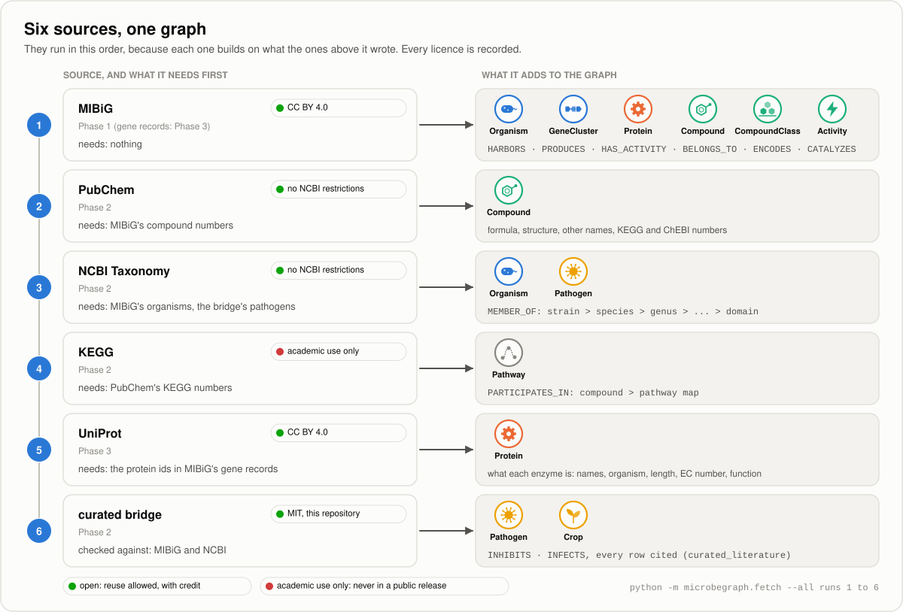
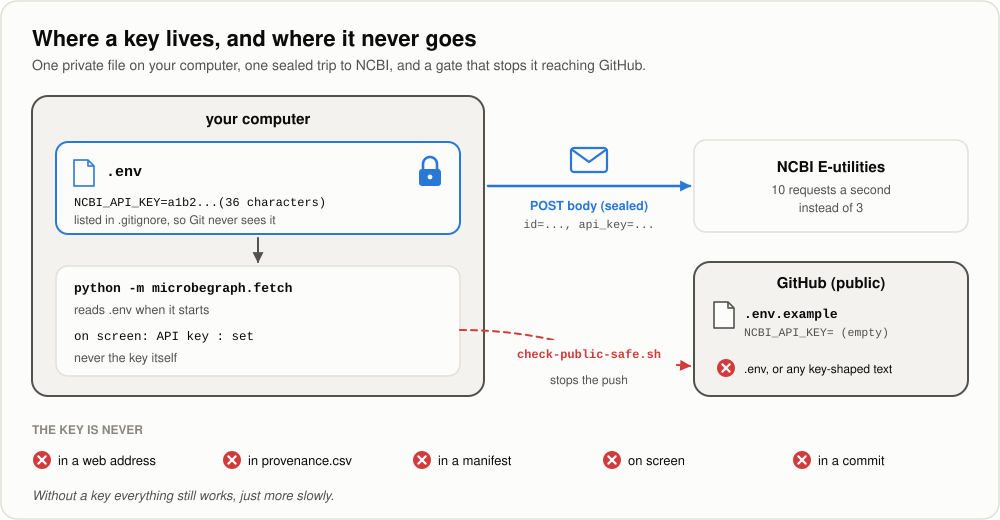
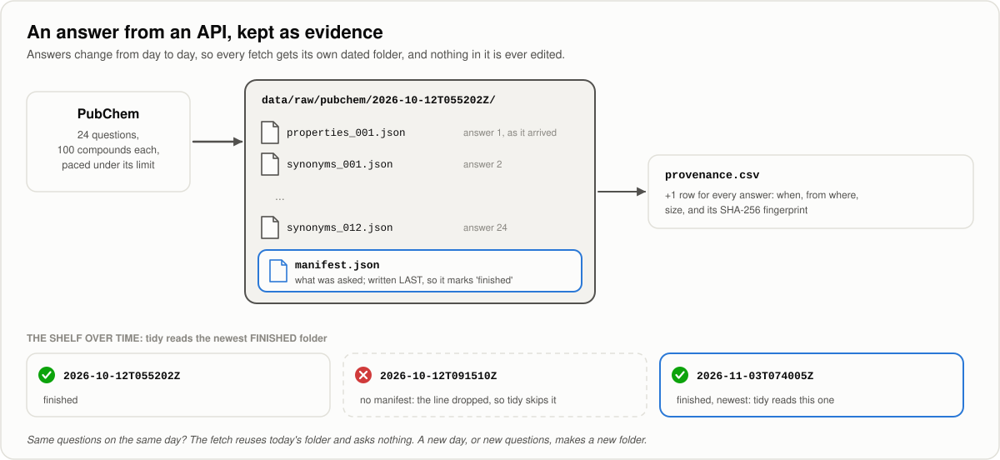
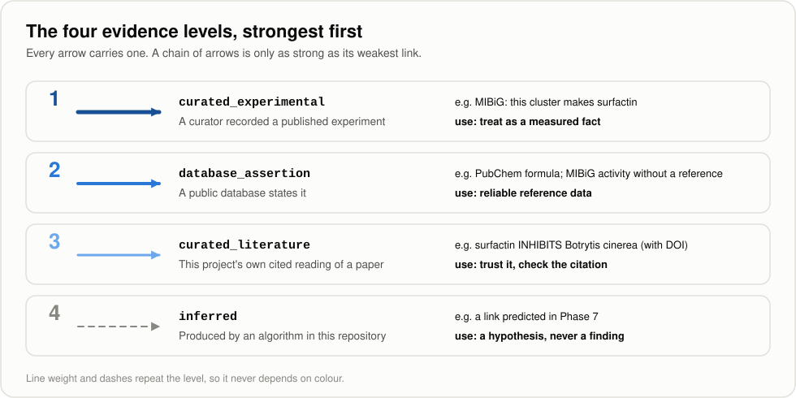

[← Handbook](HANDBOOK.md) · [README](../README.md) · [Glossary](GLOSSARY.md) · [Roadmap](ROADMAP.md) · [Git workflow](GIT-WORKFLOW.md)

# 04. More sources: PubChem, NCBI Taxonomy, KEGG and the cited bridge (Phase 2)

**Prerequisites:** [`03-ingestion-mibig.md`](03-ingestion-mibig.md) finished:
`pytest` passes, and `data/processed/staging/` holds the MIBiG tables from a real
run (`mibig_nodes.csv`, `mibig_edges.csv`, `mibig_summary.json`). It helps to
have [`02-ontology-and-data-model.md`](02-ontology-and-data-model.md), sections 4
to 6, fresh in your mind. No chemistry or biology background is needed.

**Learning goal:** after this phase you will understand how to ask a web API
for data politely (GET and POST requests, speed limits), how to keep an answer
that changes from day to day as evidence (snapshots), what an API key is and how
to keep one out of a public repository (`.env`), why a licence can limit what you
may publish, how sources that build on each other are run in order, and how a
small hand-written table of cited findings joins the graph. You will also have
tests built from real answers captured from each service.

**Time:** about 6-8 hours, in two or three sessions. The real fetch itself takes
a few minutes and brings in a few megabytes.

> Every term here is also in [`GLOSSARY.md`](GLOSSARY.md). Where this guide
> says "see the Handbook", it means [`HANDBOOK.md`](HANDBOOK.md), Stage 5.

---

## Contents

1. [What this phase builds, in one picture](#1-what-this-phase-builds-in-one-picture)
2. [The science: four new sources, in plain words](#2-the-science-four-new-sources-in-plain-words)
3. [The engineering ideas, in plain words](#3-the-engineering-ideas-in-plain-words)
4. [Step 0. Get into position](#4-step-0-get-into-position)
5. [Step 1. Put the new files in place](#5-step-1-put-the-new-files-in-place)
6. [Step 2. Settings and secrets: `settings.py`](#6-step-2-settings-and-secrets-settingspy)
7. [Step 3. Your first API key (optional)](#7-step-3-your-first-api-key-optional)
8. [Step 4. The shared machinery: POST, snapshots and staging](#8-step-4-the-shared-machinery-post-snapshots-and-staging)
9. [Step 5. The PubChem plug](#9-step-5-the-pubchem-plug)
10. [Step 6. The NCBI Taxonomy plug](#10-step-6-the-ncbi-taxonomy-plug)
11. [Step 7. The KEGG plug, and its terms of use](#11-step-7-the-kegg-plug-and-its-terms-of-use)
12. [Step 8. The curated bridge](#12-step-8-the-curated-bridge)
13. [Step 9. Tests built from real answers](#13-step-9-tests-built-from-real-answers)
14. [Step 10. Run it for real](#14-step-10-run-it-for-real)
15. [Step 11. Sources and licences, pictures, the Handbook](#15-step-11-sources-and-licences-pictures-the-handbook)
16. [How evidence and confidence are decided for the new sources](#16-how-evidence-and-confidence-are-decided-for-the-new-sources)
17. [What could go wrong](#17-what-could-go-wrong)
18. [Checkpoint](#18-checkpoint)
19. [Committing this phase](#19-committing-this-phase)

---

## 1. What this phase builds, in one picture



Phase 1 brought in the backbone: which microbe carries which gene cluster, and
which molecule that cluster makes. This phase adds four more sources, and with
them the graph can finally reach a crop:

```
Bacillus velezensis FZB42 --HARBORS--> BGC0000433 --PRODUCES--> surfactin
    --INHIBITS--> Botrytis cinerea --INFECTS--> jujube
```

The first two arrows came from MIBiG in Phase 1. The last two come from the
curated bridge in this phase, each with the DOI of the paper behind it. NCBI
Taxonomy adds the family tree above every microbe (`MEMBER_OF`), PubChem gives
each compound a precise chemical identity, and KEGG says which metabolic
pathways a compound takes part in (`PARTICIPATES_IN`).

The commands are the same three verbs as Phase 1, with new source names:

| Command | What it does | Touches the internet? |
|---|---|---|
| `python -m microbegraph.fetch --list` | Lists the five sources, their homepages and licences | No |
| `python -m microbegraph.fetch --probe` | Asks every source what it has, and checks the bridge | Yes, one small question per service |
| `python -m microbegraph.fetch --all` | Fetches and tidies all five sources, in order | Yes, about 40 requests in all |
| `python -m microbegraph.fetch --source pubchem` | Fetches and tidies one source | Yes, for that source |
| `python -m microbegraph.fetch --tidy-only --all` | Rebuilds every table from what is already on your machine | **No** |

**Files this phase creates or changes** (paths relative to the project folder):

| Path | New or changed | What it is |
|---|---|---|
| `src/microbegraph/settings.py` | new | Reads your private settings (`.env`); a key is only ever shown as "set" or "not set" |
| `src/microbegraph/staging.py` | new | Reads and writes the per-source tables, with the twelve rules checked before writing |
| `src/microbegraph/sources/api.py` | new | What the web-API sources share: snapshots, pacing, reuse on the same day |
| `src/microbegraph/sources/pubchem.py` | new | The PubChem adapter |
| `src/microbegraph/sources/ncbi_taxonomy.py` | new | The NCBI Taxonomy adapter, the one that can use a key |
| `src/microbegraph/sources/kegg.py` | new | The KEGG adapter, with its terms of use |
| `src/microbegraph/sources/curation.py` | new | Reads and checks the curated bridge |
| `src/microbegraph/sources/__init__.py` | changed | Registers the four new sources, in the order they must run |
| `src/microbegraph/sources/base.py` | changed | Adds POST requests; error messages never repeat what a request carried |
| `src/microbegraph/paths.py` | changed | Knows where the bridge file and `.env` live |
| `src/microbegraph/provenance.py` | changed | Notes only: a row is written for every file a fetch saves |
| `src/microbegraph/fetch.py` | changed | Reads `.env` at start; `--list` shows each licence on its own line |
| `curation/compound_pathogen_crop.csv` | changed | Five more columns and the first eight cited rows |
| `curation/README.md` | new | What each column means, the confidence scale, how to add a row |
| `.env.example` | changed | Clearer instructions, including how to get an NCBI key |
| `check-public-safe.sh` | changed | Also catches a key written as `NCBI_API_KEY=...`, in JSON, or in a web address |
| `.gitattributes` | changed | Captured answers in `tests/fixtures/` keep their exact bytes on every system |
| `tests/conftest.py` | changed | The fake server also answers POST requests; helpers for the new tests |
| `tests/fixtures/capture_samples.py` | new | Captures real answers from each service, for the tests |
| `tests/fixtures/README.md` | new | Where every test record came from, with fingerprints |
| `tests/fixtures/pubchem/`, `tests/fixtures/ncbi_taxonomy/`, `tests/fixtures/kegg/` | new | Ten real answers captured on 2026-10-12 |
| `tests/test_pubchem.py`, `tests/test_ncbi_taxonomy.py`, `tests/test_kegg.py`, `tests/test_curation.py`, `tests/test_settings.py` | new | The promises the new code makes |
| `docs/04-more-sources-secrets.md` | new | This guide |
| `docs/img/sources_map.svg`, `docs/img/secrets_env.svg`, `docs/img/api_snapshot.svg` | new | Three new pictures, drawn by `make_illustrations.py` |
| `docs/img/make_illustrations.py`, `docs/interactive/make_interactive.py` and the files they draw | changed | The new pictures; the worked example moves to jujube |
| `docs/01-setup.md` | changed | Its copies of `.env.example` and the safety gate match the new versions |
| `README.md`, `CHANGELOG.md`, `docs/HANDBOOK.md`, `docs/ROADMAP.md`, `docs/GLOSSARY.md`, `docs/GIT-WORKFLOW.md`, `docs/00-architecture.md`, `docs/02-ontology-and-data-model.md`, `docs/03-ingestion-mibig.md`, `docs/PRIOR-ART.md`, `docs/phases.csv` | changed | Updated for this phase |

**Files this phase writes on your computer that never go to GitHub:**

| Path | What it is |
|---|---|
| `.env` | Your private settings, if you make one in Step 3 |
| `data/raw/pubchem/<moment>/` | PubChem's answers from one fetch, plus `manifest.json` |
| `data/raw/ncbi_taxonomy/<moment>/` | NCBI's answers from one fetch, plus `manifest.json` |
| `data/raw/kegg/<moment>/` | KEGG's four answers, plus `manifest.json` |
| `data/raw/provenance.csv` | Gains one row for every answer saved |
| `data/processed/staging/<source>_nodes.csv`, `_edges.csv`, `_summary.json` | One set per source: `pubchem`, `ncbi_taxonomy`, `kegg`, `curation` |
| `data/samples/<date>/` | Answers captured by `capture_samples.py`, if you run it |

`<moment>` is the time the fetch started, in UTC, written without colons, for
example `2026-10-12T055202Z`. Section 3 explains why.

---

## 2. The science: four new sources, in plain words

### PubChem: one identity per molecule

PubChem is the largest free chemistry database in the world, run by the US
National Library of Medicine. Every distinct chemical structure gets a number,
its **CID** (compound identifier), and a page of facts: its formula, its weight,
its structure written as a line of text, and the many names it goes by.

Molecules collect names the way old towns do. Itaconic acid is also
"methylenesuccinic acid", "2-methylidenebutanedioic acid" and about ninety
other things. PubChem's CID is the one name that never changes, and its list of
synonyms is how this project will later recognise the same molecule written
differently (Phase 4).

**What this project asks it:** MIBiG records a CID for 1,176 of the 3,842
compounds in its tables. The PubChem adapter asks about exactly those, and also
reads, from each compound's synonyms, its number in two other databases: KEGG
(`C00490` for itaconic acid) and ChEBI (`CHEBI:30838`). The KEGG number is what
lets the KEGG adapter place the compound on a pathway map.

### NCBI Taxonomy: the family tree

NCBI Taxonomy, kept by the US National Center for Biotechnology Information, is
the family tree of every organism that has DNA sequences in the public
databases. Each organism, and each group above it, has a number, its **taxid**:

```
Bacillus velezensis FZB42     326423   (a strain)
  Bacillus velezensis         492670   (its species)
    Bacillus                  1386     (its genus)
      Bacillaceae             186817   (its family)
        ...
          Bacteria            2        (its domain)
```

Each line is called a **rank**. If you've ever read a postal address from the
bottom up (house, street, town, region, country), you've already climbed a
ladder like this one: each line is a bigger group that contains the one above.

**Here, it's asked for** the full record of every organism MIBiG names
(1,480 taxids) and of every pathogen in the curated bridge. With the family tree
in the graph, "every gene cluster from any *Bacillus*" becomes one question,
however each species was spelled.

**Worth knowing before you read the data:** NCBI renamed some ranks in 2025.
The top rank, once "superkingdom", is now "domain" (Bacteria, Archaea,
Eukaryota), and bacteria gained a real "kingdom" rank (*Bacillus* is in the
kingdom *Bacillati*). That's why this project's own broad label (Bacteria, Fungi,
Oomycetes, Plants...) is called `group` rather than "kingdom".

### KEGG: the maps of metabolism

KEGG (the Kyoto Encyclopedia of Genes and Genomes) is a set of hand-drawn maps
of the chemistry inside living cells, made by Kanehisa Laboratories in Japan
since 1995. Its pathway maps each show a chain of reactions, such as
"Glycolysis" (`map00010`) or "C5-Branched dibasic acid metabolism" (`map00660`),
with the compounds along the way.

A city's bus map works a bit like this: each line (a pathway) passes through
named stops (compounds), and two stops on the same line are related even if they
look nothing alike. That's the extra context KEGG gives the graph.

**In this project,** the adapter downloads four whole lists (when KEGG was
updated, every map, every compound-to-map link, and how the maps are grouped),
so it can link each compound that has a KEGG number to the maps it appears on.

**KEGG is not open data,** and section 11 explains what that means for this
project.

### The curated bridge: the link no database publishes

None of the sources above can say "this molecule protects this crop from this
disease". That link lives in the text of scientific papers. So the project keeps
its own small table of findings, read from papers one at a time, each row with
the paper's DOI:

```
curation/compound_pathogen_crop.csv
```

The first eight rows cover seven compounds, six pathogens and five crops (melon,
wheat, maize, cotton and jujube), from six papers. Each row becomes two arrows:
the compound `INHIBITS` the pathogen, and the pathogen `INFECTS` the crop, both
at evidence level `curated_literature`. [`curation/README.md`](../curation/README.md)
lists every column and explains how to add a row.

### The worked example: surfactin, grey mould and jujube

Phase 1 met surfactin, the soap-like molecule made by *Bacillus velezensis*
FZB42. This phase finishes its chain.

*Botrytis cinerea* causes grey mould, which rots many fruits after harvest.
Xiao and colleagues (2023, *AMB Express*, `doi:10.1186/s13568-023-01543-w`)
tested surfactin of over 98% purity against it: it slowed the fungus in the
laboratory (half the growth was stopped at about 46 mg per litre after five days)
and reduced grey mould on harvested winter jujube, a fruit grown widely in
China. That is one row of the bridge, and it gives the chain its last two arrows.

The paper tested the molecule, not the strain, so the arrow is about surfactin.
Whether FZB42 makes enough of it on real fruit is a separate question, and the
graph doesn't claim to answer it. [`02-ontology-and-data-model.md`, section 10](02-ontology-and-data-model.md#10-a-worked-example-one-chain-end-to-end)
walks the whole chain step by step.

---

## 3. The engineering ideas, in plain words

### Asking an API, instead of downloading a file

MIBiG publishes one file per release: you download it, check its fingerprint
against the one the publisher lists, and you're done. PubChem, NCBI and KEGG
work differently. There's no single file. You send a question to a web address
and get an answer back, which is what an **API** (application programming
interface) is: a service desk for programs.

The answers have no release number and can change any day, as records are
added or corrected. That changes how the evidence is kept (see *Snapshots*
below).

### GET and POST

There are two common ways to ask a web server something.

* A **GET** request puts everything in the web address itself:
  `https://rest.kegg.jp/list/pathway`. It's like a postcard, where anything you
  write is on the outside for everyone handling it to read.
* A **POST** request sends the details in a separate part called the **body**,
  inside the request. It's more like a sealed envelope.

This project uses POST for two reasons. A list of 200 numbers is too long for a
web address, and an API key in the body never appears in an error message, a
log or a browser history, whereas a key in a web address can turn up in all
three.

### Speed limits and the traffic light

Each service publishes how fast you may ask: PubChem at most 5 requests a second
(and 400 a minute), NCBI 3 a second without a key and 10 with one, KEGG 3 a
second. Ask faster and you get refused, or blocked for a while.

Every adapter waits a little between requests to stay well inside its limit.
PubChem also adds a traffic light to every answer, in a header called
`X-Throttling-Control`: Green, Yellow, Red or Black. The PubChem adapter slows
down when the light changes, the way you ease off the accelerator at an amber
light.

### API keys, and why they're secrets

An **API key** is a long code a service gives you so it can recognise your
requests. NCBI's is free and optional; it raises your limit from 3 requests a
second to 10.

A key is tied to your account, so it works like a library card with your name
on it: anyone holding it can borrow in your name. Once a key has been published
on GitHub, it has to be treated as public forever, because copies of a
repository spread and can't be recalled.

### Environment variables and the `.env` file

Programs read private settings from **environment variables**: named values your
computer hands to a program when it starts, outside the program's own files. A
**`.env` file** is a simple way to keep them in one place: a text file in the
project folder, one `NAME=value` per line.

The safety comes from three things working together:

1. `.env` is listed in `.gitignore` (since [`01-setup.md`, Step 9](01-setup.md#11-step-9-protect-your-secrets-before-you-have-any)),
   so Git never sees it.
2. The repository holds `.env.example` instead: the same names, every value
   empty. A newcomer can see which settings exist without seeing anyone's.
3. `check-public-safe.sh` refuses a push if `.env`, or anything shaped like a
   key, is about to be published.



### Snapshots: keeping an answer that changes

A departure board at a station changes every minute. If you need to prove what
it said at 9:14, you photograph it and write the time on the photo. That's what
the API adapters do.

Every fetch from PubChem, NCBI or KEGG creates one new folder in the evidence
locker, named after the moment the fetch started:



* Every answer is saved exactly as it arrived, and gets its own row in
  `data/raw/provenance.csv` with its size and fingerprints. The service doesn't
  publish a checksum, so these fingerprints are ours: they prove the file in the
  locker is the answer that arrived.
* `manifest.json` lists what was asked and is written **last**. A folder without
  one is a fetch that stopped halfway (a dropped connection, say). `tidy()`
  ignores it, and `--probe` points it out.
* `tidy()` reads the newest finished folder. Older ones stay, so two of them
  can be compared to see what changed at the source.
* Run the same fetch twice on the same day (UTC) and the second run reuses the
  first folder without asking the service anything. A new day, or a different
  set of questions, makes a new folder.

The folder names contain no colons (`2026-10-12T055202Z`, not
`2026-10-12T05:52:02Z`) because Windows doesn't allow colons in folder names.

### Sources that build on each other

From this phase on, some sources need another source's tables before they can
start:

| Source | Needs first | Why |
|---|---|---|
| `pubchem` | `mibig` | It asks about the CIDs MIBiG recorded |
| `ncbi_taxonomy` | `mibig` and the bridge file | It asks about MIBiG's organisms and the bridge's pathogens |
| `kegg` | `pubchem` | It links the KEGG numbers PubChem found |
| `curation` | `mibig` (and `ncbi_taxonomy`, if present) | It checks every compound against MIBiG and every pathogen's name against NCBI |

So the order matters, and `--all` follows the order listed in
`src/microbegraph/sources/__init__.py`. If a table a source needs is missing, the
message names the command that makes it.

### Licences are part of the data

Every source says what you may do with its data, and those terms travel with
the data. This project writes each source's terms into every provenance row, and
the README lists them all. Three of the five are open (MIBiG is CC BY 4.0; NCBI
places no restrictions on PubChem and Taxonomy data, although some PubChem
depositors add terms of their own; the bridge is this repository's own, under
MIT). KEGG is the exception, covered in section 11.

### Test records cut from real answers

Phase 1 taught this project the same lesson twice. Test records written by hand
from documentation drift away from what a server really sends: the MIBiG archive
turned out not to be gzip-compressed, and activity names came in a second style
that no documentation mentioned. Both times every test had passed.

So every Phase 2 test record is a real answer, captured once by a small script
and kept byte for byte. Section 13 shows how.

---

## 4. Step 0. Get into position

1. Open your terminal and go to the project folder:

   ```bash
   cd ~/projects/microbegraph      # or wherever you cloned it
   ```

   Windows PowerShell: `cd $HOME\projects\microbegraph`
2. Make sure you're on the working branch and up to date:

   ```bash
   git switch develop
   git pull --ff-only origin develop
   ```

3. Activate the toolbox:

   ```bash
   source .venv/bin/activate          # macOS / Linux / RHEL 8
   ```

   Windows PowerShell: `.\.venv\Scripts\Activate.ps1`
4. Check that Phase 1's tables are there, because three of the new sources
   build on them:

   ```bash
   ls data/processed/staging
   ```

   Windows PowerShell: `dir data\processed\staging`. You should see
   `mibig_edges.csv`, `mibig_nodes.csv` and `mibig_summary.json`. If not, run
   `python -m microbegraph.fetch --source mibig` first
   ([`03-ingestion-mibig.md`, Step 8](03-ingestion-mibig.md#12-step-8-run-it-for-real)).

✅ **Checkpoint.** Your prompt starts with `(.venv)`, `git branch` shows
`* develop`, and the three MIBiG files exist.

---

## 5. Step 1. Put the new files in place

If you cloned the repository after this phase was committed, every file is
already there and you can read along. If you're building it yourself, put each
file from the table in section 1 at the path shown. Some notes:

1. **No new packages are needed.** `requests`, `tenacity` and `python-dotenv`
   were installed in Phase 0 from `requirements.txt`. Check the one this phase
   uses for the first time:

   ```bash
   python -c "import dotenv; print('python-dotenv is installed')"
   ```

   Expected: `python-dotenv is installed`. If it says `ModuleNotFoundError`, run
   `pip install -r requirements.txt` again.
2. **No reinstall is needed either.** The package was installed in editable
   mode in Phase 1 (`pip install -e .`), so Python already reads the new files
   from `src/microbegraph/`.
3. **Check the five sources are registered:**

   ```bash
   python -m microbegraph.fetch --list
   ```

   ```
     mibig          https://mibig.secondarymetabolites.org
                    licence: CC-BY-4.0
     pubchem        https://pubchem.ncbi.nlm.nih.gov
                    licence: NCBI: no restrictions; some depositors add their own terms
     ncbi_taxonomy  https://www.ncbi.nlm.nih.gov/taxonomy
                    licence: NCBI: no restrictions
     kegg           https://www.kegg.jp
                    licence: KEGG: academic use only (kegg.jp/kegg/legal.html)
     curation       curation/compound_pathogen_crop.csv
                    licence: MIT (this repository)
   ```

✅ **Checkpoint.** `--list` shows five sources in that order. (From Phase 3 it
shows six: `uniprot` arrives between `kegg` and `curation`.)

---

## 6. Step 2. Settings and secrets: `settings.py`

[`src/microbegraph/settings.py`](../src/microbegraph/settings.py) is short, and
it sets three rules the whole project follows:

1. **Keys are read from `.env`, or from the environment, and nowhere else.**
   Never type a key into a `.py` file, a notebook or a document.
2. **A key is never printed, logged or put in a web address.** It travels inside
   the POST body. On screen, the program only ever says whether a key is `set`
   or `not set`.
3. **Everything works without a key.** A missing key means slower fetching,
   never a broken project.

The functions:

| Function | Does |
|---|---|
| `load_settings()` | Reads `.env` into the environment, if the file exists. A setting already in the environment wins over the file, so a scheduled job (Phase 12) can supply its own values without editing `.env` |
| `setting(name)` | One setting, with stray spaces and quotes removed, or `""` if it isn't set |
| `describe(value)` | How a secret appears on screen: `set` or `not set`, never the value |
| `ncbi_api_key()`, `ncbi_email()` | The two settings this phase uses |

[`src/microbegraph/fetch.py`](../src/microbegraph/fetch.py) calls
`load_settings()` before anything else, so every source sees the same settings.

> **Why a function that only ever says "set"?** Keys rarely leak because
> someone publishes one on purpose. More often a helpful debugging line,
> `print(api_key)`, ends up in a screenshot, a pasted error message or a log
> file. If the program has no way to print a key, that can't happen.

---

## 7. Step 3. Your first API key (optional)

You can skip this step: without a key, the NCBI fetch takes a few seconds longer
and nothing else changes. But it's the safest moment to learn how keys are
handled, while nothing depends on one.

1. **Make your private settings file** from the template:

   ```bash
   cp .env.example .env
   ```

   Windows PowerShell: `Copy-Item .env.example .env`
2. **Check that Git ignores it.** This must print the rule that does it:

   ```bash
   git check-ignore -v .env
   ```

   ```
   .gitignore:6:.env	.env
   ```

   If it prints nothing, **stop**: `.gitignore` is missing its secrets section.
   Go back to [`01-setup.md`, Step 9](01-setup.md#11-step-9-protect-your-secrets-before-you-have-any).
3. **Get a key from NCBI.**
   1. Sign in at <https://www.ncbi.nlm.nih.gov/> (create a free account if you
      don't have one).
   2. Click your user name at the top right, then **Account settings**.
   3. Scroll to **API Key Management** and click **Create an API Key**.
   4. Copy the key it shows: 36 letters and digits.
4. **Put the key in `.env`.** Open the file in VS Code:

   ```bash
   code .env
   ```

   Find the line `NCBI_API_KEY=` and paste your key straight after the `=`, with
   no spaces and no quotes. Optionally, put your email address after
   `NCBI_EMAIL=`: NCBI asks programs to say who to contact if they misbehave.
   Save the file.
5. **Check the program sees it, without showing it:**

   ```bash
   python -m microbegraph.fetch --probe --source ncbi_taxonomy
   ```

   Among the lines, you should see:

   ```
     API key        : set (10 requests a second)
     contact email  : set
   ```

   The key itself never appears.
6. **Check Git still can't see it:**

   ```bash
   git status --short
   ```

   `.env` must **not** be in the list. (`.env.example` may be, if you're building
   this phase yourself, because it changed.)

**If a key is ever published by mistake** (pushed to GitHub, pasted into a chat,
shown in a screenshot), treat it as public at once:

1. Go back to NCBI's **API Key Management** and replace the key. An NCBI
   account holds one key at a time.
2. Put the new key in `.env`.
3. If it was pushed, removing it from the repository afterwards is not enough,
   because copies may already exist. Replacing it is what makes the old one
   worthless.

✅ **Checkpoint.** Either you have no `.env` (and the probe says `not set`), or
the probe says `set` and `git status` doesn't list `.env`.

---

## 8. Step 4. The shared machinery: POST, snapshots and staging

Three files hold what the new adapters share, so each adapter stays short.

**[`src/microbegraph/sources/base.py`](../src/microbegraph/sources/base.py)** gains
`http_post()`, with the same retry rules as `http_get()` from Phase 1: temporary
trouble (429, 5xx, a dropped line) is retried with growing waits, and a clear
refusal is reported at once. `http_get()` can now take query parameters too. Both
report a refusal by naming the web address **without** anything that was sent
with it, so an error message can never repeat a list of identifiers or a key.

**[`src/microbegraph/sources/api.py`](../src/microbegraph/sources/api.py)** is the
snapshot machinery from section 3, as code:

| Piece | Does |
|---|---|
| `ApiSource` | The parent class of the three web adapters. Adds `pause()`, the list of finished and unfinished snapshots, and `reuse_today()` |
| `Snapshot.save()` | Writes one answer to `<name>.part`, renames it into place, and logs its provenance row |
| `Snapshot.finish()` | Writes `manifest.json` last, which marks the fetch as complete |
| `latest_snapshot()` | The newest finished folder, or a message saying which fetch to run |

A snapshot folder is only created when the first answer arrives, so a fetch
that fails on its very first request (no internet, say) leaves nothing behind.

**[`src/microbegraph/staging.py`](../src/microbegraph/staging.py)** reads another
source's tables (with a clear message if they're missing) and writes a source's
own tables. `write_tables()` runs the twelve rules from
[`validate.py`](../src/microbegraph/validate.py) first and writes nothing if any
rule fails, exactly as MIBiG's tidy does. For sources whose arrows start or end
at another source's nodes (KEGG's arrows start at PubChem's compounds), it is
told which outside nodes to expect.

---

## 9. Step 5. The PubChem plug

[`src/microbegraph/sources/pubchem.py`](../src/microbegraph/sources/pubchem.py).

**probe()** asks PubChem one safe question (the title of CID 2519, caffeine),
reports the traffic light, counts the CIDs in MIBiG's tables, and describes the
locker.

**fetch()** reads the CIDs from `mibig_nodes.csv`, sorts them by number, and
sends them 100 at a time, twice per batch:

```
POST https://pubchem.ncbi.nlm.nih.gov/rest/pug/compound/cid/property/Title,MolecularFormula,MolecularWeight,MonoisotopicMass,IUPACName,InChIKey,SMILES,ConnectivitySMILES/JSON
POST https://pubchem.ncbi.nlm.nih.gov/rest/pug/compound/cid/synonyms/JSON
     body: cid=811,5281917,16132390,...
```

The answers are saved as `properties_001.json`, `synonyms_001.json`, and so on.
If PubChem sends a fault message instead of an answer, the file is still saved
and logged (it's evidence of what happened), and then the fetch stops with
PubChem's own explanation. Carrying on would make every compound in that batch
look unknown.

**tidy()** turns each compound PubChem knows into one node:

| Node | Identifier | Properties |
|---|---|---|
| `Compound` | `pubchem.compound:<CID>` | `formula`, `molecular_weight`, `monoisotopic_mass`, `iupac_name`, `inchikey`, `smiles`, `connectivity_smiles`, the first 20 `synonyms`, `kegg_compound_ids`, `kegg_drug_ids`, `chebi_ids`, and `mibig_compound_ids` |

It writes no arrows. The arrows to these compounds come from KEGG (this phase)
and from joining them to MIBiG's compounds (Phase 4), which is what
`mibig_compound_ids` is kept for.

A CID PubChem doesn't know comes back holding nothing but its own number. It's
counted (`cids_not_in_pubchem`) and listed in `pubchem_summary.json`, and never
becomes an empty node. The first real run had five of them out of 1,176; Phase 4
looks at those five MIBiG records more closely instead of guessing.

---

## 10. Step 6. The NCBI Taxonomy plug

[`src/microbegraph/sources/ncbi_taxonomy.py`](../src/microbegraph/sources/ncbi_taxonomy.py).

NCBI's API is called **E-utilities**. Two of its programs are used:

| Program | Asked how | Returns |
|---|---|---|
| `einfo` | One GET, no key | Facts about the database: its build number, size and last update |
| `efetch` | POST, 200 taxids at a time | The full record of each taxon, as XML |

Every `efetch` request carries `tool=microbegraph`, so NCBI knows which program
is asking, plus your email and key if `.env` has them, **in the POST body
only**. The adapter waits 0.34 seconds between requests without a key (just
under 3 a second) and 0.11 seconds with one (just under 10).

The manifest records which taxids each request asked about, and only whether a
key and an email were sent:

```json
"sent": {"db": "taxonomy", "retmode": "xml", "tool": "microbegraph",
         "id": ["33", "..."], "email": "set", "api_key": "set"}
```

**tidy()** reads every XML answer and builds the family tree:

| Nodes and arrows | What they are |
|---|---|
| `Organism` `ncbitaxon:<taxid>` | Each MIBiG organism, with `rank`, `lineage`, `group`, `division`, `synonyms` |
| `Organism` `ncbitaxon:<taxid>` | Its ancestors at the main ranks only: species, genus, family, order, class, phylum, kingdom, domain |
| `Pathogen` `ncbitaxon:<taxid>` | Each bridge pathogen, with the same properties |
| `MEMBER_OF` | Child to parent, one step at a time, at `database_assertion` |

Ranks in between ("species group", "clade", "suborder"...) stay in the lineage
text but get no node, which keeps the tree readable.

Three situations are handled on purpose, and each one is counted:

* **A merged taxid.** NCBI sometimes merges two numbers into one. Asking about
  the old one returns the record under the new one, listing the old one as
  "also known as". The node gets the new number and remembers the old one in
  `merged_from`, and `ncbi_taxonomy_summary.json` lists every merge.
* **A deleted taxid.** It comes back with nothing. It's listed under
  `taxids_not_found`.
* **A pathogen that is also a producer.** *Botrytis cinerea*, for example, makes
  molecules that MIBiG records and also causes grey mould. If a bridge
  pathogen's taxid is already an `Organism` (a MIBiG organism, or the species
  above one), it stays an `Organism` here and is counted under
  `pathogens_also_organisms`. The first real run found two: *Botrytis cinerea*
  and *Fusarium graminearum*. Phase 4 decides how one node carries both roles,
  as [`02-ontology-and-data-model.md`, section 4](02-ontology-and-data-model.md#7-pathogen)
  planned.

---

## 11. Step 7. The KEGG plug, and its terms of use

[`src/microbegraph/sources/kegg.py`](../src/microbegraph/sources/kegg.py).

KEGG's API is plain text. The adapter asks four questions, waiting 0.4 seconds
between them:

| Question | Saved as | What it is |
|---|---|---|
| `/info/kegg` | `info_kegg.txt` | When each part of KEGG was last updated |
| `/list/pathway` | `list_pathway.txt` | Every pathway map: number and name |
| `/link/pathway/compound` | `link_pathway_compound.txt` | Every compound-to-map link, one per line |
| `/get/br:br08901` | `pathway_categories.txt` | The categories the maps are filed under |

**tidy()** reads PubChem's tables to find which of our compounds have a KEGG
number, then follows the links:

```
pubchem.compound:811 (itaconic acid, KEGG C00490)
    --PARTICIPATES_IN--> kegg.pathway:map00660 (C5-Branched dibasic acid metabolism)
```

It writes a `Pathway` node only for maps actually used, with KEGG's `category`
and `subcategory`. Two kinds of map are left out and counted
(`links_to_overview_maps_skipped`): "Global and overview maps" such as `map01100`
("Metabolic pathways", which draws nearly every compound KEGG has), and
"Chemical structure transformation maps". Both are maps of other maps, so an
arrow to one says almost nothing about a particular compound.

**The terms of use.** KEGG is not open data. In Kanehisa Laboratories' own words,
"KEGG API is provided for academic use by academic users belonging to academic
institutions", and "Non-academic use of KEGG requires a commercial license". The
API page also asks for no more than 3 calls a second, or access is blocked, and
academic users who provide services using KEGG are asked to obtain a licence for
that too ([kegg.jp/kegg/legal.html](https://www.kegg.jp/kegg/legal.html)). So
this project:

* fetches KEGG only on your own machine, for study (`data/` never goes to
  GitHub), under 3 requests a second;
* keeps KEGG rows out of the public app and the public data release in Phase 9,
  which publish only openly licensed data;
* writes the terms into every KEGG provenance row and into the summary.

**If you aren't an academic user,** leave KEGG out: instead of `--all`, run the
other sources by name (section 14 shows how). Nothing else depends on KEGG.

---

## 12. Step 8. The curated bridge

[`src/microbegraph/sources/curation.py`](../src/microbegraph/sources/curation.py)
reads [`curation/compound_pathogen_crop.csv`](../curation/compound_pathogen_crop.csv).

**Why it's in the repository and not in `data/`:** every other source is
downloaded, so it can be rebuilt. The bridge is written by hand, so it can't be
rebuilt from anywhere; it *is* the original. It's committed to Git, and Git's
history is its provenance log. That's also why its `fetch()` downloads nothing
and just says so.

**The columns** grew from ten (Phase 0) to fifteen. The five new ones are
`pathogen_type`, `disease`, `crop_scientific_name`, `crop_category` and
`added_on`. [`curation/README.md`](../curation/README.md) describes every column.

**The first eight rows:**

| Compound | Pathogen (NCBI taxid) | Disease, crop | Paper | Confidence |
|---|---|---|---|---|
| iturin | *Podosphaera fusca* (62727) | powdery mildew, melon | Romero et al. 2007 | 0.80 |
| fengycin | *Podosphaera fusca* (62727) | powdery mildew, melon | Romero et al. 2007 | 0.80 |
| bacillomycin D | *Fusarium graminearum* (5518) | Fusarium head blight, wheat | Gu et al. 2017 | 0.90 |
| bacillomycin D | *Fusarium graminearum* (5518) | Gibberella ear rot, maize | Gu et al. 2017 | 0.80 |
| 2,4-diacetylphloroglucinol | *Gaeumannomyces tritici* (36779) | take-all, wheat | Keel et al. 1992 | 0.80 |
| pyrrolnitrin | *Rhizoctonia solani* (456999) | damping-off, cotton | Hill et al. 1994 | 0.80 |
| pyoluteorin | *Globisporangium ultimum* (2052682) | damping-off, cotton | Howell and Stipanovic 1980 | 0.85 |
| surfactin | *Botrytis cinerea* (40559) | grey mould, jujube | Xiao et al. 2023 | 0.90 |

Three pathogens appear under the name NCBI uses today, which differs from the
paper's: *Podosphaera fusca* (also called *P. xanthii*), *Gaeumannomyces tritici*
(the paper says *G. graminis* var. *tritici*) and *Globisporangium ultimum* (the
paper says *Pythium ultimum*). The notes column of each row says so.

**The thirteen checks.** Before anything is written, every row must pass each
of these, and a failure names the line:

| # | Check |
|---|---|
| 1 | The columns are exactly the fifteen expected, in order |
| 2 | Every column except `notes` is filled in |
| 3 | `relationship` is `INHIBITS` |
| 4 | The compound exists in MIBiG's tables, under that exact identifier |
| 5 | The pathogen is `ncbitaxon:<digits>` |
| 6 | `pathogen_type` is one of the allowed words |
| 7 | `crop_curie` is `mg.crop:` plus the crop name, lowercase and hyphenated |
| 8 | `crop_category` is one of the allowed words |
| 9 | `citation` is `doi:10.<...>` or `pmid:<digits>` |
| 10 | `confidence` is a number from 0 to 1 |
| 11 | `added_on` is a real date written `YYYY-MM-DD` |
| 12 | No two rows describe the same compound, pathogen and crop |
| 13 | Once NCBI Taxonomy has been tidied: the pathogen exists there, under that exact name, and its type matches NCBI's group |

**What tidy() writes:** `Pathogen` nodes (with `pathogen_type` and `diseases`,
for example `grey mould (jujube)`), `Crop` nodes (with `scientific_name` and
`category`), and the `INHIBITS` and `INFECTS` arrows, all at
`curated_literature` with the row's citation and confidence. Rows that share an
arrow become one arrow: bacillomycin D against *F. graminearum* appears on two
rows (wheat and maize) but is one `INHIBITS` arrow, keeping both rows' citations,
the higher confidence and the earlier date.

---

## 13. Step 9. Tests built from real answers

1. **Where the test records came from.** Before any adapter was written, the
   script [`tests/fixtures/capture_samples.py`](../tests/fixtures/capture_samples.py)
   asked each service a few small questions (fourteen requests, one a second,
   no key) and saved the answers exactly as they arrived, in
   `data/samples/<date>/`. Ten of those answers are now the test records in
   `tests/fixtures/pubchem/`, `tests/fixtures/ncbi_taxonomy/` and
   `tests/fixtures/kegg/`.
   [`tests/fixtures/README.md`](../tests/fixtures/README.md) lists each one with
   the question that produced it and its fingerprint, so anyone can check
   nothing was edited. The only cut-down file is KEGG's 19,689-line link list:
   its first 40 lines and every line for two compounds are kept, exactly as they
   arrived.

   They include the awkward cases on purpose: a CID PubChem doesn't know, a
   compound with properties but no other names, a taxid NCBI merged into
   another, and one NCBI deleted.
2. **The fake server, grown up.** [`tests/conftest.py`](../tests/conftest.py)'s
   `FakeSession` now answers POST requests as well as GET, and records what
   each request carried, which is how a test proves a key never travelled in a
   web address. The tests also never read your real `.env`: a key you keep
   there can't end up inside a test run. The key-handling tests use a made-up
   key in a temporary file.
3. **Run the tests:**

   ```bash
   pytest
   ```

   ```
   ........................................................................ [ 50%]
   ........................................................................ [100%]
   144 passed in 0.8s
   ```

   (The time varies by computer. Phase 3 adds 39 more tests, for 183 in all.)
4. **Run the style checker:**

   ```bash
   ruff check .
   ```

   Expected: `All checks passed!`

**What the new tests promise:**

* every answer is saved byte for byte, with a manifest written last and a
  provenance row per answer;
* the same questions on the same day ask the service nothing; different
  questions make a new snapshot;
* a fetch that fails on its first request leaves no empty folder, and tidy
  ignores an unfinished one;
* PubChem's traffic light slows the fetch down, and a fault instead of an answer
  stops it after logging it;
* a CID PubChem doesn't know never becomes a node;
* the family tree climbs one rank at a time and skips the in-between ranks;
* merged and deleted taxids are handled and counted;
* a pathogen that is also an organism stays an organism, and is counted;
* **the key travels only in the POST body**: never in a web address, a query, a
  provenance row, a manifest, an error message or on screen;
* KEGG's overview maps are left out, and a garbled KEGG answer is refused;
* **the real bridge file passes all thirteen checks against real NCBI answers**,
  and each check catches the mistake it exists for;
* settings come from `.env`, the environment wins over the file, and a secret is
  only ever described as `set` or `not set`.

✅ **Checkpoint.** `pytest` ends with `passed` and no `failed`; `ruff check .`
says `All checks passed!`.

---

## 14. Step 10. Run it for real

This is the step that uses the internet. It asks PubChem about 24 questions,
NCBI 9 and KEGG 4.

1. **Probe everything.** Nothing is downloaded:

   ```bash
   python -m microbegraph.fetch --probe
   ```

   The MIBiG part is the same as in Phase 1, except that it now finds the
   archive in your locker (`in your locker : yes, 9.5 MB, verified`). This is
   the real output of the new parts from a run on 2026-10-12, with an NCBI key
   in `.env`. NCBI's build, size and date, and KEGG's release dates, will be
   newer on your run:

   ```
   [pubchem] probe
     service        : answering (test question: CID 2519 is Caffeine)
     traffic light  : Green
     version        : live database, no release numbers
     to ask about   : 1,176 CIDs from MIBiG, 24 requests
     in your locker : nothing yet (run the fetch)
   [ncbi_taxonomy] probe
     database build : Build261011-2030.1
     taxa           : 3,156,382
     last update    : 2026/10/11 21:07
     API key        : set (10 requests a second)
     contact email  : set
     to ask about   : 1,480 organisms from MIBiG and 6 pathogens from the bridge, 9 requests
     in your locker : nothing yet (run the fetch)
   [kegg] probe
     release        : pathway 2026/10/09, compound 2026/10/09
     terms of use   : academic use only, see https://www.kegg.jp/kegg/legal.html
     public release : KEGG rows are kept out of it (ROADMAP, Phase 9)
     to ask about   : 4 requests, whole lists
     in your locker : nothing yet (run the fetch)
   [curation] probe
     file           : curation/compound_pathogen_crop.csv
     rows           : 8
     covers         : 7 compounds, 6 pathogens, 5 crops, 6 papers
     checks         : every row passes checks 1 to 12 (check 13 waits for NCBI Taxonomy)
   ```

   Without a key, the two NCBI lines say `API key        : not set (3 requests a
   second)` and `contact email  : not set`.
2. **Fetch and tidy all five sources, in order:**

   ```bash
   python -m microbegraph.fetch --all
   ```

   **Not an academic user?** Leave KEGG out by naming the others instead:

   ```bash
   python -m microbegraph.fetch --source mibig --source pubchem --source ncbi_taxonomy --source curation
   ```

   MIBiG goes first, finds its archive already in the locker, and tidies it
   again (the same counts as in Phase 1). Then each new source prints its
   progress and its counts. This is the real output from the run on 2026-10-12,
   shortened where it says `...`. The folder names are the time each fetch
   started, so yours will differ. PubChem, NCBI and KEGG are live databases, so
   your counts may differ slightly too; the sanity checks below the output tell
   you whether they make sense:

   ```
   [pubchem] fetch
     [pubchem] asking about 1,176 CIDs in 12 batches of up to 100
     [pubchem] data/raw/pubchem/2026-10-12T071614Z/properties_001.json
     [pubchem] data/raw/pubchem/2026-10-12T071614Z/synonyms_001.json
     ...
     [pubchem] data/raw/pubchem/2026-10-12T071614Z/properties_008.json
     [pubchem] attempt 1 of 5 failed (https://pubchem.ncbi.nlm.nih.gov/rest/pug/compound/cid/synonyms/JSON answered HTTP 502 (busy or temporarily broken)); trying again in 2 s
     [pubchem] data/raw/pubchem/2026-10-12T071614Z/synonyms_008.json
     ...
     [pubchem] data/raw/pubchem/2026-10-12T071614Z/synonyms_012.json
     [pubchem] downloaded: data/raw/pubchem/2026-10-12T071614Z/ (24 answers, 2.1 MB), provenance logged
   [pubchem] tidy
     [pubchem] wrote pubchem_nodes.csv and pubchem_edges.csv
       cids_requested            1176
       compounds_found           1171
       cids_not_in_pubchem          5
       compounds_with_synonyms   1072
       compounds_with_kegg_id     131
       compounds_with_chebi_id    717
   [ncbi_taxonomy] fetch
     [ncbi_taxonomy] API key set, pacing for 10 requests a second
     [ncbi_taxonomy] asking about 1,485 taxids in 8 batches of up to 200
     [ncbi_taxonomy] data/raw/ncbi_taxonomy/2026-10-12T071639Z/efetch_001.xml (200 taxa)
     ...
     [ncbi_taxonomy] data/raw/ncbi_taxonomy/2026-10-12T071639Z/efetch_008.xml (85 taxa)
     [ncbi_taxonomy] downloaded: data/raw/ncbi_taxonomy/2026-10-12T071639Z/ (9 answers, 5.4 MB), provenance logged
   [ncbi_taxonomy] tidy
     [ncbi_taxonomy] wrote ncbi_taxonomy_nodes.csv and ncbi_taxonomy_edges.csv
       answers_read                  8
       taxids_requested           1485
       organisms_requested        1480
       pathogens_requested           6
       taxa_found                 1485
       taxids_merged                 7
       taxids_not_found              0
       organism_nodes             2441
       pathogen_nodes                4
       member_of_edges            2433
       pathogens_also_organisms      2
   [kegg] fetch
     [kegg] data/raw/kegg/2026-10-12T071654Z/info_kegg.txt
     [kegg] data/raw/kegg/2026-10-12T071654Z/list_pathway.txt
     [kegg] data/raw/kegg/2026-10-12T071654Z/link_pathway_compound.txt
     [kegg] data/raw/kegg/2026-10-12T071654Z/pathway_categories.txt
     [kegg] downloaded: data/raw/kegg/2026-10-12T071654Z/ (4 answers, 528.3 KB), provenance logged
   [kegg] tidy
     [kegg] wrote kegg_nodes.csv and kegg_edges.csv
       pathways_listed                   587
       compound_pathway_links          19689
       our_compounds_with_kegg_id        131
       our_kegg_ids_on_no_map             56
       links_to_overview_maps_skipped    104
       participates_in_edges              85
       pathways_used                      39
   [curation] fetch
     [curation] nothing to download: the rows live in curation/compound_pathogen_crop.csv, and Git records every change to them
   [curation] tidy
     [curation] wrote curation_nodes.csv and curation_edges.csv
       rows_read                      8
       compounds_used                 7
       pathogen_nodes                 6
       crop_nodes                     5
       inhibits_edges                 7
       infects_edges                  7
       papers_cited                   6
       rows_checked_against_ncbi      8
   ```

   **That `attempt 1 of 5 failed` line is normal.** PubChem was busy for a
   moment and answered `HTTP 502`. The fetch waited 2 seconds, asked again, and
   got its answer: the retry rules from Phase 1 at work. You may see a line like
   it on any run, or none at all. Only five failures in a row stop the fetch.

   **What the counts mean:**

   | Count | Meaning |
   |---|---|
   | `cids_requested` | CIDs MIBiG recorded, each asked about once |
   | `compounds_found` | CIDs PubChem knows; each became a `Compound` node |
   | `cids_not_in_pubchem` | CIDs that came back empty (listed in the summary) |
   | `compounds_with_synonyms`, `_with_kegg_id`, `_with_chebi_id` | How many found compounds have other names, a KEGG number, a ChEBI number |
   | `answers_read` | XML answers tidied (the `einfo` answer isn't counted) |
   | `taxids_requested` | Different taxids asked about: MIBiG's organisms plus the bridge's pathogens, minus any that are both |
   | `taxa_found` | Taxids NCBI answered for, including merged ones |
   | `taxids_merged`, `taxids_not_found` | Old numbers NCBI moved to new ones; numbers it no longer has |
   | `organism_nodes` | MIBiG's organisms plus their ancestors at the main ranks |
   | `pathogen_nodes` | Bridge pathogens that aren't also organisms |
   | `member_of_edges` | Steps up the family tree |
   | `pathogens_also_organisms` | Bridge pathogens that are also a MIBiG organism or the species above one |
   | `pathways_listed`, `compound_pathway_links` | The size of KEGG's lists that day |
   | `our_compounds_with_kegg_id` | Our PubChem compounds with a KEGG number |
   | `our_kegg_ids_on_no_map` | KEGG numbers of ours that appear on no map |
   | `links_to_overview_maps_skipped` | Links to the maps of maps, left out |
   | `participates_in_edges`, `pathways_used` | The arrows written, and the maps they point at |
   | `rows_read` ... `rows_checked_against_ncbi` | The bridge: rows, compounds, pathogens, crops, arrows, papers, and how many rows NCBI confirmed |

   **Sanity checks on your numbers** (the run above in brackets):
   * `compounds_found + cids_not_in_pubchem` equals `cids_requested`
     (1,171 + 5 = 1,176);
   * `taxa_found + taxids_not_found` equals `taxids_requested` (1,485 + 0 = 1,485);
   * `taxids_requested` is 1,486 minus the number of bridge pathogens that are
     also MIBiG organisms (1,485, so one of the six is);
   * `pathogen_nodes + pathogens_also_organisms` equals 6, unless a pathogen was
     not found (4 + 2 = 6; the two are *Fusarium graminearum* and *Botrytis
     cinerea*);
   * `our_compounds_with_kegg_id` equals PubChem's `compounds_with_kegg_id`
     (131 = 131);
   * the curation counts match the ones above exactly, because the bridge is a
     file in the repository, and `rows_checked_against_ncbi` is 8.

   The details behind three of the counts are in the summaries: which pathogens
   are also organisms and which taxids NCBI merged (old number to new) in
   `ncbi_taxonomy_summary.json`, and which CIDs PubChem doesn't know in
   `pubchem_summary.json`. To print them:

   ```bash
   python -c "import json; s = json.load(open('data/processed/staging/ncbi_taxonomy_summary.json')); print('also organisms:', s['pathogens_also_organisms']); print('merged:', s['merged_taxids']); p = json.load(open('data/processed/staging/pubchem_summary.json')); print('not in PubChem:', p['cids_not_in_pubchem'])"
   ```

   ```
   also organisms: ['5518', '40559']
   merged: {'68172': '67303', '182080': '46161', '213632': '3158555', '237631': '5270', '718014': '37483', '1550033': '285564', '1559982': '1912'}
   not in PubChem: ['275017958', '341715773', '402380609', '406870989', '406870990']
   ```

3. **Run it again.** Every API source now says
   `today's fetch data/raw/<source>/<moment>/ already asked these questions;
   using it again (nothing downloaded)`, and `provenance.csv` gains one
   `already_present` row per source.
4. **Look at what you made.** Open `data/raw/provenance.csv` in VS Code: one row
   per answer, each with its size, fingerprints and licence. Open one snapshot's
   `manifest.json`: what was asked, when, and (for NCBI) `"api_key": "set"` or
   `"not set"`, never the key. Then follow the worked example through the new
   tables:

   ```bash
   python -c "import pandas as pd; e = pd.concat(pd.read_csv(f'data/processed/staging/{s}_edges.csv', dtype=str, keep_default_na=False) for s in ['curation', 'ncbi_taxonomy']); print(e[e.source_id.isin(['mg.compound:surfactin', 'ncbitaxon:40559', 'ncbitaxon:326423'])][['source_id', 'edge_type', 'target_id', 'evidence_level', 'citation']].to_string(index=False))"
   ```

   The real output from the run on 2026-10-12:

   ```
               source_id edge_type        target_id     evidence_level    citation
         ncbitaxon:40559   INFECTS   mg.crop:jujube curated_literature doi:10.1186/s13568-023-01543-w
   mg.compound:surfactin  INHIBITS  ncbitaxon:40559 curated_literature doi:10.1186/s13568-023-01543-w
        ncbitaxon:326423 MEMBER_OF ncbitaxon:492670 database_assertion
         ncbitaxon:40559 MEMBER_OF  ncbitaxon:33196 database_assertion
   ```

   The first two rows are the bridge: grey mould on jujube, and surfactin
   against it, both `curated_literature` with the paper's DOI. The third is FZB42
   stepping up to its species, *Bacillus velezensis*. The fourth is *Botrytis
   cinerea* stepping up to its genus, *Botrytis* (`ncbitaxon:33196`). It's there
   because *Botrytis cinerea* also belongs to MIBiG's side of the graph (it's one
   of the two `pathogens_also_organisms`), so NCBI's tables give it a place in the
   family tree too.
5. **Write your numbers down.** Copy the counts from the four new
   `*_summary.json` files into the Phase 2 entry of
   [`CHANGELOG.md`](../CHANGELOG.md). The changelog only states numbers that a
   real run produced.

6. **Prove the key stayed out of the log** (only if you made a `.env` in
   Step 3). This reads your key and the log, and says only whether one is inside
   the other:

   ```bash
   python -c "from microbegraph.settings import load_settings, ncbi_api_key; load_settings(); k = ncbi_api_key(); t = open('data/raw/provenance.csv', encoding='utf-8').read(); print('KEY FOUND IN THE LOG' if k and k in t else 'no key in the log')"
   ```

   Expected: `no key in the log`.

✅ **Checkpoint.** Each of `data/raw/pubchem/`, `data/raw/ncbi_taxonomy/` and
`data/raw/kegg/` holds one finished snapshot (with `manifest.json`);
`data/processed/staging/` holds the tables of all five sources; the sanity checks
add up.

---

## 15. Step 11. Sources and licences, pictures, the Handbook

**Data sources and licences.** The README gains a section listing each source,
what it supplies, its terms, and how to cite it. It's the first place a reader
looks before reusing anything, so KEGG's limits get the same space as the open
licences.

**The pictures.** Three new diagrams, all drawn by
`docs/img/make_illustrations.py`: the five sources (`sources_map.svg`), where a
key lives (`secrets_env.svg`), and how an API answer is kept
(`api_snapshot.svg`). The adapter-contract picture now shows the Phase 2 sources
as built, and the worked example in the interactive evidence chain ends at
jujube, with the real citation.

**At the end of this phase,** as at the end of every phase:

1. In `docs/phases.csv` (in VS Code), set Phase 2's `status` to `done`.
2. Re-run both picture scripts:

   ```bash
   python docs/img/make_illustrations.py
   python docs/interactive/make_interactive.py
   ```

   The first prints `Done: 15 figures in docs/img/`.
3. In `docs/HANDBOOK.md`: flip Stage 5 to ✅ and Stage 6 to ⏳, update the
   version, date and repository state at the top, and add a change-log line.
4. Make the same status change in the README build log and `docs/ROADMAP.md`.
5. Add the Phase 2 entry to `CHANGELOG.md`, with your numbers from Step 10.
6. Commit all of it in the phase commit (section 19).

---

## 16. How evidence and confidence are decided for the new sources



| Arrow | Source | Evidence level | Confidence | Why |
|---|---|---|---|---|
| `MEMBER_OF` | NCBI Taxonomy | `database_assertion` | empty | NCBI states the classification; it doesn't grade its own records |
| `PARTICIPATES_IN` | KEGG | `database_assertion` | empty | KEGG states the link; no grade either |
| `INHIBITS`, `INFECTS` | the bridge | `curated_literature` | from the row | This project's own reading of a paper, always with its citation |

An empty confidence means "the source gives no grade", which is different from
a low grade, so the column is left empty rather than filled with a made-up
number. (Rule 11 only checks confidence when there is one.)

For the bridge, confidence says how directly the paper showed the effect on the
crop. The scale is in [`curation/README.md`](../curation/README.md): 0.90 when
the purified compound reduced disease on the crop itself, down to 0.70 for
laboratory inhibition only, and nothing below that is added. The surfactin row
is 0.90: purified surfactin, tested on harvested fruit.

`source_record_id` says exactly where each arrow came from: the child's taxid for
`MEMBER_OF`, the KEGG compound number for `PARTICIPATES_IN`, and the bridge's file
name for the curated arrows (Git's history then says which commit added the
row).

---

## 17. What could go wrong

| Symptom | Likely cause | Fix |
|---|---|---|
| `... mibig_nodes.csv is missing, and pubchem builds on it` | Phase 1's tables aren't there | `python -m microbegraph.fetch --source mibig` |
| `... pubchem_nodes.csv is missing, and kegg builds on it` | KEGG ran before PubChem | `python -m microbegraph.fetch --source pubchem`, then KEGG again |
| `... holds no finished fetch yet` | `--tidy-only` before any fetch, or every fetch stopped halfway | Run the fetch for that source |
| Probe: `1 unfinished fetch folder(s) ...` | A fetch stopped halfway (dropped line, Ctrl+C) | Nothing to fix; tidy ignores it. Delete the folder, or keep it as a record |
| `... answered HTTP 429` and retries | Asking too fast, often because something else on your network uses the same service | The adapter waits and retries by itself. If it keeps happening, wait ten minutes |
| `attempt 1 of 5 failed (... answered HTTP 502 ...)` or `HTTP 503` from PubChem | PubChem is busy for a moment (503 is `PUGREST.ServerBusy`) | Nothing: it's retried automatically. If all five tries fail, run it again later |
| `... arrived and is logged, but it isn't the answer expected (PubChem says: ...)` | PubChem sent a fault message | Read PubChem's message; run the fetch again in a few minutes |
| `... arrived and is logged, but it isn't the taxonomy XML expected` | NCBI sent an error page | Open the named file to read NCBI's message; run again |
| `... answered HTTP 400` from NCBI | Often a wrong or revoked API key | Check `NCBI_API_KEY` in `.env`, or remove it to fetch without one |
| Probe says `API key : not set` although you made `.env` | The file isn't in the project folder, isn't called exactly `.env`, or the line has a typo | `ls -a` (Windows: `dir -Force`) to see it; the line must be `NCBI_API_KEY=` followed by the key |
| `git status` lists `.env` | `.gitignore` lost its secrets section | Don't commit. Restore `.gitignore` from [`01-setup.md`, Step 9](01-setup.md#11-step-9-protect-your-secrets-before-you-have-any) |
| Safety gate: `2. No key-shaped strings ... FAIL` | A key is in a tracked file | `git restore --staged <file>`, remove the key, and replace it at NCBI if it was ever pushed ([`GIT-WORKFLOW.md`](GIT-WORKFLOW.md#the-safety-gate-says-not-safe)) |
| KEGG: `... has none of the lines expected from KEGG` | KEGG sent an error or a blocking page | Open the file; if KEGG blocked you, wait and fetch again later |
| Curation: `... has 1 problem(s) ... check 13: ... NCBI calls ...` | A pathogen's name differs from NCBI's current one | Use NCBI's name in `pathogen_name`; put the paper's name in `notes` |
| Curation: `check 4: ... is not a compound in MIBiG's tables` | The compound's identifier is misspelled, or MIBiG names it differently | Look it up (step 2 of [`curation/README.md`](../curation/README.md#adding-a-row-step-by-step)) |
| Curation: `check 13: ... is not in NCBI Taxonomy's tables` | A new bridge pathogen hasn't been fetched yet | `python -m microbegraph.fetch --source ncbi_taxonomy --source curation` |
| `taxids_not_found` is more than 0 | NCBI deleted some numbers MIBiG still uses | Nothing to fix now; they're listed in the summary, and Phase 4 decides what to do with them |
| `pathogens_also_organisms` is more than 0 | A pathogen also makes molecules MIBiG records | Expected; Phase 4 reconciles the two roles |

---

## 18. Checkpoint

You have finished this phase when you can answer these without scrolling up:

1. What's the difference between a GET and a POST request, and why does this
   project send NCBI's key in a POST?
2. What is an API key, where does yours live, and what are the three things that
   keep it off GitHub?
3. An API answer has no published checksum. How does this project still prove
   what arrived, and when?
4. What does `manifest.json` mark, and why is it written last?
5. Why must `pubchem` run before `kegg`?
6. Why is the curated bridge in the repository rather than in `data/`?
7. What may you do with KEGG data, and what does this project do because of it?
8. Why are the Phase 2 test records real answers, and how can someone check that
   nothing was edited?

<details>
<summary>Answers (open after you've tried)</summary>

1. A GET puts everything in the web address; a POST sends details in the body.
   A key in an address can show up in error messages, logs and browser history;
   a key in the body doesn't.
2. A code that tells a service the requests are yours. It lives in `.env` in the
   project folder. `.gitignore` excludes `.env`, the repository only holds
   `.env.example` with empty values, and `check-public-safe.sh` stops a push
   that contains a key.
3. Every answer is saved byte for byte in a dated snapshot folder and gets its
   own provenance row with its size, MD5 and SHA-256, and the time it arrived.
4. That the fetch finished. Written last, it only exists if every answer was
   saved, so `tidy()` can trust any folder that has one and skip any that
   doesn't.
5. KEGG links compounds through their KEGG numbers, and those numbers come from
   PubChem's tables.
6. It's written by hand, so it can't be downloaded again: it is the original.
   Git's history records every change to it.
7. KEGG's API is for academic use by academic users; other use needs a
   commercial licence, and serving KEGG data to others needs one too. This
   project fetches it only locally, under its speed limit, records the terms,
   and keeps KEGG rows out of the public app and data release.
8. Hand-written records drifted from reality twice in Phase 1, while every test
   passed. `tests/fixtures/README.md` lists each file's SHA-256 as captured, so
   anyone can recompute it.

</details>

**Files that should now exist:** every file in the table in
[section 1](#1-what-this-phase-builds-in-one-picture), plus, on your machine only,
the files under `data/` and (if you made one) `.env`.

---

## 19. Committing this phase

Run the tests and the safety gate, then commit, push, and sync. Each phase goes
into a single commit; the second `-m` adds a short description underneath the
title line.

```bash
git switch develop
git add -A                    # stage first, so the gate can see the new files

git status --short            # .env must NOT be listed
pytest                        # must end with "passed" and no "failed"
ruff check .                  # must say "All checks passed!"
./check-public-safe.sh        # must print "SAFE TO PUSH"
                              # Windows: bash check-public-safe.sh

git commit -m "feat: add PubChem, NCBI Taxonomy and KEGG adapters and the cited bridge" -m "API snapshots with a provenance row per answer, the optional NCBI key kept in .env, the first eight cited bridge rows with thirteen checks, tests built from real captured answers, and the data sources and licences section."
git push origin develop develop:beta develop:master
## --tags is optional, only when a release tag was created (not in this phase)

# bring local master in step with the remote master just updated
git switch master
git pull --ff-only origin master
git switch develop
```

Then open the **Actions** tab on GitHub and wait for the green ticks (about five
minutes).

---

**Next:** Phase 3, [`05-proteomics-uniprot.md`](05-proteomics-uniprot.md): the
enzymes each gene cluster encodes join the graph, from MIBiG's gene records and
UniProt, so the chain gains its middle layer (genomics → proteomics →
metabolomics). The overview is in the
[Handbook, Stage 6](HANDBOOK.md#stage-6-the-proteomics-layer-phase-3).
