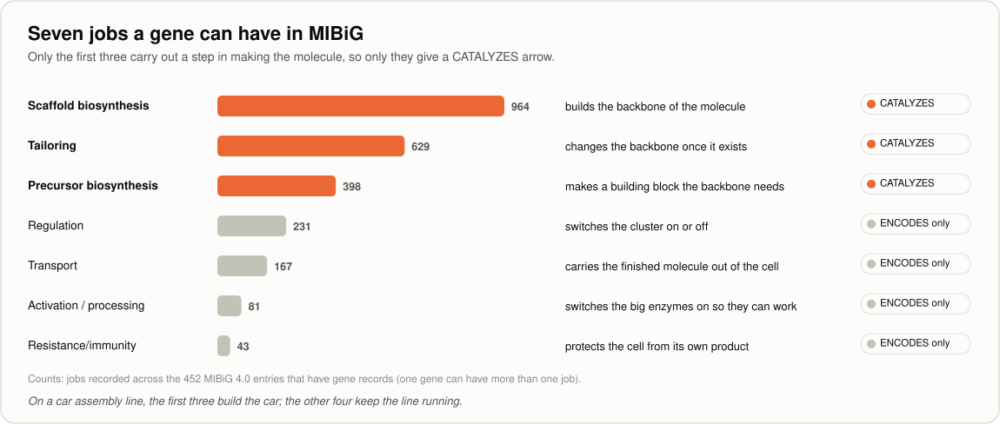

[← Handbook](HANDBOOK.md) · [README](../README.md) · [Glossary](GLOSSARY.md) · [Roadmap](ROADMAP.md) · [Git workflow](GIT-WORKFLOW.md)

# 05. The proteomics layer: MIBiG's gene records and UniProt (Phase 3)

**Prerequisites:** [`04-more-sources-secrets.md`](04-more-sources-secrets.md)
finished: `pytest` passes, the MIBiG archive is in `data/raw/mibig/`, and
`data/processed/staging/` holds the tables of all five Phase 2 sources. It helps
to have [`02-ontology-and-data-model.md`](02-ontology-and-data-model.md),
section 4 (`Protein`) and section 5 (the edge types), fresh in your mind. No
biology background is needed.

**Learning goal:** after this phase you will understand what a gene, a protein
and an enzyme are, and the jobs genes do inside a gene cluster; how two
databases that don't refer to each other can still be joined through a third
identifier; how a web service that works in the background is asked
(a job, a ticket number, polling, an HTTP redirect); how an identifier that only
means something inside one genome is kept from clashing with another; and how
to say openly what a join didn't match. You will also see why a quick look at
real data before writing any code changed the plan for this phase.

**Time:** about 5-7 hours, in two sessions. The real fetch takes a minute or
two and brings in under a megabyte.

> Every term here is also in [`GLOSSARY.md`](GLOSSARY.md). The overview of this
> phase is in [`HANDBOOK.md`](HANDBOOK.md), Stage 6.

---

## Contents

1. [What this phase builds, in one picture](#1-what-this-phase-builds-in-one-picture)
2. [The science, in plain words](#2-the-science-in-plain-words)
3. [The engineering ideas, in plain words](#3-the-engineering-ideas-in-plain-words)
4. [Step 0. Get into position](#4-step-0-get-into-position)
5. [Step 1. Put the new files in place](#5-step-1-put-the-new-files-in-place)
6. [Step 2. A new kind of identifier: `ncbiprotein`](#6-step-2-a-new-kind-of-identifier-ncbiprotein)
7. [Step 3. MIBiG reads its gene records](#7-step-3-mibig-reads-its-gene-records)
8. [Step 4. Asking without following a redirect](#8-step-4-asking-without-following-a-redirect)
9. [Step 5. The UniProt plug](#9-step-5-the-uniprot-plug)
10. [Step 6. Tests built from real answers](#10-step-6-tests-built-from-real-answers)
11. [Step 7. Run it for real](#11-step-7-run-it-for-real)
12. [Step 8. Pictures, the Handbook and the records](#12-step-8-pictures-the-handbook-and-the-records)
13. [How evidence and confidence are decided for the protein arrows](#13-how-evidence-and-confidence-are-decided-for-the-protein-arrows)
14. [What the protein layer doesn't cover yet](#14-what-the-protein-layer-doesnt-cover-yet)
15. [What could go wrong](#15-what-could-go-wrong)
16. [Checkpoint](#16-checkpoint)
17. [Committing this phase](#17-committing-this-phase)

---

## 1. What this phase builds, in one picture


Until now the graph went straight from a gene cluster to the molecule it makes.
This phase fills in the middle: the **enzymes** the cluster's genes code for,
which are the machines that actually build the molecule. The chain becomes

```
Organism --HARBORS--> GeneCluster --ENCODES--> Protein --CATALYZES--> Compound
```

with MIBiG's direct `PRODUCES` arrow from Phase 1 kept alongside as a shortcut.
With proteins in place, one walk through the graph can cross three kinds of
biological measurement: genes (genomics), proteins (proteomics) and molecules
(metabolomics). That's what the README means by **multi-omics integration**.

Two sources do the work. That split wasn't the original plan, and section 3
explains why it changed:

* **MIBiG's gene records** supply the proteins and both new arrows. Some MIBiG
  entries list the cluster's genes, each with the number of the protein it makes
  and, often, the job it does. The MIBiG adapter from Phase 1 now reads them.
* **UniProt** says what each of those proteins is: its names, the organism, its
  length, the reaction it carries out and a description of what it does. A sixth
  adapter asks UniProt about every protein number MIBiG gives.

The commands are the same three verbs as before:

| Command | What it does | Touches the internet? |
|---|---|---|
| `python -m microbegraph.fetch --list` | Lists the six sources, their homepages and licences | No |
| `python -m microbegraph.fetch --tidy-only --source mibig` | Rebuilds MIBiG's tables, now with proteins | **No** |
| `python -m microbegraph.fetch --probe --source uniprot` | Asks UniProt which release it's on, and counts the proteins to ask about | Yes, one small question |
| `python -m microbegraph.fetch --source uniprot` | Maps every protein number to UniProt and tidies the answers | Yes, about 20 requests |
| `python -m microbegraph.fetch --tidy-only --all` | Rebuilds every table from what is on your machine | **No** |

**Files this phase creates or changes** (paths relative to the project folder):

| Path | New or changed | What it is |
|---|---|---|
| `src/microbegraph/sources/uniprot.py` | new | The UniProt adapter: ID mapping jobs, kept as a snapshot |
| `src/microbegraph/sources/mibig.py` | changed | Reads each entry's gene records: `Protein` nodes, `ENCODES` and `CATALYZES` arrows |
| `src/microbegraph/ontology.py` | changed | Knows the `ncbiprotein` prefix |
| `src/microbegraph/sources/base.py` | changed | A GET can be told not to follow a redirect |
| `src/microbegraph/sources/__init__.py` | changed | Registers UniProt, after KEGG and before the bridge |
| `src/microbegraph/staging.py` | changed | Notes only: UniProt builds on MIBiG's tables |
| `tests/fixtures/capture_uniprot_samples.py` | new | Surveys MIBiG's gene records and captures real UniProt answers |
| `tests/fixtures/uniprot/` | new | Seven real UniProt answers captured on 2026-10-12, plus their status codes and headers |
| `tests/fixtures/mibig/BGC0000433.json` | changed | Now keeps the real surfactin entry's gene records |
| `tests/fixtures/mibig/BGC9999901.json`, `BGC9999903.json` | changed | Made-up gene records for the cases surfactin doesn't cover |
| `tests/fixtures/README.md` | changed | Where the UniProt answers came from, with fingerprints |
| `tests/conftest.py` | changed | The fake server records a GET that doesn't follow redirects; staging helper knows proteins |
| `tests/test_uniprot.py`, `tests/test_mibig_genes.py` | new | The promises the new code makes |
| `tests/test_settings.py` | changed | `--list` now shows six sources |
| `docs/05-proteomics-uniprot.md` | new | This guide |
| `docs/img/protein_layer.svg`, `docs/img/gene_jobs.svg`, `docs/img/idmapping_flow.svg`, `docs/img/protein_coverage.svg` | new | Four new pictures |
| `docs/img/make_illustrations.py`, `docs/interactive/make_interactive.py` and the files they draw | changed | The new pictures; six sources; the evidence chain gains srfAA |
| `docs/phases.csv` | changed | Phase 3 done; Phase 3b added to the plan |
| `README.md`, `CHANGELOG.md`, `docs/HANDBOOK.md`, `docs/ROADMAP.md`, `docs/GLOSSARY.md`, `docs/GIT-WORKFLOW.md`, `docs/00-architecture.md`, `docs/02-ontology-and-data-model.md`, `docs/03-ingestion-mibig.md`, `docs/04-more-sources-secrets.md` | changed | Updated for this phase |

**Files this phase writes on your computer that never go to GitHub:**

| Path | What it is |
|---|---|
| `data/raw/uniprot/<moment>/` | UniProt's answers from one fetch, plus `manifest.json` |
| `data/raw/provenance.csv` | Gains one row for every answer saved |
| `data/processed/staging/mibig_*` | Rewritten, now with proteins |
| `data/processed/staging/uniprot_nodes.csv`, `_edges.csv`, `_summary.json` | UniProt's tables |
| `data/samples/<date>/uniprot/` | The survey and answers from `capture_uniprot_samples.py`, if you run it |

---

## 2. The science, in plain words

### Genes, proteins and enzymes

A **gene** is one instruction in an organism's DNA. Most genes are the recipe
for one **protein**: a long chain of building blocks called **amino acids**,
folded into a shape that does a job. Some proteins are structure, some carry
messages, and many are **enzymes**, machines that carry out one chemical
reaction, very fast, over and over.

A cookbook works as a comparison. The genome is the book, a gene is one
recipe, and the protein is what comes out of the kitchen when the recipe is
followed.

That's why proteins are the missing middle of this project's chain. A gene
cluster doesn't make surfactin directly. Its genes are read, the proteins they
describe are built, and those proteins (enzymes) assemble surfactin from
smaller pieces.

### The jobs genes do in a gene cluster

Not every gene in a cluster builds the molecule. MIBiG can give each gene one
or more of seven jobs (many genes have none recorded), and the split matters for
which arrows the graph gets:



The first three carry out a step in making the molecule: building its
backbone (**scaffold biosynthesis**), making an unusual building block the
backbone needs (**precursor biosynthesis**), or changing the backbone once it
exists (**tailoring**). Those genes get a `CATALYZES` arrow to the molecule.

The other four keep the cluster working without building anything: switching
the cluster on and off (**regulation**), carrying the finished molecule out of
the cell (**transport**), switching the big enzymes on (**activation /
processing**), and protecting the cell from its own product
(**resistance/immunity**). Their genes are still in the cluster, so they get an
`ENCODES` arrow, but no `CATALYZES`.

For many jobs, MIBiG also records how it was shown, for example a **knock-out**
(switching the gene off and seeing the molecule disappear), an **activity
assay** (testing what the purified enzyme does), or **heterologous
expression** (moving the gene into another organism and seeing what it makes).
Those are experiments, and section 13 explains how they set the evidence level.

### UniProt: the catalogue of proteins

**UniProt** is the world's main public catalogue of proteins, run jointly by
the European Bioinformatics Institute, the Swiss Institute of Bioinformatics and
the Protein Information Resource. Each protein has an entry with an
**accession** (a permanent number such as `Q70KJ7`), names, the organism it
comes from, its length, and, where it's known, its function and its **EC
number** (a standard code for the reaction an enzyme performs).

Entries come in two kinds, and the difference matters when you read them:

| Kind | Also called | How it's made | How many |
|---|---|---|---|
| **Reviewed** | Swiss-Prot | A curator has read the papers and written the entry by hand | About half a million |
| **Unreviewed** | TrEMBL | Made automatically from a sequence record, with predicted names and functions | Hundreds of millions |

Most enzymes from gene clusters are unreviewed. That's normal: nobody has had
time to curate them by hand, and the entry still gives the protein a stable
identity.

### Three ways of naming a protein

MIBiG's gene records name each protein in one of three ways, and they don't
carry the same weight:

| Style | Example | Where it comes from | Unique where? |
|---|---|---|---|
| INSDC protein id | `CAE02630.1` | GenBank, EMBL or DDBJ, the three public sequence archives, which share one numbering (together they're called **INSDC**) | Worldwide |
| RefSeq protein id | `WP_029025939.1` | NCBI's **RefSeq**, a cleaned-up copy of the archives in which each protein is listed once | Worldwide |
| Locus tag or gene name | `TSTA_117750`, `abyU` | The genome project that described the organism | Only inside that genome |

The first two are like passport numbers: one number, one protein, anywhere in
the world. The third is more like a staff badge number: `TSTA_117750` is
perfectly clear inside its own company, but another company's badge 117750 is
someone else entirely. Section 3 shows what that means for identifiers.

### The worked example: surfactin's nine genes

The surfactin entry, BGC0000433, lists nine gene records, all with INSDC
protein ids:

| Gene | Protein id | Product (as MIBiG writes it) | Job | How shown | Arrows |
|---|---|---|---|---|---|
| srfAA | `CAE02630.1` | surfactin synthetase A | Scaffold biosynthesis | knock-out | `ENCODES`, `CATALYZES` |
| srfAB | `CAE02631.1` | surfactin synthetase B | Scaffold biosynthesis | not stated | `ENCODES`, `CATALYZES` |
| comS | `CAE02632.1` | competence protein S | not stated | | `ENCODES` |
| srfAC | `CAE02633.1` | surfactin synthetase C | Scaffold biosynthesis | not stated | `ENCODES`, `CATALYZES` |
| srfAD | `CAE02634.1` | surfactin synthetase D | not stated | | `ENCODES` |
| ycxc | `CAE02636.1` | transporter | Transport | not stated | `ENCODES` |
| ycxD | `CAE02637.1` | transcriptional regulator containing an aminotransferase domain | Regulation | not stated | `ENCODES` |
| sfp | `CAE02638.1` | phosphopantetheinyl transferase involved in nonribosomal synthesis | Activation / processing | knock-out | `ENCODES` |
| yczE | `CAE02639.1` | integral membrane protein involved in nonribosomal synthesis | not stated | | `ENCODES` |

srfAA, srfAB and srfAC are the three parts of the **surfactin synthetase**, a
giant assembly-line enzyme of the kind called an **NRPS**
(nonribosomal peptide synthetase). It strings surfactin's seven amino acids
together one after another. sfp is essential too, because it switches the
synthetase on, but it doesn't touch the molecule itself, which is why its job
is "activation" and it gets no `CATALYZES` arrow. srfAD has no job recorded in
MIBiG, even though its product name says it belongs to the synthetase, so it
gets `ENCODES` only.

UniProt then fills in each enzyme. `CAE02630.1` maps to the entry `Q70KJ7`,
"Surfactin synthetase A", 3,584 amino acids long, from *Bacillus
amyloliquefaciens* (*Bacillus velezensis*). It's an unreviewed entry, made from
the sequence record. A reviewed entry for srfAA does exist (`P27206`,
SRFAA_BACSU), but it describes the protein from *Bacillus subtilis* strain 168,
a different organism. The ID mapping finds the protein that this cluster's own
DNA codes for.

---

## 3. The engineering ideas, in plain words

### Looking at real data before writing code

Phase 1 was caught out twice by test records written from documentation, and
Phase 2 answered by capturing real answers first. This phase went one step
further: before any adapter code existed, a small script,
[`tests/fixtures/capture_uniprot_samples.py`](../tests/fixtures/capture_uniprot_samples.py),
surveyed MIBiG's gene records offline and then asked UniProt about a sample of
them. Three of its findings changed the plan:

1. **UniProt doesn't cross-reference MIBiG.** The roadmap said it did, and that
   the join would be "exact rather than fuzzy". Asking UniProt's own list of
   linked databases for "mibig" returns nothing at all
   (<https://rest.uniprot.org/database/search?query=mibig> shows
   `{"results":[]}`). So the link has to go another way, through the protein
   numbers in MIBiG's gene records.
2. **Only 452 of the 2,437 active MIBiG entries have gene records** in the
   pinned JSON release. Section 14 says what that means and how Phase 3b fills
   the gap.
3. **Not every protein number maps.** Of the 29 real INSDC ids in the sample,
   18 came back with a UniProt entry: all nine of surfactin's, and 9 of the 20
   picked evenly from the rest. Of 5 RefSeq ids, 2 did. A protein can be missing
   from UniProt because its sequence record was withdrawn, merged or never
   imported.

### Joining two databases through a third identifier

MIBiG and UniProt never mention each other, yet both know the INSDC protein id.
That shared number is enough: MIBiG says "this cluster has the gene whose protein
is `CAE02630.1`", and UniProt's **ID mapping** service answers "`CAE02630.1` is
my entry `Q70KJ7`".

Two shops with separate customer lists can match their customers the same way:
neither knows the other's customer numbers, but both have the customers' email
addresses. A table of matched numbers like this is called a **crosswalk**.

So each gene record becomes a `Protein` node named after its sequence number,
`ncbiprotein:CAE02630.1`, and each UniProt entry becomes a `Protein` node of its
own, `uniprot:Q70KJ7`, which remembers the number it was found through
(`mibig_protein_ids`). Phase 4 joins the two into one node, the same way it
joins MIBiG's compounds to PubChem's.

### A job with a ticket number

Most of the questions so far got their answer straight back. ID mapping works
differently, because a large mapping can take a while. It's a **job** that runs
in the background, like ordering at a busy cafe counter:


1. **Hand in the order.** The adapter POSTs the ids, with the name of their
   type, and gets back a ticket number: `{"jobId": "8Pr33gbOw8"}`.
2. **Ask whether it's ready.** It asks `/idmapping/status/8Pr33gbOw8` every few
   seconds. While the job runs, the answer is `{"jobStatus": "RUNNING"}`; once
   it's done, the answer is `{"jobStatus": "FINISHED"}`. Asking again and again
   like this is called **polling**.
3. **Collect.** It downloads the results as one table, with a `From` column
   holding the id that was asked about and one row per UniProt entry found.

### Redirects, and why this adapter doesn't follow them

When a job is finished, UniProt's status answer is **HTTP 303**, a
**redirect**: a reply that says "what you want is over there", with the new
address in a header called `Location`. Web browsers and the `requests` library
follow redirects automatically, which is usually what you want. Here it isn't:
following it would download a page of results every time the adapter checked a
finished job, and the adapter would have to recognise "finished" from the shape
of those results. With redirects turned off, the answer stays small and says
what it means, and the 303 and the word FINISHED both count as done. (The
results themselves are then collected in one piece, from the stream address in
step 3.)

### What a snapshot keeps, and what it doesn't

The UniProt fetch is kept as a dated snapshot, exactly like Phase 2's. Each
job's ticket answer and its results table are saved and logged. The "is it
ready?" answers are not: they say nothing about proteins, and there can be
several per job. The manifest records how many were needed. UniProt keeps a
finished job for about a week, so a job number in an old manifest may no longer
work, while the saved results stay in your locker for good.

### A name that only means something in one place

`ncbiprotein:CAE02630.1` is safe to share between entries: if two MIBiG entries
named the same INSDC protein, it would be the same protein, and one node with
two `ENCODES` arrows is right. A locus tag isn't safe in the same way. The real
survey found eleven locus tags and gene names that appear in more than one entry
(`mscA` to `mscH` in two entries, for example), and nothing guarantees they're
the same protein.

So a locus tag or gene name gets an identifier scoped to its entry:
`TSTA_117750` in BGC0000154 becomes `mg.protein:bgc0000154-tsta-117750`. The
`mg.` prefix says the identifier was made up by this project, and the entry
number in it keeps two genomes' badge numbers apart. If two of them really are
one protein, Phase 4's ledger is where that merge is decided and written down.

### Saying what didn't match

An id UniProt can't map just isn't in the results. Nothing in the answer says
"not found", so it would be easy to lose them without noticing. The adapter
works out the missing ones itself (asked minus answered), counts them
(`ids_not_mapped`) and lists every one in `uniprot_summary.json`. The test
capture asked about one made-up id, `XYZ99999.99`, to prove the count works.

---

## 4. Step 0. Get into position

1. Open your terminal and go to the project folder:

   ```bash
   cd ~/projects/microbegraph      # or wherever you cloned it
   ```

   Windows PowerShell: `cd $HOME\projects\microbegraph`
2. Make sure you're on the working branch and up to date:

   ```bash
   git switch develop
   git pull --ff-only origin develop
   ```

3. Activate the toolbox:

   ```bash
   source .venv/bin/activate          # macOS / Linux / RHEL 8
   ```

   Windows PowerShell: `.\.venv\Scripts\Activate.ps1`
4. Check that the MIBiG archive is in the locker, because this phase re-reads it:

   ```bash
   ls data/raw/mibig
   ```

   Windows PowerShell: `dir data\raw\mibig`. You should see
   `mibig_json_4.0.tar.gz`. If not, run
   `python -m microbegraph.fetch --source mibig` first
   ([`03-ingestion-mibig.md`, Step 8](03-ingestion-mibig.md#12-step-8-run-it-for-real)).

✅ **Checkpoint.** Your prompt starts with `(.venv)`, `git branch` shows
`* develop`, and the archive is there.

---

## 5. Step 1. Put the new files in place

If you cloned the repository after this phase was committed, every file is
already there and you can read along. If you're building it yourself, put each
file from the table in section 1 at the path shown. Then:

1. **No new packages are needed.** Everything this phase uses (`requests`,
   `tenacity`, the `csv` and `json` modules that come with Python) is already
   installed.
2. **No reinstall is needed either.** The package is installed in editable mode
   (`pip install -e .`, Phase 1), so Python reads the new files straight from
   `src/microbegraph/`.
3. **Check the six sources are registered, in order:**

   ```bash
   python -m microbegraph.fetch --list
   ```

   ```
     mibig          https://mibig.secondarymetabolites.org
                    licence: CC-BY-4.0
     pubchem        https://pubchem.ncbi.nlm.nih.gov
                    licence: NCBI: no restrictions; some depositors add their own terms
     ncbi_taxonomy  https://www.ncbi.nlm.nih.gov/taxonomy
                    licence: NCBI: no restrictions
     kegg           https://www.kegg.jp
                    licence: KEGG: academic use only (kegg.jp/kegg/legal.html)
     uniprot        https://www.uniprot.org
                    licence: CC-BY-4.0
     curation       curation/compound_pathogen_crop.csv
                    licence: MIT (this repository)
   ```

✅ **Checkpoint.** `--list` shows six sources, with `uniprot` fifth.

---

## 6. Step 2. A new kind of identifier: `ncbiprotein`

Rule 2 of the rulebook says every identifier needs a known prefix, so the INSDC
and RefSeq protein numbers need one before any row can use them.
[`src/microbegraph/ontology.py`](../src/microbegraph/ontology.py) gains one line:

```python
    "ncbiprotein",        # NCBI protein sequence records (GenBank, EMBL, DDBJ, RefSeq)
```

`ncbiprotein` is the prefix the [Bioregistry](https://bioregistry.io/ncbiprotein),
a public list of identifier prefixes, gives NCBI Protein. NCBI's protein
database holds the proteins coded for by the genes in GenBank (and so the INSDC
numbers) as well as RefSeq's, so one prefix covers both. The prefix table in
[`02-ontology-and-data-model.md`, section 3](02-ontology-and-data-model.md#the-prefixes-microbegraph-uses)
gains the same row. This is the only change to the rulebook in this phase: the
`Protein` node type and the `ENCODES` and `CATALYZES` arrows were in the design
from Phase 0.

---

## 7. Step 3. MIBiG reads its gene records

[`src/microbegraph/sources/mibig.py`](../src/microbegraph/sources/mibig.py)
learns to read the `genes` part of an entry. Nothing about how MIBiG is
downloaded changes, and the archive in your locker is the same file. Only
`tidy()` reads more of it.

**What each gene record becomes:**

| Row | Identifier | Comes from |
|---|---|---|
| `Protein` node | `ncbiprotein:<id>` for an INSDC or RefSeq id; `mg.protein:<entry>-<id>` for anything else | Every gene record that has an id |
| `ENCODES` arrow | cluster → protein | Every gene record that has an id |
| `CATALYZES` arrow | protein → every compound of the entry | Only genes whose jobs include scaffold biosynthesis, precursor biosynthesis or tailoring |

The node's name is the gene name (`srfAA`), or the product when there's no gene
name, or the id when there's neither. Its properties are `protein_id`,
`id_type` (`insdc`, `refseq` or `other`), `gene_name`, `product`, `functions`
(the jobs, joined with `|`), `function_evidence` (the methods, such as
`Knock-out`), and, when MIBiG gives them, `comment` and `mutation_phenotype`
(what happened when the gene was switched off).

**Why "every compound of the entry".** MIBiG records a gene's job for the
cluster, not for one particular compound. Most entries make one compound, so
the arrow is exact. An entry that lists several (one lists 21) gives each of its
building genes an arrow to every one of them, because MIBiG doesn't say which
gene works on which. That spread is counted
(`catalyzes_in_multi_compound_entries`), so it can be seen and, later, narrowed.

**What's left out on purpose**, and counted where it's countable: gene records
with no id at all (`genes_without_id`); the domain-by-domain detail some records
give for large enzymes, which no phase uses; and MIBiG's corrections to the gene
list of the underlying sequence record (`to_add`, `to_delete`), which matter
once Phase 3b reads the full gene lists.

**Run it, offline:**

```bash
python -m microbegraph.fetch --tidy-only --source mibig
```

This is the real output from the run on 2026-10-12. MIBiG 4.0 is pinned, so your
numbers should be exactly the same:

```
[mibig] tidy
  [mibig] wrote mibig_nodes.csv and mibig_edges.csv
    bioactivities_not_observed              66
    bioactivities_observed                2937
    catalyzes_in_multi_compound_entries   3324
    compound_name_collisions                 4
    compounds_read                        4294
    entries_active                        2437
    entries_predicted_or_unstated         1629
    entries_skipped_status                 576
    entries_with_experimental_evidence     808
    entries_with_gene_records              452
    files_not_mibig4                         0
    files_read                            3013
    files_unreadable                         0
    genes_in_biosynthesis                 1991
    genes_insdc_id                        3994
    genes_other_id                         648
    genes_other_roles                      522
    genes_read                            4737
    genes_refseq_id                         95
    genes_role_not_stated                 2224
    genes_without_id                         0
    property_conflicts                     275
```

Twelve of these counts are Phase 1's, with the same values. The counts print in
alphabetical order, so the ten new ones are mixed in among them:

| Count | Meaning |
|---|---|
| `entries_with_gene_records` | Active entries that list at least one gene |
| `genes_read` | Gene records across those entries |
| `genes_without_id` | Gene records with no protein id at all, left out |
| `genes_insdc_id`, `genes_refseq_id`, `genes_other_id` | How each gene's protein is named: INSDC, RefSeq, or a locus tag or gene name |
| `genes_in_biosynthesis` | Genes with at least one of the three building jobs; each gets `CATALYZES` arrows |
| `genes_other_roles` | Genes whose jobs are all of the other four; `ENCODES` only |
| `genes_role_not_stated` | Genes with no job recorded; `ENCODES` only |
| `catalyzes_in_multi_compound_entries` | `CATALYZES` arrows that come from entries listing more than one compound |

**Sanity checks on your numbers:**

* `genes_insdc_id + genes_refseq_id + genes_other_id + genes_without_id` equals
  `genes_read` (3,994 + 95 + 648 + 0 = 4,737);
* `genes_in_biosynthesis + genes_other_roles + genes_role_not_stated` equals
  `genes_read - genes_without_id` (1,991 + 522 + 2,224 = 4,737);
* `entries_with_gene_records` is 452, the number the survey found.

**Look at surfactin's proteins:**

```bash
python -c "import pandas as pd; e = pd.read_csv('data/processed/staging/mibig_edges.csv', dtype=str, keep_default_na=False); print(e[e.edge_type.isin(['ENCODES', 'CATALYZES']) & (e.source_id.eq('mibig:BGC0000433') | e.target_id.eq('mg.compound:surfactin'))][['source_id', 'edge_type', 'target_id', 'evidence_level', 'source_record_id']].to_string(index=False))"
```

The real output:

```
             source_id edge_type              target_id       evidence_level source_record_id
ncbiprotein:CAE02630.1 CATALYZES  mg.compound:surfactin curated_experimental       BGC0000433
ncbiprotein:CAE02631.1 CATALYZES  mg.compound:surfactin   database_assertion       BGC0000433
ncbiprotein:CAE02633.1 CATALYZES  mg.compound:surfactin   database_assertion       BGC0000433
      mibig:BGC0000433   ENCODES ncbiprotein:CAE02630.1   database_assertion       BGC0000433
      mibig:BGC0000433   ENCODES ncbiprotein:CAE02631.1   database_assertion       BGC0000433
      mibig:BGC0000433   ENCODES ncbiprotein:CAE02632.1   database_assertion       BGC0000433
      mibig:BGC0000433   ENCODES ncbiprotein:CAE02633.1   database_assertion       BGC0000433
      mibig:BGC0000433   ENCODES ncbiprotein:CAE02634.1   database_assertion       BGC0000433
      mibig:BGC0000433   ENCODES ncbiprotein:CAE02636.1   database_assertion       BGC0000433
      mibig:BGC0000433   ENCODES ncbiprotein:CAE02637.1   database_assertion       BGC0000433
      mibig:BGC0000433   ENCODES ncbiprotein:CAE02638.1   database_assertion       BGC0000433
      mibig:BGC0000433   ENCODES ncbiprotein:CAE02639.1   database_assertion       BGC0000433
```

Nine `ENCODES` arrows from the cluster, one per gene record, all
`database_assertion`. Three `CATALYZES` arrows into surfactin, from the three
synthetase genes, and all from BGC0000433 (the only active entry with a compound
named surfactin). srfAA's is `curated_experimental` because MIBiG records a
knock-out for its job; srfAB's and srfAC's are `database_assertion` because their
job is stated with no experiment.

Across the whole release, the gene records add 9,229 arrows to MIBiG's 10,023:

| Arrow | Total | Split by evidence |
|---|---|---|
| `ENCODES` | 4,737 | all `database_assertion`, one per gene record |
| `CATALYZES` | 4,492 | 1,482 `curated_experimental`, 3,010 `database_assertion`; from 1,991 proteins to 457 compounds, in 250 entries |

MIBiG's table now holds 4,737 `Protein` nodes: 4,089 `ncbiprotein:` and 648
`mg.protein:`. 3,324 of the `CATALYZES` arrows come from entries that list more
than one compound (`catalyzes_in_multi_compound_entries`), so they're spread
over every compound of their entry.

✅ **Checkpoint.** The tidy finishes without a rule failure; the new counts add
up; surfactin has nine `ENCODES` arrows and three `CATALYZES` arrows from its
own entry.

---

## 8. Step 4. Asking without following a redirect

[`src/microbegraph/sources/base.py`](../src/microbegraph/sources/base.py):
`http_get()` gains one option, `allow_redirects`, which is passed straight to
`requests`. It's `True` unless an adapter says otherwise, so MIBiG, PubChem,
NCBI and KEGG behave exactly as before. Only UniProt's status question turns it
off, for the reason in section 3.

The fake server in [`tests/conftest.py`](../tests/conftest.py) records every GET
that was asked not to follow a redirect, so a test can prove the status question
was asked that way.

---

## 9. Step 5. The UniProt plug

[`src/microbegraph/sources/uniprot.py`](../src/microbegraph/sources/uniprot.py).

**probe()** asks UniProt one question, the list of identifier types its ID
mapping accepts (`/configure/idmapping/fields`). From that one answer it reports
the release UniProt is on (every answer carries it in a header,
`X-UniProt-Release`) and checks that both types this project uses are still on
the list:

| Type in MIBiG | UniProt's name for it |
|---|---|
| INSDC protein id | `EMBL-GenBank-DDBJ_CDS` (CDS means "coding sequence": the stretch of DNA that codes for one protein) |
| RefSeq protein id | `RefSeq_Protein` |

If UniProt ever renames one, the probe says so before any fetch is tried. The
probe also counts the protein ids in MIBiG's tables and how many jobs they need.

**fetch()** reads the `ncbiprotein:` nodes from `mibig_nodes.csv`, sorts the
INSDC and RefSeq ids, and sends them 1,000 per job. For each job:

```
POST https://rest.uniprot.org/idmapping/run
     body: from=EMBL-GenBank-DDBJ_CDS, to=UniProtKB, ids=AAA16191.1,AAL06661.1,...
GET  https://rest.uniprot.org/idmapping/status/<job>          (redirects off, until finished)
GET  https://rest.uniprot.org/idmapping/uniprotkb/results/stream/<job>?format=tsv&fields=...
```

The answers are saved as `insdc_001_job.json`, `insdc_001_results.tsv`, and so
on, then `refseq_001_job.json` and `refseq_001_results.tsv`. The adapter waits
one second between requests and three seconds between status questions. If a
job reports an error, or is still running after 100 checks, the fetch stops
with a message, and the unfinished folder is ignored by tidy. A results answer
that isn't the table expected is saved and logged first (it's evidence of what
happened), then the fetch stops.

The results are asked for as **TSV** (tab-separated values: a CSV that uses tabs
instead of commas), with these columns:

| Asked for as | Arrives headed | Kept as |
|---|---|---|
| (always first) | `From` | the id that was asked about |
| `accession` | `Entry` | the node id, `uniprot:<Entry>` |
| `id` | `Entry Name` | `entry_name`, such as `Q70KJ7_BACAM` |
| `reviewed` | `Reviewed` | `reviewed`, true or false |
| `protein_name` | `Protein names` | `protein_names`; the first name becomes the node's name |
| `gene_names` | `Gene Names` | `gene_names`, joined with `\|` |
| `organism_name`, `organism_id` | `Organism`, `Organism (ID)` | `organism`, `organism_taxid` |
| `length` | `Length` | `length`, in amino acids |
| `ec` | `EC number` | `ec_numbers`, joined with `\|` |
| `cc_function` | `Function [CC]` | `function`, without its `FUNCTION:` label |
| `protein_existence` | `Protein existence` | `protein_existence`, how directly the protein is known to exist |
| `annotation_score` | `Annotation` | `annotation_score`, UniProt's 1 to 5 rating of how well the entry is described |

**tidy()** turns every UniProt entry found into one `Protein` node,
`uniprot:<accession>`, with the properties above and `mibig_protein_ids`, the
MIBiG protein number(s) it was found through. It writes no arrows: the arrows
come from MIBiG, and Phase 4 joins each `ncbiprotein:` node to its UniProt entry.
Two unusual cases are counted rather than guessed at: one MIBiG number that
maps to several UniProt entries (`ids_with_several_entries`, also listed in
`uniprot_summary.json`), and one UniProt entry reached from several MIBiG numbers
(`entries_from_several_ids`, which happens when identical proteins were submitted
more than once; such an entry's `mibig_protein_ids` names all of them).

**The organism UniProt names can differ from MIBiG's.** UniProt files srfAA
under *Bacillus amyloliquefaciens* (taxid 1390, with *Bacillus velezensis* in
brackets), at the level of the species, while MIBiG and NCBI place the cluster in
the strain *Bacillus velezensis* FZB42 (taxid 326423). The UniProt node keeps
UniProt's value as a property, and the graph's organism stays MIBiG's. Phase 4
won't create organism nodes from UniProt.

**Licence and citation.** UniProt is free to use under CC BY 4.0, which means
credit is required. Every provenance row records `CC-BY-4.0`, and the README's
sources table gives the citation: The UniProt Consortium (2025) *Nucleic Acids
Research* 53(D1):D609-D617, `doi:10.1093/nar/gkae1010`.

---

## 10. Step 6. Tests built from real answers

1. **Where the test records came from.**
   [`tests/fixtures/capture_uniprot_samples.py`](../tests/fixtures/capture_uniprot_samples.py)
   asked UniProt about surfactin's nine protein ids, twenty more spread evenly
   through MIBiG's INSDC ids, one made-up id (`XYZ99999.99`) and five RefSeq ids,
   and saved every answer exactly as it arrived, with its status code and
   headers (the command to run it again is in
   [`tests/fixtures/README.md`](../tests/fixtures/README.md#refreshing-the-samples)).
   Seven of those answers are now the test records in
   `tests/fixtures/uniprot/`, and `headers.json` beside them holds the status
   code and headers each one really came with, so the fake server can answer
   `303` where UniProt did.
   [`tests/fixtures/README.md`](../tests/fixtures/README.md) lists each file with
   its fingerprint.

   Two answers are made up, and the tests that use them say so: "still running"
   and "error". Both real jobs had finished by the first check, so the capture
   never saw either. The "still running" answer follows the example in UniProt's
   documentation; the "error" one has the same shape with a different state, to
   check that any state other than new, running or finished stops the fetch.
2. **MIBiG's test records grew gene records.** The surfactin record now keeps
   its nine real gene records, copied unchanged from the MIBiG 4.0 archive (only
   its biosynthesis modules are still removed). The two made-up records cover
   what surfactin doesn't: a RefSeq id, locus tags, the same locus tag in two
   entries, a gene with no name, a job shown by an assay with a reference, a gene
   with two jobs, and a gene record with no id. Each record's `comment` field says
   what it covers.
3. **Run the tests:**

   ```bash
   pytest
   ```

   ```
   .............................................................................. [ 42%]
   .............................................................................. [ 85%]
   ...........................                                                    [100%]
   183 passed in 1.53s
   ```

   (The time varies by computer, and the number of dots on a line depends on how
   wide your terminal window is.)
4. **Run the style checker:**

   ```bash
   ruff check .
   ```

   Expected: `All checks passed!`

**What the new tests promise:**

* every surfactin gene becomes a `Protein` node the cluster `ENCODES`, and only
  the three scaffold genes `CATALYZES` surfactin;
* a job shown by an experiment makes `CATALYZES` `curated_experimental`, a
  stated job without one makes it `database_assertion`, and a prediction never
  counts as an experiment;
* a cited assay keeps its reference, and an entry with two compounds gives a
  building gene an arrow to both, counted;
* INSDC and RefSeq ids become `ncbiprotein:` nodes, one per number however many
  entries list it; a locus tag becomes one node per entry;
* the gene counts add up;
* the probe reports UniProt's release and warns if an identifier type disappears;
* each job's ticket answer and results are kept, logged and counted, the status
  question never follows a redirect, and the fetch waits while a job runs;
* a job that fails, never finishes, or returns something that isn't a table stops
  the fetch, and tidy ignores the unfinished folder;
* the same questions on the same day ask UniProt nothing;
* tidy turns `CAE02630.1` into `uniprot:Q70KJ7`, keeps EC numbers, function and
  gene names, and lists every id that didn't map, including the made-up one.

✅ **Checkpoint.** `pytest` ends with `passed` and no `failed`; `ruff check .`
says `All checks passed!`.

---

## 11. Step 7. Run it for real

This is the step that uses the internet: one question for the probe, and about
twenty for the fetch.

1. **Probe UniProt.** Nothing is downloaded:

   ```bash
   python -m microbegraph.fetch --probe --source uniprot
   ```

   The real output from the run on 2026-10-12. UniProt publishes a new release
   every eight weeks or so, so yours may show a newer one:

   ```
   [uniprot] probe
     release        : 2026_03 (published 02-September-2026)
     ID mapping     : offers both identifier types used here (EMBL-GenBank-DDBJ_CDS, RefSeq_Protein)
     to ask about   : 3,994 INSDC and 95 RefSeq protein ids from MIBiG, 5 jobs
     in your locker : nothing yet (run the fetch)
   ```

   `5 jobs` is four jobs for the INSDC ids (1,000 each, the last one shorter)
   and one for the RefSeq ids.
2. **Fetch and tidy MIBiG and UniProt, in order:**

   ```bash
   python -m microbegraph.fetch --source mibig --source uniprot
   ```

   MIBiG finds its archive already in the locker and tidies it again, then
   UniProt runs its jobs. The real output, from the run on 2026-10-12, with
   MIBiG's counts (the same as in Step 3) left out where it says `...`; the folder name is the time the fetch started, so yours will
   differ, and UniProt is a live database, so your counts may differ slightly:

   ```
   [mibig] fetch
     [mibig] mibig_json_4.0.tar.gz is already in the locker and verified, nothing to download
     [mibig] already_present: data/raw/mibig/mibig_json_4.0.tar.gz (9.5 MB, 3013 records), provenance logged
   [mibig] tidy
     [mibig] wrote mibig_nodes.csv and mibig_edges.csv
       ...
   [uniprot] fetch
     [uniprot] mapping 3,994 INSDC protein ids in 4 batches of up to 1,000
     [uniprot] data/raw/uniprot/2026-10-12T090322Z/insdc_001_results.tsv (869 rows for 1,000 ids)
     [uniprot] data/raw/uniprot/2026-10-12T090322Z/insdc_002_results.tsv (706 rows for 1,000 ids)
     [uniprot] data/raw/uniprot/2026-10-12T090322Z/insdc_003_results.tsv (566 rows for 1,000 ids)
     [uniprot] data/raw/uniprot/2026-10-12T090322Z/insdc_004_results.tsv (279 rows for 994 ids)
     [uniprot] mapping 95 RefSeq protein ids in 1 batch of up to 1,000
     [uniprot] data/raw/uniprot/2026-10-12T090322Z/refseq_001_results.tsv (34 rows for 95 ids)
     [uniprot] downloaded: data/raw/uniprot/2026-10-12T090322Z/ (10 answers, 777.6 KB), provenance logged
   [uniprot] tidy
     [uniprot] wrote uniprot_nodes.csv and uniprot_edges.csv
       results_files_read            5
       ids_asked                  4089
       ids_asked_insdc            3994
       ids_asked_refseq             95
       ids_mapped                 2449
       ids_not_mapped             1640
       ids_with_several_entries      5
       uniprot_entries            2442
       entries_from_several_ids     12
       entries_reviewed            360
       entries_with_ec_number      683
       entries_with_function       524
   ```

   The rows thin out from job to job (869, 706, 566, then 279) because the ids
   are sorted. The first jobs hold the ids that begin with A, which mostly map;
   the last one holds every id that begins with M, O, Q, R, S or U, and of
   those only about one in five maps. This project doesn't guess why a given id
   is missing from UniProt; it lists them all.

   **What the counts mean:**

   | Count | Meaning |
   |---|---|
   | `results_files_read` | Results tables tidied, one per job |
   | `ids_asked`, `ids_asked_insdc`, `ids_asked_refseq` | Protein ids sent to UniProt, in all and by type |
   | `ids_mapped` | Ids that came back with at least one UniProt entry |
   | `ids_not_mapped` | Ids that came back with nothing (listed in the summary) |
   | `ids_with_several_entries` | Ids that map to more than one entry (listed in the summary) |
   | `uniprot_entries` | Different UniProt entries found; each became a `Protein` node |
   | `entries_from_several_ids` | Entries reached from more than one MIBiG id |
   | `entries_reviewed` | Entries a curator wrote by hand (Swiss-Prot) |
   | `entries_with_ec_number`, `entries_with_function` | Entries that give an EC number, a description of function |

   **Sanity checks on your numbers** (the run above in brackets):
   * `ids_asked` equals the total in the probe's `to ask about` line, the
     different INSDC and RefSeq numbers in MIBiG's tables (3,994 + 95 = 4,089);
   * `ids_mapped + ids_not_mapped` equals `ids_asked` (2,449 + 1,640 = 4,089);
   * `uniprot_entries` is close to `ids_mapped`: higher if some ids map to several
     entries, lower if some entries are reached from several ids (2,442: five ids
     have two entries each, adding 5, and twelve entries are each reached from
     two ids, taking 12 away).

   To see which ids didn't map, and any that map to several entries:

   ```bash
   python -c "import json; s = json.load(open('data/processed/staging/uniprot_summary.json')); n = s['ids_not_mapped']; print('not mapped:', len(n['insdc']), 'INSDC,', len(n['refseq']), 'RefSeq; first five:', n['insdc'][:5]); print('several entries:', s['ids_with_several_entries'])"
   ```

   ```
   not mapped: 1574 INSDC, 66 RefSeq; first five: ['AAD13555.1', 'AAD13560.1', 'AAL78055.1', 'AAM21200.1', 'AAM21201.1']
   several entries: {'WP_002277496.1': ['A0A1L7LLZ8', 'G5JW76'], 'XP_001798918.1': ['A0A7U2I333', 'Q0UI05'], 'XP_001798919.1': ['A0A7U2F2L8', 'Q0UI04'], 'XP_001798924.1': ['A0A7U2F355', 'Q0UHZ9'], 'XP_001798925.1': ['A0A7U2F6V0', 'Q0UHZ8']}
   ```

   Five ids have two UniProt entries each. All five are RefSeq numbers, and in
   each pair one entry has an older accession (`G5JW76`, `Q0UI05`...) and one a
   newer one (`A0A...`). Phase 4's ledger decides which entry each protein joins.

3. **Run it again**, the same command:

   ```bash
   python -m microbegraph.fetch --source mibig --source uniprot
   ```

   UniProt now says `today's fetch data/raw/uniprot/<moment>/ already asked these
   questions; using it again (nothing downloaded)`, and `provenance.csv` gains
   one `already_present` row.
4. **Rebuild every table offline**, to make sure all six sources still tidy
   together:

   ```bash
   python -m microbegraph.fetch --tidy-only --all
   ```

   Every source prints its counts again and nothing is downloaded.
5. **Follow srfAA from MIBiG to UniProt:**

   ```bash
   python -c "import json, pandas as pd; n = pd.read_csv('data/processed/staging/uniprot_nodes.csv', dtype=str, keep_default_na=False); r = n[n.properties.str.contains('ncbiprotein:CAE02630.1', regex=False)].iloc[0]; p = json.loads(r.properties); print(r.node_id, '|', r['name']); print({k: p[k] for k in ['entry_name', 'reviewed', 'organism', 'organism_taxid', 'length', 'mibig_protein_ids']})"
   ```

   The real output:

   ```
   uniprot:Q70KJ7 | Surfactin synthetase A
   {'entry_name': 'Q70KJ7_BACAM', 'reviewed': False, 'organism': 'Bacillus amyloliquefaciens (Bacillus velezensis)', 'organism_taxid': 1390, 'length': 3584, 'mibig_protein_ids': 'ncbiprotein:CAE02630.1'}
   ```

6. **Write your numbers down.** Copy the counts from `mibig_summary.json` and
   `uniprot_summary.json` into the Phase 3 entry of
   [`CHANGELOG.md`](../CHANGELOG.md). The changelog only states numbers that a
   real run produced.

✅ **Checkpoint.** `data/raw/uniprot/` holds one finished snapshot (with
`manifest.json`); `data/processed/staging/` holds the tables of all six sources;
the sanity checks add up.

---

## 12. Step 8. Pictures, the Handbook and the records

**The pictures.** Four new diagrams, all drawn by
`docs/img/make_illustrations.py`: the protein layer with surfactin's nine genes
(`protein_layer.svg`), the seven gene jobs with their counts in MIBiG 4.0
(`gene_jobs.svg`), the ID mapping job (`idmapping_flow.svg`), and how far the
protein layer reaches, with the numbers from the first run
(`protein_coverage.svg`, in section 14). The sources
picture now shows six sources, the adapter contract shows UniProt as built, and
the interactive evidence chain gains srfAA, with its `ENCODES` and `CATALYZES`
arrows beside the `PRODUCES` shortcut.

**At the end of this phase,** as at the end of every phase:

1. In `docs/phases.csv` (in VS Code), Phase 3's `status` is `done`, and the new
   row for Phase 3b is `planned`.
2. Re-run both picture scripts:

   ```bash
   python docs/img/make_illustrations.py
   python docs/interactive/make_interactive.py
   ```

   The first prints `Done: 19 figures in docs/img/`.
3. In `docs/HANDBOOK.md`: Stage 6 is ✅ and the next stage is ⏳, with the
   version, date and repository state at the top updated, and a change-log line.
4. The same status change is in the README build log and `docs/ROADMAP.md`.
5. Add the Phase 3 entry to `CHANGELOG.md`, with your numbers from Step 7.
6. Commit all of it in the phase commit (section 17).

---

## 13. How evidence and confidence are decided for the protein arrows


| Arrow | Source | Evidence level | Confidence | Why |
|---|---|---|---|---|
| `ENCODES` | MIBiG gene record | `database_assertion` | the entry's grade | MIBiG states which genes are in the cluster; the cluster's own experiments show that it makes the molecule, which says nothing about each gene |
| `CATALYZES` | MIBiG gene record | `curated_experimental` when the gene's building job was shown by an experiment (knock-out, activity assay, heterologous expression, or another in vivo study, meaning an experiment in living cells) | the entry's grade | A curator recorded an experiment on that gene |
| `CATALYZES` | MIBiG gene record | `database_assertion` when the job is stated without an experiment, or only predicted from the sequence | the entry's grade | MIBiG states the job; nobody recorded a test of it |

The confidence is MIBiG's grade for the whole entry, carried through as in
Phase 1 (high 0.95, medium 0.85, low 0.70, questionable 0.50), so surfactin's
protein arrows are 0.50 like its other arrows.

An `ENCODES` arrow's citation is the references MIBiG gives for the cluster; a
`CATALYZES` arrow's adds any reference given for the gene's job itself.
`source_record_id` is the entry's accession. If the same INSDC protein appeared
in two entries, it would get two `ENCODES` arrows, one from each cluster, while
its `CATALYZES` arrows to a compound both entries make would merge exactly as in
Phase 1: both accessions, every citation, the stronger level and the higher
confidence.

UniProt's nodes carry no arrows of their own, so they have no evidence level.
Their `reviewed`, `protein_existence` and `annotation_score` properties say how
much UniProt itself knows about each protein, and Phase 5 can use them to rank or
filter.

---

## 14. What the protein layer doesn't cover yet


Here is everything the protein layer leaves out so far, in one place.

| Gap | How big | What happens to it |
|---|---|---|
| Entries without gene records | 1,985 of the 2,437 active entries have no gene records in the pinned JSON release | **Phase 3b** reads every cluster's proteins from MIBiG's protein file |
| Protein ids UniProt can't map | 1,640 of the 4,089 numbers asked about (1,574 INSDC, 66 RefSeq) | Listed in `uniprot_summary.json`; Phase 4 keeps their `ncbiprotein:` nodes, with MIBiG's gene name and product |
| Locus tags and gene names | 648 gene records (`genes_other_id`) | Never sent to UniProt (it can't map them); kept as `mg.protein:` nodes |
| Arrows spread over several compounds | 3,324 of the 4,492 `CATALYZES` arrows (`catalyzes_in_multi_compound_entries`) | Counted; narrowing them needs a source that says which gene works on which compound |
| Genes whose job isn't recorded | 2,224 gene records (`genes_role_not_stated`) | `ENCODES` only; srfAD is one |
| UniProt's organism names | Older names on some entries (srfAA's is *B. amyloliquefaciens*) | Kept as a property; organisms come from MIBiG and NCBI |

**Phase 3b, in one paragraph.** MIBiG's own download server
(<https://dl.secondarymetabolites.org/mibig/>) also publishes every protein of
every cluster as one file, `mibig_prot_seqs_4.0.fasta` (about 30 MB), and the
GenBank records as `mibig_gbk_4.0.tar.gz`. Neither is in the Zenodo record this
project pins, so neither comes with a published checksum. Phase 3b will look at
the file first, the same way this phase looked at the JSON, then pin it by its
own fingerprint, read each protein's cluster and id from the file, add the
missing `Protein` nodes and `ENCODES` arrows, and map the new ids through the
same UniProt adapter. The plan is in
[`ROADMAP.md`, Phase 3b](ROADMAP.md#phase-3b-every-clusters-proteins-mibigs-protein-file).

---

## 15. What could go wrong

| Symptom | Likely cause | Fix |
|---|---|---|
| `... mibig_nodes.csv is missing, and uniprot builds on it` | MIBiG's tables aren't there | `python -m microbegraph.fetch --source mibig` |
| `mibig_nodes.csv has no proteins with an INSDC or RefSeq id` | The tables were written before Phase 3 | `python -m microbegraph.fetch --tidy-only --source mibig` |
| Probe: `to ask about` says `unknown yet (...)` | Same as either of the two above | The message in brackets names the command |
| Probe: `UniProt's ID mapping no longer lists ...` | UniProt renamed an identifier type | Look up the new name in UniProt's list (`/configure/idmapping/fields`) and update `FROM_NAMES` in `uniprot.py` |
| `UniProt stopped job ... (ERROR)` | UniProt couldn't run the job | Run the fetch again; if it happens twice, check <https://www.uniprot.org/help/id_mapping> |
| `UniProt job ... was still running after 100 checks` | UniProt is very busy | Run the fetch again later; the unfinished folder is ignored |
| `... holds no job number` | UniProt refused the request (often a wrong identifier type name) | Read UniProt's message in the error; check `FROM_NAMES` |
| `... isn't the results table expected` | UniProt sent an error page or message instead of a table | Open the named file to read it; run again |
| `attempt 1 of 5 failed (... HTTP 429 ...)` or `HTTP 503` | UniProt is busy for a moment | Nothing: it's retried automatically |
| `ids_not_mapped` is much higher than in the run above | UniProt removed many entries, or an identifier type changed meaning | Compare the summary with an older snapshot; look up a few of the ids on <https://www.uniprot.org> |
| A rule failure naming `ncbiprotein:...` | `ontology.py` doesn't have the new prefix | Check Step 2 |
| `pytest` fails in `test_settings.py` with five names | `sources/__init__.py` doesn't register UniProt | Check that the file imports `UniprotSource` and lists it after `KeggSource` |

---

## 16. Checkpoint

You have finished this phase when you can answer these without scrolling up:

1. What's the difference between a gene, a protein and an enzyme?
2. Which three gene jobs give a `CATALYZES` arrow, and why does sfp, which
   surfactin can't be made without, not get one?
3. MIBiG and UniProt never mention each other. How are they joined?
4. Why does the status question turn redirects off?
5. Why is `TSTA_117750` given an identifier that includes its entry number,
   while `CAE02630.1` isn't?
6. An id that UniProt can't map leaves no trace in the answer. How does the
   adapter still report it?
7. Why is srfAA's `CATALYZES` arrow `curated_experimental`, while srfAB's is
   `database_assertion`?
8. What did looking at real data first change about this phase?

<details>
<summary>Answers (open after you've tried)</summary>

1. A gene is an instruction in DNA; a protein is the molecule built by following
   it; an enzyme is a protein whose job is to carry out one chemical reaction.
2. Scaffold biosynthesis, precursor biosynthesis and tailoring: they carry out
   steps in making the molecule. sfp switches the synthetase on, which is
   essential, but it doesn't act on the molecule itself.
3. Through the protein's sequence number (INSDC or RefSeq), which both know:
   MIBiG's gene record gives it, and UniProt's ID mapping translates it into a
   UniProt accession.
4. Following the redirect would download a page of results at every check of a
   finished job. With redirects off, the 303 answer itself says "finished", in a
   few bytes.
5. `CAE02630.1` is a worldwide number, unique to one protein. A locus tag only
   means something inside its own genome, and two genomes can use the same one.
6. It compares what it asked with what came back: asked minus answered. The
   missing ids are counted and listed in `uniprot_summary.json`.
7. A knock-out showed srfAA's job; srfAB's job is stated with no experiment
   recorded.
8. UniProt turned out not to cross-reference MIBiG, so the join had to go
   through protein numbers; and only 452 entries have gene records, which is why
   Phase 3b is in the plan.

</details>

**Files that should now exist:** every file in the table in
[section 1](#1-what-this-phase-builds-in-one-picture), plus, on your machine only,
the files under `data/`.

---

## 17. Committing this phase

Run the tests and the safety gate, then commit, push, and sync. Each phase goes
into a single commit; the second `-m` adds a short description under the title
line.

```bash
git switch develop
git add -A                    # stage first, so the gate can see the new files

git status --short            # .env must NOT be listed
pytest                        # must end with "passed" and no "failed"
ruff check .                  # must say "All checks passed!"
./check-public-safe.sh        # must print "SAFE TO PUSH"
                              # Windows: bash check-public-safe.sh

git commit -m "feat: add UniProt adapter and the protein layer" -m "MIBiG gene records become Protein nodes with ENCODES and CATALYZES arrows, the ncbiprotein prefix, UniProt ID mapping kept as a snapshot with unmapped ids listed, tests from real captured answers, and Phase 3b in the plan."
git push origin develop develop:beta develop:master
## --tags is optional, only when a release tag was created (not in this phase)

# bring local master in step with the remote master just updated
git switch master
git pull --ff-only origin master
git switch develop
```

Then open the **Actions** tab on GitHub and wait for the green ticks (about five
minutes).

---

**Next:** Phase 3b, `05b-all-cluster-proteins.md`: every cluster's proteins from
MIBiG's protein file, so the protein layer covers every cluster that has proteins
in that file instead of only the 452 entries with gene records. The plan is in the
[Handbook, Stage 6b](HANDBOOK.md#stage-6b-every-clusters-proteins-phase-3b).
