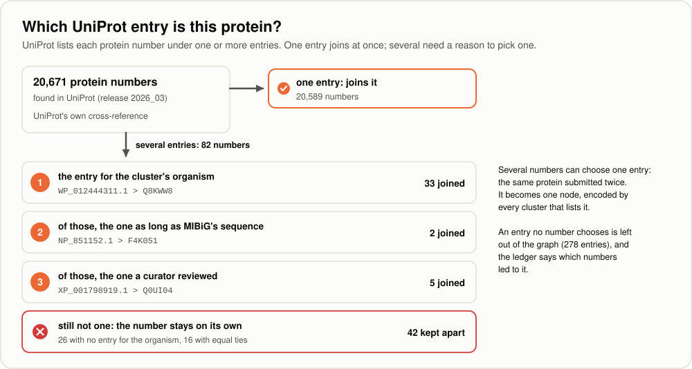
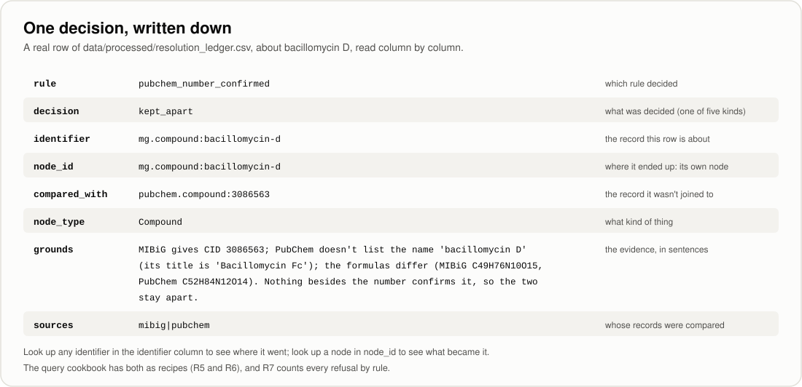

[← Handbook](HANDBOOK.md) · [README](../README.md) · [Glossary](GLOSSARY.md) · [Roadmap](ROADMAP.md) · [Query cookbook](QUERY_COOKBOOK.md) · [Git workflow](GIT-WORKFLOW.md)

# 06. Entity resolution and the graph build (Phase 4)

**Prerequisites:** [`05b-all-cluster-proteins.md`](05b-all-cluster-proteins.md)
finished: `pytest` passes and `data/processed/staging/` holds the tables of all
six sources (MIBiG, PubChem, NCBI Taxonomy, KEGG, UniProt and the curated
bridge). Nothing here downloads anything, so you can do this phase offline. No
chemistry, biology or database background is needed: each idea is explained
where it first appears.

**Learning goal:** after this phase you will understand what entity resolution
is and why a wrong merge does more harm than a missed one; how to decide that
two records describe the same thing, and how to write each decision down with
its grounds; what a molecular formula is and why two molecules can share one;
how records are grouped with a small data structure called union-find; what a
database is, what SQL is, and how a database can enforce rules by itself; why
the project keeps one source of truth and rebuilds everything else from it; and
how the same facts are queried as tables (DuckDB) and walked as a graph
(NetworkX).

**Time:** about 10 to 12 hours, in three or four sessions; it is the largest
phase of release 1.0. The commands themselves are quick: the resolver runs in
about ten seconds and the build in about five.

> Every term here is also in [`GLOSSARY.md`](GLOSSARY.md). The overview of this
> phase is in [`HANDBOOK.md`](HANDBOOK.md), Stage 7. The recipes for asking the
> finished database questions are in [`QUERY_COOKBOOK.md`](QUERY_COOKBOOK.md).

---

## Contents

1. [What this phase builds, in one picture](#1-what-this-phase-builds-in-one-picture)
2. [The science, in plain words](#2-the-science-in-plain-words)
3. [The engineering ideas, in plain words](#3-the-engineering-ideas-in-plain-words)
4. [Step 0. Get into position](#4-step-0-get-into-position)
5. [Step 1. Put the new files in place](#5-step-1-put-the-new-files-in-place)
6. [Step 2. Look at the real data first](#6-step-2-look-at-the-real-data-first)
7. [Step 3. A Pathogen becomes a kind of Organism](#7-step-3-a-pathogen-becomes-a-kind-of-organism)
8. [Step 4. Organisms](#8-step-4-organisms)
9. [Step 5. Compounds](#9-step-5-compounds)
10. [Step 6. Proteins](#10-step-6-proteins)
11. [Step 7. One node per group, and the ledger](#11-step-7-one-node-per-group-and-the-ledger)
12. [Step 8. The graph build: DuckDB and NetworkX](#12-step-8-the-graph-build-duckdb-and-networkx)
13. [Step 9. Tests built from a real slice](#13-step-9-tests-built-from-a-real-slice)
14. [Step 10. Run it for real](#14-step-10-run-it-for-real)
15. [Step 11. Pictures, the Handbook and the records](#15-step-11-pictures-the-handbook-and-the-records)
16. [How evidence and confidence carry through a merge](#16-how-evidence-and-confidence-carry-through-a-merge)
17. [What the graph still doesn't cover](#17-what-the-graph-still-doesnt-cover)
18. [What could go wrong](#18-what-could-go-wrong)
19. [Checkpoint](#19-checkpoint)
20. [Committing this phase](#20-committing-this-phase)

---

## 1. What this phase builds, in one picture


Until now each source has had its own tables. MIBiG says cluster BGC0000433
makes "surfactin"; PubChem describes compound 12560; UniProt describes protein
entry Q70KJ7; NCBI Taxonomy describes organism 326423. Several of those records
are about the same real thing under different identifiers, and a graph that
keeps them apart counts one antibiotic twice and splits its facts across two
dots.

This phase does two jobs:

1. **The resolver** (`python -m microbegraph.resolve`) decides which records are
   the same thing, joins them into single nodes, re-points every arrow, and
   writes every decision, joins and refusals alike, into a **resolution
   ledger** with its grounds. Then it runs the twelve rules of
   [`02-ontology-and-data-model.md`](02-ontology-and-data-model.md#9-validation-rules-the-loader-enforces)
   on the merged tables, and writes nothing if any rule fails.
2. **The graph build** (`python -m microbegraph.build_graph`) loads the result
   into a database, DuckDB, and rebuilds the same facts as a NetworkX graph,
   then checks that the two agree, type by type.

It also adds a small command for asking the database questions
(`python -m microbegraph.query`) and the first
[`QUERY_COOKBOOK.md`](QUERY_COOKBOOK.md): 19 SQL recipes and 5 graph recipes,
each tested.

One change to the rulebook comes with it: **a Pathogen is now a kind of
Organism**, so an organism that makes molecules and also causes a crop disease
is one node (Step 3).

The commands:

| Command | What it does | Touches the internet? |
|---|---|---|
| `python tests/fixtures/capture_resolution_samples.py --survey` | Counts the duplicates and disagreements in your staging tables (Step 2) | No |
| `python -m microbegraph.fetch --tidy-only --source ncbi_taxonomy` | Rebuilds NCBI Taxonomy's table, now with the pathogens' family trees (Step 3) | No |
| `python -m microbegraph.resolve` | Merges the six sources into one graph, with the ledger | No |
| `python -m microbegraph.build_graph` | Loads the graph into DuckDB, rebuilds it in NetworkX, compares | No |
| `python -m microbegraph.query --recipe 9` | Runs a recipe from the cookbook (or your own SQL) | No |

**Files this phase creates or changes** (paths relative to the project folder):

| Path | New or changed | What it is |
|---|---|---|
| `src/microbegraph/resolve.py` | new | The resolver: runs the rules in order, checks, writes the four files |
| `src/microbegraph/resolution/__init__.py` | new | What entity resolution is, and the order the steps run in |
| `src/microbegraph/resolution/pool.py` | new | Reads all six sources' tables into one pool |
| `src/microbegraph/resolution/groups.py` | new | Union-find groups, the naming identifier, and the guard against over-merging |
| `src/microbegraph/resolution/names.py` | new | Comparing names and formulas fairly |
| `src/microbegraph/resolution/organisms.py` | new | Moves organisms whose NCBI number was merged |
| `src/microbegraph/resolution/compounds.py` | new | The PubChem and NPAtlas rules |
| `src/microbegraph/resolution/proteins.py` | new | The UniProt, identical-sequence and gene-name rules |
| `src/microbegraph/resolution/combine.py` | new | One node per group; arrows re-pointed and combined |
| `src/microbegraph/resolution/ledger.py` | new | The ledger, its columns and the list of rules |
| `src/microbegraph/build_graph.py` | new | DuckDB with its tables, rules and views; NetworkX; the comparison |
| `src/microbegraph/query.py` | new | Runs a cookbook recipe or your own SQL, read-only |
| `src/microbegraph/ontology.py` | changed | `SUBTYPE_OF` and `is_a()`: a Pathogen is a kind of Organism |
| `src/microbegraph/validate.py` | changed | Rule 8 accepts a kind of a type |
| `src/microbegraph/sources/ncbi_taxonomy.py` | changed | Pathogens get their family tree |
| `src/microbegraph/paths.py` | changed | Where the merged files and the database live |
| `src/microbegraph/staging.py`, `src/microbegraph/sources/mibig.py` | changed | Notes only |
| `tests/fixtures/capture_resolution_samples.py` | new | The survey (Step 2), and the slice the tests use |
| `tests/fixtures/resolve/` (18 files) | new | A real slice of all six sources' tables, around 22 chosen clusters |
| `tests/fixtures/README.md` | changed | Where the slice came from, cluster by cluster |
| `tests/conftest.py` | changed | Helpers for the slice |
| `tests/test_resolve.py`, `tests/test_build_graph.py`, `tests/test_query.py` | new | The promises the new code makes, and every cookbook recipe |
| `tests/test_foundations.py`, `tests/test_ncbi_taxonomy.py` | changed | A Pathogen is a kind of Organism, and has a family tree |
| `docs/06-entity-resolution-graph-build.md` | new | This guide |
| `docs/QUERY_COOKBOOK.md` | new | Tested recipes for asking the database questions |
| `docs/img/resolution_flow.svg`, `pubchem_check.svg`, `uniprot_choice.svg`, `ledger_row.svg`, `two_shapes.svg` | new | Five new pictures |
| `docs/img/make_illustrations.py`, `docs/interactive/make_interactive.py` and the files they draw | changed | The new pictures; the ontology map shows "a kind of"; the explorers name UniProt's node for srfAA |
| `docs/phases.csv` | changed | Phase 4 done; Phase 4b planned |
| `README.md`, `CHANGELOG.md`, `docs/HANDBOOK.md`, `docs/ROADMAP.md`, `docs/GLOSSARY.md`, `docs/GIT-WORKFLOW.md`, `docs/00-architecture.md`, `docs/02-ontology-and-data-model.md`, `docs/03-ingestion-mibig.md`, `docs/04-more-sources-secrets.md`, `docs/05-proteomics-uniprot.md`, `docs/05b-all-cluster-proteins.md`, `docs/R-SETUP.md` | changed | Updated for this phase |

**Files this phase writes on your computer that never go to GitHub:**

| Path | What it is | Size on the real data |
|---|---|---|
| `data/processed/nodes.csv` | One row per node of the merged graph | about 31 MB |
| `data/processed/edges.csv` | One row per arrow | about 7.5 MB |
| `data/processed/resolution_ledger.csv` | Every decision, with its grounds | about 4 MB |
| `data/processed/resolve_summary.json` | The counts, and the lists for Phase 4b | 4 KB |
| `data/processed/microbegraph.duckdb` | The database | about 40 MB |
| `data/processed/staging/ncbi_taxonomy_*` | Rewritten in Step 3 | |

---

## 2. The science, in plain words

### Why one thing ends up with several records

Every source names things its own way, for its own reasons.

* **Compounds.** MIBiG's curators record each molecule under the name its paper
  used ("erythromycin A"), and, for about a third of them, a PubChem number.
  PubChem, the public chemistry database, has its own record for that number,
  titled "Erythromycin". Same molecule, two records.
* **Proteins.** MIBiG names each protein by its INSDC or RefSeq number, a record
  of one stretch of DNA read in one lab (`CAE02630.1`). UniProt, the protein
  knowledgebase, gathers what is known about the protein into an entry
  (`Q70KJ7`) and lists the DNA records it came from. Same protein, two records.
* **Organisms.** These are easier: MIBiG and NCBI Taxonomy both use NCBI's
  numbers. But NCBI sometimes decides that two numbers were one species all
  along, keeps one and retires the other, and MIBiG 4.0 still uses seven retired
  numbers. And NCBI renames species when they are reclassified: MIBiG calls
  taxid 1063 *Rhodobacter sphaeroides*, NCBI now calls it *Cereibacter
  sphaeroides*.

A familiar version of the problem: a school where the office has a pupil as
"Sam Lee" and the sports club has "Samantha Lee, year 9". Before anyone can say
how many pupils play football, someone has to decide which records are the same
child.

### What a molecular formula is, and why two molecules can share one

A molecular formula lists the atoms in one molecule. Surfactin is C52H91N7O13:
52 carbon atoms, 91 hydrogen, 7 nitrogen and 13 oxygen. Two records of the same
molecule should give the same formula, so the formula is a useful check.

It isn't proof, though. Atoms can be put together in different arrangements,
like the same Lego bricks built into different models. Molecules with the same
atoms in different arrangements are called **isomers**, and they can behave
completely differently. MIBiG gives minutissamides B and C the PubChem number of
minutissamide D, and all three have the formula C55H91N13O16: the formula
agrees, and they are still three different molecules. That case shapes one of
the rules in Step 5.

A formula ending in a sign, such as C10H16NO4-, describes an **ion**: a molecule
carrying an electric charge. Databases don't always write the sign. For
prekainic acid, MIBiG gives C10H16NO4 and PubChem C10H16NO4-: the same atoms,
with and without the sign, so the comparison ignores a sign at the end (one pair
on the real data). It doesn't ignore a difference in the atoms themselves. An
acid and its ion usually differ by one hydrogen, and those still count as two
different formulas.

### What NPAtlas is

The Natural Products Atlas (NPAtlas) is a curated database of molecules made by
microbes. MIBiG records NPAtlas numbers for many compounds, so when two MIBiG
names carry the same NPAtlas number, they may be one compound recorded twice.
Lovastatin and monacolin K are a real example: one cholesterol-lowering molecule,
discovered twice and named twice.

### What UniProt's "reviewed" means

UniProt has two kinds of entry. **Reviewed** entries (Swiss-Prot) have been read
and checked by a curator. **Unreviewed** entries (TrEMBL) are generated
automatically from DNA records. When two entries describe the same protein in
the same organism, the reviewed one is the one UniProt's own curators stand
behind.

### An organism that is also a pathogen

*Fusarium graminearum* is a fungus that makes several molecules MIBiG records
(four of its gene clusters are in MIBiG) and also causes head blight on wheat
and ear rot on maize. Until now the project's rulebook had no way to say "this
organism is both": MIBiG and NCBI called it an Organism, the curated bridge
called it a Pathogen, and both used the same identifier. Step 3 settles it.

---

## 3. The engineering ideas, in plain words

### Entity resolution

Deciding when two records describe the same real-world thing is called
**entity resolution** (also record linkage or deduplication). Banks do it to
avoid opening two accounts for one customer; hospitals do it so one patient's
results end up in one file.

### A wrong merge does more harm than a missed one

If two records of one molecule stay apart, the graph has a small gap: one
molecule appears twice, and anyone looking can see both. If two *different*
molecules are joined into one dot, every fact about either one now seems to be
about both, and every answer that passes through that dot inherits the mistake
without showing it. So every rule here asks for clear evidence before joining
anything, and when the evidence isn't there, the records stay apart and the
ledger says why.

### What counts as evidence

The strongest evidence is an **exact identifier one source gives for another**:
UniProt's own statement that protein record CAE02630.1 belongs to its entry
Q70KJ7, kept by UniProt. A number someone typed by hand (MIBiG's PubChem numbers)
is weaker, so it needs a **second, independent clue** before two records are
joined: the name, or the formula. A name alone, or a formula alone, is never
enough, because names are reused and formulas are shared.

Of the two clues, the formula is the weaker. It is only independent of the
number if MIBiG worked it out on its own. When MIBiG copied a compound's
structure from the PubChem record its number points at, the formulas agree
whether the number is right or not. Step 5 shows the cases where that happened.

### Groups that grow by joining (union-find)

Every identifier starts in a group of its own. When a rule decides two
identifiers are the same thing, their groups are joined. If A joins B and later
B joins C, then A, B and C are one group. At a party, whenever two people turn
out to know each other, their little groups merge, and at the end of the evening
every cluster of people is one group however it formed.

The data structure that does this quickly is called **union-find** (or a
disjoint-set forest). It lives in `src/microbegraph/resolution/groups.py`.

### Which identifier names a joined node

Each group becomes one node, and the node needs one identifier. The identifier
from the most specific public authority wins:

| Kind | Preferred first | Then | Then |
|---|---|---|---|
| Compound | `pubchem.compound:` | `mg.compound:` | |
| Protein | `uniprot:` | `ncbiprotein:` | `mg.protein:` |
| Organism | NCBI's current `ncbitaxon:` number | | |

Within the same kind, the identifier that sorts first wins, so the choice is the
same on every run and every computer. Every other identifier in the group is kept
as an **alias**: the node lists them, and the database's `aliases` view finds
the node from any of them (cookbook recipe R5).

**The guard against over-merging:** a group may hold at most one PubChem
compound and at most one UniProt entry. PubChem and UniProt have already decided
that their records are different things, so a chain of joins that would put two
of them in one group is refused.

### The ledger

Every decision goes into `data/processed/resolution_ledger.csv` with the rule
that made it and its grounds in a sentence. A bank statement is the everyday
version: nobody trusts a balance that can't be explained line by line, and
nobody should trust a merged node that can't be either. The ledger is one of the
project's outputs, as much as the graph is.

### Refuse, don't warn (again)

The resolver runs the twelve rules from Phase 1 on the merged tables and writes
nothing if any fails. Merging can break rules that every source passed on its
own: two records joined into one node, an arrow re-pointed to a node that was
left out. Catching that the day it happens is the point of Phase 1's rule.

### A database, and SQL

A **database** is a program for storing tables and answering questions about
them. **DuckDB** is a database that lives in a single file
(`microbegraph.duckdb`) and needs no server, so there is nothing to install
beyond the Python package, and it runs the same on Windows, macOS and RHEL 8.
You ask it questions in **SQL**, the standard language for databases;
[`QUERY_COOKBOOK.md`, section 2](QUERY_COOKBOOK.md#2-sql-in-ten-minutes)
teaches the basics in ten minutes.

### Rules the database enforces by itself

The database's tables are declared with **constraints**, rules the database
checks on every row:

* a **primary key** (`node_id`) must be unique: rule 1, enforced by the database;
* a **foreign key** (`edges.source_id` must be a `nodes.node_id`): an arrow can't
  point at nothing, rule 6;
* a **CHECK** constraint (`evidence_level` must be one of the four): rules 3, 7
  and 9.

The CHECK lists are built from `ontology.py`, so the Python rules and the
database rules can't disagree. A hand-edited row that breaks them is refused at
the door.

### Views

A **view** is a saved question that looks and behaves like a table. The
database has one for each node type with properties worth showing (`organisms`,
`compounds`, `proteins`...; activities and compound classes have only a name,
so the `nodes` table is enough for them), each with the most-used properties as
ordinary columns, so a query can say
`proteins.reviewed` instead of digging into the JSON `properties` column. This
is what [`02-ontology-and-data-model.md`](02-ontology-and-data-model.md#7-the-physical-schema-two-csv-files)
meant by "promoting" properties.

### One source of truth, two shapes

The same facts are kept as tables in DuckDB and as a graph in NetworkX, a Python
library for graphs. DuckDB is the **single source of truth**: the NetworkX graph
is always rebuilt from it (`load_graph()`) and never edited, so the two can't
drift apart. A library's catalogue and its shelves describe the same books: the
catalogue answers "how many books by this author?", and the shelves let you walk
from one book to the one beside it.


NetworkX holds the graph as a **DiGraph** (directed graph): every arrow
remembers which way it points, and there is at most one arrow from one node to
another. The build checks that the counts agree, type by type, and stops if they
don't.

### Writing to a temporary file first

The database is built in `microbegraph.duckdb.building`, compared with NetworkX,
and only renamed to `microbegraph.duckdb` once both checks pass. If anything
fails on the way, the temporary file is deleted and the previous database is
still there, untouched: the same idea as Phase 1's "write files together".

---

## 4. Step 0. Get into position

1. Open your terminal and go to the project folder:

   ```bash
   cd ~/projects/microbegraph      # or wherever you cloned it
   ```

   Windows PowerShell: `cd $HOME\projects\microbegraph`
2. Make sure you're on the working branch and up to date:

   ```bash
   git switch develop
   git pull --ff-only origin develop
   ```

3. Activate the toolbox:

   ```bash
   source .venv/bin/activate          # macOS / Linux / RHEL 8
   ```

   Windows PowerShell: `.\.venv\Scripts\Activate.ps1`
4. Check that all six sources' tables are there:

   ```bash
   ls data/processed/staging
   ```

   Windows PowerShell: `dir data\processed\staging`. You should see 18 files,
   `<source>_nodes.csv`, `<source>_edges.csv` and `<source>_summary.json` for
   `curation`, `kegg`, `mibig`, `ncbi_taxonomy`, `pubchem` and `uniprot`. If any
   is missing, `python -m microbegraph.fetch --all` makes them (Phases 1 to 3b).

✅ **Checkpoint.** Your prompt starts with `(.venv)`, `git branch` shows
`* develop`, and the 18 staging files are there.

---

## 5. Step 1. Put the new files in place

If you cloned the repository after this phase was committed, every file is
already there and you can read along. If you're building it yourself, put each
file from the table in section 1 at the path shown. Then:

1. **No new packages are needed.** DuckDB and NetworkX have been in
   `requirements.txt` since Phase 0, waiting for this phase. Check that they're
   installed:

   ```bash
   python -c "import duckdb, networkx; print(duckdb.__version__, networkx.__version__)"
   ```

   You should see two version numbers, such as `1.5.5 3.6.1` (yours may be
   newer). If Python says `No module named 'duckdb'`, run
   `pip install -r requirements.txt` again.
2. **No reinstall is needed either.** The package is installed in editable mode
   (`pip install -e .`), so Python finds the new `resolution/` folder and the
   three new commands straight from the project folder.

✅ **Checkpoint.** `python -m microbegraph.resolve --help` prints a short usage
message starting with `usage: python -m microbegraph.resolve`.

---

## 6. Step 2. Look at the real data first

Every phase so far started by looking at real data before writing code, and each
time the look changed the plan. This survey counts the duplicates and
disagreements in your staging tables, and writes nothing:

```bash
python tests/fixtures/capture_resolution_samples.py --survey
```

The real output (after Step 3's re-tidy; before it, the first line says 70,601,
because the pathogens' family trees aren't there yet):

```
Identifiers
  identifiers in the six tables                                70,613
    ...that more than one source describes                      1,478
Organisms
  MIBiG organisms                                               1,480
    ...whose number NCBI has merged into another                    7
    ...that NCBI names differently today                          130
  organisms that are also crop pathogens                            2
Compounds
  MIBiG compounds                                               3,842
    ...that give a PubChem number                               1,186
      the formulas agree                                          977
      they agree once the charge is ignored                         1
      the formulas differ                                          34
      MIBiG gives no formula to compare                           169
      PubChem doesn't have the number                               5
    PubChem numbers given to more than one MIBiG compound          10
    NPAtlas numbers given to more than one MIBiG compound          10
Proteins
  protein numbers UniProt found                                20,671
    ...with exactly one entry                                  20,589
    ...with several entries                                        82
  UniProt entries reached from several numbers                    349
  sequences shared by more than one MIBiG protein record          797
  gene records MIBiG's protein file doesn't name                   59
```

What these numbers changed, one by one:

| What the survey found | What it means | The rule it led to |
|---|---|---|
| 1,478 identifiers described by more than one source | Mostly MIBiG's organisms, which NCBI Taxonomy also describes | `same_identifier`: one node, every source's facts (Step 4) |
| 130 organisms NCBI names differently | Species renamed since MIBiG's curators wrote them down | NCBI's name for the node, MIBiG's kept in `other_names` |
| 7 merged numbers | MIBiG uses numbers NCBI has retired | `ncbi_merged_number`: move to the current number |
| 2 organisms that are also pathogens | *Fusarium graminearum* and *Botrytis cinerea* | A Pathogen becomes a kind of Organism (Step 3) |
| 34 PubChem numbers whose formula differs | Looking at them showed most point at a different molecule: "bacillomycin D" carries the number of PubChem's "Bacillomycin Fc", with a different formula | A number needs a second clue (Step 5) |
| 10 numbers shared by several MIBiG names | Some are true synonyms (erythromycin and erythromycin A), some are isomers (minutissamides B and C, both given D's number) | With several names on one number, each name must be confirmed |
| 10 shared NPAtlas numbers | Some are one compound named twice (lovastatin and monacolin K); some aren't (cyclic and linear trichrysobactin, one with no formula) | Join only when the formulas agree too |
| 82 protein numbers with several UniProt entries | Mostly RefSeq "WP_" numbers, which NCBI shares between strains with identical proteins | Pick by organism, then length, then review status; otherwise refuse |
| 349 entries reached from several numbers | The same protein submitted twice, once in a cluster's record and once in a genome's | One node, encoded by every cluster that lists it |
| 797 shared sequences | The same sequence under two records, sometimes in one organism, sometimes in two | Join within one organism only |
| 59 gene records not in the protein file | Phase 3b's leftover list | Match through UniProt's gene names (Step 6) |

Two jobs that earlier guides left for this phase turned out to need more than a
rule, so they aren't built here: matching activity names that mean the same
thing, and the 275 property values on which two MIBiG entries describing the same
thing disagree (Phase 1's `property_conflicts`). Both went to Phase 4b
(section 17), and both are built there ([`06b-closing-the-gaps.md`](06b-closing-the-gaps.md)).

✅ **Checkpoint.** Your survey shows the same numbers, or close ones if your
downloads are from a different day.

---

## 7. Step 3. A Pathogen becomes a kind of Organism


The rulebook had a known cost, written down in
[`02-ontology-and-data-model.md`](02-ontology-and-data-model.md#7-pathogen) since
Phase 0: an organism that is both a producer and a pathogen would need two dots
with one identifier, which rule 1 forbids. This phase settles it the way
ontologies usually do, with a **subtype**: a Pathogen is a kind of Organism.

Anything an Organism may do in the graph, a Pathogen may do too: harbour a gene
cluster (`HARBORS`), sit in the family tree (`MEMBER_OF`). The reverse isn't
true: `INFECTS` starts only at a Pathogen. A sports car is a kind of car, so it
may park wherever cars may park, but not every car is allowed on the race track.

Three small changes carry it:

1. **`src/microbegraph/ontology.py`** gains `SUBTYPE_OF = {"Pathogen": "Organism"}`
   and a function `is_a(node_type, wanted)`.
2. **`src/microbegraph/validate.py`**, rule 8, accepts a kind of the required
   type at either end of an arrow. A test checks both directions: a Pathogen may
   start `HARBORS`; an Organism may not start `INFECTS`.
3. **`src/microbegraph/sources/ncbi_taxonomy.py`** gives each pathogen its family
   tree, the same way MIBiG's organisms have theirs. *Globisporangium ultimum*,
   which causes damping-off in cotton seedlings, now has `MEMBER_OF` arrows up to
   the genus *Globisporangium*, the family Pythiaceae, and on to Eukaryota. (The
   two pathogens that are also organisms already had theirs.)

Rebuild NCBI Taxonomy's table from the answers already in your locker (no
download):

```bash
python -m microbegraph.fetch --tidy-only --source ncbi_taxonomy
```

The real output:

```
[ncbi_taxonomy] tidy
  [ncbi_taxonomy] wrote ncbi_taxonomy_nodes.csv and ncbi_taxonomy_edges.csv
    answers_read                  8
    taxids_requested           1485
    organisms_requested        1480
    pathogens_requested           6
    taxa_found                 1485
    taxids_merged                 7
    taxids_not_found              0
    organism_nodes             2453
    pathogen_nodes                4
    member_of_edges            2449
    pathogens_also_organisms      2
```

Compared with Phase 2's run, `organism_nodes` grew from 2,441 to 2,453 (the
pathogens' ancestors: 12 genera, families and so on that no MIBiG organism
needed) and `member_of_edges` from 2,433 to 2,449 (one arrow up from each of the
4 pathogens, plus one from each of the 12 new ancestors). `pathogen_nodes` is
still 4: *Fusarium graminearum* and *Botrytis cinerea* stay Organisms in this
table, counted under `pathogens_also_organisms`, and the resolver gives each one
both roles (Step 4).

✅ **Checkpoint.** `member_of_edges` is 2,449 (or Phase 2's number plus 16).

---

## 8. Step 4. Organisms

`src/microbegraph/resolution/organisms.py` and `combine.py` apply three rules.

**Rule `same_identifier`.** MIBiG and NCBI Taxonomy both describe
`ncbitaxon:326423`, *Bacillus velezensis* FZB42. The two rows become one node,
with every source's facts: MIBiG's name and NCBI's rank, lineage and group. The
node's `source` column says `mibig|ncbi_taxonomy`. 1,478 identifiers are
combined this way, all organisms and pathogens.

When two sources give the same property different values, the source that knows
best for that kind of node keeps its value, and the other is kept as
`<source>_<property>`:

| Node type | Who knows best, in order |
|---|---|
| Organism, Pathogen | NCBI Taxonomy, then the curated bridge, then MIBiG |
| Compound | PubChem, then MIBiG |
| Protein | UniProt, then MIBiG |

The **name** follows a simpler rule: the one a reader is most likely to
recognise. For organisms that's NCBI's current scientific name, because species
get renamed and NCBI tracks it; MIBiG's name goes into `other_names`, so a search
for either finds the node. For compounds and proteins it's MIBiG's name, because
PubChem's titles are often long systematic names ("(2S,4S)-4-[[2-[(1S,3S)-1-
acetyloxy-...") and UniProt's describe the job rather than the gene ("Surfactin
synthetase A" for srfAA).

**Rule `ncbi_merged_number`.** NCBI has merged 7 of MIBiG's organism numbers
into others. Phase 2 asked NCBI about them and recorded the current number in
`ncbi_taxonomy_summary.json`. The resolver moves MIBiG's organism to that
number, so its clusters hang from the same node as everything NCBI files there.
In three of the seven cases MIBiG also uses the current number, so two MIBiG
organisms become one: MIBiG's *Actinomadura namibiensis* (182080) is now
*Actinomadura kijaniata* (46161). It works like a forwarding address: post to
the old address still arrives.

**Rule `organism_and_pathogen`.** When an identifier is an Organism in one source
and a Pathogen in another, the node becomes a Pathogen, which is a kind of
Organism, so it keeps its clusters and its family tree. Two nodes:
*Fusarium graminearum* (a producer itself) and *Botrytis cinerea* (the species
above a producing strain, B05.10).

✅ **Checkpoint.** Recipe R16 in the cookbook lists six pathogens, and recipe R5
with `WHERE alias = 'ncbitaxon:182080'` shows it became `ncbitaxon:46161`
(after Step 10).

---

## 9. Step 5. Compounds


`src/microbegraph/resolution/compounds.py` applies four rules.

**Rule `pubchem_number_confirmed`.** MIBiG gives 1,186 compounds a PubChem number
(a CID). Each PubChem record remembers which MIBiG compound gave its number
(`mibig_compound_ids`, from Phase 2), so finding the pairs is easy. A pair is
joined when a second clue agrees:

* **the name**: MIBiG's name (or one of its synonyms) is PubChem's title or one of
  PubChem's synonyms; or
* **the formula**: the two formulas agree, or agree once a charge is ignored.

Names are compared as **keys**: lower case, accents and Greek letters spelled
out, everything but letters and digits removed, so "Erythromycin A",
"erythromycin-A" and "erythromycin A" all become `erythromycina`. The signs of
mirror-image molecules are kept as words ("(+)" becomes "plus"), so
(+)-menthol and (-)-menthol never match: they smell different, and they are
different molecules. The code is in `src/microbegraph/resolution/names.py`.

On the real data: 637 pairs agree on both, 135 on the name only, 325 on the
formula only. **64 agree on neither**, and stay apart. *Bacillomycin D* is one of
them: MIBiG gives it the number of PubChem's "Bacillomycin Fc", a relative with
a different formula (C49H76N10O15 against C52H84N12O14). Joining them would have
moved the cited claim that bacillomycin D inhibits *Fusarium graminearum*
(from the curated bridge) onto a different molecule.

When the name agrees but the formula doesn't (8 cases, such as geldanamycin),
the pair is joined, PubChem's formula is kept, and MIBiG's stays as
`mibig_formula`, so the disagreement is visible.

**Rule `pubchem_number_shared`.** Ten numbers are given to two MIBiG names each.
A matching formula proves nothing here, because isomers share formulas, so each
name must be one PubChem lists. Erythromycin and erythromycin A are both
confirmed and become one node; minutissamides B and C are not, and stay apart
(8 confirmed, 12 not).

**Rule `pubchem_number_unknown`.** Five numbers MIBiG gives aren't in PubChem at
all (Phase 2 listed them). Nothing to join.

**Rule `npatlas_and_formula`.** Two MIBiG compounds with the same NPAtlas number
**and** the same formula are one compound recorded under two names: lovastatin
and monacolin K, gladiofungin A and gladiostatin A. Three pairs are joined; seven
stay apart, because one of the two has no formula to compare.

What happens to a compound that stays apart: its MIBiG node stays as it was, with
a note in `resolution_notes`, and its unconfirmed number moves from `pubchem_cid`
to `pubchem_cid_not_confirmed`, so nobody filtering on `pubchem_cid` mistakes it
for a confirmed one. The PubChem record nothing was joined to is left out of the
graph (rule `not_used`), because it describes nothing the graph contains.

**Where the formula fails.** 325 of the joins above rest on the formula alone:
PubChem's first 20 names (all that Phase 2 keeps) don't include MIBiG's name.
Most of them are right. PubChem's title is often a systematic chemical name, or
a spelling of the same name ("Amphotericin beta" for amphotericin B,
"6-Methylsalicylic Acid" for MIBiG's "6-methylsalicyclic acid"). A few are
wrong. Either MIBiG's record took its structure from the PubChem record its
number points at, so the formulas agree for the wrong reason, or the number
belongs to a close relative that happens to share the formula.

* MIBiG's "2-methylisoborneol" (a small molecule with an earthy smell, C11H20O)
  carries the formula C15H16BrN3O4S, a bromine compound that is PubChem's record
  9237955.
* "minutissamide A" carries the number and formula of the record PubChem titles
  "Minutissamide C".
* The record named "desosamine" carries methymycin's number, formula, NPAtlas
  number and structure (its SMILES string is PubChem's for methymycin), though
  desosamine is only the sugar part of methymycin. The PubChem join and then the
  NPAtlas rule both put it with methymycin.

The rules can't tell these apart from the right joins, because the data agrees
with itself. The ledger keeps every one findable: recipe R19 lists them (five at
first, all 325 once you remove its `LIMIT` line). Phase 4b took them up
([`06b-closing-the-gaps.md`](06b-closing-the-gaps.md)): PubChem's full list of
names turned out to confirm none of them, but keeping every value MIBiG's
entries give explained both cases above, a review file now keeps them apart with
a source, and PubChem's name search reviewed the rest: 82 still rest on the
formula alone.

✅ **Checkpoint.** Recipe R6 shows the two ledger rows that made
`pubchem.compound:12560` one node; recipe R8 shows three refusals with their
grounds.

---

## 10. Step 6. Proteins



`src/microbegraph/resolution/proteins.py` applies three rules, in this order.

**Rule `uniprot_cross_reference`.** UniProt's link from an entry to a protein
number is UniProt's own cross-reference, so a number with one entry joins it:
20,589 numbers. A number with several entries (82) needs a reason to pick one,
tried in order:

1. the entry whose organism is the cluster's organism (33 decided);
2. of those, the one as long as MIBiG's sequence (2 more);
3. of those, the one a curator has reviewed (5 more).

If that still doesn't leave exactly one, the number stays on its own (42), and
its candidates are listed in the node's `resolution_notes` and in the ledger.
CBF82293.1 is an example: UniProt lists that one record under two reviewed
entries for the same organism, P0CU77 (368 amino acids) and P0CU78 (407), while
MIBiG's sequence is 822 long, so neither is clearly "the" entry.

Several numbers can choose the same entry: the same protein submitted twice, once
in a cluster's record and once in a genome's. They become one node, encoded by
every cluster that lists it. An entry that no number chose (278) is left out.

**Rule `identical_sequence`.** Phase 3b kept an MD5 fingerprint of every
protein's sequence. Two protein records with the same fingerprint **in the same
organism** are one protein (220 joined): typically a gene listed once by its
locus tag and once by its number. Two strains with identical proteins stay
apart, because the graph tracks which strain makes what. If UniProt has two
separate entries for the pair, UniProt's separation wins (9 kept apart).
Often one of the pair has already joined a UniProt entry under the rule before.
Then the other one joins that node too, and the ledger row is about the one that
disappears: AVW82949.1 and MQS11304.1 have the same sequence, MQS11304.1 already
belongs to UniProt entry A0A1S6Q5K4, so the row says AVW82949.1 went there.

**Rule `gene_name_in_uniprot`.** 59 of MIBiG's gene records name their protein
only by a gene name that MIBiG's protein file doesn't use. If UniProt gives that
gene name to exactly one protein of the same cluster, the gene record joins it,
and its facts move along: baeJ's gene record says a knock-out showed its job in
making bacillaene, and that `CATALYZES` arrow now starts at UniProt entry Q1RS73.
38 join; 21 stay on their own and are listed for Phase 4b, which looks them up in
MIBiG's GenBank file. (Since Phase 4b, the GenBank file places all 59 before the
resolver runs, so this rule finds nothing left to do and stays as a fallback.
Phase 4b also found that the rule missed UniProt entries listing more than one
gene name, baeI's among them, and fixed it.)

After this step, surfactin synthetase A is one node, `uniprot:Q70KJ7`, still
named srfAA, carrying MIBiG's facts (its job, the knock-out) and UniProt's (its length, its
description, and `reviewed` = false: no curator has checked this entry yet) side
by side.

✅ **Checkpoint.** Recipe R11 lists srfAA to srfAD with their UniProt entries;
recipe R18 shows 20,229 proteins joined to UniProt.

---

## 11. Step 7. One node per group, and the ledger

`src/microbegraph/resolution/combine.py` turns each group into one row of
`nodes.csv` (section 3 and Step 4 say how names and properties combine) and
re-points every arrow:

* both ends of every arrow are replaced by their group's identifier;
* two arrows that became the same arrow are combined into one, keeping the
  strongest evidence level, the highest confidence and every record number and
  citation (96 on the real data: a cluster that produced "erythromycin" and
  another that produced "erythromycin A" now produce one compound, and their
  `HAS_ACTIVITY` arrows to "antibacterial" are one arrow listing both entries);
* an arrow at an entry that was left out is dropped and counted (3: KEGG pathway
  links of PubChem records nothing was joined to);
* an arrow pointing at an identifier no source has is **not** dropped: it stays,
  so rule 6 catches it and the resolver refuses to write.



The ledger has one row per decision. Every identifier that disappeared has a
row of its own (the resolver checks this before writing anything, and stops if
one is missing), so looking one up in the `identifier` column tells you where it
went; looking up a node in `node_id` lists everything that became it. It has
five kinds of decision:

| decision | Meaning | Rows on the real data |
|---|---|---|
| `combined` | One identifier, several sources' records | 1,480 (1,478 plus the 2 organism-and-pathogen rows) |
| `moved` | An old NCBI number moved to the current one | 7 |
| `merged` | An identifier joined another node | 21,995 |
| `kept_apart` | A join the evidence didn't support | 160 |
| `left_out` | A PubChem or UniProt entry nothing was joined to | 347 |

Then the twelve rules run on the merged tables, and only if all pass, and the
ledger accounts for every identifier, are the four files written, together
(Phase 1's "write files together").

✅ **Checkpoint.** Recipe R7 counts the refusals by rule; the five counts above
add up to the ledger's 23,989 rows.

---

## 12. Step 8. The graph build: DuckDB and NetworkX

`src/microbegraph/build_graph.py` does five things in order:

1. **Checks** `nodes.csv` and `edges.csv` against the twelve rules again, in case
   either was edited by hand. If any rule fails, it stops and builds nothing.
2. **Creates the database** in `microbegraph.duckdb.building`, with the tables
   declared with their constraints (primary key, foreign keys, CHECK lists built
   from `ontology.py`), and loads the four files into the `nodes`, `edges`,
   `ledger` and `sources` tables, plus a `build_info` table (when it was built,
   from which resolver run).
3. **Adds the views**: `organisms`, `clusters`, `compounds`, `proteins`,
   `pathogens`, `crops`, `pathways` and `aliases`. The `organisms` view includes
   pathogens, because a Pathogen is a kind of Organism.
4. **Rebuilds the NetworkX graph** from the new file and counts nodes and
   arrows of every type in both. Any difference stops the build with the counts,
   and the old database stays as it was. (Two arrows between the same pair of
   nodes would be the likely cause, since a DiGraph holds one; the real data has
   none, and a test makes sure such a case is caught.)
5. **Swaps the new file in** for the old one. On macOS and Linux this works even
   while another program (an R session, a notebook) has the old database open:
   that program keeps reading the old version until it connects again. Windows
   won't replace a file that's in use, so there the build stops and asks you to
   close whatever has the database open (an R session, a notebook, a database
   viewer), deletes the new file and leaves the old database as it was.

The database opens read-only for every question you ask it later
(`python -m microbegraph.query`, `load_graph()`), so asking can never change it.

✅ **Checkpoint.** You can say why DuckDB is the source of truth and NetworkX is
rebuilt, rather than the other way round.

---

## 13. Step 9. Tests built from a real slice

The resolver's tests need staging tables shaped exactly like the real ones, with
the awkward cases in them. The real tables are 40 MB and never go to GitHub, so
`tests/fixtures/capture_resolution_samples.py` cuts out the rows around 22 chosen
clusters (surfactin, bacillaene, bacillomycin D, the erythromycins, the
minutissamides, lovastatin and monacolin K, a *Fusarium graminearum* cluster, and
others; the script lists why each is there) and writes them to
`tests/fixtures/resolve/`, about 380 KB. The slice is self-contained: every arrow
in it points at a node in it. UniProt's long function descriptions are cut to
their first sentence, because the resolver never reads them.

If you are building the phase yourself, make the slice once (the repository
already has it):

```bash
python tests/fixtures/capture_resolution_samples.py
```

You should see:

```
  mibig           369 nodes  478 edges
  pubchem          18 nodes    0 edges
  ncbi_taxonomy    86 nodes   84 edges
  kegg              5 nodes    6 edges
  uniprot         166 nodes    0 edges
  curation          5 nodes    7 edges
Wrote tests/fixtures/resolve/ (376 KB)
```

(The slice is cut from the staging tables as they were before Step 3, which is
why it has no pathogen family trees; `tests/test_ncbi_taxonomy.py` tests those.)

Three test files check the promises:

| File | What it checks |
|---|---|
| `tests/test_resolve.py` | Every rule on its real case (bacillomycin D stays apart, erythromycin joins, baeJ's job moves to Q1RS73...), that every identifier that disappeared is in the ledger (and that the resolver refuses to write if one isn't), that the same input gives byte-for-byte the same files, and that a broken merge is refused with nothing written |
| `tests/test_build_graph.py` | DuckDB and NetworkX agree; the views work; the database itself refuses an arrow to nowhere; a broken CSV, a bad value or a count that differs leaves the old database untouched; two arrows between one pair are caught |
| `tests/test_query.py` | Every recipe in `QUERY_COOKBOOK.md`, SQL and Python, runs on the slice, and four give the expected answers; the query command can't change the database |

Run them all:

```bash
pytest
ruff check .
```

You should see (the number of dots on a line depends on your window's width):

```
.............................................................................. [ 26%]
.............................................................................. [ 52%]
.............................................................................. [ 79%]
..............................................................                 [100%]
296 passed in 6.77s
All checks passed!
```

✅ **Checkpoint.** 296 tests pass and ruff is clean. (The time on the last line
depends on your computer.)

---

## 14. Step 10. Run it for real

1. **Rebuild NCBI Taxonomy's table** if you haven't yet (Step 3):

   ```bash
   python -m microbegraph.fetch --tidy-only --source ncbi_taxonomy
   ```

2. **Resolve:**

   ```bash
   python -m microbegraph.resolve
   ```

   The real output from the run on 2026-10-12:

   ```
   [resolve] reading data/processed/staging/ (six sources)
     mibig           47,907 nodes   version 4.0
     pubchem          1,171 nodes   version live
     ncbi_taxonomy    2,457 nodes   version Build261011-2030.1
     kegg                39 nodes   version pathway 2026/10/09, compound 2026/10/09
     uniprot         20,507 nodes   version 2026_03
     curation            11 nodes   version repository file
   [resolve] decisions, rule by rule (the ledger has one row for each)
     same_identifier           combined 1,478
     ncbi_merged_number        moved 7
     organism_and_pathogen     combined 2
     pubchem_number_confirmed  merged 1,097   kept_apart 64
     pubchem_number_shared     merged 8   kept_apart 12
     pubchem_number_unknown    kept_apart 5
     npatlas_and_formula       merged 3   kept_apart 7
     uniprot_cross_reference   merged 20,629   kept_apart 42
     identical_sequence        merged 220   kept_apart 9
     gene_name_in_uniprot      merged 38   kept_apart 21
     not_used                  left_out 347
   [resolve] the merged graph
     nodes  48,264   from 70,613 identifiers (347 left out)
       Activity           74
       Compound        3,836
       CompoundClass      37
       Crop                5
       GeneCluster     2,437
       Organism        2,451
       Pathogen            6
       Pathway            39
       Protein        39,379
     edges  57,012   from 57,111 (96 combined, 3 dropped with left-out entries)
       BELONGS_TO        529
       CATALYZES       4,492
       ENCODES        39,955
       HARBORS         2,437
       HAS_ACTIVITY    2,771
       INFECTS             7
       INHIBITS            7
       MEMBER_OF       2,449
       PARTICIPATES_IN     82
       PRODUCES        4,283
   [resolve] the twelve rules pass on the merged tables
   [resolve] every identifier that disappeared has a ledger row
   [resolve] wrote data/processed/: nodes.csv, edges.csv, resolution_ledger.csv, resolve_summary.json
   Next:  python -m microbegraph.build_graph
   ```

   Reading it: 70,613 identifiers went in and 48,264 nodes came out. The
   difference is 21,995 identifiers merged into other nodes, 7 old organism
   numbers moved, and 347 PubChem and UniProt entries left out
   (70,613 - 21,995 - 7 - 347 = 48,264). Compounds went from 3,842 MIBiG records
   plus 1,171 PubChem records to 3,836 nodes; proteins from 40,037 MIBiG records
   plus 20,507 UniProt entries to 39,379 nodes.

3. **Build the database and the graph:**

   ```bash
   python -m microbegraph.build_graph
   ```

   The real output:

   ```
   [build_graph] checking data/processed/nodes.csv and edges.csv against the twelve rules
   [build_graph] wrote data/processed/microbegraph.duckdb
     tables  nodes 48,264   edges 57,012   ledger 23,989   sources 6   build_info
     views   organisms, clusters, compounds, proteins, pathogens, crops, pathways, aliases
   [build_graph] rebuilt the NetworkX graph from the database and compared
                          DuckDB  NetworkX
     nodes                48,264    48,264
       Activity               74        74
       Compound            3,836     3,836
       CompoundClass          37        37
       Crop                    5         5
       GeneCluster         2,437     2,437
       Organism            2,451     2,451
       Pathogen                6         6
       Pathway                39        39
       Protein            39,379    39,379
     edges                57,012    57,012
       BELONGS_TO            529       529
       CATALYZES           4,492     4,492
       ENCODES            39,955    39,955
       HARBORS             2,437     2,437
       HAS_ACTIVITY        2,771     2,771
       INFECTS                 7         7
       INHIBITS                7         7
       MEMBER_OF           2,449     2,449
       PARTICIPATES_IN        82        82
       PRODUCES            4,283     4,283
   [build_graph] every count matches. Done in 3.2 s.
   Next:  try the recipes in docs/QUERY_COOKBOOK.md
   ```

   The time varies by computer.
4. **Ask it the project's question:**

   ```bash
   python -m microbegraph.query --recipe 9
   ```

   The real output:

   ```
   R9. Which microbes might help against which crop disease?

   crop    pathogen                 compound                    microbe                     weakest_link        citation
   ------  -----------------------  --------------------------  --------------------------  ------------------  -------------------------------
   cotton  Globisporangium ultimum  pyoluteorin                 Pseudomonas protegens Pf-5  curated_literature  doi:10.1094/Phyto-70-712
   cotton  Globisporangium ultimum  pyoluteorin                 Pseudomonas sp. M18         curated_literature  doi:10.1094/Phyto-70-712
   cotton  Rhizoctonia solani       pyrrolnitrin                Pseudomonas chlororaphis    curated_literature  doi:10.1128/aem.60.1.78-85.1994
   jujube  Botrytis cinerea         surfactin                   Bacillus velezensis FZB42   curated_literature  doi:10.1186/s13568-023-01543-w
   maize   Fusarium graminearum     bacillomycin D              Bacillus velezensis FZB42   curated_literature  doi:10.1128/AEM.01075-17
   melon   Podosphaera fusca        fengycin                    Bacillus velezensis FZB42   curated_literature  doi:10.1094/MPMI-20-4-0430
   melon   Podosphaera fusca        iturin                      Bacillus subtilis           curated_literature  doi:10.1094/MPMI-20-4-0430
   wheat   Fusarium graminearum     bacillomycin D              Bacillus velezensis FZB42   curated_literature  doi:10.1128/AEM.01075-17
   wheat   Gaeumannomyces tritici   2,4-diacetylphloroglucinol  Pseudomonas fluorescens     curated_literature  doi:10.1094/MPMI-5-004
   (9 rows)
   ```

   Every row is a chain of four arrows from the graph, with the weakest one named
   and the paper that supports it. That's the answer this project was built to
   give, and the cookbook explains how the query works
   ([recipe R9](QUERY_COOKBOOK.md#r9-which-microbes-might-help-against-which-crop-disease)).
5. **Look at a few decisions yourself.** `python -m microbegraph.query --list`
   shows every recipe; R5 to R8 follow the resolver's decisions. Or open
   `data/processed/resolution_ledger.csv` in VS Code (it's 4 MB, so search with
   Ctrl+F or Cmd+F for `bacillomycin` rather than scrolling).
6. **Optional: read the same database from R.** If you set up R
   ([`R-SETUP.md`](R-SETUP.md)), Step 7 there now works: `source("R/explore.R")`
   prints the tables the Python build made.
7. **Write your numbers down.** Copy the counts from the resolver's output into
   `CHANGELOG.md` (Step 11).

✅ **Checkpoint.** `build_graph` ends with `every count matches`, and recipe R9
shows the jujube row for surfactin.

---

## 15. Step 11. Pictures, the Handbook and the records

**The pictures.** Five new diagrams, all drawn by
`docs/img/make_illustrations.py`: the path from six sources to one graph
(`resolution_flow.svg`, in section 1), the PubChem number check
(`pubchem_check.svg`), the UniProt choice (`uniprot_choice.svg`), one ledger row
column by column (`ledger_row.svg`), and the two shapes of the graph
(`two_shapes.svg`). The ontology map shows that a Pathogen is a kind of
Organism, and the interactive explorers name srfAA's node by its UniProt entry.

**At the end of this phase,** as at the end of every phase:

1. In `docs/phases.csv` (in VS Code), Phase 4's `status` is `done`, and Phase 4b
   is there, `planned`.
2. Re-run both picture scripts:

   ```bash
   python docs/img/make_illustrations.py
   python docs/interactive/make_interactive.py
   ```

   The first prints `Done: 27 figures in docs/img/`.
3. In `docs/HANDBOOK.md`: Stage 7 is ✅ and Stage 7b (Phase 4b) is ⏳, with the
   version, date and repository state at the top updated, and a change-log line.
4. The same status change is in the README build log and `docs/ROADMAP.md`.
5. Add the Phase 4 entry to `CHANGELOG.md`, with your numbers from Step 10.
6. Commit all of it in the phase commit (section 20).

---

## 16. How evidence and confidence carry through a merge


Resolution adds no new kind of arrow and no new facts. A join isn't an arrow in
the graph; it's a ledger row. What happens to the arrows that already exist:

| Situation | What the arrow keeps | Why |
|---|---|---|
| An arrow's end is joined to another node | Everything: evidence level, confidence, citation, record number | Only the identifier at its end changes |
| Two arrows become the same arrow | The **strongest** evidence level, the **highest** confidence, every record number and every citation, joined with `\|` | Nothing is lost, and the arrow is as strong as its best support |
| An arrow ends at an entry that was left out | Dropped, and counted | The entry describes nothing in the graph |
| A gene record joins a numbered protein | Its `CATALYZES` arrow, with its evidence (baeJ's stays `curated_experimental`) | The experiment was about that gene, whichever record names it |

The cited bridge's arrows (`INHIBITS`, `INFECTS`) stay `curated_literature` with
their citations, and they still point at the molecule the paper tested: the
refusal to join bacillomycin D to Bacillomycin Fc is what keeps that true.

---

## 17. What the graph still doesn't cover

| Gap | How big | What happens to it |
|---|---|---|
| Gene records named only by a gene name UniProt can't confirm | 21 (listed in `resolve_summary.json`, `for_phase_4b`) | They stay `mg.protein:` nodes. **Closed in Phase 4b:** MIBiG's GenBank file gives each gene's name and protein number side by side |
| Curators' removals no list names | 4 maize genes in BGC0002390 (`LOC100272490` and three more) | **Closed in Phase 4b:** MIBiG's GenBank file links NCBI gene numbers (`GeneID`) to protein numbers |
| MIBiG compounds without any PubChem number | 2,656 of 3,842 | They stay `mg.compound:` nodes. **Narrowed in Phase 4b:** PubChem's name search found a record for 865 of the 1,254 with a formula |
| PubChem numbers refused | 81 (64 + 12 + 5) | Some are missed joins (1233A is hymeglusin, but PubChem's short list of names doesn't say so). **Revisited in Phase 4b:** the name search found 1233A under a record of hymeglusin's structure, so the two are joined |
| Protein numbers with tied UniProt entries | 42 | Their candidates are listed on the node. Phase 4b added the review file, where a person can decide; one is decided (CBF82293.1), and one left with the maize removals, so 40 remain |
| Property values two MIBiG entries disagree on | 275 (`property_conflicts`, Phase 1), for example two masses for one compound | **Closed in Phase 4b:** the MIBiG adapter keeps every value with its entry (`<property>_by_entry`) |
| Activity names that mean the same thing | antitumor, anticancer, antineoplastic, among 74 activities | **Closed in Phase 4b:** `curation/activity_synonyms.csv`, each row with a reason and a source; 70 activities remain |
| Decisions only a person can make | For example MIBiG's "desosamine" record, which carries methymycin's structure | **Closed in Phase 4b:** `curation/resolution_decisions.csv`, applied before the matching rules and recorded as `reviewed_by_hand` |

What Phase 4b did with each, and what is still open after it, is in
[`06b-closing-the-gaps.md`, section 17](06b-closing-the-gaps.md#17-what-the-graph-still-doesnt-cover).

---

## 18. What could go wrong

| Symptom | Likely cause | Fix |
|---|---|---|
| `... is missing, and the resolver builds on it. Run: python -m microbegraph.fetch --source X` | A source's staging table isn't there | Run the command it prints, or `python -m microbegraph.fetch --tidy-only --all` if the downloads are already in the locker |
| `The merged tables break the rulebook (N problems), so nothing was written` | A staging table was edited by hand, or a new source writes something the rules don't allow | Read the first problems it lists; re-run the source's tidy (`--tidy-only --source X`) rather than editing files |
| `rule 8: edge ncbitaxon:... --MEMBER_OF--> ...` from a pathogen | The tables are from this phase (pathogens with family trees) but the code is from before it | `git pull`, then re-run Step 3 |
| `... is open in another program ..., and Windows won't replace a file that's in use` (Windows only) | R, a notebook or a database viewer holds the database | Close that connection (`dbDisconnect(con, shutdown = TRUE)` in R, `con.close()` in Python), then build again. The old database is unchanged |
| `... identifiers disappeared without a ledger row, so nothing was written` | A rule joined records without recording the decision (a bug in the resolver, not in your data) | Note the identifiers it lists and the rule involved, and fix the rule; the test `test_a_join_the_ledger_does_not_record_is_refused` shows the check |
| `DuckDB refused the data (...)` | A value in the CSVs that the database's rules reject, such as a date that isn't a date | The message names the column. Re-run the resolver rather than editing the CSV |
| `DuckDB and NetworkX disagree about ...` | Two arrows between the same pair of nodes, from two sources | Look at the counts it prints; the arrow that appears twice needs a decision (and probably a note in the Roadmap) |
| `IO Error: Could not set lock on file` when querying | Another program has the database open for writing (in R, a `dbConnect()` without `read_only = TRUE`) | Close that program's connection, or reopen it read-only, then try again. Opening your own connection read-only doesn't help while another program writes |
| `python -m microbegraph.query` prints `There's no recipe R...` | A recipe number that isn't in the cookbook | `python -m microbegraph.query --list` |
| The survey's numbers differ from this guide | Your downloads are from another day (PubChem changes daily; UniProt monthly) | Expected; the rules don't depend on the exact numbers |
| VS Code is slow on `nodes.csv` | It's about 31 MB | Use the query command or DuckDB instead; that's what the database is for |

---

## 19. Checkpoint

You have finished this phase when you can answer these without scrolling up:

1. Why does a wrong merge do more harm than a missed one?
2. MIBiG gives a compound a PubChem number. What else has to agree before the
   two records are joined, and why isn't the number enough?
3. Why does a matching formula count when one MIBiG name has a number, but not
   when several names share one?
4. A protein number has three UniProt entries. How does the resolver choose, and
   what happens if it can't?
5. Why are two identical sequences joined only when they're in the same organism?
6. What does "a Pathogen is a kind of Organism" allow that wasn't allowed before,
   and what does it still not allow?
7. Where would you look to find out why `mg.compound:monacolin-k` is no longer a
   node?
8. Why is DuckDB the source of truth and the NetworkX graph rebuilt from it?
9. Name two rules the database itself enforces, and the Phase 1 rule each one
   repeats.
10. Why is the database built in a temporary file first?

<details>
<summary>Answers (open after you've tried)</summary>

1. A missed merge leaves a visible gap (one thing twice). A wrong merge attaches
   facts to the wrong thing, invisibly, and every answer through that node
   inherits it.
2. Its name must be one PubChem lists for that number, or the two formulas must
   agree. The numbers were typed in by hand, and 64 of them point at a different
   molecule.
3. Isomers share formulas. With one name on a number, a matching formula is
   usually enough, though not always (2-methylisoborneol, Step 5), which is why
   Phase 4b reviews those joins with PubChem's name search. When several
   names claim one number, the formula agrees for all of them, so only the names
   can tell them apart.
4. The entry for the cluster's organism; of those, the one as long as MIBiG's
   sequence; of those, the reviewed one. If that doesn't leave exactly one, the
   number stays on its own and its candidates are listed.
5. Two strains each make their own copy, and the graph keeps track of which
   strain makes what.
6. A Pathogen may harbour gene clusters and sit in the family tree. An ordinary
   Organism still can't be the start of `INFECTS`.
7. The ledger: recipe R5 with `WHERE alias = 'mg.compound:monacolin-k'`, or the
   ledger rows whose `identifier` is that id (rule `npatlas_and_formula`, joined
   to lovastatin).
8. Facts live in one place, so the two shapes can't drift apart. A graph that
   could be edited directly would soon disagree with the tables.
9. The primary key on `node_id` (rule 1), the foreign keys on `edges` (rule 6),
   and the CHECK lists for node types, edge types and evidence levels (rules 3,
   7 and 9).
10. So a failure on the way (a bad row, a value DuckDB refuses, counts that
    differ) leaves the previous database untouched.

</details>

**Files that should now exist:** every file in the table in
[section 1](#1-what-this-phase-builds-in-one-picture), plus, on your machine only,
the files under `data/processed/` listed there.

---

## 20. Committing this phase

Run the tests and the safety gate, then commit, push, and sync. Each phase goes
into a single commit; the second `-m` adds a short description under the title
line.

```bash
git switch develop
git add -A                    # stage first, so the gate can see the new files

git status --short            # .env must NOT be listed, nor anything under data/
pytest                        # must end with "passed" and no "failed"
ruff check .                  # must say "All checks passed!"
./check-public-safe.sh        # must print "SAFE TO PUSH"
                              # Windows: bash check-public-safe.sh

git commit -m "feat: add entity resolution, resolution ledger, and graph build" -m "Six sources merged into one graph by rules that need a second clue before joining, every decision in a ledger with its grounds, a Pathogen as a kind of Organism, DuckDB with the ontology as database rules, NetworkX rebuilt from it and compared, a tested query cookbook, and the guide, Handbook and pictures for Phase 4."
git push origin develop develop:beta develop:master
## --tags is optional, only when a release tag was created (not in this phase)

# bring local master in step with the remote master just updated
git switch master
git pull --ff-only origin master
git switch develop
```

Then open the **Actions** tab on GitHub and wait for the green ticks (about five
minutes).

---

**Next:** Phase 4b, [`06b-closing-the-gaps.md`](06b-closing-the-gaps.md): closing
the gaps the rules left, with MIBiG's GenBank file, PubChem's name search and a
review file for decisions only a person can make. The plan is in the
[Handbook, Stage 7b](HANDBOOK.md#stage-7b-closing-the-gaps-phase-4b).
