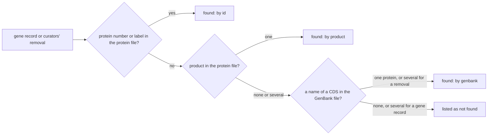
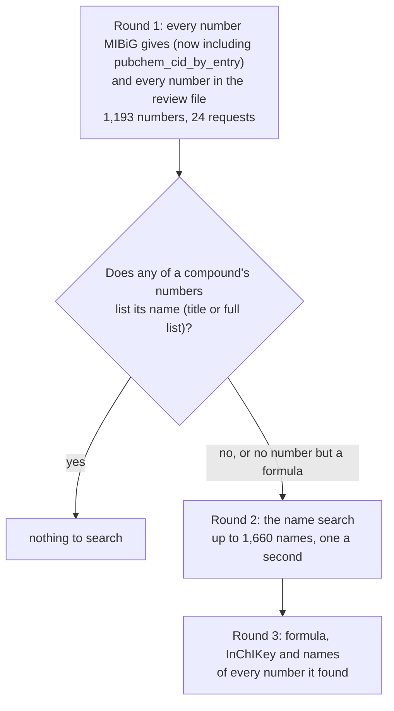

[← Handbook](HANDBOOK.md) · [README](../README.md) · [Glossary](GLOSSARY.md) · [Roadmap](ROADMAP.md) · [Query cookbook](QUERY_COOKBOOK.md) · [Phase 4 guide](06-entity-resolution-graph-build.md)

# 06b. Closing the gaps: GenBank, PubChem names and a review file (Phase 4b)

**Prerequisites:** [`06-entity-resolution-graph-build.md`](06-entity-resolution-graph-build.md)
finished: `pytest` passes, `python -m microbegraph.build_graph` ends with
`every count matches`, and `data/processed/resolve_summary.json` exists. You need
the internet for two steps (MIBiG's GenBank file, about 80 MB, and PubChem's name
search); everything else runs offline. No chemistry or biology background is
needed: each idea is explained where it first appears.

**Learning goal:** after this phase you will understand how a GenBank record
describes the genes on a piece of DNA, and how it ties a gene's name to its
protein's number; why one molecule can have several records in PubChem, and how
the first block of an InChIKey tells them apart from different molecules; how to
keep every value when two sources disagree instead of silently keeping one; how
to ask a public service politely, and what to do when it says "too many
requests"; and how a person's decision gets a proper, visible place in a
pipeline that is otherwise run by rules.

**Time:** about 7 hours over two or three sessions, plus one unattended run of
about 40 minutes for PubChem's name search (Step 10). The commands themselves
are quick: the MIBiG tidy takes about ten seconds, the resolver about ten.

> Every term here is also in [`GLOSSARY.md`](GLOSSARY.md). The overview of this
> phase is in [`HANDBOOK.md`](HANDBOOK.md), Stage 7b. The new recipes for
> following what this phase changed are R20 to R22 in
> [`QUERY_COOKBOOK.md`](QUERY_COOKBOOK.md).

---

## Contents

1. [What this phase builds, in one picture](#1-what-this-phase-builds-in-one-picture)
2. [The science, in plain words](#2-the-science-in-plain-words)
3. [The engineering ideas, in plain words](#3-the-engineering-ideas-in-plain-words)
4. [Step 0. Get into position](#4-step-0-get-into-position)
5. [Step 1. Put the new files in place](#5-step-1-put-the-new-files-in-place)
6. [Step 2. Look at the real data first](#6-step-2-look-at-the-real-data-first)
7. [Step 3. MIBiG's GenBank file](#7-step-3-mibigs-genbank-file)
8. [Step 4. When MIBiG's entries disagree, keep every value](#8-step-4-when-mibigs-entries-disagree-keep-every-value)
9. [Step 5. PubChem in three rounds](#9-step-5-pubchem-in-three-rounds)
10. [Step 6. The compound rules, now with four clues](#10-step-6-the-compound-rules-now-with-four-clues)
11. [Step 7. The review file: decisions made by a person](#11-step-7-the-review-file-decisions-made-by-a-person)
12. [Step 8. Activity words that mean the same thing](#12-step-8-activity-words-that-mean-the-same-thing)
13. [Step 9. Tests](#13-step-9-tests)
14. [Step 10. Run it for real](#14-step-10-run-it-for-real)
15. [Step 11. Pictures, the Handbook and the records](#15-step-11-pictures-the-handbook-and-the-records)
16. [How evidence and confidence carry through](#16-how-evidence-and-confidence-carry-through)
17. [What the graph still doesn't cover](#17-what-the-graph-still-doesnt-cover)
18. [What could go wrong](#18-what-could-go-wrong)
19. [Checkpoint](#19-checkpoint)
20. [Committing this phase](#20-committing-this-phase)

---

## 1. What this phase builds, in one picture


Phase 4's rules refused every join they couldn't confirm, and listed what they
left over. That was the right call, but a list of refusals is a queue, and a
queue needs a way to be worked. This phase works it in three ways:

1. **More evidence from sources the project already uses.** MIBiG publishes a
   third file beside the two the project reads, its **GenBank file**, which
   lists every name each gene goes by next to its protein's number. It places
   the last 21 gene records and the 4 maize genes MIBiG's curators removed.
   PubChem, asked for each MIBiG name directly, says which compound carries it.
2. **Nothing thrown away.** When two MIBiG entries describe one compound
   differently, the adapter now keeps every value with the entry that gave it,
   instead of keeping the first and counting the rest. That one change exposed
   the cause of two wrong joins in Phase 4.
3. **A proper place for a person's judgement.** Some questions need someone who
   has read the paper. A **review file**, `curation/resolution_decisions.csv`,
   holds those decisions, each with a reason and a source, and the resolver
   applies them before the rules that join compounds and proteins, and records
   them in the ledger like any other decision. A second small file, `curation/activity_synonyms.csv`, folds
   activity words that mean the same thing.

It also fixes a small structural fault Phase 4 found: one Python file couldn't
be imported on its own (Step 1).

The commands:

| Command | What it does | Touches the internet? |
|---|---|---|
| `python tests/fixtures/capture_gap_samples.py` | Looks at the evidence before any code (Step 2); optional when you repeat the build | Yes, once |
| `python -m microbegraph.fetch --source mibig` | Downloads the GenBank file into the locker and rebuilds MIBiG's tables (Step 3) | Yes, about 80 MB |
| `python -m microbegraph.fetch --source pubchem` | Asks PubChem about every number and searches the names (Step 5) | Yes, about 40 minutes |
| `python -m microbegraph.fetch --tidy-only --source kegg --source curation` | Rebuilds the two tables that read PubChem's and MIBiG's | No |
| `python -m microbegraph.resolve` | Merges the six sources again, now with the two curated files | No |
| `python -m microbegraph.build_graph` | Loads the graph into DuckDB and NetworkX, compares | No |

**Files this phase creates or changes** (paths relative to the project folder):

| Path | New or changed | What it is |
|---|---|---|
| `src/microbegraph/sources/mibig_genbank.py` | new | Reads MIBiG's GenBank file: every gene's names and protein number |
| `src/microbegraph/sources/mibig.py` | changed | The third pinned file; places gene records and removals through it; keeps every value of a disputed property |
| `src/microbegraph/sources/pubchem.py` | changed | Three rounds: every number, the name search, the numbers it found; a polite pace; a clean stop and a resume |
| `src/microbegraph/sources/api.py`, `src/microbegraph/sources/base.py` | changed | A snapshot can be finished incomplete; a request can accept "not found" as an answer |
| `src/microbegraph/tables.py` | new | The table shapes and safe writers, moved out of the adapters' package (the import fix) |
| `src/microbegraph/staging.py`, `src/microbegraph/resolution/pool.py` | changed | Read the helpers from `tables.py` |
| `src/microbegraph/resolution/reviewed.py` | new | Reads the review file and applies it before the matching rules |
| `src/microbegraph/resolution/activities.py` | new | Reads the activity synonyms and folds the words |
| `src/microbegraph/resolution/compounds.py` | changed | The four clues, every number MIBiG gives, the name search |
| `src/microbegraph/resolution/groups.py` | changed | A pair a person kept apart can never meet, even through a chain |
| `src/microbegraph/resolution/proteins.py`, `ledger.py` | changed | Respect decisions by hand; four new rules in the ledger |
| `src/microbegraph/resolve.py` | changed | Runs the new steps; the summary lists what is still open |
| `curation/resolution_decisions.csv` | new | The review file, with the first 5 decisions |
| `curation/activity_synonyms.csv` | new | 4 activity words and the word each means the same as |
| `curation/README.md` | changed | How to add a row to either file |
| `tests/fixtures/capture_gap_samples.py` | new | The look at the evidence (Step 2), and the GenBank test sample (`--fixture`) |
| `tests/fixtures/capture_resolution_samples.py` | changed | 12 more clusters in the real slice, and its own `curation/` folder |
| `tests/fixtures/mibig/genbank/` (3 files) | new | Surfactin's real GenBank record, cut down, and two made-up records |
| `tests/fixtures/pubchem/name_search_found.json`, `name_search_not_found.json` | new | Two real answers from PubChem's name search |
| `tests/fixtures/resolve/` | changed | The slice, cut again, with `curation/` inside |
| `tests/fixtures/README.md` | changed | Where every new sample came from |
| `tests/test_closing_the_gaps.py` | new | The promises this phase makes |
| `tests/conftest.py`, `tests/test_mibig_fetch_probe.py`, `tests/test_pubchem.py`, `tests/test_resolve.py`, `tests/test_build_graph.py`, `tests/test_query.py` | changed | The third MIBiG file, the PubChem rounds, the real Phase 4b cases |
| `docs/06b-closing-the-gaps.md` | new | This guide |
| `docs/QUERY_COOKBOOK.md` | changed | New recipes R20 to R22; R19 and the answers updated |
| `docs/img/gaps_closed.svg`, `genbank_record.svg`, `clue_ladder.svg`, `review_row.svg` | new | Four new pictures |
| `docs/interactive/resolution_cases.html` | new | Six real cases, clue by clue, in your browser |
| `docs/img/make_illustrations.py`, `docs/interactive/make_interactive.py` and the files they draw | changed | The new pictures and page; the journey map shows Phase 4b done |
| `docs/phases.csv` | changed | Phase 4b done |
| `README.md`, `CHANGELOG.md`, `docs/HANDBOOK.md`, `docs/ROADMAP.md`, `docs/GLOSSARY.md`, `docs/00-architecture.md`, `docs/02-ontology-and-data-model.md`, `docs/03-ingestion-mibig.md`, `docs/04-more-sources-secrets.md`, `docs/05b-all-cluster-proteins.md`, `docs/06-entity-resolution-graph-build.md` | changed | Updated for this phase |

**Files this phase writes on your computer that never go to GitHub:**

| Path | What it is | Size |
|---|---|---|
| `data/raw/mibig/mibig_gbk_4.0.tar.gz` | MIBiG's GenBank file, pinned by its SHA-256 | 79.8 MB |
| `data/raw/pubchem/<date>/` | A new PubChem snapshot with the name search (Step 5) | a few MB |
| `data/samples/<date>/gaps/` | What the look at the evidence saved (Step 2) | about 80 MB |
| `data/processed/staging/mibig_*`, `pubchem_*`, `kegg_*`, `curation_*` | Rewritten | |
| `data/processed/*.csv`, `resolve_summary.json`, `microbegraph.duckdb` | Rewritten by the resolver and the build | |

---

## 2. The science, in plain words

### A GenBank record: one piece of DNA, and what sits where on it

A **GenBank record** is the text file NCBI and its partners have used since the
1980s to describe a piece of DNA. It has three parts: a header (what the DNA
is, which organism it came from), a **FEATURES** table (what sits where on the
DNA), and the DNA itself. A street map with an index works the same way: the
header names the town, the index lists each building with its address, and the
map is drawn underneath.

Each gene that codes for a protein appears in the features table as a **CDS**
(coding sequence), followed by **qualifiers**, one per line, each starting with
`/`. Here is surfactin's first gene, from the real file. I've left out the
cross-references to other databases, the annotation software's notes and the
protein's sequence, which runs for many lines:

```
     CDS             64..1341
                     /codon_start=1
                     /gene="yciC"
                     /product="YciC protein"
                     /protein_id="CAE02619.1"
                     /transl_table=11
```

`64..1341` is where the gene sits on the DNA. `/gene` is the gene's short name,
`/product` what the protein is called, and `/protein_id` the protein's number in
the public sequence archives, the same `CAE02619.1` the graph already uses for
it. That line-up of name and number is what Phase 4 was missing.

A gene from a plant genome carries more names. This is one of the four maize
genes MIBiG's curators removed from the zealexin cluster (BGC0002390), again
without its sequence. Its location wraps onto a second line, because the gene
is split into pieces, and so does its note:

```
     CDS             complement(join(63720..63793,63898..64033,73837..73862,
                     74207..74251,74359..74474,74580..74676,74787..75168))
                     /codon_start=1
                     /db_xref="GeneID:100272490"
                     /gene="LOC100272490"
                     /gene_synonym="GRMZM2G134862"
                     /note="Derived by automated computational analysis using
                     gene prediction method: BestRefSeq."
                     /product="translin"
                     /protein_id="NP_001140431.1"
                     /transl_table=11
```

The curators name the gene `LOC100272490`; this record says that name belongs to
the protein `NP_001140431.1`. The picture below takes it apart.


### Names a gene goes by

A gene can be named four different ways, and MIBiG's records use all four:

| Kind of name | Example | Who gives it | Means something |
|---|---|---|---|
| Gene name | `baeI`, `srfAA` | The scientists who described the gene | Inside one paper or one genome |
| Locus tag | `AMIS_77560` | The team that sequenced the genome | Inside one genome |
| NCBI gene number | `LOC100272490`, `GeneID:100272490` | NCBI's Gene database | Worldwide |
| Protein number | `CAG23956.1` | The sequence archives | Worldwide |

A GenBank record lists several of them side by side for each gene, which is why
it can translate a curator's `baeI` into the number `CAG23956.1`. NCBI gene
names of the form `LOC` followed by digits are only the gene number written
another way: `LOC100272490` is gene `100272490`, which the record writes as
`/db_xref="GeneID:100272490"`.

### One molecule, several PubChem records

PubChem gives every distinct structure its own number, and "distinct" is
strict. A molecule drawn with its 3D arrangement spelled out and the same
molecule drawn without it are two records. So is a molecule in which one iron
atom is a radioactive isotope, and so is a molecule's sodium salt (where a
sodium atom takes the place of a hydrogen). Usually only one of those records
carries the common name.

That arrangement in space is called **stereochemistry**. Your two hands are the
everyday version: made of the same parts, connected the same way, yet a left
glove doesn't fit a right hand. Some molecules come in such mirror forms, and
chemists draw them differently.

### The InChIKey, and its first block

An **InChIKey** is a fingerprint of a structure, 27 characters in three blocks:

```
HUKYPYXOBINMND-HYUJHOPRSA-N
^^^^^^^^^^^^^^ ^^^^^^^^^^ ^
block 1        block 2    block 3
```

That one is methymycin's. The **first block** encodes the atoms and how they
are connected, and nothing else. The second encodes the 3D arrangement and
isotopes, the third whether protons were added or taken away (a sign of a
charge). Two PubChem records with the same first block are the same molecule
drawn in different ways (with or without its 3D arrangement, or with an unusual
isotope); two records with different first blocks are different molecules,
however similar their names or formulas. A salt counts as different here: the
first block also encodes the formula, sodium included, so a salt's first block
differs from its acid's. Block 1 is
the part this phase uses: it can tell "another record of the same molecule"
from "another molecule".

### Activity words

MIBiG records what each compound has been seen to do with a short word. A few
of them mean the same thing: "anticancer", "antitumor" and "antineoplastic"
(acting against tumours, which doctors call neoplasms), and MIBiG itself labels
one of them "antitumor (duplicate of anticancer)". Others only sound alike:
"cytotoxic" (kills cells, any cells) isn't "anticancer", and "antiplasmodial"
(acts on the malaria parasite in a dish) isn't "antimalarial" (treats the
disease). Deciding which is which takes a person who knows the words, so it
isn't left to a rule.

---

## 3. The engineering ideas, in plain words

### Look at the data first, again

Every phase has started with a short survey of the real data before any code,
and every time it changed the plan. This one did too, twice: PubChem's full list
of names turned out to confirm none of the joins it was meant to check, and
keeping both values of a disagreement turned out to explain two wrong joins
(Step 2 has both).

### Keep every value, say where each came from

When two sources disagree about a fact, a pipeline can keep the first value,
keep the last, average them, or keep them all. Only the last one loses nothing.
From this phase, a disputed property keeps its first value under its usual name
(so nothing that read it breaks) and gains a second property listing every
value with the entry that gave it:

```
pubchem_cid             9237955
pubchem_cid_by_entry    BGC0000657: 9237955|BGC0000658: 16913|BGC0000659: 16913
```

It works like a witness statement: three witnesses, three statements, each
signed, and the disagreement is there for anyone to read.

### A ladder of clues

Phase 4 joined a MIBiG compound to a PubChem record when the name or the
formula confirmed MIBiG's number. This phase replaces that with four clues, from
strongest to weakest, and the strongest one present decides (Step 6). The
weakest, the formula alone, stops counting when a stronger clue points
somewhere else.

### Asking politely, and taking "too many requests" well

A public service limits how hard anyone may ask, so that one busy user can't
slow it down for everybody. PubChem asks for at most 5 requests a second and
400 a minute, and answers **HTTP 429 Too Many Requests** when a client goes
over. While this phase was being built, a survey asking four names a second was
refused after about 400 names, and the refusals went on for hours, even for the
ordinary number lookups that had worked that morning.

The lesson went into the code. The name search now asks one name a second,
waits 15, 30, 60 and 60 seconds when PubChem says it's busy, and if PubChem
still refuses, stops cleanly: the answers that arrived are kept, the snapshot
is finished and marked incomplete, and the next run carries those answers over
and asks only what's missing. A long trip with a few rest stops behaves the same
way: if the road closes at one of them, you pick up from there the next day,
not from your front door.

### A person's decision, in the open

Some questions only a person can settle, by reading the paper the data came
from. Leaving those decisions out makes the graph worse; slipping them in
quietly makes it untrustworthy. The middle way is a file of decisions, each with
a reason and a citation, applied before the rules that join compounds and
proteins, and written to the ledger under its own rule, `reviewed_by_hand`. Anyone can see which joins a rule made
and which a person made, and check the person's source. A decision always wins
over a rule, and the ledger says so.

### A circular import, and how to break it

Python loads a file when another file asks for it, and runs it from the top.
Two files that each need the other before they can finish loading are stuck,
like two people at a door each waiting for the other to go first. Phase 4 found
one such pair: `import microbegraph.staging` on its own failed, because staging
needed the adapters' package, and the package loaded the adapters, which needed
staging. Every command happened to load the adapters first, so nothing broke in
practice, but a new script or a notebook could have. The fix moves the shared
pieces (the table columns, the safe writers, the error type) into a file of
their own, `src/microbegraph/tables.py`, which needs neither side.

---

## 4. Step 0. Get into position

1. Open your terminal and go to the project folder:

   ```bash
   cd ~/projects/microbegraph      # or wherever you cloned it
   ```

   Windows PowerShell: `cd $HOME\projects\microbegraph`
2. Make sure you're on the working branch and up to date:

   ```bash
   git switch develop
   git pull --ff-only origin develop
   ```

3. Activate the toolbox:

   ```bash
   source .venv/bin/activate          # macOS / Linux / RHEL 8
   ```

   Windows PowerShell: `.\.venv\Scripts\Activate.ps1`
4. Check that Phase 4's output is there:

   ```bash
   python -m microbegraph.query --recipe 2
   ```

   You should see the number of nodes of each type, nine rows, with `Protein`
   at the top. If it says the database doesn't exist, finish
   [Phase 4](06-entity-resolution-graph-build.md#14-step-10-run-it-for-real)
   first.

✅ **Checkpoint.** Your prompt starts with `(.venv)`, `git branch` shows
`* develop`, and recipe R2 prints nine rows.

---

## 5. Step 1. Put the new files in place

If you cloned the repository after this phase was committed, every file is
already there and you can read along. If you're building it yourself, put each
file from the table in section 1 at the path shown. Then:

1. **No new packages.** The GenBank reader uses only Python's own `tarfile`
   and `re`; I chose a small reader of my own over a full GenBank library
   because the project needs six of the hundred or so qualifiers a GenBank
   record can hold, and the reader that skips the rest reads all 2,636 records
   in about four seconds.
2. **No reinstall.** The package is installed in editable mode, so Python finds
   the new files straight from the project folder.
3. **Check the import fix.** This used to fail with `ImportError: cannot import
   name 'edge_row' from partially initialized module`:

   ```bash
   python -c "import microbegraph.staging; print('staging loads on its own')"
   ```

   You should see:

   ```
   staging loads on its own
   ```

✅ **Checkpoint.** `pytest` ends with `350 passed` and no `failed`.

---

## 6. Step 2. Look at the real data first

Before any code, a capture script looked at the evidence this phase would use:

```bash
python tests/fixtures/capture_gap_samples.py
```

It downloads MIBiG's GenBank file once into `data/samples/<date>/gaps/`, asks
PubChem's name search about a sample of 541 MIBiG compounds (the 325 joined on
the formula alone, the 81 whose number Phase 4 refused, every twentieth compound
with no number, and surfactin and methymycin, the guides' own examples), and
then, offline, lines
everything up
with what the project already has. Everything it saves stays in `data/`, which
never goes to GitHub.

> **When you repeat the build, this step is optional.** Its findings are below,
> and the PubChem fetch in Step 10 asks every one of these names anyway. The
> survey sends 541 requests to PubChem, one a second (about ten minutes); if
> you run it, leave an hour or so before the PubChem fetch, so the two together
> don't add up to more than PubChem will answer at once (section 3 has the
> story of what happens then).

The GenBank part, on the real file:

```
Part 2: reading what arrived, with the files already in your locker (offline)
    files_in_archive                     2636
    entries_with_cds                     2636
    records_per_file                     {1: 2636}
    cds_total                            46987
    cds_without_protein_id               1071
    protein_file_records_also_a_cds      45916
    protein_file_records_not_a_cds       1071
    leftover gene records placed         21 of 21
    leftover removals placed             4 of 4
```

What that says, line by line:

| Finding | What it means |
|---|---|
| 2,636 files, one record each | One GenBank record per MIBiG entry, active and pending alike, the same 2,636 entries the protein file covers |
| 46,987 CDS features | Exactly the 46,987 proteins of the protein file: the two files describe the same genes |
| 1,071 CDS without a protein number | The same 1,071 proteins the protein file names only by a locus tag or gene name |
| 21 of 21 gene records placed | Every gene record Phase 4 left over (baeI, agqA to agqD, SCO6265...) is the `/gene` of exactly one CDS, whose number the protein file has |
| 4 of 4 removals placed | Each maize gene the curators removed from BGC0002390 is the `/gene` and the `GeneID` of one CDS |

So the GenBank file closes both protein gaps, completely. Two more findings
changed the plan:

**PubChem's full list of names confirmed none of the 325 formula-only joins.**
Phase 2 had kept the first 20 names of each PubChem compound; the plan was to
check the rest. On the real data, 86 of those 325 PubChem records list no names
at all, 213 list 20 or fewer (so the short list already was the full list), and
only 26 list more than 20. None of the 26 has MIBiG's name further down. One is
a spelling slip in MIBiG ("6-methylsalicyclic acid" for 6-methylsalicylic
acid). The full list is still read (it costs nothing), but it closes nothing on
this data.

**PubChem's name search often files MIBiG's name under a different number.**
Of the 541 names, 399 were answered before PubChem began refusing (the 429
story in section 3): 293 found at least one number, 106 none. For 237 of the 319
formula-only joins that were answered, the name is filed under another number
than the one MIBiG gives. That's usually the same molecule drawn another way,
but not always, which is why Step 6 compares the two records' InChIKeys before
trusting either. Names whose number Phase 4 refused show the same thing:
"1233A" is filed under 54144091, while MIBiG gives 6440895 (hymeglusin).

**Keeping both values explained two of Phase 4's joins.** A quick re-run of the
MIBiG tidy that recorded every disagreement found that 17 compounds get
different PubChem numbers from different entries. Two of them were joined
wrongly in Phase 4:

| Compound | What the entries say | What Phase 4 did |
|---|---|---|
| 2-methylisoborneol | BGC0000657 gives CID 9237955 (a bromine compound, C15H16BrN3O4S) with its formula and structure; BGC0000658 and BGC0000659 give 16913 and C11H20O | Joined it to the bromine compound, on the formula alone |
| desosamine | BGC0000898 gives CID 5282034 (methymycin, C25H43NO7), methymycin's formula and its NPAtlas number; BGC0000899 gives 419813 and C8H17NO3 | Joined it to methymycin's record on the formula, then pulled MIBiG's methymycin into the same node through the shared NPAtlas number |

Desosamine is a sugar that methymycin carries, so the graph had merged a part
into its whole.

---

## 7. Step 3. MIBiG's GenBank file

**The file is pinned like the protein file.** MIBiG's download server publishes
no checksum for it, so its SHA-256 was measured on the first download and
written into `src/microbegraph/sources/mibig.py`, together with its size:

```python
GENBANK_FILE = "mibig_gbk_4.0.tar.gz"
GENBANK_FILE_SHA256 = "43543f9c85316bc44e555dd2c6c37331b1a56150218b204dc14e623ea66e834b"
GENBANK_FILE_BYTES = 83_652_126
```

Every later download must match, and the probe compares the size the server
reports without downloading anything. Unlike the JSON archive, this one really
is gzip-compressed; the reader opens archives by their contents, so it doesn't
need to know.

**The reader** (`src/microbegraph/sources/mibig_genbank.py`) reads only the
features table of each record, only the CDS features, and only six
qualifiers: `/gene`, `/locus_tag`, `/old_locus_tag`, `/gene_synonym` (split on
`;`, since it can hold several names), `/db_xref="GeneID:..."` and
`/protein_id`. A value in quotes can wrap onto the next line; the reader joins
those lines for the qualifiers it keeps, and skips them for the rest, so a line
inside a long note that happens to start with `/gene=` is never mistaken for a
gene name. A test checks exactly that case.

**The MIBiG adapter** uses it as a third way to find a protein, after the two
from Phase 3b (by number or label, then by product):



A gene record still needs exactly one protein (several would be a guess); a
removal removes every protein the name leads to, as before.

1. Fetch MIBiG again. The archive and the protein file are already in the
   locker, so only the GenBank file is downloaded:

   ```bash
   python -m microbegraph.fetch --source mibig
   ```

   You should see (the first lines; the full list of counts follows):

   ```
   [mibig] fetch
     [mibig] mibig_json_4.0.tar.gz is already in the locker and verified, nothing to download
     [mibig] already_present: data/raw/mibig/mibig_json_4.0.tar.gz (9.5 MB, 3013 records), provenance logged
     [mibig] mibig_prot_seqs_4.0.fasta is already in the locker and verified, nothing to download
     [mibig] already_present: data/raw/mibig/mibig_prot_seqs_4.0.fasta (30.4 MB, 46987 proteins), provenance logged
     [mibig] downloading mibig_gbk_4.0.tar.gz
         79.8 MB of 79.8 MB (100%)
     [mibig] downloaded: data/raw/mibig/mibig_gbk_4.0.tar.gz (79.8 MB, 2636 GenBank records), provenance logged
   [mibig] tidy
     [mibig] wrote mibig_nodes.csv and mibig_edges.csv
   ```

2. Among the counts, these are new or changed:

   ```
       genbank_cds                          46987
       genes_found_by_genbank                  59
       genes_given_a_protein_number           511
       genes_not_in_protein_file                0
       property_conflicts                     278
       proteins_removed_by_curators            22
       removals_found_by_genbank                4
       to_delete_not_found                      0
   ```

   **59, not 21.** In Phase 4, 59 gene records were named only by a name the
   protein file doesn't use. UniProt's gene names rescued 38 of them inside the
   resolver, and 21 were left over. The GenBank file places all 59 before the
   resolver runs, so they arrive with protein numbers, and the resolver's
   gene-name rule now finds nothing left to do (it stays as a fallback).
   Checking baeI turned up a bug in that rule: UniProt's entry Q1RS74 does
   list the gene name baeI, as "baeI|PV946_13250", but the rule split the list
   on spaces and semicolons only, never on `|`, so an entry with more than one
   gene name could never match. Some of the 21 were left over for that reason
   alone. The rule now reads every name (`gene_names()` in
   `src/microbegraph/resolution/proteins.py`, with a test), though it has
   nothing left to match on this data. The
   gene records given a protein number go from 452 to 511 (452 + 59), and the
   curators' removals from 18 to 22.

**278, not 275.** `property_conflicts` counts every time an entry gives a
value different from the one already kept. The three new ones are real:
entries BGC0000038 and BGC0000849 describe the same two proteins. BGC0000038
calls CAB60184.1 and CAB60185.1 "SCO6265" and "SCO6266"; BGC0000849's gene
records call them "scbR" and "scbA", with only the locus tags SCO6265 and
SCO6266 to identify them. Before this phase those two gene records were among
the leftovers, nodes of their own; now each joins its protein, so the two names
(and two descriptions of CAB60185.1) show as a disagreement.

✅ **Checkpoint.** `data/raw/mibig/` holds `mibig_gbk_4.0.tar.gz`, and
`mibig_summary.json` lists no `genes_not_in_protein_file` and no
`to_delete_not_found`.

---

## 8. Step 4. When MIBiG's entries disagree, keep every value

Nothing to run here: the change is inside the MIBiG tidy you just ran. The
adapter now remembers, for every property of every node, which entry gave
which value. When a property got more than one value, the node gains
`<property>_by_entry`. On the real data:

| Property | Nodes with a disagreement |
|---|---|
| `smiles_by_entry` (the structure as text) | 109 compounds |
| `mass_by_entry` | 49 compounds |
| `pubchem_cid_by_entry` | 17 compounds |
| `formula_by_entry` | 16 compounds |
| `gene_name_by_entry`, `product_by_entry` | 2 proteins, 1 protein |

That's 194 properties on 120 nodes (118 compounds and 2 proteins), since many
nodes disagree about more than one property. The MIBiG summary's
`property_conflicts` says 278 because it counts every entry that disagrees,
and some nodes are described by many entries.

The first value stays under the property's own name, so every recipe and every
rule that read `formula` or `pubchem_cid` still works. The new lists feed three
places: the PubChem fetch asks about every number in `pubchem_cid_by_entry`
(Step 5), the compound rules judge each number with the formula from the
entries that gave it (Step 6), and a formula the entries disagree about can no
longer confirm a number on its own (Step 6 again). Recipe R21 lists them.

Many disagreements are tiny. 29 of the 49 masses differ by less than 0.01,
often only in the last digits of a long decimal (C-1027: 843.2406160840001 in
one entry, 843.2406160840002 in another), so they count as disagreements
without meaning anything. Others are names used for several molecules at once:
"capsular polysaccharide" gets three PubChem numbers from 17 entries, because
the entries describe three different polysaccharides under the same general
name.

---

## 9. Step 5. PubChem in three rounds

The PubChem adapter now asks in three rounds, all saved in one snapshot:



**Who gets a name search.** A compound whose own numbers already list its name
is skipped. So is a compound with no number and no formula, because a name
match is only accepted when the formula agrees (Step 6), and without a formula
it never could be. On the real data that leaves up to 1,660 names: up to 406
compounds whose numbers don't list their name, and 1,254 with no number but a
formula. ("Up to", because those counts come from the Phase 2 snapshot. Round 1
also brings the records of the 17 second numbers, and where such a record lists
the name, that compound needs no search, so your run may ask a few fewer.)

**How one name is asked.** By POST, with the name in the request's body, so a
name with a slash or a bracket can't be mistaken for part of the address:

```
POST https://pubchem.ncbi.nlm.nih.gov/rest/pug/compound/name/cids/JSON
     body: name=2-methylisoborneol
```

PubChem answers with the numbers it files the name under, or with 404 "No CID
found", which the adapter accepts as an answer rather than an error. Names
filed under more than 10 numbers are kept but not followed up: a name that
vague can't pick a compound.

**What a PubChem node now carries:**

| Property | What it is |
|---|---|
| `mibig_compound_ids` | The MIBiG compounds that give this number (as before) |
| `found_by_name` | The MIBiG compounds whose name search returned this number |
| `names_matching_mibig` | Names from PubChem's FULL list that match one of those compounds' names |
| `synonym_count` | How many names PubChem lists in all |

**The pace, and the clean stop.** Round 2 asks one name a second and slows down
further if PubChem's traffic light turns yellow. When PubChem answers 429, the
adapter waits 15, 30, 60 and 60 seconds before giving up on that request. What
happens next depends on the round:

| PubChem gives up in | What is kept | What the next run does |
|---|---|---|
| Round 1 | Nothing from this run is used; tidy keeps reading the snapshot you already have | Starts again |
| Round 2 | Every name-search answer that arrived, in a snapshot finished and marked incomplete. Round 3 is skipped, because asking a server that is refusing only prolongs the block | Carries those answers over (in a file of their own, `names_carried_over.json`, logged as `already_present`), asks only the rest, then does round 3 |
| Round 3 (a refusal, a dropped line or an answer that isn't PubChem's) | Every name-search answer, as for round 2 | Carries every answer over and repeats round 3 |

In both of the last two cases, tidy leaves out the search answers of every
compound whose search found a number round 3 had to describe, so half an
answer is never used.

Each case ends with a message that says which it was, in plain words.

✅ **Checkpoint.** The tests for the three rounds, the clean stop and the
carry-over pass (`pytest tests/test_pubchem.py`).

---

## 10. Step 6. The compound rules, now with four clues


For each MIBiG compound, the candidates are every number its entries give and
every number the name search found. Each candidate is judged on these clues,
and the strongest one present decides:

| Clue | What must be true | Rule in the ledger |
|---|---|---|
| 1. name | MIBiG gives the number and PubChem lists the name under it (title, short list, full list), or the name search returns that very number | `pubchem_number_confirmed`, or `pubchem_numbers_differ` when entries give several numbers |
| 2. same structure | MIBiG gives the number, PubChem files the name under another number, and the two records share the first block of their InChIKey | the same |
| 3. name search | MIBiG gives no number that passes 1 or 2, and the name search finds the name under exactly one number whose formula agrees with MIBiG's (with one of them, when the entries give several: here the name is the independent clue, and the formula a check on it) | `pubchem_name_search` |
| 4. formula alone | MIBiG gives one number, its formula agrees, the name search points at no other molecule, and MIBiG's entries agree about the formula | `pubchem_number_confirmed` |

Two candidates equally strong and different stay apart from the compound, and
the ledger names both: choosing would be a guess. A number several MIBiG
compounds share still needs each compound's own name (clue 1 only), for the
reason Phase 4 gave: isomers share formulas and can share structure keys.

**The two new limits on clue 4,** with the real compounds that prompted them:

* **The name points elsewhere.** If the name search files MIBiG's name under a
  record of a different molecule, the formula agreeing with MIBiG's number
  proves little: MIBiG may have copied the structure from the wrong record, as
  it did for 2-methylisoborneol.
* **The entries disagree about the formula.** MIBiG gives ferrichrome two
  formulas, one with its iron atom and one without, and its number points at
  PubChem's "[55Fe] Ferrichrome", a record of the molecule with a radioactive
  iron. One formula agreeing with that record can't confirm it. The same rule
  now refuses lasalocid, whose entries give the sodium salt's formula twice and
  the free acid's once. The name search can still settle both: if PubChem files
  "lasalocid" under one record whose formula matches one of MIBiG's, clue 3
  joins them, because the name is the evidence there and the formula only a
  check.

The ledger's sentence says which clue decided, so recipe R19 can list the
joins that still rest on the formula alone: every merged row that ends with
`Confirmed by the formula alone.`

A walk through all of it, case by case, is in your browser:
[`interactive/resolution_cases.html`](interactive/resolution_cases.html).

✅ **Checkpoint.** You can say which clue would decide for a compound whose
MIBiG number lists its name, and why one matching formula still doesn't
confirm ferrichrome's number.

---

## 11. Step 7. The review file: decisions made by a person


`curation/resolution_decisions.csv` holds one decision per row:

| Column | Example | What it is |
|---|---|---|
| `identifier` | `mg.compound:2-methylisoborneol` | One record |
| `other_identifier` | `pubchem.compound:9237955` | The other record |
| `decision` | `keep_apart` | `join` (the same thing) or `keep_apart` (different things) |
| `reason` | `PubChem's record 9237955 is ... a bromine and sulfur compound. 2-Methylisoborneol is C11H20O ...` | Why, in a sentence or two a reader can check |
| `citation` | `pubchem.compound:9237955` | Where to check: `doi:`, `pubmed:` or a database record |
| `decided_on` | `2026-10-12` | The date, written YYYY-MM-DD |

The first five decisions:

| Records | Decision | Source |
|---|---|---|
| 2-methylisoborneol and PubChem 9237955 | keep apart: the record is a bromine and sulfur compound | PubChem's record itself |
| desosamine and PubChem 5282034 | keep apart: the record is methymycin, which carries desosamine | pubmed:9770448, the paper MIBiG cites for both entries |
| desosamine and MIBiG's methymycin | keep apart: a sugar and the molecule that carries it | pubmed:9770448 |
| CBF82293.1 and UniProt P0CU77 | keep apart: MIBiG's 822-amino-acid sequence spans two genes UniProt describes separately | UniProt's entry P0CU77 |
| CBF82293.1 and UniProt P0CU78 | keep apart, for the same reason | UniProt's entry P0CU78 |

**What the resolver does with it** (`src/microbegraph/resolution/reviewed.py`):

1. It reads the file and checks every row: no empty cell, a known decision, two
   identifiers in `prefix:local` form, a date written YYYY-MM-DD, no pair
   twice. A bad row stops the run with its line number.
2. It checks that every identifier named is in the graph. A typo, or a PubChem
   number not fetched yet, stops the run (the PubChem fetch asks about every
   PubChem number named here, so the next fetch brings it).
3. Before the rules that join compounds and proteins run (only the organism
   number moves and the activity synonyms come first), it applies each
   decision: a `join` joins the two at once; a `keep_apart` tells the grouping
   code that the two may never end up in one group, by any rule or any chain of
   joins. A `keep_apart` for two records that rows above have already joined is
   refused, since it could no longer do anything. Each decision is written to
   the ledger under the rule `reviewed_by_hand`, with the reason and citation in
   its grounds.
4. Every rule skips a pair a person has settled.

**To add a decision of your own:** open the file in VS Code (a spreadsheet
program can change its quoting), add a row, run `python -m
microbegraph.resolve` and then `python -m microbegraph.build_graph` (the
recipes read the database the build writes), and look for your row with recipe
R20. `curation/README.md` has the checklist.

The review file only says what 2-methylisoborneol and desosamine are not.
Their right records, 16913 and 419813, need no decision by hand: MIBiG's other
entries give those numbers, so the rules judge them as soon as the next PubChem
fetch brings the two records (Step 10).

✅ **Checkpoint.** Recipe R20 lists the five decisions.

---

## 12. Step 8. Activity words that mean the same thing

`curation/activity_synonyms.csv` lists the activity words to fold, each with the
word it means the same as, a reason and a source:

| Activity | Same as | Source |
|---|---|---|
| antitumor (duplicate of anticancer) | anticancer | MIBiG's own label |
| antitumor | anticancer | MIBiG's own label, as above |
| antineoplastic | anticancer | MeSH heading D000970, Antineoplastic Agents |
| antibacterial (gram-negative) | anti-gram-negative | Two spellings in MIBiG 4.0 |

The resolver moves each word's node to the other's, the way an old NCBI number
moves to the current one. A compound with arrows to both "antitumor" and
"anticancer" now has one arrow, carrying the stronger evidence of the two, and
the old word stays in the node's `other_names`, so a search for it still finds
the node. The ledger gets one row per word (rule `activity_synonym`). A row
whose words no source uses yet waits, and the resolver's summary lists it.

Activities went from 74 to 70.

✅ **Checkpoint.** Recipe R22 lists the four folded words.

---

## 13. Step 9. Tests

There are 350 tests, 54 more than Phase 4. The new ones are in
`tests/test_closing_the_gaps.py`, plus additions in the PubChem, MIBiG and
resolver test files:

| What is tested | How |
|---|---|
| The GenBank reader | On surfactin's real record (cut down to its header and its 23 CDS features without their sequences, `tests/fixtures/mibig/genbank/BGC0000433.gbk`), on made-up records, and on a wrapped `/note` whose second line starts with `/gene=` |
| The third pinned file | Fetched, verified, logged, refused when it isn't the pinned one, and probed by its size |
| The PubChem rounds | Only names that can change a decision are searched; round 3 follows what round 2 found; a busy PubChem stops cleanly in round 2 or round 3 and the next run carries on; a refusal in round 1 says so in plain words |
| The four clues | Made-up compounds named alpha to mu, shaped like the real cases, one small case per situation, including ferrichrome's two formulas, a run with no name search and a search PubChem stopped halfway |
| The review file and the synonyms | Joins and refusals applied and recorded; a chain can't undo a refusal; a `keep_apart` row for two records rows above already joined is refused; bad rows refused with their line number; the real files read cleanly |
| The real cases | The slice the resolver tests use now holds 2-methylisoborneol, desosamine, the maize cluster, scbR and the activity words, cut from the real tables by `tests/fixtures/capture_resolution_samples.py` |
| The import fix | A fresh Python loads `microbegraph.staging` on its own, and the resolver no longer loads any source adapter |
| The new recipes | R20 to R22 run on the slice like every other recipe, and give the real answers: the five decisions by hand, 2-methylisoborneol's three numbers, antitumor folded into anticancer |

✅ **Checkpoint.** `pytest` ends with `350 passed`.

---

## 14. Step 10. Run it for real

1. **MIBiG**, if you haven't yet (Step 3):

   ```bash
   python -m microbegraph.fetch --source mibig
   ```

2. **PubChem.** This is the long one, about 40 minutes, and you can leave it
   alone while it runs:

   ```bash
   python -m microbegraph.fetch --source pubchem
   ```

   It prints a line for each of round 1's 24 answers, then a line like
   `round 2: the name search, 1,660 names, one a second (about 42 minutes)`
   (your count may be a little lower, see Step 5), a progress line every 100
   names, and round 3.

   **If PubChem is refusing your computer**, you'll see it wait and try again
   four times, 15, 30, 60 and 60 seconds apart (about three minutes in all),
   and then a plain message. Each failed try prints one long line naming the
   address it asked; the first one starts like this:

   ```
   [pubchem] fetch
     [pubchem] round 1: asking about 1,193 CIDs in 12 batches of up to 100
     [pubchem] attempt 1 of 5 failed (https://pubchem.ncbi.nlm.nih.gov/rest/pug/compound/cid/property/...
   ```

   and the run ends with:

   ```
   [pubchem] FAILED: PubChem is refusing requests from this computer for now (HTTP 429, too many requests). It does this for a while after it was asked too fast. Nothing from this run is used: tidy keeps reading the snapshot you already have.
     Try again in a few hours (a block can last until the next day) with the same command. The rest of the project works meanwhile.
     (add --debug to see the full error)
   ```

   Nothing is broken when this happens, and nothing is lost: the PubChem
   tables from Phase 2 stay in use. Leave it for a few hours (overnight is
   safest), then run the same command again.

   > **Status on 2026-10-12.** The project's own run of this step was refused
   > that day, so the graph described below was built with the PubChem snapshot
   > from Phase 2. Running it is the first thing to do before Phase 5; the
   > [roadmap](ROADMAP.md#phase-4b-closing-the-gaps-names-genbank-and-a-review-file-)
   > and the [Handbook](HANDBOOK.md#stage-7b-closing-the-gaps-phase-4b) list it,
   > and its numbers will be added to this guide, the cookbook and the
   > changelog when it has run.

3. **The two tables that read PubChem's and MIBiG's.** KEGG's table takes its
   compounds from PubChem's, and the curated table checks its compounds against
   MIBiG's, so both are rebuilt after those two change. Offline, a few seconds:

   ```bash
   python -m microbegraph.fetch --tidy-only --source kegg --source curation
   ```

4. **Resolve.**

   ```bash
   python -m microbegraph.resolve
   ```

   You should see (with the PubChem snapshot from Phase 2):

   ```
   [resolve] reading data/processed/staging/ (six sources) and curation/
     mibig           47,844 nodes   version 4.0
     pubchem          1,171 nodes   version live
     ncbi_taxonomy    2,457 nodes   version Build261011-2030.1
     kegg                39 nodes   version pathway 2026/10/09, compound 2026/10/09
     uniprot         20,507 nodes   version 2026_03
     curation            11 nodes   version repository file
   [resolve] decisions, rule by rule (the ledger has one row for each)
     same_identifier           combined 1,478
     ncbi_merged_number        moved 7
     organism_and_pathogen     combined 2
     activity_synonym          merged 4
     reviewed_by_hand          kept_apart 5
     pubchem_number_confirmed  merged 1,094   kept_apart 65
     pubchem_number_shared     merged 8   kept_apart 12
     pubchem_number_unknown    kept_apart 5
     npatlas_and_formula       merged 2   kept_apart 7
     uniprot_cross_reference   merged 20,626   kept_apart 40
     identical_sequence        merged 220   kept_apart 9
     not_used                  left_out 353
   [resolve] the merged graph
     nodes  48,236   from 70,550 identifiers (353 left out)
       Activity           70
       Compound        3,837
       CompoundClass      37
       Crop                5
       GeneCluster     2,437
       Organism        2,451
       Pathogen            6
       Pathway            39
       Protein        39,354
     edges  56,987   from 57,048 (58 combined, 3 dropped with left-out entries)
       BELONGS_TO        529
       CATALYZES       4,492
       ENCODES        39,930
       HARBORS         2,437
       HAS_ACTIVITY    2,771
       INFECTS             7
       INHIBITS            7
       MEMBER_OF       2,449
       PARTICIPATES_IN     82
       PRODUCES        4,283
   [resolve] curation/: 4 of 4 activity synonyms applied, 5 decisions by hand
   [resolve] the twelve rules pass on the merged tables
   [resolve] every identifier that disappeared has a ledger row
   [resolve] wrote data/processed/: nodes.csv, edges.csv, resolution_ledger.csv, resolve_summary.json
   Next:  python -m microbegraph.build_graph
   ```

   `gene_name_in_uniprot` has gone from the list because it found nothing to
   do, and `pubchem_numbers_differ` and `pubchem_name_search` are absent too:
   they need the new PubChem snapshot.

5. **Build.**

   ```bash
   python -m microbegraph.build_graph
   ```

   It should end with `every count matches`, the ledger holding 23,937 rows.

**The sanity checks,** against Phase 4:

| Number | Phase 4 | Phase 4b | Why it changed |
|---|---|---|---|
| Activity nodes | 74 | 70 | Four words folded |
| Compound nodes | 3,836 | 3,837 | Desosamine and methymycin are two nodes again, and no longer part of PubChem's methymycin record (+1); 2-methylisoborneol leaves the bromine compound's record and lasalocid its sodium salt's, which changes nothing in the count (each record was one node with it, and is left out now) |
| Protein nodes | 39,379 | 39,354 | The 21 leftover gene records join their proteins (-21), and 4 removed maize proteins leave (-4) |
| `ENCODES` arrows | 39,955 | 39,930 | The same 25 |
| Arrows combined | 96 | 58 | The 38 gene records UniProt's gene names joined are now one node from the start, so their arrows never needed combining (-38). Two smaller changes cancel out: folding antitumor into anticancer combines one compound's two arrows (+1), and splitting desosamine from methymycin separates an antibacterial arrow the two had shared (-1) |
| Left out | 347 | 353 | PubChem 9237955 and 5282034, lasalocid's sodium salt record, three UniProt entries of removed maize proteins; ferrichrome's record stays out as before |
| Joins on the formula alone | 325 | 322 | 2-methylisoborneol and desosamine settled by hand; lasalocid refused (entries disagree on the formula) |
| Identifiers in | 70,613 | 70,550 | The 59 gene records and 4 removed proteins no longer arrive as identifiers of their own |
| Ledger rows | 23,989 | 23,937 | No gene-name rows (-59), the new rules' rows (+9), and the changes above |

Check that the numbers add up, the way the Phase 4 guide did. 70,550
identifiers went in; 21,954 were merged into other nodes (4 + 1,094 + 8 + 2 +
20,626 + 220, the `merged` counts above), 7 old organism numbers moved and 353
entries were left out: 70,550 - 21,954 - 7 - 353 = 48,236 nodes. And by type:
70 + 3,837 + 37 + 5 + 2,437 + 2,451 + 6 + 39 + 39,354 = 48,236.

---

## 15. Step 11. Pictures, the Handbook and the records

**The pictures.** Four new diagrams drawn by `docs/img/make_illustrations.py`:
the gaps and what closed them (`gaps_closed.svg`, in section 1), one CDS feature
part by part (`genbank_record.svg`), the four clues (`clue_ladder.svg`), and a
decision by hand column by column (`review_row.svg`). A new page,
`docs/interactive/resolution_cases.html`, walks through six real cases clue by
clue. The journey map now shows Phase 4b done.

**At the end of this phase,** as at the end of every phase:

1. In `docs/phases.csv` (in VS Code), Phase 4b's `status` is `done`.
2. Re-run both picture scripts:

   ```bash
   python docs/img/make_illustrations.py
   python docs/interactive/make_interactive.py
   ```

   The first prints `Done: 31 figures in docs/img/`, the second names four
   pages.
3. In `docs/HANDBOOK.md`: Stage 7b is ✅ and Stage 8 (Phase 5) is ⏳, with the
   version, date and repository state at the top updated, and a change-log line.
4. The same status change is in the README build log and `docs/ROADMAP.md`.
5. Add the Phase 4b entry to `CHANGELOG.md`, with your numbers from Step 10.
6. Commit all of it in the phase commit (section 20).

---

## 16. How evidence and confidence carry through


This phase adds no new kind of arrow, and no arrow changes its evidence level
because of a decision by hand. What does change:

| Situation | What happens | Why |
|---|---|---|
| A gene record placed through the GenBank file | It joins its protein node in the MIBiG tidy; its `CATALYZES` arrows keep their evidence (`curated_experimental` where an experiment showed the gene's job) | The experiment was about that gene, whichever list names it |
| Two activity words folded | Two arrows from one compound become one, with the stronger evidence, the higher confidence and every citation | The same rule Phase 4 uses for any two arrows that become one |
| A wrong join undone | The compound's own arrows (its clusters, its activities) stop at its own node instead of continuing to the wrong molecule | The bridge's cited claims and the cookbook answers are about the right molecule again |
| A decision by hand | A ledger row, not an arrow; its citation is in the grounds | A decision says which records are the same thing; it adds no fact about what a molecule or a protein does |

---

## 17. What the graph still doesn't cover

| Gap | How big | What happens to it |
|---|---|---|
| PubChem's name search and the second numbers | Not yet run (PubChem refused on 2026-10-12) | The first step of the next session: `python -m microbegraph.fetch --source pubchem`, then resolve and build. Expected to join 2-methylisoborneol to 16913, desosamine to 419813 and lasalocid to its own record, and to review the 322 formula-only joins |
| Joins on the formula alone | 322 (recipe R19) | The name search reviews them. Those it can't confirm or refute need a second, independent witness; [the roadmap](ROADMAP.md#phase-4b-closing-the-gaps-names-genbank-and-a-review-file-) plans NPAtlas, whose records tie a name to a PubChem number independently of MIBiG |
| MIBiG compounds with no PubChem number | 2,656 of 3,842, of which 1,254 have a formula | The name search asks about the 1,254; the other 1,402 can't be confirmed by name without a formula and stay `mg.compound:` nodes |
| Protein numbers with tied UniProt entries | 40 (42 in Phase 4: CBF82293.1 is settled by hand, and NP_001140431.1 was one of the maize proteins the curators removed) | Each needs a person's reading; the review file is the place |
| Methymycin with no PubChem number | MIBiG's methymycin gives none, so it stays apart from PubChem's methymycin record (5282034) | The name search should find it |
| Gene names for proteins without a gene record | 19,759 of the 46,987 CDS in the GenBank file carry a `/gene`, most for proteins MIBiG has no gene record for | Not used yet; [the roadmap](ROADMAP.md#phase-5-graph-analytics) adds them as protein labels in Phase 5, where readable names matter for the network pictures |
| A second PubChem number in the same entry | 17 compounds in active entries list two PubChem numbers in one entry (ferrichrome in BGC0000900 lists 644246 and 90658043; echinomycin, lincomycin...). The MIBiG adapter makes only the first, in sorted order, the compound's `pubchem_cid`; the other stays in `database_ids` | Found while checking this guide. [The roadmap](ROADMAP.md#phase-4b-closing-the-gaps-names-genbank-and-a-review-file-) makes every number an entry lists a candidate, together with the name search run, so both reach PubChem in one fetch |

---

## 18. What could go wrong

| Symptom | Likely cause | Fix |
|---|---|---|
| `data/raw/mibig/mibig_gbk_4.0.tar.gz is not in the evidence locker yet` | The MIBiG tidy now reads the GenBank file | `python -m microbegraph.fetch --source mibig` (only that file is downloaded) |
| `mibig_gbk_4.0.tar.gz arrived with SHA-256 ..., but this project pinned ...` | The download was damaged, a proxy changed it, or MIBiG replaced the file | Run the fetch again; if it repeats, `python -m microbegraph.fetch --probe --source mibig` shows whether the size changed |
| A probe warning that the GenBank file's size differs from the pinned one | MIBiG replaced the file | Don't fetch until you know why; the plan for upgrades is in [`03-ingestion-mibig.md`, section 16](03-ingestion-mibig.md#16-upgrading-mibig-later) |
| `PubChem is refusing requests from this computer for now (HTTP 429 ...)` | Too many requests from your computer, recently | Wait a few hours (it can last until the next day), then run the same command. Don't retry in a loop: that keeps the block going |
| `PubChem stopped answering after N of M names` | PubChem began refusing during round 2 | Wait, then run the same command: it carries the answers over and asks only what's missing |
| `PubChem stopped answering in round 3, after the name search` | PubChem began refusing, or the line dropped, after the name search had finished | Wait a few hours, then run the same command: it carries every answer over and repeats round 3 |
| `curation/resolution_decisions.csv has N problem(s): line 4: ...` | A row in the review file is incomplete or malformed | Fix the line it names. Columns, allowed values and an example are in [`curation/README.md`](../curation/README.md) |
| `curation/resolution_decisions.csv names records the graph doesn't have` | A typo, or a PubChem number not fetched yet | Check the spelling; for a PubChem number, run `python -m microbegraph.fetch --source pubchem` (it asks about every number in the file) |
| `... can't be joined: the group would hold two PubChem compounds or two UniProt entries` | A `join` row asks for two records their own database says are different | Join the MIBiG record to one of them instead |
| `... are already one group, joined by a row above, so they can't be kept apart` | A `keep_apart` row for two records that `join` rows above it have already brought together | Decide which is right and remove one of the rows |
| `curation/activity_synonyms.csv has N problem(s)` | A word mapped to itself, listed twice, or a chain (a to b and b to c) | Point every word straight at the word it means the same as |
| `note: no source uses the activity 'X' yet` | A synonym row whose word isn't in the data | Check the spelling against the list of activities, `python -m microbegraph.query "SELECT name FROM nodes WHERE node_type = 'Activity' ORDER BY name"`, or leave it: it applies when the word appears |
| `ImportError: cannot import name ... from partially initialized module` | Code from before this phase | `git pull` and run again |

---

## 19. Checkpoint

You have finished this phase when you can answer these without scrolling up:

1. What does a CDS feature in a GenBank record tell you that MIBiG's protein
   file couldn't?
2. Why does `LOC100272490` match `/db_xref="GeneID:100272490"`?
3. Two MIBiG entries give a compound different PubChem numbers. What does the
   node keep, and why not only the first?
4. What does the first block of an InChIKey encode, and what does it leave out?
5. When does a matching formula stop counting as a clue, and why?
6. Why does the name search skip a compound with no number and no formula?
7. PubChem answers 429. What should a program do, and what should it not do?
8. Where would you look to find out why desosamine isn't part of methymycin's
   node any more?
9. Why must every decision in the review file have a citation?
10. Why did the import fix move code into a new file rather than reorder the
    imports?

<details>
<summary>Answers (open after you've tried)</summary>

1. Every name a gene goes by (gene name, locus tag, NCBI gene number) next to
   its protein's number, so a curator's name can be turned into a number.
2. NCBI writes a gene with no other name as `LOC` followed by its gene number;
   the GenBank record writes the same number as `GeneID:...`.
3. The first value under the property's name, so nothing that read it breaks,
   and `pubchem_cid_by_entry` with every value and its entry, so the
   disagreement is visible and the rules can judge each number.
4. The atoms and how they're connected. It leaves out the 3D arrangement,
   isotopes (block 2) and the charge (block 3).
5. When the name search files the name under a different molecule, and when
   MIBiG's own entries disagree about the formula: in both cases an agreeing
   formula may agree for the wrong reason.
6. A name match is only accepted when the formula agrees, so without a formula
   the search could never change the outcome.
7. Wait, longer each time, and stop cleanly if it keeps refusing, keeping what
   arrived. It should not retry quickly in a loop, which keeps the block going.
8. The ledger: recipe R20, or the rows whose `identifier` is
   `mg.compound:desosamine` (two `reviewed_by_hand` rows with their source).
9. A decision by hand overrides the rules; one nobody can check would be worse
   than the gap it closes.
10. The two files needed each other while loading. Moving the pieces both need
    into a file that needs neither removes the loop for good, whatever order
    anything is imported in.

</details>

**Files that should now exist:** every file in the table in
[section 1](#1-what-this-phase-builds-in-one-picture), plus, on your machine only,
the files under `data/` listed there.

---

## 20. Committing this phase

Draw the pictures, run the checks, then commit, push, and sync. Each phase goes
into a single commit; the second `-m` adds a short description under the title
line.

```bash
git switch develop
python docs/img/make_illustrations.py          # must end "Done: 31 figures in docs/img/"
python docs/interactive/make_interactive.py
git add -A                    # stage first, so the gate can see the new files

git status --short            # .env must NOT be listed, nor anything under data/
pytest                        # must end with "passed" and no "failed"
ruff check .                  # must say "All checks passed!"
./check-public-safe.sh        # must print "SAFE TO PUSH"
                              # Windows: bash check-public-safe.sh

git commit -m "feat: close resolution gaps with GenBank, PubChem names and a review file" -m "MIBiG's GenBank file places the last gene records and removals, disputed values are kept with their entries, PubChem is asked in three rounds with a resumable name search, compounds are judged on four clues, decisions by hand and activity synonyms get their own files and ledger rules, and the circular import is fixed; with the guide, cookbook recipes, pictures and Handbook for Phase 4b."
git push origin develop develop:beta develop:master
## --tags is optional, only when a release tag was created (not in this phase)

# bring local master in step with the remote master just updated
git switch master
git pull --ff-only origin master
git switch develop
```

Then open the **Actions** tab on GitHub and wait for the green ticks (about five
minutes).

---

**Next:** the PubChem name search (Step 10, item 2) when PubChem lets your
computer back in, then Phase 5, `07-graph-analytics.md`: evidence paths from any
crop back to candidate microbes, hubs, bridges and communities. The plan is in
the [Handbook, Stage 8](HANDBOOK.md#stage-8-graph-analytics-phase-5).
