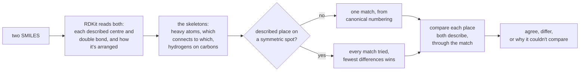
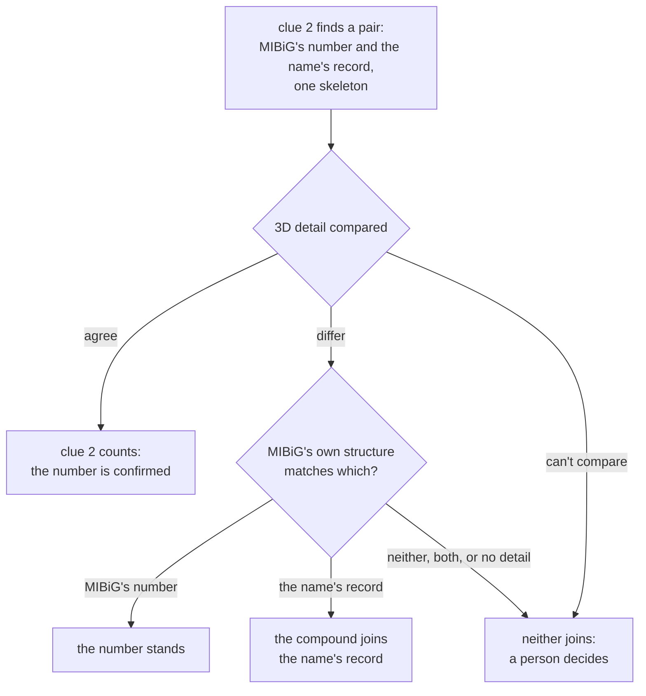

[← Handbook](HANDBOOK.md) · [README](../README.md) · [Glossary](GLOSSARY.md) · [Roadmap](ROADMAP.md) · [Query cookbook](QUERY_COOKBOOK.md) · [Phase 4b guide](06b-closing-the-gaps.md)

# 06c. Checking the 3D detail of same-structure joins (Phase 4c)

**Prerequisites:** [`06b-closing-the-gaps.md`](06b-closing-the-gaps.md)
finished: `pytest` passes, `python -m microbegraph.build_graph` ends with
`every count matches`, and `data/processed/resolution_ledger.csv` exists. You
need the internet once, to install one library (RDKit, about 30 MB). Nothing is
downloaded from PubChem or MIBiG, and nothing is asked of them. No chemistry
background is needed: each idea is explained where it first appears.

**Learning goal:** after this phase you will understand how two molecules can
have the same atoms and the same bonds and still be different compounds; how a
SMILES string writes down the way atoms sit in space; what the names R, S, E
and Z mean; how to compare two drawings of a molecule place by place, why a
place left open agrees with anything, and why symmetry needs care; how a third
witness can settle a disagreement between two sources, why its answer can
still be wrong, and when a program should stop and hand the question to a
person; and why one library in this project is pinned to an exact version.

**Time:** about 3 to 4 hours in one or two sessions. Every command is quick: the
resolver still takes about ten seconds, and the 3D check inside it under one.

> Every term here is also in [`GLOSSARY.md`](GLOSSARY.md). The overview of this
> phase is in [`HANDBOOK.md`](HANDBOOK.md), Stage 7c. The new recipes for
> following what it decided are R23 and R24 in
> [`QUERY_COOKBOOK.md`](QUERY_COOKBOOK.md#7-decisions-by-hand-and-disagreements-r20-to-r24).

---

## Contents

1. [What this phase builds, in one picture](#1-what-this-phase-builds-in-one-picture)
2. [The science, in plain words](#2-the-science-in-plain-words)
3. [The engineering ideas, in plain words](#3-the-engineering-ideas-in-plain-words)
4. [Step 0. Get into position](#4-step-0-get-into-position)
5. [Step 1. Install RDKit and put the new files in place](#5-step-1-install-rdkit-and-put-the-new-files-in-place)
6. [Step 2. Look at the real data first](#6-step-2-look-at-the-real-data-first)
7. [Step 3. How RDKit reads 3D detail](#7-step-3-how-rdkit-reads-3d-detail)
8. [Step 4. Comparing two drawings, place by place](#8-step-4-comparing-two-drawings-place-by-place)
9. [Step 5. Clue 2 with the 3D check](#9-step-5-clue-2-with-the-3d-check)
10. [Step 6. Run it on your data](#10-step-6-run-it-on-your-data)
11. [Step 7. Tests](#11-step-7-tests)
12. [Step 8. Pictures, the Handbook and the records](#12-step-8-pictures-the-handbook-and-the-records)
13. [How evidence and confidence carry through](#13-how-evidence-and-confidence-carry-through)
14. [What the graph still doesn't cover](#14-what-the-graph-still-doesnt-cover)
15. [What could go wrong](#15-what-could-go-wrong)
16. [Checkpoint](#16-checkpoint)
17. [Committing this phase](#17-committing-this-phase)

---

## 1. What this phase builds, in one picture

![Echinomycin's two PubChem records share a skeleton; the 8 chiral centres both describe read R R R S R R R S and S R R S R S R S, so 6 agree and 2 differ, at the two alanines. MIBiG's own structure matches CID 458034, but the literature gives L-alanine, as in CID 6857732, so a decision by hand joins that record. For each of the 183 pairs clue 2 looks at, the resolver compares the 3D detail: 118 agree and clue 2 counts; 65 differ and MIBiG's own structure decides: 38 keep MIBiG's number, 17 move to the record PubChem names, 10 can't be decided and leave 9 compounds for a person](img/three_d_check.svg)

Phase 4b taught the resolver a second clue for a compound's PubChem number:
when PubChem files MIBiG's name under a different record ("the name's record"
in this guide), and that record's InChIKey starts with the same block as the
number MIBiG gives, the two are treated as one molecule drawn two ways. The
first InChIKey block describes the atoms and how they connect, and nothing
about how they sit in space. A check that echinomycin prompted at the end of
Phase 4b showed that in 137 of the 180 joins this clue made, both records
describe the 3D arrangement, and describe it differently. Some of those pairs could be two different compounds that happen
to share a skeleton.

This phase checks every one of them:

1. **Place by place.** A new module, `stereo.py`, reads both records' SMILES
   with RDKit, a free chemistry library, matches their atoms one to one and
   compares every chiral centre and every double bond both describe (section
   2 explains both). Clue 2 now counts only when nothing differs.
2. **A third witness.** When the two records differ, the resolver asks
   MIBiG's own structure (most MIBiG entries carry a SMILES of their own). The
   record it matches is the compound, whichever of the two that is.
3. **A person for the rest.** When MIBiG's structure can't tell (it has none,
   it's drawn without 3D detail, or it matches neither), neither record is
   joined, and the ledger says a person should decide.

Echinomycin, the compound that started this, turned out to be a case where the
third witness is wrong: MIBiG's structure matches the record MIBiG's number
points at, and the literature gives the other one. It is settled by hand in
the review file (Step 5).

Nothing new is fetched: PubChem's SMILES have been in the staging tables since
Phase 2, and MIBiG's since Phase 1.

The commands:

| Command | What it does | Touches the internet? |
|---|---|---|
| `pip install -r requirements.txt` | Installs RDKit 2025.9.3 (Step 1) | Yes, once, about 30 MB |
| `python tests/fixtures/survey_3d_detail.py` | Looks at the real pairs before the new rules run (Step 2) | No |
| `python -m microbegraph.resolve` | Merges the six sources again, now with the 3D check | No |
| `python -m microbegraph.build_graph` | Loads the graph into DuckDB and NetworkX, compares | No |

**Files this phase creates or changes** (paths relative to the project folder):

| Path | New or changed | What it is |
|---|---|---|
| `src/microbegraph/resolution/stereo.py` | new | Compares the 3D detail of two SMILES, place by place, with RDKit |
| `src/microbegraph/resolution/compounds.py` | changed | Clue 2 counts only when the 3D detail agrees; when it differs, MIBiG's own structure decides |
| `src/microbegraph/resolve.py` | changed | The summary and the printed report say what the 3D check did |
| `src/microbegraph/resolution/__init__.py` | changed | The list of steps names `stereo.py` |
| `curation/resolution_decisions.csv` | changed | An eighth decision by hand: echinomycin joins 6857732 (Step 5) |
| `requirements.txt`, `requirements.lock.txt` | changed | RDKit, pinned to 2025.9.3 |
| `check-setup.py` | changed | Checks that RDKit imports |
| `tests/test_3d_check.py` | new | The promises this phase makes |
| `tests/test_closing_the_gaps.py` | changed | Phase 4b's made-up clue 2 records now have SMILES |
| `tests/fixtures/survey_3d_detail.py` | new | The look at the real pairs (Step 2) |
| `tests/fixtures/README.md` | changed | Describes the survey script |
| `docs/06c-checking-3d-detail.md` | new | This guide |
| `docs/QUERY_COOKBOOK.md` | changed | New recipes R23 and R24; R7 and the build date updated |
| `docs/img/three_d_check.svg` | new | The picture above |
| `docs/img/make_illustrations.py`, `docs/interactive/make_interactive.py` and the files they draw | changed | The new picture; three new cases on the resolution cases page; the journey map and the roadmap page show Phase 4c |
| `docs/phases.csv` | changed | Phase 4c, done |
| `README.md`, `CHANGELOG.md`, `docs/HANDBOOK.md`, `docs/ROADMAP.md`, `docs/GLOSSARY.md`, `docs/00-architecture.md`, `docs/01-setup.md`, `docs/02-ontology-and-data-model.md`, `docs/06b-closing-the-gaps.md`, `curation/README.md` | changed | Updated for this phase |

**Files this phase writes on your computer that never go to GitHub:** none new.
The resolver and the build rewrite `data/processed/*.csv`,
`resolve_summary.json` and `microbegraph.duckdb`, as they always do.

---

## 2. The science, in plain words

### Same atoms, same bonds, different shape

A molecule is atoms held together by bonds, and it has a shape in three
dimensions. Most of that shape follows from the bonds. Some of it doesn't: at
certain places the atoms can sit in one of two arrangements, and nothing about
which atom connects to which says which one. Two molecules that differ only
there are **stereoisomers**. They have the same formula and the same skeleton,
and they can still behave differently in a cell, because the proteins they meet
have shapes of their own (Phase 4b's guide has the glove comparison).

In the molecules of this project that choice comes up at two kinds of spot,
called "places" in this guide and in the ledger.

### Chiral centres, and the names R and S

A **chiral centre** is usually a carbon atom with four different groups
attached. The four can be arranged around it in two ways that are mirror
images, and no turning makes one into the other.

Chemists name the two arrangements **R** and **S** with a short recipe (the CIP
rules, after Cahn, Ingold and Prelog, who wrote them):

1. Rank the four groups by the atom that attaches each one to the centre: the
   higher its atomic number (roughly, the heavier the atom), the higher it
   ranks. Ties are broken by looking one step further out.
2. Turn the molecule so the lowest-ranked group points away from you.
3. Follow the other three from highest to lowest. Clockwise, like the hands of
   a clock, is R (Latin *rectus*); anticlockwise is S (*sinister*).

Alanine, a building block of proteins, has one chiral centre. The kind in your
own proteins is S.

### Double bonds that can be E or Z

Atoms can't rotate around a double bond, so the groups at its two ends stay
where they are. When each end carries two different groups, the more important
group at one end is either on the **same side** as the more important group at
the other end, or on the **opposite side**. Same side is **Z** (German
*zusammen*, together), opposite is **E** (*entgegen*, against). Two people on
the same bank of a river, or on opposite banks: the river stays where it is
either way.

### How a SMILES string writes 3D

A **SMILES** string writes a molecule as one line of text: `C=C(CC(=O)O)C(=O)O`
is itaconic acid. PubChem has sent one with every record since Phase 2, and
MIBiG gives one for most compounds. The 3D detail is written with two marks:

* **`@` and `@@` at a chiral centre.** In `C[C@H](N)C(=O)O`, look from the atom
  written just before the centre (the `C` at the start) towards it. The
  neighbours written after it, in order (the `H`, then the `N`, then the rest),
  go anticlockwise for `@` and clockwise for `@@`. Swap `@` for `@@` and you
  have the mirror image: `C[C@H](N)C(=O)O` is the alanine in proteins,
  `C[C@@H](N)C(=O)O` the other one.
* **`/` and `\` at the bonds next to a double bond.** They show which way each
  bond leans. `F/C=C/F` has the two fluorines on opposite sides (E), `F/C=C\F`
  on the same side (Z).

A SMILES without these marks says nothing about those places, and such a
drawing is called **flat**: it leaves every place open. In an InChIKey, the
second block is a fingerprint of the 3D detail (and of any isotope labels,
such as a deuterium), so a flat drawing without isotope labels always gets the
same second block, `UHFFFAOYSA`.

### Mirror images, epimers and the rest

When two drawings of one skeleton disagree, the pattern says what kind of
stereoisomers they are:

| Pattern | Name | A real pair from this phase |
|---|---|---|
| Both describe every chiral centre, and every one is the other way round | **enantiomers** (mirror images) | brevione E's two records, 9 centres, all opposite |
| Some places agree, some differ | **diastereomers** | echinomycin's, 6 centres agree and 2 differ |
| Exactly one of two or more chiral centres differs | an **epimer**, a diastereomer of the closest kind | colistin A's, 12 agree and 1 differs |
| Double bonds differ | **E/Z isomers** | macbecin II's, 3 double bonds, E in one record and Z in the other |

### A hydrogen in a different place: tautomers

Some molecules exist in two forms that turn into each other on their own, a
hydrogen atom hopping from one atom to a neighbour, with a double bond moving
along. These forms are **tautomers**, and chemists count them as one compound.
PubChem sometimes keeps one record for each. For the common kind, where the
hydrogen moves between nitrogen or oxygen atoms, the InChIKey's first block is
built to give both the same value. Saxitoxin is one: in one record a hydrogen
sits on one nitrogen, in the other on the next. A comparison that matched atoms
by their bonds exactly would call these two skeletons different, so the one in
this phase doesn't (Step 4).

Tautomers can even change a name. The CIP recipe ranks the groups by what they
are made of, and a hydrogen that moves can change the ranking around a centre,
and with it the name R or S, though nothing moved in space. That's why the
comparison in this phase looks at the arrangement itself and never compares
the names.

---

## 3. The engineering ideas, in plain words

### Look at the data first, again

Every phase has started with a look at the real data, and this one did too. It
settled the design: it showed that about a third of the pairs (66 of the 184
after Phase 4b) are two different compounds (so the check matters), that
tautomers and unusual ways of writing a charge occur (so the atom matching has
to look past them), and that MIBiG's own structure can settle most of the
disagreements (Step 2).

### Compare place by place, and let a blank agree

Two forms about the same person, one with the date of birth filled in and one
with that box blank, don't contradict each other. They would only conflict if
both filled in the box with different dates. The 3D check works the same way:
a place counts as a difference only when **both** drawings describe it and
describe it differently. A place only one drawing describes is counted, and
reported, but it can't make them disagree.

### Symmetry: more than one way to match

To compare two drawings place by place, you first need to know which atom in one
is which atom in the other. For most molecules there is exactly one way to
match them. A symmetric molecule has several: a hexagonal nut fits the spanner
six ways. If the program picked one of those ways at random, it could compare
the left half of one molecule with the right half of the other and report a
difference that isn't there.

So `stereo.py` takes two steps. RDKit's canonical numbering (a fixed way of
numbering any molecule's atoms, so that the same molecule always gets the same
numbers) gives one match at once. When a described place sits on a symmetric
spot, every way of matching is tried and the one with the fewest differences
wins. Of the 5,797 structures in the data (2,522 PubChem records and 3,275
MIBiG structures), 129 needed the second step, and the most any needed was
1,536 tries. A safety limit of 10,000 tries keeps a very
symmetric molecule from filling the computer's memory; such a molecule is
reported as "too symmetric" instead of guessed.

### A third witness, and when to stop guessing

When MIBiG's number and PubChem's naming point at two different stereoisomers,
two sources disagree, and neither is obviously the stronger: MIBiG's curators
chose the number, PubChem's depositors chose the name. A third source that
describes the same detail can settle it, and most MIBiG compounds have one,
MIBiG's own SMILES (747 of the 3,842 have none). The resolver asks it, and when
it matches one record and not the other, that record wins.

The third witness isn't independent of the first, though. MIBiG's curators may
have copied their SMILES from the record their number points at, so "MIBiG's
structure matches MIBiG's number" is weaker evidence than "MIBiG's structure
matches the record PubChem names". The ledger says which of the two happened,
so a reader can weigh it, and echinomycin shows the weakness is real (Step 5).
When the third witness can't tell at all, the program stops: neither record is
joined and the ledger asks for a person. A wrong join hides facts about one
molecule under another one's name, which is worse than a gap.

### One version of a library, everywhere

Every other package in `requirements.txt` has a range (`pandas>=2.2,<4` means
at least 2.2, below 4), so the project keeps receiving fixes. RDKit has an
exact version, `rdkit==2025.9.3`. RDKit stopped publishing ready-made installs
for Intel Macs after 2025.9.3, so on an Intel Mac pip would quietly install
that version while every other computer took a newer one. And the resolver's
counts depend on which places RDKit thinks a drawing describes: two versions
could disagree about an unusual drawing and print different numbers. One
version everywhere keeps every computer's output the same, the way a class
that reads one edition of a textbook can quote page numbers to each other.

---

## 4. Step 0. Get into position

1. Open your terminal and go to the project folder:

   ```bash
   cd ~/projects/microbegraph      # or wherever you cloned it
   ```

   Windows PowerShell: `cd $HOME\projects\microbegraph`
2. Make sure you're on the working branch and up to date:

   ```bash
   git switch develop
   git pull --ff-only origin develop
   ```

3. Activate the toolbox:

   ```bash
   source .venv/bin/activate          # macOS / Linux / RHEL 8
   ```

   Windows PowerShell: `.\.venv\Scripts\Activate.ps1`
4. Check that Phase 4b's output is there:

   ```bash
   python -m microbegraph.query --recipe 20
   ```

   You should see seven decisions made by hand. If it says the database
   doesn't exist, finish
   [Phase 4b](06b-closing-the-gaps.md#14-step-10-run-it-for-real) first.

✅ **Checkpoint.** Your prompt starts with `(.venv)`, `git branch` shows
`* develop`, and recipe R20 prints seven rows (eight if you have already run
this phase's resolver).

---

## 5. Step 1. Install RDKit and put the new files in place

If you cloned the repository after this phase was committed, every file is
already there and you can read along. If you're building it yourself, put each
file from the table in section 1 at the path shown. Then:

1. **Install the new library.** `requirements.txt` now lists
   `rdkit==2025.9.3`, so the usual command installs it:

   ```bash
   pip install -r requirements.txt
   ```

   The same command works on macOS, Windows and RHEL 8. Near the end, pip
   prints a line starting `Successfully installed` that includes
   `rdkit-2025.9.3` (and `pillow` too, if your computer didn't have it yet).
   RDKit comes as a ready-made package for 64-bit Windows, Linux (RHEL 8
   included) and both kinds of Mac, for every Python this project supports
   (3.11 to 3.13), so nothing is compiled.
2. **Check that it imports:**

   ```bash
   python -c "import rdkit; print(rdkit.__version__)"
   ```

   You should see:

   ```
   2025.09.3
   ```

   RDKit writes its month with two digits, so 2025.9.3 and 2025.09.3 are the
   same version.
3. **Run the setup check**, which now looks for RDKit too:

   ```bash
   python check-setup.py
   ```

   Among the package lines you should see `[PASS]  package: rdkit`, and at the
   end `All checks passed. Your workshop is ready.`
4. **No reinstall of the project.** The package is installed in editable mode,
   so Python finds `stereo.py` straight from the project folder.

✅ **Checkpoint.** `pytest` ends with `398 passed` and no `failed`.

---

## 6. Step 2. Look at the real data first

Before the new rules were written, a few lines of Python looked at the pairs
clue 2 had joined. `tests/fixtures/survey_3d_detail.py` is that look, tidied
so you can repeat it. It uses `stereo.py` (so Step 1's files must be in place),
reads three files you already have (the ledger and two staging tables), sends
nothing anywhere and writes nothing:

```bash
python tests/fixtures/survey_3d_detail.py
```

It finds the pairs by the phrase every clue 2 sentence in the ledger contains,
"both InChIKeys start". Run now, it reads the ledger Phase 4b wrote. On the
real data:

```
Part 1: pairs of records with one skeleton, in the ledger
    pairs                                184
    both 3D, and different               140
    MIBiG's number drawn flat            28
    the name's record drawn flat         9
    the same second block                7
Part 2: their 3D detail, compared place by place in two ways
    stereo.py agree    InChI agree     118   the methods agree
    stereo.py differ   InChI differ     66   the methods agree
Part 3: for the pairs that differ, what MIBiG's own structure matches
    matches MIBiG's number                        39   (e.g. a-201a)
    matches the name's record                     17   (e.g. abyssomicin-c)
    can't decide: MIBiG's entries disagree         3   (e.g. fluostatin-f)
    can't decide: another skeleton                 3   (e.g. brevione-e)
    can't decide: differs from both                2   (e.g. brasilinolide-a)
    can't decide: agrees with both                 1   (e.g. kosinostatin)
    can't decide: no 3D detail                     1   (e.g. nocardicin-a)
```

After Step 6 the same command prints 183 pairs instead of 184 (and 139, 65 and
38 where it now prints 140, 66 and 39), because echinomycin is then decided in
the review file and clue 2 no longer looks at it (Step 5).

What that says:

| Finding | What it means |
|---|---|
| 184 pairs | The 180 joins clue 2 made in Phase 4b, plus 4 pairs inside two ties: kosinostatin and valclavam each have two numbers that both reached clue 2, so neither joined |
| 140 both 3D, and different | Both records describe 3D detail, and their second InChIKey blocks differ. 137 of them are among the 180 joins, the number the roadmap handed on |
| 28 and 9 drawn flat | One record has no 3D detail at all (second block `UHFFFAOYSA`), so nothing can disagree |
| 7 with the same second block | Identical 3D detail. 6 of them are tautomers, written with a hydrogen on a different atom (capreomycin IIb, decarbamoylsaxitoxin, gonyautoxin 2, neosaxitoxin, nisin A, saxitoxin); the seventh, endophenazine B, is the acid in one record and its charged carboxylate in the other |
| 118 agree, 66 differ | Of the 140, 74 agree once compared place by place: one record describes more places than the other. 66 really differ |
| The methods agree | Two comparisons, written with different code, give the same verdict on every pair (below) |

**The comparison, checked a second way.** The survey compares every pair
twice. The first way is `stereo.py` (Step 4): match the atoms, then compare how
each place is arranged through the match. The second asks RDKit to write each
record as an InChI string, the text from which an InChIKey is made. Its `/t`
layer lists every chiral centre by atom number with a `+` or a `-`, its `/b`
layer every double bond, and its `/m` layer says whether the signs are written
for the mirror image. Both ways start from RDKit's reading of the SMILES, so
they aren't fully independent, but they find and compare the places with
different code, and they agree on all 184 pairs.

**How the 66 differ.**

| Kind of difference | Pairs | Example |
|---|---|---|
| Every place both describe is the other way round | 10 | brevione E (9 centres), macbecin II (3 double bonds), n-myristoyl-D-asparagine (its one centre) |
| Only chiral centres differ, and some places agree | 34 | colistin A, 1 of 13 centres |
| Only double bonds differ, and some places agree | 16 | capsimycin, 1 of 2 double bonds |
| Both chiral centres and double bonds differ | 6 | heronamide A |

In 37 of the 66, the records differ at exactly one place.
n-myristoyl-D-asparagine is one of them, and its two records also differ by a
deuterium atom (a heavier form of hydrogen) in one of them: the atom matching
looks past the label and finds the centre opposite.

**MIBiG's own structure settles 56 of the 66** (Part 3). It matches the number
MIBiG gives in 39 and the record PubChem names in 17. The other 10 it can't
settle: in 3, MIBiG's entries give structures that disagree with each other;
in 3 its structure has another skeleton altogether; in 2 it differs from both
records; in 1 (kosinostatin) it agrees with both, because it leaves open the
place where they differ; and in 1 (nocardicin A) it carries no 3D marks at all.
The 39 are the weakest of these answers, for the reason section 3 gives, and
echinomycin is one of them (Step 5).

**What the look changed.** The atom matching looks past bond orders and
charges, because of the tautomers and because salinipostin G's two records
write the same phosphorus group two ways (P+ with O- in one, P=O in the
other). Symmetric molecules get every way of matching tried, which costs
little: all 184 pairs compare in about half a second. And the rule for MIBiG's
structure reads every structure MIBiG's entries give, not only the first,
because 3 of the 10 undecided cases are entries that disagree.

---

## 7. Step 3. How RDKit reads 3D detail

RDKit turns a SMILES into a molecule object you can ask questions. Try it: type
`python`, paste these lines, and press Enter once more if nothing happens
(the prompt waits for a blank line after the indented lines):

```python
from rdkit import Chem
from rdkit.Chem import rdCIPLabeler

for smiles in ("C[C@H](N)C(=O)O", "N[C@@H](C)C(=O)O", "C[C@@H](N)C(=O)O"):
    mol = Chem.MolFromSmiles(smiles)
    rdCIPLabeler.AssignCIPLabels(mol)
    centre = mol.GetAtomWithIdx(1)
    order = [n.GetSymbol() + str(n.GetIdx()) for n in centre.GetNeighbors()]
    print(f"{smiles:<18} {centre.GetProp('_CIPCode')}  {centre.GetChiralTag()}  {order}")
```

You should see:

```
C[C@H](N)C(=O)O    S  CHI_TETRAHEDRAL_CCW  ['C0', 'N2', 'C3']
N[C@@H](C)C(=O)O   S  CHI_TETRAHEDRAL_CW  ['N0', 'C2', 'C3']
C[C@@H](N)C(=O)O   R  CHI_TETRAHEDRAL_CW  ['C0', 'N2', 'C3']
```

Atom number 1 (counting from 0, so the second atom written) is alanine's chiral
centre in all three. Line by line:

* `Chem.MolFromSmiles` reads the text. It returns `None` for a SMILES it can't
  read, and `stereo.py` reports that as "unreadable" instead of failing.
* `rdCIPLabeler.AssignCIPLabels` applies the CIP rules from section 2 and
  writes the name onto each atom (and each double bond) as a property called
  `_CIPCode`. It is RDKit's newer, more careful implementation of the rules;
  some unusual molecules get a different, wrong name from the older one. Only
  places the SMILES describes get a name. A flat SMILES gets none.
* `GetChiralTag()` is what RDKit itself keeps for the centre: clockwise (`CW`)
  or anticlockwise (`CCW`), for the order in which `GetNeighbors()` lists the
  centre's neighbours (the hydrogen, which isn't a separate atom here, has a
  fixed place in that order).

Now read the three lines together. The first two are the same molecule, the
alanine in proteins, written in two orders: both are S. RDKit's word differs
because its list differs: the methyl carbon and the nitrogen have swapped
places, and one swap of two neighbours turns clockwise into anticlockwise. The
third line is the mirror image: the same list as the first, the other word,
and the name R.

So the word only means something together with its list, and the name R or S
is worked out from the whole molecule. Step 4 compares the words through the
lists. Type `exit()` to leave.

✅ **Checkpoint.** You can say why `C[C@H](N)C(=O)O` and `N[C@@H](C)C(=O)O` are
the same molecule although one has `@` and the other `@@`.

---

## 8. Step 4. Comparing two drawings, place by place

`src/microbegraph/resolution/stereo.py` does the comparison. Its one main
function takes two SMILES and returns what it found:



The **skeleton** is what lets tautomers and charge styles match. It keeps the
heavy atoms (everything but hydrogen) and which connects to which, and drops
bond orders, charges and isotope labels. Hydrogens stay only as a count on each
carbon atom: without that count, a carbon in a C=O group and a carbon carrying
an OH would look alike, and a chiral centre could be matched with a ketone.
The tautomers clue 2 meets move a hydrogen between nitrogen or oxygen atoms,
so the carbons keep their counts and the two forms still match. (A hydrogen
that moves onto a carbon, as between a ketone and an enol, changes the first
InChIKey block as well, so clue 2 never pairs such records.) Two drawings whose skeletons
don't match are reported as "other skeleton", and nothing is compared.

**Comparing a place through the match.** For a chiral centre, `stereo.py`
takes the second drawing's list of neighbours, translates each one through the
match into the first drawing's atoms, and counts the swaps of two neighbours
needed to put them in the first drawing's order. Each swap flips clockwise and
anticlockwise, so an even number of swaps with the same word, or an odd number
with opposite words, is the same arrangement. A double bond works the same way:
RDKit keeps one chosen neighbour at each end and whether the two sit on the
same side, and at each end where the two drawings chose different neighbours
(once matched), the answer flips. The names R/S and E/Z are never compared,
because of the tautomers in section 2 whose names change while nothing moves.

Try it: type `python` again to start it, and paste these lines. The third line
compares two threonines. Threonine has two chiral centres, so it comes in four
arrangements; these two are the one in proteins and one that differs at a
single centre:

```python
from microbegraph.resolution import stereo

print(stereo.compare("C[C@H](N)C(=O)O", "CC(N)C(=O)O"))
print(stereo.compare("C[C@H](N)C(=O)O", "C[C@@H](N)C(=O)O"))
print(stereo.compare("C[C@@H](O)[C@H](N)C(=O)O", "C[C@H](O)[C@H](N)C(=O)O"))
print(stereo.compare("C[C@H](N)C(=O)O", "N[C@@H](C)C(=O)O"))
```

You should see:

```
Comparison(status='agree', same_centres=0, same_bonds=0, differing_centres=0, differing_bonds=0, only_first=1, only_second=0)
Comparison(status='differ', same_centres=0, same_bonds=0, differing_centres=1, differing_bonds=0, only_first=0, only_second=0)
Comparison(status='differ', same_centres=1, same_bonds=0, differing_centres=1, differing_bonds=0, only_first=0, only_second=0)
Comparison(status='agree', same_centres=1, same_bonds=0, differing_centres=0, differing_bonds=0, only_first=0, only_second=0)
```

Read them one at a time:

1. Alanine against a flat alanine: they **agree**. The first describes one
   place the second leaves open (`only_first=1`), and nothing is compared.
2. Alanine against its mirror image: they **differ** at one chiral centre.
3. Two threonines: one centre is the same, one differs, so they differ. These
   two are epimers.
4. Alanine written in two orders, the pair from Step 3: `@` against `@@`, and
   they **agree**, because the swap in the list cancels the change of word.

The result is a small record called `Comparison`, with a `status` and six
counts. The status is `agree` or `differ` when the two could be compared; when
they couldn't, it says why: `unreadable` (a SMILES is missing or RDKit can't
read it), `other skeleton`, or `too symmetric`.

Two more functions serve the next step: `skeleton_key` computes the first
InChIKey block of a SMILES (MIBiG's structures don't come with an InChIKey),
and `described` counts the places a drawing describes.

✅ **Checkpoint.** You can say why a flat drawing agrees with every other
drawing of its skeleton, and what `only_first=1` means in the first line.

---

## 9. Step 5. Clue 2 with the 3D check

The change to the rules is in `src/microbegraph/resolution/compounds.py`, in a
new function, `_judge_same_structure`, that runs where clue 2 used to accept a
pair straight away. "The number" below is the PubChem number MIBiG gives; "the
name's record" is the different record PubChem files MIBiG's name under, with
the same first InChIKey block.



What each outcome does, with the closing words the ledger uses:

| Outcome | What happens | The ledger's closing words |
|---|---|---|
| The two agree | Clue 2 counts, as before. The sentence now says how the 3D detail compares | "Confirmed by name, through the same structure." |
| They differ, and MIBiG's structure matches MIBiG's number | The number is confirmed; the name's record is kept apart, "better supported" naming the number | "Confirmed through the same skeleton and MIBiG's own 3D structure." |
| They differ, and MIBiG's structure matches the name's record | The compound joins the name's record (rule `pubchem_name_search`); MIBiG's number is kept apart and moves to `pubchem_cid_not_confirmed` on the node | "Confirmed by name and by MIBiG's own 3D structure." |
| They differ, and MIBiG's structure can't tell | Neither record joins; both rows say "a person should decide between them" (unless another number MIBiG gives joined, as kosinostatin's did: then those words are left out, and the row ends "CID 102302126 is better supported, so this one stays apart.") | "Nothing else confirms it, so the two stay apart." |
| The 3D detail can't be compared at all | Treated like the row above, with the reason ("can't be compared in 3D (...)") | the same |

A real sentence of each kind, from your ledger after Step 6:

* **They agree** (1233A, the number MIBiG gives against a flat record):
  "... but files it under CID 54144091, the same molecule drawn another way:
  both InChIKeys start ODCZJZWSXPVLAW, and CID 54144091 describes no place in
  3D, so nothing can disagree; ..."
* **MIBiG's number stands** (n-myristoyl-D-asparagine): "... but files it
  under CID 138986957, a record with the same skeleton (both InChIKeys start
  XCYGCBVZSVXYON) that differs in 3D at 1 chiral centre; MIBiG's own structure
  matches CID 102500690, so the number MIBiG gives stands; ..." Here the name
  agrees too: 102500690 draws the centre R, which at that carbon is
  D-asparagine.
* **The compound moves** (macbecin II, on the name's record): "PubChem's name
  search finds 'macbecin II' under CID 5778325 ('Macbecin II'), and MIBiG's own
  structure matches its 3D detail; CID 6438438, the number MIBiG gives, has the
  same skeleton and differs in 3D at 3 double bonds; ..."
* **A person decides** (nocardicin A): "... that differs in 3D at 1 double
  bond, and MIBiG's own structure gives no 3D detail, so a person should decide
  between them; ..."

**How MIBiG's structure is asked** (`_mibig_side`). Every structure MIBiG's
entries give for the compound is used: one entry's SMILES, or every entry's
when they differ (`smiles_by_entry`, Phase 4b). Each is checked for the same
skeleton (its first InChIKey block, computed with `skeleton_key`), then for any
3D detail at all, then compared with both records. They must all point the same
way. A structure that agrees with both records says nothing, because it leaves
open the places where they differ.

**A tie the check can settle.** When MIBiG gives two numbers and both reach
clue 2, the two used to tie and neither joined. If only one of them agrees in
3D with the name's record, it's now the only one clue 2 accepts, so the tie is
settled. That happened once in the real data, to kosinostatin (Step 6).

**What runs before the check.** The isotope rule from the Phase 4b follow-ups
runs first, so a tracer like "[55Fe] Ferrichrome" is still refused before any 3D
check. And a decision in the review file still wins over every rule here,
which matters for the next case.

**Echinomycin, settled by hand.** The compound that started this phase is one
the check alone gets wrong. Both records describe 8 chiral centres (a ninth,
the carbon in its sulfur bridge, is open in both), and they differ at 2.
MIBiG's own structure matches 458034, the one of MIBiG's two numbers that
reached clue 2, at all 8, so the rule keeps that number. The two centres are
the alpha carbons of its two alanines (the alpha carbon is the chiral centre
every amino acid but glycine has, and D and L are the older names for its two
forms; both are in the glossary). A review of echinomycin and its relatives (Dawson, Malkinson,
Paumier and Searcey, *Natural Product Reports*, 2007, doi:10.1039/b516347c)
gives D at the serine that carries the quinoxaline ring and L at the alpha
carbon of every other residue, so the alanines are L, which is S. The record
PubChem titles "Echinomycin", 6857732, draws both alanines S; 458034 (titled
"S-426-S (Lepetit)") and MIBiG's structure draw them R. This is the copying
section 3 warns about: MIBiG's SMILES most likely came from the record its
number points at.

So I settled it by hand. `curation/resolution_decisions.csv` has an eighth
decision, a `join` of echinomycin and 6857732 with the review as its source,
and it wins over clue 2. The other 38 compounds whose number MIBiG's structure
keeps haven't been checked against the literature yet; the
[roadmap](ROADMAP.md#phase-4c-the-3d-check-of-same-structure-joins-) plans it.

**The counts.** `join_pubchem` now returns what the check found, and the
resolver writes it into `resolve_summary.json` as `same_structure_3d_check`,
with the compounds left for a person under
`still_open.same_structure_3d_for_a_person`. The printed report gains three
lines (Step 6).

✅ **Checkpoint.** You can say what happens to a compound whose two records
differ in 3D when MIBiG's own structure is drawn flat, and why.

---

## 10. Step 6. Run it on your data

1. **Resolve:**

   ```bash
   python -m microbegraph.resolve
   ```

   The real output from the run on 2026-10-13:

   ```
   [resolve] reading data/processed/staging/ (six sources) and curation/
     mibig           47,844 nodes   version 4.0
     pubchem          2,522 nodes   version live
     ncbi_taxonomy    2,457 nodes   version Build261011-2030.1
     kegg                53 nodes   version pathway 2026/10/09, compound 2026/10/09
     uniprot         20,507 nodes   version 2026_03
     curation            11 nodes   version repository file
   [resolve] decisions, rule by rule (the ledger has one row for each)
     same_identifier           combined 1,478
     ncbi_merged_number        moved 7
     organism_and_pathogen     combined 2
     activity_synonym          merged 4
     reviewed_by_hand          merged 3   kept_apart 5
     pubchem_number_confirmed  merged 991   kept_apart 139
     pubchem_number_shared     merged 9   kept_apart 12
     pubchem_numbers_differ    merged 19   kept_apart 37
     pubchem_name_search       merged 944   kept_apart 374
     pubchem_number_unknown    kept_apart 5
     npatlas_and_formula       merged 1   kept_apart 7
     uniprot_cross_reference   merged 20,626   kept_apart 40
     identical_sequence        merged 220   kept_apart 9
     not_used                  left_out 857
   [resolve] the merged graph
     nodes  48,234   from 71,915 identifiers (857 left out, 5 of them maps no arrow reaches)
       Activity           70
       Compound        3,826
       CompoundClass      37
       Crop                5
       GeneCluster     2,437
       Organism        2,451
       Pathogen            6
       Pathway            48
       Protein        39,354
     edges  57,014   from 57,105 (66 combined, 25 dropped with left-out entries)
       BELONGS_TO        528
       CATALYZES       4,492
       ENCODES        39,930
       HARBORS         2,437
       HAS_ACTIVITY    2,765
       INFECTS             7
       INHIBITS            7
       MEMBER_OF       2,449
       PARTICIPATES_IN    117
       PRODUCES        4,282
   [resolve] curation/: 4 of 4 activity synonyms applied, 8 decisions by hand
   [resolve] 3D check of same-structure joins: 183 pairs, 118 agree, 65 differ
     MIBiG's own structure keeps the number 38, moves to the name's record 17, can't decide 10
     9 compounds are left without a PubChem record, for a person to decide
   [resolve] the twelve rules pass on the merged tables
   [resolve] every identifier that disappeared has a ledger row
   [resolve] wrote data/processed/: nodes.csv, edges.csv, resolution_ledger.csv, resolve_summary.json
   Next:  python -m microbegraph.build_graph
   ```

2. **Build:**

   ```bash
   python -m microbegraph.build_graph
   ```

   It should end with `every count matches`, the ledger holding 25,789 rows.
3. **Look at what the check decided** with the two new recipes:

   ```bash
   python -m microbegraph.query --recipe 23
   python -m microbegraph.query --recipe 24
   ```

   R23 shows 38, 17 and 10, R24 the 9 compounds that wait for a person. Both
   are explained in the cookbook.

**What changed, and why the totals barely move.** The graph keeps its 48,234
nodes and 57,014 arrows: no compound node appears or disappears, only which
PubChem record each one is joined to. Against Phase 4b:

| Count | After Phase 4b | After Phase 4c | Why |
|---|---|---|---|
| `reviewed_by_hand` | merged 2, kept apart 5 | merged 3, kept apart 5 | Echinomycin joins 6857732 (Step 5) |
| `pubchem_number_confirmed` | merged 1,017, kept apart 113 | merged 991, kept apart 139 | 26 numbers lost: 17 to the name's record, 9 to "a person decides" |
| `pubchem_number_shared` | merged 9, kept apart 13 | merged 9, kept apart 12 | Echinomycin is decided by hand now, so its row for 3197 (a number MIBiG gives quinomycin too) goes |
| `pubchem_numbers_differ` | merged 19, kept apart 38 | merged 19, kept apart 37 | Kosinostatin's tie settled: 102302126 joins. Echinomycin's join to 458034 goes, for the same reason as the row above |
| `pubchem_name_search` | merged 927, kept apart 384 | merged 944, kept apart 374 | The 17 records that won are merged now (14 of them had a kept-apart row before; azolemycin D's, eurocidin E's and oxepinamide F's were left out). Echinomycin's 6857732 loses its kept-apart row, because the review file joins it. 5 records the name search found get a row of their own, because their compound now waits for a person (brevione E's, and 4 of capsimycin's) |
| `not_used` | 849 | 857 | 27 records left out now (the 26 numbers that lost, and echinomycin's 458034), 19 no longer (the 17 records that won, kosinostatin's 102302126 and echinomycin's 6857732) |
| Ledger rows | 25,775 | 25,789 | 8 more `not_used` rows, 7 more `pubchem_name_search` rows and 1 more `reviewed_by_hand` row; 1 fewer each for `pubchem_number_shared` and `pubchem_numbers_differ` |
| MIBiG compounds with a PubChem record | 1,975 | 1,967 | 9 now wait for a person; kosinostatin gained its record; echinomycin changed records |

The 17 compounds that moved to the record PubChem names: abyssomicin C,
azolemycin D, BE-14106, belactosin A, bicyclomycin, cyclizidine,
cystargolide A, eurocidin E, FD-891, heronamide A, C and D, macbecin II,
oxepinamide F, pneumocandin A0, saprolmycin E and spiruchostatin A.

The 9 left for a person (recipe R24): brasilinolide A, brevione E, capsimycin,
cremimycin, fluostatin F, heronamide B, nocardicin A, syringolin A and
versipelostatin.

**Sanity checks.** Run the survey from Step 2 again. It compares MIBiG's
structures with the InChI method rather than `stereo.py`, and it should now
print 183 pairs, 118 agreeing and 65 differing, and 38, 17 and 10 in Part 3:
the resolver's numbers. One kept number can also be checked against its own
name: n-myristoyl-D-asparagine keeps 102500690, which draws its one centre R,
and R at that carbon is D-asparagine; the record PubChem names,
"N-myristoyl-d-asparagine" (138986957), draws it S. And recipe R20 shows
echinomycin's decision among the eight made by hand.

✅ **Checkpoint.** The resolver prints the three lines about the 3D check with
the numbers above, the build ends with `every count matches`, and R24 lists 9
compounds.

---

## 11. Step 7. Tests

There are 398 tests, 37 more than Phase 4b: 35 in `tests/test_3d_check.py`
(27 test functions, some of them run several times with different inputs), and
the two new recipes, R23 and R24, which `tests/test_query.py` runs on the real
slice like every other recipe. The 35:

| What is tested | How |
|---|---|
| The comparison itself | On alanine, threonine, butane-2,3-diol and crotonic acid, small molecules whose 3D arrangement can be checked by hand: the same drawing, a flat drawing, a mirror image, an epimer, an E/Z pair, and five drawings each written in ten random atom orders |
| Symmetry | Butane-2,3-diol has two centres that can swap places: two drawings that each describe one of them agree, and two that really differ still differ whichever way the atoms are matched |
| What can't be compared | A SMILES RDKit can't read, a missing SMILES, another skeleton, and a molecule above the symmetry limit each give their own status, never a guess |
| Tautomers, labels and look-alike carbons | Saxitoxin's two real records match atom for atom; a tautomer whose name R or S changes with the moved hydrogen still agrees; a deuterium label doesn't stop the match; a ketone carbon is never matched with a chiral centre |
| The rules | Made-up compounds (tau to omega, sigma and rho), all threonine, one per outcome: MIBiG's structure keeps the number (A-201A's shape), moves to the name's record (macbecin II's), can't decide because it's flat (nocardicin A's) or missing, a record without a SMILES, two numbers where the one that agrees settles the tie (kosinostatin's), a number PubChem names that another number's check never overrules, and a number that agrees winning over a move to the same record |
| The summary and the report | The counts in `resolve_summary.json`, the list of compounds left for a person (a compound whose other number joined isn't on it), and the exact lines the resolver prints |

Phase 4b's made-up clue 2 case got real SMILES (one record with a chiral
centre, one flat), because without a SMILES there is nothing to compare, and
the check now leaves such a pair for a person.

✅ **Checkpoint.** `pytest` ends with `398 passed`.

---

## 12. Step 8. Pictures, the Handbook and the records

**The pictures.** One new diagram drawn by `docs/img/make_illustrations.py`,
`three_d_check.svg` (section 1): the eight centres echinomycin's records both
describe, side by side, and what the resolver does with every pair. The page
`docs/interactive/resolution_cases.html` has three new cases: echinomycin
(MIBiG's structure keeps the number, and a decision by hand overrules it),
macbecin II (the compound moves to the record PubChem names) and nocardicin A
(a person decides). The journey map and the roadmap page show Phase 4c done.

**At the end of this phase,** as at the end of every phase:

1. In `docs/phases.csv` (in VS Code), Phase 4c's `status` is `done`.
2. Re-run both picture scripts:

   ```bash
   python docs/img/make_illustrations.py
   python docs/interactive/make_interactive.py
   ```

   The first prints `Done: 33 figures in docs/img/`, the second names four
   pages.
3. In `docs/HANDBOOK.md`: Stage 7c is ✅ and Stage 8 (Phase 5) is ⏳, with the
   version, date and repository state at the top updated, and a change-log line.
4. The same status change is in the README build log and `docs/ROADMAP.md`.
5. Add the Phase 4c entry to `CHANGELOG.md`, with your numbers from Step 6.
6. Commit all of it in the phase commit (section 17).

---

## 13. How evidence and confidence carry through


This phase adds no new kind of arrow, and no arrow changes its evidence level.
What does change:

| Situation | What happens | Why |
|---|---|---|
| A compound moves to the name's record | Its arrows (its clusters, its activities, the bridge's cited claims) now end at that record's node, with their evidence unchanged | The facts are about MIBiG's compound; only the record that represents it changed |
| A compound waits for a person | It stays an `mg.compound:` node with all its arrows, and its PubChem facts (synonyms, KEGG and ChEBI numbers) stay out | Joining the wrong stereoisomer would attach another compound's facts to it |
| The ledger | Every outcome says which places differ and what MIBiG's structure matched | Anyone can check a decision without rerunning anything |

---

## 14. What the graph still doesn't cover

| Gap | How big | What happens to it |
|---|---|---|
| Compounds the 3D check leaves for a person | 9 (recipe R24) | Each needs someone to read the paper behind the compound and record which record is right in `curation/resolution_decisions.csv` |
| Numbers kept on MIBiG's structure alone | 38 (recipe R23) | Echinomycin showed that MIBiG's structure can copy the record its number points at. [The roadmap](ROADMAP.md#phase-4c-the-3d-check-of-same-structure-joins-) plans a person's check of each against the literature |
| Agreeing pairs whose MIBiG structure matches neither record | 5: chromomycin A3 and ikarugamycin (MIBiG's structure has another skeleton), pleuromutilin and pneumocandin B0 (it differs from both at one centre), and curacin A (two of its three entries differ from both at one centre; the third agrees with both). In 2-methylisoborneol and bryostatin, one of MIBiG's entries is another molecule altogether | The two records agree, so clue 2 counts and nothing changed. MIBiG's own structure may be the odd one out; the roadmap plans a check of MIBiG's structure against the record of every join, not only clue 2's |
| A flat number joined where MIBiG's structure disagrees with the name's record | 2 seen so far: indolmycin, joined to its flat number 3082186, where MIBiG's structure is the mirror image of 135417159, the record PubChem names; and bottromycin A2, joined to its flat number 3081434, where one of its three entries differs from 25215756, the record PubChem names, at one centre | A flat record can't disagree with anything, so the 3D check doesn't touch it. The same roadmap item covers it |
| Ties between equally good records | 34 (33 names PubChem files under several equally good records, and valclavam, whose two numbers both agree in 3D with the name's record), down from 35 | A person can settle each in the review file |
| RDKit and PubChem disagreeing about a record's second InChIKey block | 4 records of 3 compounds (eurocidin D, eurocidin E and both hitachimycin records): the second block RDKit computes differs from the one PubChem sends | First blocks always match, so clue 2 finds the same pairs. The comparison uses RDKit's reading throughout, so the two records of a pair are judged alike |

The 80 joins on the formula alone, the 131 compounds the clues refused and the
other gaps Phase 4b listed are unchanged
([`06b-closing-the-gaps.md`, section 17](06b-closing-the-gaps.md#17-what-the-graph-still-doesnt-cover)).

---

## 15. What could go wrong

| Symptom | Likely cause | Fix |
|---|---|---|
| `ModuleNotFoundError: No module named 'rdkit'` | RDKit isn't installed in the environment you're using | Activate `.venv` (Step 0), then `pip install -r requirements.txt` |
| `ERROR: Could not find a version that satisfies the requirement rdkit==2025.9.3` | Your Python is 3.9 or older, or 32-bit, or the computer is one RDKit 2025.9.3 has no ready-made install for: Linux older than RHEL 8, Alpine Linux, Windows on ARM, or macOS older than 10.15 | `python --version` should say 3.11, 3.12 or 3.13 (the versions this project supports); [`01-setup.md`](01-setup.md) shows how to install one, then recreate `.venv` |
| `[FAIL]  package: rdkit` in `check-setup.py` | The same as the first row | The same fix |
| The resolver's numbers differ from Step 6 | Another RDKit version (someone ran `pip install --upgrade rdkit`), or other downloads | `pip install rdkit==2025.9.3`; if the numbers still differ, compare the versions printed by the resolver's first lines with the ones above |
| The resolver prints `N couldn't be compared in 3D` | A SMILES is missing or RDKit can't read it, or a molecule is too symmetric to match within the limit | Not an error: each pair has a ledger row with the reason. Find them with `python -m microbegraph.query "SELECT identifier, grounds FROM ledger WHERE grounds LIKE '%can''t be compared in 3D%' ORDER BY identifier"` |
| `data/processed/resolution_ledger.csv isn't there yet. Run python -m microbegraph.resolve first.` | The survey (Step 2) needs a ledger to find the pairs | Run the resolver once, then the survey |
| A compound you rely on lost its PubChem record | It's one of the 9 the check leaves for a person | Recipe R24, then the compound's rows in the ledger. Settle it in the review file once a source says which record is right ([`curation/README.md`](../curation/README.md)) |
| Echinomycin joins 458034, the resolver prints `7 decisions by hand`, and the counts differ from Step 6 | `curation/resolution_decisions.csv` is the old one, without echinomycin's row | Put the file from this phase in place (Step 1); recipe R20 then shows eight decisions |
| pip installs RDKit 2025.9.3 although newer versions exist | That's the pinned version, on purpose | Nothing to fix; section 3 says why |

---

## 16. Checkpoint

You have finished this phase when you can answer these without scrolling up:

1. Two PubChem records share the first block of their InChIKey. What do you
   know about them, and what don't you know?
2. What does `@@` instead of `@` change in a SMILES?
3. Why does a place one drawing leaves open never count as a difference?
4. Why can't the program match the atoms of a symmetric molecule in just any
   way?
5. Why does the atom matching ignore bond orders and charges, but keep a
   count of the hydrogens on each carbon?
6. Two records differ in 3D. What does the resolver ask next, and what are the
   three possible answers?
7. Why is "MIBiG's structure matches MIBiG's number" weaker evidence than
   "MIBiG's structure matches the record PubChem names"?
8. Why does a compound whose third witness can't tell end up with no PubChem
   record, instead of the record PubChem names?
9. Why is RDKit pinned to an exact version when every other package has a
   range?
10. How did the check settle kosinostatin's tie?
11. Why does echinomycin join 6857732, although MIBiG's own structure matches
    458034?

<details>
<summary>Answers (open after you've tried)</summary>

1. They have the same atoms, connected the same way. You don't know how those
   atoms sit in space: they may be the same molecule drawn more or less
   completely, or two stereoisomers.
2. It turns that chiral centre into its mirror image: the neighbours written
   after it go clockwise instead of anticlockwise.
3. Open means "not described here", which can't contradict a description,
   like a blank box on one form next to a filled box on another.
4. A symmetric molecule can be matched in several ways, and a careless choice
   would compare one half with the other half and report a difference that
   isn't there. Every way is tried when a described place sits on a symmetric
   spot.
5. So that tautomers and different ways of writing a charge still match: they
   are the same compound, with the same skeleton of heavy atoms. The counts on
   the carbons keep a ketone carbon from being matched with a chiral centre,
   and the tautomers clue 2 meets move their hydrogen between nitrogen or
   oxygen atoms, so they don't change the counts.
6. MIBiG's own structure. It matches MIBiG's number (the number stands), the
   name's record (the compound joins it), or it can't tell (neither joins, and a
   person decides).
7. MIBiG's curators may have copied their structure from the record their
   number points at, so the two aren't fully independent; echinomycin is a
   case where that seems to have happened. A match with the record PubChem
   names comes from a different source.
8. Joining the wrong stereoisomer would attach another compound's facts to it,
   and nobody would notice. A gap the ledger names is easier to fix.
9. Its answers decide the resolver's counts, and Intel Macs can't install a
   version newer than 2025.9.3; one version everywhere keeps every computer's
   numbers the same.
10. Of kosinostatin's two numbers, 102302126 agrees in 3D with PubChem's
    "Kosinostatin" record and 216205 differs at a chiral centre, so only one
    passes clue 2, and the tie is gone.
11. A review of echinomycin gives L at both alanines (S), as 6857732 draws
    them; 458034 and MIBiG's structure draw them R. A decision in the review
    file, with the review as its source, wins over clue 2.

</details>

**Files that should now exist:** every file in the table in
[section 1](#1-what-this-phase-builds-in-one-picture).

---

## 17. Committing this phase

Draw the pictures, run the checks, then commit, push, and sync. The phase goes
into a single commit; the second `-m` adds a short description under the title
line.

```bash
git switch develop
python docs/img/make_illustrations.py          # must end "Done: 33 figures in docs/img/"
python docs/interactive/make_interactive.py
git add -A                    # stage first, so the gate can see the new files

git status --short            # .env must NOT be listed, nor anything under data/
pytest                        # must end with "398 passed"
ruff check .                  # must say "All checks passed!"
./check-public-safe.sh        # must print "SAFE TO PUSH"
                              # Windows: bash check-public-safe.sh

git commit -m "feat: check the 3D detail of same-structure joins" -m "Clue 2 now compares the two PubChem records' chiral centres and double bonds with RDKit (pinned at 2025.9.3) and counts only when they agree; when they differ, MIBiG's own structure decides, and the compounds it can't settle are left for a person. Echinomycin is settled by hand against the literature. With the guide, cookbook recipes R23 and R24, a new picture, three new cases and the Handbook for Phase 4c."
git push origin develop develop:beta develop:master
## --tags is optional, only when a release tag was created (not in this phase)

# bring local master in step with the remote master just updated
git switch master
git pull --ff-only origin master
git switch develop
```

Then open the **Actions** tab on GitHub and wait for the green ticks (about five
minutes). The CI installs RDKit on all four systems from the same
`requirements.txt`.

---

**Next:** Phase 5, `07-graph-analytics.md`: evidence paths from any crop back to
candidate microbes, hubs, bridges and communities. The plan is in the
[Handbook, Stage 8](HANDBOOK.md#stage-8-graph-analytics-phase-5).
