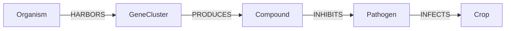

[← Handbook](HANDBOOK.md) · [README](../README.md) · [Glossary](GLOSSARY.md) · [Roadmap](ROADMAP.md) · [Query cookbook](QUERY_COOKBOOK.md) · [Phase 4c guide](06c-checking-3d-detail.md)

# 07. Graph analytics: paths, hubs and communities (Phase 5)

**Prerequisites:** [`06c-checking-3d-detail.md`](06c-checking-3d-detail.md)
finished: `pytest` passes, `python -m microbegraph.build_graph` ends with
`every count matches`, and recipe R24 lists 9 compounds. Nothing needs
installing: NetworkX, plotly and pyvis have been in `requirements.txt` since
Phase 0. Nothing is downloaded and no website is asked anything. No maths
background is needed: every measure is explained with a picture and a small
example before the real numbers.

**Learning goal:** after this phase you will understand why the shortest path
through a knowledge graph can be meaningless, and how a typed route (a
metapath) fixes it; how to rank evidence paths when their weakest links tie;
what degree and betweenness measure, and why "important" has more than one
meaning; how the Louvain method finds communities and what modularity scores;
why the choice of which arrows count changes every answer; how to find the
single points of failure in a chain of evidence; and how to make results that
come out the same on every computer and pages that open without an internet
connection.

**Time:** about 8 to 10 hours in two or three sessions. Reading and the
exercises take most of it. The slowest command, the full analysis, takes
about a minute.

> Every term here is also in [`GLOSSARY.md`](GLOSSARY.md). The overview of this
> phase is in [`HANDBOOK.md`](HANDBOOK.md), Stage 8. The new recipes are R25
> and N6 to N9 in [`QUERY_COOKBOOK.md`](QUERY_COOKBOOK.md#9-the-same-facts-as-a-graph-networkx-recipes-n1-to-n9).
> If the weakest-link idea is new to you, open
> [`interactive/evidence_chain.html`](interactive/evidence_chain.html) first; for
> hubs and bridges, [`interactive/hubs_bridges_groups.html`](interactive/hubs_bridges_groups.html).

---

## Contents

1. [What this phase builds, in one picture](#1-what-this-phase-builds-in-one-picture)
2. [The graph ideas, in plain words](#2-the-graph-ideas-in-plain-words)
3. [The engineering ideas, in plain words](#3-the-engineering-ideas-in-plain-words)
4. [Step 0. Get into position](#4-step-0-get-into-position)
5. [Step 1. Put the new files in place](#5-step-1-put-the-new-files-in-place)
6. [Step 2. Look at the graph first](#6-step-2-look-at-the-graph-first)
7. [Step 3. A gene name for every protein that has one](#7-step-3-a-gene-name-for-every-protein-that-has-one)
8. [Step 4. Evidence paths from a crop back to microbes](#8-step-4-evidence-paths-from-a-crop-back-to-microbes)
9. [Step 5. Hubs, bridges and single points of failure](#9-step-5-hubs-bridges-and-single-points-of-failure)
10. [Step 6. Communities](#10-step-6-communities)
11. [Step 7. The full run and the pages](#11-step-7-the-full-run-and-the-pages)
12. [Step 8. Tests](#12-step-8-tests)
13. [Step 9. Pictures, the Handbook and the records](#13-step-9-pictures-the-handbook-and-the-records)
14. [How evidence and confidence carry through](#14-how-evidence-and-confidence-carry-through)
15. [What the analytics can't tell you](#15-what-the-analytics-cant-tell-you)
16. [What could go wrong](#16-what-could-go-wrong)
17. [Checkpoint](#17-checkpoint)
18. [Committing this phase](#18-committing-this-phase)

---

## 1. What this phase builds, in one picture

![Three questions for the finished graph. Evidence paths follow the typed route organism, cluster, compound, pathogen, crop (FZB42, BGC0000433, surfactin, Botrytis cinerea, jujube), not the shortest route, which runs through the label antibacterial and puts 592 microbes within six steps of jujube; 10 paths and 9 leads to 5 crops, every weakest link a paper. Hubs have many arrows (antibacterial, 936); bridges sit on the routes between groups (carotenoid, made by 17 microbes). Without proteins the graph splits into 63 communities, modularity 0.778](img/graph_analytics.svg)

Until now every phase built the graph: six sources read, aliases merged, every
decision written in the ledger. This phase asks the finished graph questions.
One new command, `python -m microbegraph.analyze`, answers three of them:

1. **Which microbes might help this crop, and how sure are we?** It starts at
   a crop and walks the arrows backwards, along the chain the project was
   built for: microbe, cluster, compound, pathogen, crop. Each route is an
   evidence path, shown with every arrow's evidence and ranked by its weakest
   arrow. Cookbook recipe R9 answered this as one SQL query in Phase 4; now it
   is a tool, with a ranking and an answer to "what if one of these facts is
   wrong?".
2. **Which nodes matter?** Hubs (nodes with many arrows) and bridges (nodes
   on the routes between other nodes). The look at the data before any code
   showed that the answer depends on which arrows you count, so this phase is
   as much about choosing the question as computing the answer.
3. **Which groups does the graph fall into?** Communities, found with the
   Louvain method.

Along the way, proteins get readable names. MIBiG's GenBank file gives a gene
name to 15,812 proteins that had none from MIBiG's curators (for 6,668 of
them no other source has one either), so a picture shows
`dauE (aklaviketone reductase)` where it used to show only the product. Of the
4,901 proteins called "hypothetical protein" or alike, 1,877 now show a gene
name in their label, 323 of them thanks to the GenBank file alone.

The results are CSV files and pages you open in your browser, written to
`data/processed/analytics/`, beside the database and never inside it.

The commands:

| Command | What it does | Touches the internet? |
|---|---|---|
| `python tests/fixtures/survey_graph_shape.py` | Looks at the graph before the analysis runs (Step 2; it uses the new files, so Step 1 comes first) | No |
| `python -m microbegraph.fetch --tidy-only --source mibig` | Re-reads MIBiG's three files from the locker, now keeping each protein's GenBank gene name (Step 3) | No |
| `python -m microbegraph.resolve` and `python -m microbegraph.build_graph` | Merge and build again, as in every phase | No |
| `python -m microbegraph.analyze --paths`, `--hubs`, `--bridges`, `--communities` | One question at a time, on screen (Steps 4 to 6) | No |
| `python -m microbegraph.analyze --around NODE` | Writes a page of one node and its neighbours (Step 7) | No |
| `python -m microbegraph.analyze` | Everything, with every file in `data/processed/analytics/` (Step 7) | No |

**Files this phase creates or changes** (paths relative to the project folder):

| Path | New or changed | What it is |
|---|---|---|
| `src/microbegraph/analyze.py` | new | The command: one question at a time, or everything |
| `src/microbegraph/analytics/__init__.py` | new | The package and its ground rules |
| `src/microbegraph/analytics/labels.py` | new | Readable names for nodes, gene first for proteins |
| `src/microbegraph/analytics/evidence_paths.py` | new | The typed route, the ranking, leads, and single points of failure |
| `src/microbegraph/analytics/centrality.py` | new | Degree (hubs) and betweenness (bridges) |
| `src/microbegraph/analytics/communities.py` | new | Louvain communities and modularity |
| `src/microbegraph/analytics/pictures.py` | new | The pages, drawn with pyvis and plotly |
| `src/microbegraph/sources/mibig_genbank.py` | changed | Each CDS keeps its first `/gene` on its own |
| `src/microbegraph/sources/mibig.py` | changed | Proteins get `genbank_gene`, and a new count says how many |
| `src/microbegraph/build_graph.py` | changed | The `proteins` view has a `genbank_gene` column |
| `src/microbegraph/paths.py` | changed | The new folder, `data/processed/analytics/` |
| `tests/test_graph_analytics.py` | new | The promises this phase makes |
| `tests/test_mibig_protein_file.py` | changed | YciC now carries its GenBank gene name |
| `tests/fixtures/resolve/mibig_nodes.csv` | changed | The slice's proteins carry `genbank_gene` too (Step 8) |
| `tests/fixtures/survey_graph_shape.py` | new | The look at the graph (Step 2) |
| `tests/fixtures/README.md` | changed | Describes the survey script and the slice's new property |
| `docs/07-graph-analytics.md` | new | This guide |
| `docs/QUERY_COOKBOOK.md` | changed | New recipes R25 and N6 to N9 |
| `docs/img/graph_analytics.svg`, `docs/img/single_points.svg` | new | The picture above and the one in Step 5 |
| `docs/interactive/hubs_bridges_groups.html` | new | A small network to try every measure on |
| `docs/img/make_illustrations.py`, `docs/interactive/make_interactive.py` and the files they draw | changed | The new pictures and page; the journey map and the roadmap page show Phase 5; the logo's two words no longer touch |
| `docs/phases.csv` | changed | Phase 5, done |
| `README.md`, `CHANGELOG.md`, `docs/HANDBOOK.md`, `docs/ROADMAP.md`, `docs/GLOSSARY.md`, `docs/00-architecture.md`, `docs/02-ontology-and-data-model.md`, `docs/05-proteomics-uniprot.md`, `docs/06b-closing-the-gaps.md`, `docs/06c-checking-3d-detail.md`, `curation/README.md` | changed | Updated for this phase |

**Files this phase writes on your computer that never go to GitHub:** the new
folder `data/processed/analytics/` (like everything in `data/`). The MIBiG
tidy, the resolver and the build rewrite their files as they always do.

---

## 2. The graph ideas, in plain words

### A path, and why the shortest one can mislead

A **path** is a walk from one node to another along arrows. NetworkX can find
the **shortest path** between any two nodes, the walk with the fewest steps.
On a road map that is often what you want. In a knowledge graph it often isn't.

Most of MicrobeGraph's nodes are linked by a handful of very general ones.
936 compounds point at the activity label "antibacterial", so any two of them
are two steps apart through it. Ignoring which way the arrows point, the
shortest walk from jujube to *Streptomyces coelicolor* A3(2) is:

```
jujube - Botrytis cinerea - surfactin - antibacterial - coelimycin P1 - coelimycin P1 BGC - Streptomyces coelicolor A3(2)
```

Six real arrows, but the walk says nothing about protecting jujube. It only
crosses from surfactin to coelimycin P1 because both carry the label
antibacterial. 592 microbes are six steps or fewer from jujube this way.

### A typed route instead

The fix is to say which kinds of arrows a path may take, and in which order.
The project's question has always had one shape:



Walking backwards from a crop, the first step may only take an `INFECTS`
arrow, the next only an `INHIBITS` arrow, and so on. A path pattern written
in node and arrow types instead of in particular nodes is called a
**metapath**, a term from the study of networks with many kinds of node
(Sun, Han, Yan, Yu and Wu, "PathSim: meta path-based top-k similarity search
in heterogeneous information networks", *Proceedings of the VLDB Endowment* 4,
2011, doi:10.14778/3402707.3402736). Along this one, jujube has one path, the
one the guides have followed since Phase 1.

### A path is only as strong as its weakest arrow

Every arrow carries an evidence level, and a path inherits the weakest
([`ontology.py`](../src/microbegraph/ontology.py), `evidence_rank`). A rope
holds what its thinnest strand holds. On today's data every crop path has two
arrows at `curated_literature`, this project's own reading of a paper, so the
weakest link ties all ten paths. The ranking therefore looks further:

1. the weakest evidence level (stronger first);
2. how many arrows a published experiment backs (`curated_experimental`),
   more first;
3. how sure the weakest arrows are: the lowest confidence among the arrows at
   the weakest level, higher first. Those are the paper arrows, which the
   curated bridge file grades by hand (0.8 to 0.9). MIBiG's own arrows all
   carry 0.5, its "questionable" grade
   ([`02-ontology-and-data-model.md`](02-ontology-and-data-model.md)), so
   comparing them would separate nothing;
4. names, only so that ties always come out in the same order.

A **lead** is one microbe, one compound, one pathogen and one crop.
*Pseudomonas fluorescens* has two clusters that both make
2,4-diacetylphloroglucinol, so it has two paths to wheat but only one lead,
ranked by its better path.

### Degree: hubs

The **degree** of a node is the number of arrows that touch it, in or out. A
train station served by many lines has a high degree. High-degree nodes are
**hubs**. Degree is quick to compute (one count per node) and easy to read,
and on this graph it mostly finds general things: labels like
"antibacterial", the genus *Streptomyces*, families of compounds. A label
shared by 936 compounds tells you little about any one of them.

### Betweenness: bridges

**Betweenness** asks a different question: how often does a node sit on the
shortest route between two other nodes? For every pair of nodes, find their
shortest routes, see which nodes those routes pass through, and add up each
node's share. A small station where two lines meet may have two platforms and
still be the only place to change between two regions; its betweenness is
high. Nodes with high betweenness are **bridges**. Linton Freeman defined the
measure ("A set of measures of centrality based on betweenness", *Sociometry*
40, 1977, doi:10.2307/3033543), and NetworkX computes it with Ulrik Brandes's
method ("A faster algorithm for betweenness centrality", *Journal of
Mathematical Sociology* 25, 2001, doi:10.1080/0022250X.2001.9990249). NetworkX
scales it to between 0 and 1 (`normalized=True`): 1 would mean "on every
shortest route in the graph".

Measures like these are called **centrality**, and there are more of them.
This phase uses the two that answer its questions.

### Which arrows count

On the whole graph, betweenness crowns the same general nodes degree does:
any two antibacterial compounds are two steps apart through the label, so the
label is "between" thousands of pairs. A bridge worth finding links things
that would otherwise be apart, so this phase looks for bridges on the
**production layer**: only the `HARBORS`, `PRODUCES`, `INHIBITS` and `INFECTS`
arrows, the ones that say who makes what and what it does to a pathogen. No
labels, no family tree, no proteins. There, the bridges are microbes with many
clusters and compounds made by several unrelated microbes.

Both measures read the graph with the directions set aside. Following arrows
only forwards, nothing could ever lie "between" a compound and the microbe
that makes it, because no arrow leads back from the compound.

### Single points of failure

A fact that every path of a lead uses is a **single point of failure**: if it
turned out wrong (a paper misread, a strain misidentified), the lead would be
gone. A paper only counts where an arrow rests on it alone: a claim the bridge
file backs with two papers survives either one turning out wrong. This is the
disease side's version of a bridge, and it is the most practical result of the
phase, because it says which facts deserve a second look first.

### Communities and modularity

A **community** is a group of nodes with many arrows inside the group and few
to the rest. In a school, friendship links split pupils into groups without
anyone drawing the lines. **Community detection** draws them from the links
alone.

The **Louvain method** (Blondel, Guillaume, Lambiotte and Lefebvre, "Fast
unfolding of communities in large networks", *J. Stat. Mech.* 2008, P10008,
doi:10.1088/1742-5468/2008/10/P10008; named after the university in
Louvain-la-Neuve where it was written) starts with every node alone. It moves
each node into the neighbouring group that raises a score called modularity
the most, until no move helps; then it treats each group as one node and does
the same again, until nothing changes.

**Modularity** compares the arrows inside the groups with the number you
would expect if every node kept its number of arrows but they were wired up at
random. It runs from below 0 up to just under 1. Newman and Girvan, who
introduced it, found that networks with clear groups typically score from
about 0.3 to 0.7 ("Finding and evaluating community structure in networks",
*Physical Review E* 69, 026113, 2004, doi:10.1103/PhysRevE.69.026113). It is
one score, though. A method that searches for the best split, as Louvain does,
finds a high modularity even in graphs wired at random (Guimerà, Sales-Pardo
and Amaral, "Modularity from fluctuations in random graphs and complex
networks", *Physical Review E* 70, 025101, 2004,
doi:10.1103/PhysRevE.70.025101). Step 6 shows how much that matters here, and
Phase 6 compares the real score with many rewired copies.

Louvain visits the nodes in a random order, so the code fixes the random
**seed** (42): the same order on every run, the same groups on every computer
with the same NetworkX version.

---

## 3. The engineering ideas, in plain words

### Look at the data first, again

As in every phase, a look at the real graph came before the code (Step 2),
and it changed the design three times: paths follow a typed route because the
shortest ones run through labels; bridges are looked for on the production
layer because the whole graph crowns labels; and communities leave out the
proteins because 36,910 of the 39,354 have a single arrow, from their cluster,
and would only make the groups about five times bigger on average.

### Results beside the database, never inside it

The database stays the one source of truth, built by `build_graph` alone. The
analytics read the graph through `load_graph()`, which opens the database
read-only, and write their results as files in `data/processed/analytics/`, so
a mistake in an analysis can never change a fact. Phase 6 reads
`node_measures.csv` to check the same numbers from R.

### The same answer every time

Three habits make the CSV files identical from run to run (the summary file
and the pages also record when they were made): every list is sorted
with a tie-break (a name or an identifier), the graphs handed to NetworkX are
built in sorted order, and the two places that use chance (Louvain's node
order, and the sample of starting nodes for the whole-graph estimate) use a
fixed seed. A test runs the analysis twice and compares the CSV files byte for
byte. The summary file records the NetworkX, pyvis and plotly versions, because
another NetworkX version may group a few nodes differently.

### Pages that work offline

Two libraries draw the pages. **pyvis** turns nodes and arrows from Python
into a web page with a network you can drag, zoom and hover over; the drawing
itself is done in the browser by a JavaScript library called vis-network.
**plotly** draws charts (here a scatter plot and a bar chart) that you can
hover over and zoom, and save as a picture. Both write ordinary HTML files.

pyvis can link its pages to the drawing library vis-network on a website, or
copy the library into each page. These pages carry it inside
(`cdn_resources="in_line"`), and two links pyvis's template always adds, to a
styling library nothing here uses, are taken out. The plotly page shares one
copy of `plotly.min.js`, written beside it. So every page opens from your
folder with no internet connection, and asks no website for anything; a test
checks that no page links to one.

### A name for every protein that has one

Labels never decide anything, they only show. That is why the GenBank gene
name goes into a field of its own, `genbank_gene`, and not into `gene_name`:
the resolver's `gene_name_in_uniprot` rule matches on `gene_name`, and a new
name there would change which proteins merge. A test resolves the slice with
and without the new field and checks that the ledger and the arrows are
identical.

---

## 4. Step 0. Get into position

1. Open your terminal and go to the project folder:

   ```bash
   cd ~/projects/microbegraph      # or wherever you cloned it
   ```

   Windows PowerShell: `cd $HOME\projects\microbegraph`
2. Make sure you're on the working branch and up to date:

   ```bash
   git switch develop
   git pull --ff-only origin develop
   ```

3. Activate the toolbox:

   ```bash
   source .venv/bin/activate          # macOS / Linux / RHEL 8
   ```

   Windows PowerShell: `.\.venv\Scripts\Activate.ps1`
4. Check that Phase 4c's output is there:

   ```bash
   python -m microbegraph.query --recipe 24
   ```

   You should see 9 compounds waiting for a person. If it says the database
   doesn't exist, finish
   [Phase 4c](06c-checking-3d-detail.md#10-step-6-run-it-on-your-data) first.

✅ **Checkpoint.** Your prompt starts with `(.venv)`, `git branch` shows
`* develop`, and recipe R24 prints 9 rows.

---

## 5. Step 1. Put the new files in place

If you cloned the repository after this phase was committed, every file is
already there and you can read along. If you're building it yourself, put each
file from the table in section 1 at the path shown. Then:

1. **Check the three libraries this phase uses.** They came with
   `requirements.txt` in Phase 0, so nothing is installed:

   ```bash
   python -c "import networkx, plotly, pyvis; print(networkx.__version__, plotly.__version__, pyvis.__version__)"
   ```

   You should see three versions, for example `3.6.1 7.0.0 0.3.2`. Yours may
   be newer within the ranges `requirements.txt` allows; that's fine. If
   Python says `No module named ...`, run `pip install -r requirements.txt`.
2. **No reinstall of the project.** The package is installed in editable mode,
   so Python finds the new `analytics/` folder straight from the project
   folder.
3. **Run the tests:**

   ```bash
   pytest
   ```

✅ **Checkpoint.** `pytest` ends with `439 passed` and no `failed`.

---

## 6. Step 2. Look at the graph first

Before the analytics were written, a few lines of Python looked at the graph.
`tests/fixtures/survey_graph_shape.py` is that look, tidied so you can repeat
it. It reads the database (read-only) and MIBiG's GenBank file, sends nothing
anywhere and writes nothing. It takes about two minutes; Part 4 is the slow
one.

```bash
python tests/fixtures/survey_graph_shape.py
```

On the real data, before Step 3:

```
Part 1: the shape of the graph
    nodes                                           48234
    arrows                                          57014
    separate pieces (ignoring arrow directions)         2
    nodes in the biggest piece                      48215
    the busiest nodes (arrows in and out):
        936  antibacterial (Activity)
        627  cytotoxic (Activity)
        399  Streptomyces (Organism)
        368  antifungal (Activity)
        188  inhibitor (Activity)
        117  siderophore (Activity)
Part 2: the shortest route from jujube to a microbe, ignoring directions
    jujube - Botrytis cinerea - surfactin - antibacterial - coelimycin P1 - coelimycin P1 BGC - Streptomyces coelicolor A3(2)
    microbes with a cluster, six steps or fewer       592
Part 3: the typed route, microbe -> cluster -> compound -> pathogen -> crop
    paths                                              10
    leads (microbe, compound, pathogen, crop)           9
    microbes on them                                    6
    weakest link curated_literature                    10
    the microbe on most crops: Bacillus velezensis FZB42, 4 of 5
Part 4: betweenness, two ways
    the production layer: 7,750 nodes, 6,733 arrows, 1,183 pieces; exact:
      0.00355  Streptomyces sp. (Organism)
      0.00307  Allostigmatella aurantiaca Sg a15 (Organism)
      0.00301  carotenoid (Compound)
      0.00298  Myxococcus xanthus DK 1622 (Organism)
      0.00284  Myxococcus xanthus (Organism)
    the whole graph, estimated from 300 starting nodes:
      0.53802  antibacterial (Activity)
      0.24587  cytotoxic (Activity)
      0.15916  Streptomyces (Organism)
      0.11918  antifungal (Activity)
      0.07750  siderophore (Activity)
Part 5: communities (Louvain, seed 42)
    without proteins: communities                      63
    without proteins: modularity                    0.778
    without proteins or labels: communities           156
    without proteins or labels: modularity          0.942
    a rewired copy: modularity                      0.700
Part 6: what the proteins are called
    proteins                                        39354
    named after their product                       33984
    named 'hypothetical protein' or alike            4901
    given a GenBank gene name (genbank_gene)     none yet (Step 3 adds them)
    GenBank file: CDS                               46987
      with a /gene                                  19759
      with a /gene and a protein number             19639
```

What each part decided:

| Part | What it showed | What the code does about it |
|---|---|---|
| 1 | One giant piece, held together by labels and the family tree. The other piece (19 nodes) is the valactamide A cluster, which MIBiG files under a cloning vector rather than an organism | Nothing to fix; the analytics treat the 19 nodes like any others |
| 2 | The shortest route runs through a label | Paths follow the typed route (Step 4) |
| 3 | Every weakest link is the same | The ranking has three tie-breaks (section 2) |
| 4 | On the whole graph the labels are the "bridges" | Bridges on the production layer (Step 5); the whole-graph estimate stays available as `--whole-graph`, for comparison |
| 5 | With labels, groups read as themes; without them, the groups mostly follow the family tree. A copy with its arrows shuffled at random (every node keeps its number of arrows) still scores 0.700 | Communities on the graph without proteins, labels kept (Step 6), with the 0.700 kept in mind when reading the 0.778 |
| 6 | Most proteins are named after a product; the GenBank file has a gene name for 19,639 numbered proteins | A field of its own, `genbank_gene` (Step 3) |

Two more views were tried while the code was being designed, both computed
exactly and both taking several minutes. Without the proteins, the labels came
first again (antibacterial, cytotoxic, antifungal). Without the proteins and
the labels, the family tree took over (*Streptomyces*, *Bacillati*,
*Actinomycetes*). Neither answers the question, so neither is in the script.

✅ **Checkpoint.** Your numbers match the block above. Part 6 says
`none yet (Step 3 adds them)`.

---

## 7. Step 3. A gene name for every protein that has one

**What changes in the code.** MIBiG's GenBank file (Phase 4b) lists every
protein of every cluster as a CDS with the names it goes by. Until now only
the matching used them. Three small changes put the gene name on the protein:

1. `read_cds()` in `src/microbegraph/sources/mibig_genbank.py` keeps each
   CDS's first `/gene` on its own, in a new field, `gene`.
2. The MIBiG adapter (`src/microbegraph/sources/mibig.py`) looks up each
   protein from the protein file in its entry's GenBank record, by protein
   number, and stores that `/gene` as the property `genbank_gene`. A new count,
   `proteins_with_genbank_gene`, says how many got one.
3. `src/microbegraph/analytics/labels.py` builds a node's label. For a
   protein the gene comes first and the product after it in brackets, and the
   gene is taken from MIBiG's curators (`gene_name`), else the GenBank file
   (`genbank_gene`), else UniProt's first gene name. A protein with none of the
   three keeps its name.

`build_graph.py` adds a `genbank_gene` column to the `proteins` view, so SQL
sees it too.

**Run it.** The tidy step only re-reads the three MIBiG files already in your
locker:

1. **Re-tidy MIBiG:**

   ```bash
   python -m microbegraph.fetch --tidy-only --source mibig
   ```

   You should see the usual list of counts with one new line:

   ```
   [mibig] tidy
     [mibig] wrote mibig_nodes.csv and mibig_edges.csv
       ...
       proteins_with_genbank_gene           18595
       ...
   ```

   Every other count is the same as after Phase 4b (`property_conflicts`
   stays at 278, for example), because only a property was added.
2. **Resolve and build:**

   ```bash
   python -m microbegraph.resolve
   python -m microbegraph.build_graph
   ```

   The resolver prints exactly what it printed after Phase 4c
   ([`06c-checking-3d-detail.md`, Step 6](06c-checking-3d-detail.md#10-step-6-run-it-on-your-data)):
   48,234 nodes, 57,014 arrows and the same decisions. The build reports a
   ledger of 25,789 rows and ends with `every count matches`.
3. **See where the gene names come from** with the new recipe:

   ```bash
   python -m microbegraph.query --recipe 25
   ```

   You should see:

   ```
   R25. Where does each protein's gene name come from?

   gene_name_from        proteins
   --------------------  --------
   1. MIBiG gene record  3908
   2. GenBank file       15812
   3. UniProt only       4850
   4. none               14784
   (4 rows)
   ```

**What the numbers mean.** 18,595 proteins in MIBiG's own tables carry a
GenBank gene name; the resolver joins some of them (the same UniProt entry, or
the same sequence), so 18,289 nodes in the graph do. For 15,812 of them it is
the only gene name from MIBiG's side; 4,850 more proteins have a gene name only
from UniProt, and 14,784 have none anywhere. UniProt also names 9,144 of the
15,812, so for 6,668 proteins the GenBank file is the only source of a gene
name. Of the 4,901 proteins called "hypothetical protein", "conserved
hypothetical protein" or "unknown", 1,877 now show a gene name in their label,
323 of them thanks to the GenBank file alone.

The names are kept as the file writes them. Where one record gives the same
gene name to several proteins, the file adds `_rename1`, `_rename2` and so on
to the repeats: the tylactone cluster (BGC0000166) has `tylG` and `tylG_rename1`
to `tylG_rename6`, seven proteins that one record names after a single gene.
19 proteins in the graph carry such a name. And where the resolver merged two
proteins the file names differently, `genbank_gene` holds both names joined
with `|` (`inkH|nokH`); the label shows the first.

**Sanity checks.** Run the survey again (`python tests/fixtures/survey_graph_shape.py`).
In Part 6, the line that said `none yet` now reads:

```
    given a GenBank gene name (genbank_gene)        18289
      of them with no MIBiG gene name               15812
```

Everything else it prints is the same as in Step 2. The resolver's numbers
didn't move either, since no rule reads `genbank_gene`.

✅ **Checkpoint.** The tidy prints `proteins_with_genbank_gene 18595`, the
build ends with `every count matches`, and R25 shows 15,812 names from the
GenBank file.

---

## 8. Step 4. Evidence paths from a crop back to microbes

**The code** is in `src/microbegraph/analytics/evidence_paths.py`. The typed
route is a short list, walked backwards from the crop:

```python
ROUTE = (
    ("INFECTS", "Pathogen"),       # crop     <- pathogen
    ("INHIBITS", "Compound"),      # pathogen <- compound
    ("PRODUCES", "GeneCluster"),   # compound <- cluster
    ("HARBORS", "Organism"),       # cluster  <- organism
)
```

`paths_to_crop()` starts with the crop, and at each step keeps every node with
an arrow of that type into the last node of a partial route. A pathogen that
harbours clusters counts as an organism (the rulebook's "a Pathogen is a kind
of Organism", `is_a()`). The finished routes become `EvidencePath` objects with
their four arrows, and `rank_key()` sorts them by the four rules in section 2.
`group_leads()` collects paths with the same microbe, compound, pathogen and
crop into one lead. Arrows at the level `inferred`, hypotheses this project
makes itself (none yet; Phase 7 makes the first), are skipped unless you add
`--include-inferred`, as the rulebook asks.

(The longer route through a protein, cluster `ENCODES` protein `CATALYZES`
compound, finds no cluster on today's data that `PRODUCES` doesn't, so it is
left out.)

1. **One crop:**

   ```bash
   python -m microbegraph.analyze --paths jujube
   ```

   You should see:

   ```
   [analyze] read the graph from data/processed/microbegraph.duckdb: 48,234 nodes, 57,014 arrows
   [analyze] evidence paths to jujube: 1 lead, 1 path
     1. Bacillus velezensis FZB42 -> surfactin -> Botrytis cinerea -> jujube
        weakest link curated_literature; 2 of 4 arrows from an experiment; weakest arrows' confidence 0.90
          HARBORS   Bacillus velezensis FZB42 -> BGC0000433 surfactin BGC
                    curated_experimental, from mibig, pubmed:14762003, confidence 0.50
          PRODUCES  BGC0000433 surfactin BGC -> surfactin
                    curated_experimental, from mibig, pubmed:14762003, confidence 0.50
          INHIBITS  surfactin -> Botrytis cinerea
                    curated_literature, from curation, doi:10.1186/s13568-023-01543-w, confidence 0.90
          INFECTS   Botrytis cinerea -> jujube
                    curated_literature, from curation, doi:10.1186/s13568-023-01543-w, confidence 0.90
   ```

   Each arrow shows its evidence level, the source that gave it, its citation
   and its confidence: everything a reader needs to check it. The two paper
   arrows cite Xiao et al. (2023), who used purified surfactin and saw less
   grey mould on harvested jujube: a lead worth testing on the crop, with
   the paper to start from.
2. **Every crop:**

   ```bash
   python -m microbegraph.analyze --paths
   ```

   It prints the same block for cotton, jujube, maize, melon and wheat. The
   leads, best first:

   | Crop | Lead | Experiments | Weakest arrows' confidence |
   |---|---|---|---|
   | cotton | *Pseudomonas protegens* Pf-5, pyoluteorin, *Globisporangium ultimum* | 0 | 0.85 |
   | cotton | *Pseudomonas* sp. M18, pyoluteorin, *Globisporangium ultimum* | 0 | 0.85 |
   | cotton | *Pseudomonas chlororaphis*, pyrrolnitrin, *Rhizoctonia solani* | 0 | 0.80 |
   | jujube | *Bacillus velezensis* FZB42, surfactin, *Botrytis cinerea* | 2 | 0.90 |
   | maize | *Bacillus velezensis* FZB42, bacillomycin D, *Fusarium graminearum* | 2 | 0.80 |
   | melon | *Bacillus velezensis* FZB42, fengycin, *Podosphaera fusca* | 2 | 0.80 |
   | melon | *Bacillus subtilis*, iturin, *Podosphaera fusca* | 0 | 0.80 |
   | wheat | *Bacillus velezensis* FZB42, bacillomycin D, *Fusarium graminearum* | 2 | 0.90 |
   | wheat | *Pseudomonas fluorescens*, 2,4-diacetylphloroglucinol, *Gaeumannomyces tritici* | 2 | 0.80 |

   The ranking at work: in melon, FZB42's fengycin comes first because two of
   its arrows rest on an experiment and none of iturin's do. In wheat, both
   leads have two experiments, and bacillomycin D's paper arrows are graded
   0.90 against 0.80. In cotton, Pf-5 and M18 tie on everything (the same
   compound, pathogen and paper), so the names decide. The wheat lead from
   *P. fluorescens* ends with `also through BGC0000281 ...`: its second
   cluster, with only database evidence.
3. **A crop that isn't there:**

   ```bash
   python -m microbegraph.analyze --paths rice
   ```

   You should see:

   ```
   [analyze] read the graph from data/processed/microbegraph.duckdb: 48,234 nodes, 57,014 arrows
   [analyze] There's no crop called 'rice'. The crops in the graph: cotton, jujube, maize, melon, wheat.
   ```

   Names are matched without regard to capitals, and identifiers work too
   (`--paths mg.crop:jujube`).

✅ **Checkpoint.** You can print the path from jujube back to FZB42 with every
arrow's evidence, and say why melon's two leads come in that order.

---

## 9. Step 5. Hubs, bridges and single points of failure

**The code** is in `src/microbegraph/analytics/centrality.py` (degree and
betweenness) and in `what_if_wrong()` in `evidence_paths.py`.

1. **Hubs:**

   ```bash
   python -m microbegraph.analyze --hubs
   ```

   You should see the three busiest nodes of each type:

   ```
   [analyze] read the graph from data/processed/microbegraph.duckdb: 48,234 nodes, 57,014 arrows
   [analyze] hubs: the nodes with the most arrows (degree), three per type
     Activity         936  antibacterial
                      627  cytotoxic
                      368  antifungal
     Compound          61  lomaiviticin C
                       61  lomaiviticin D
                       60  lomaiviticin E
     CompoundClass     60  Polycyclic polyketide
                       55  Cyclic polyketide
                       48  Lipopeptide
     Crop               2  cotton
                        2  wheat
                        1  jujube
     GeneCluster      117  BGC0000081 kedarcidin BGC
                      116  BGC0001281 ustilagic acid BGC
                      111  BGC0000413 Pf-5 pyoverdine BGC
     Organism         399  Streptomyces
                       54  Streptomyces sp.
                       38  Aspergillus
     Pathogen           9  Fusarium graminearum
                        4  Botrytis cinerea
                        4  Podosphaera fusca
     Pathway            8  Neomycin, kanamycin and gentamicin biosyn...
                        8  Biosynthesis of type II polyketide products
                        7  Sesquiterpenoid and triterpenoid biosynth...
     Protein           12  ambO1 (rieske oxygenase)
                       12  ambI3 (isonitrile indole synthase B (IsnB))
                       12  ambT1 (anthranilate synthase (TrpE))
   ```

   A cluster's degree is mostly its proteins (kedarcidin's cluster encodes
   115), a compound's is mostly the clusters, enzymes and activities around
   it, and a genus's is its species. The three proteins with 12 arrows are
   each encoded by two ambiguine clusters and catalyse ten of their compounds.
   Labels longer than 44 characters end in `...`.
2. **Bridges and single points of failure:**

   ```bash
   python -m microbegraph.analyze --bridges
   ```

   It takes about half a minute to a minute (betweenness looks at every pair
   of nodes in the layer). You should see:

   ```
   [analyze] read the graph from data/processed/microbegraph.duckdb: 48,234 nodes, 57,014 arrows
   [analyze] bridges: betweenness on the production layer (HARBORS, PRODUCES, INHIBITS, INFECTS)
     7,750 nodes, 6,733 arrows, 1,183 separate pieces
      1  0.00355  Organism     Streptomyces sp.
      2  0.00307  Organism     Allostigmatella aurantiaca Sg a15
      3  0.00301  Compound     carotenoid
      4  0.00298  Organism     Myxococcus xanthus DK 1622
      5  0.00284  Organism     Myxococcus xanthus
      6  0.00277  GeneCluster  BGC0002492 myxochelin B, myxochelin A BGC
      7  0.00277  GeneCluster  BGC0001345 myxochelin A, myxochelin B BGC
      8  0.00276  Compound     myxochromide A
      9  0.00274  GeneCluster  BGC0001425 myxochromide A BGC
     10  0.00270  GeneCluster  BGC0001343 aurachin A, aurachin D BGC
   [analyze] if one fact were wrong: the leads lost, of 9
     lost  crops left with none  fact
        4  jujube, maize         Bacillus velezensis FZB42 (Organism)
        2  maize                 bacillomycin D (Compound)
        2  maize                 BGC0001090 bacillomycin D BGC (GeneCluster)
        2  melon                 doi:10.1094/MPMI-20-4-0430 (paper)
        2  maize                 doi:10.1128/AEM.01075-17 (paper)
        2  maize                 Fusarium graminearum (Pathogen)
        2  melon                 Podosphaera fusca (Pathogen)
        2  none                  doi:10.1094/Phyto-70-712 (paper)
        2  none                  Globisporangium ultimum (Pathogen)
        2  none                  pyoluteorin (Compound)
   ```

**Reading the bridges.** The layer falls into 1,183 separate pieces, most of
them one microbe, one cluster and its compounds, so betweenness only counts
routes inside a piece and the values are small. The top places all go to
nodes of the biggest piece (578 nodes), the ones that hold it together:
"*Streptomyces* sp." (one NCBI number for 53 clusters from strains
nobody has named; recipe R13), carotenoid (made by 17 different microbes),
and two myxobacteria, *Allostigmatella aurantiaca* Sg a15 and *Myxococcus
xanthus* DK 1622. Both make myxochelin, which links them, and Sg a15 also
makes aurachin D, as one of the "*Streptomyces* sp." clusters does, which links
the myxobacteria to the rest of that piece.

**Reading the single points.**


One strain, *Bacillus velezensis* FZB42, carries 4 of the 9 leads; without it
jujube and maize would have none. Each pathogen rests on one or two compounds
and on one paper, so a single misread paper would take a whole pathogen's
leads with it. The list says where a person's time is best spent: the strain
behind four crops, and the three papers that would each leave a crop with no
lead. Two are in the table above (maize and melon); jujube's
(doi:10.1186/s13568-023-01543-w) costs only one lead, so it sits further down
in `single_points.csv`. It also shows
how thin the disease side is (7 `INHIBITS` arrows, 7 `INFECTS` arrows), which
is the gap Phase 17 goes after: it plans to propose many more such arrows from
paper abstracts, each entering only after a person accepts it.

3. **For comparison, the whole graph** (optional, about a minute more):

   ```bash
   python -m microbegraph.analyze --bridges --whole-graph
   ```

   After the same two tables it adds:

   ```
   [analyze] for comparison: betweenness on the whole graph, estimated from 300 starting nodes (seed 42)
      1  0.5380  Activity     antibacterial
      2  0.2459  Activity     cytotoxic
      3  0.1592  Organism     Streptomyces
      4  0.1192  Activity     antifungal
      5  0.0775  Activity     siderophore
      6  0.0496  Activity     inhibitor
      7  0.0328  Organism     Streptomyces sp.
      8  0.0235  Organism     Escherichia coli
      9  0.0198  Compound     eicosapentaenoic acid
     10  0.0192  Activity     cell envelope
   ```

   The labels again. Exact betweenness on 48,234 nodes would take hours, so
   this is an estimate from 300 starting nodes chosen at random (the same 300
   every time, thanks to the seed).

✅ **Checkpoint.** You can say why the production layer has 1,183 pieces, and
which one fact would cost jujube and maize every lead.

---

## 10. Step 6. Communities

**The code** is in `src/microbegraph/analytics/communities.py`: drop the
proteins, set the directions aside, run NetworkX's
`louvain_communities(seed=42)`, and number the groups by size.

```bash
python -m microbegraph.analyze --communities
```

You should see:

```
[analyze] read the graph from data/processed/microbegraph.duckdb: 48,234 nodes, 57,014 arrows
[analyze] communities in the graph without proteins: 63, modularity 0.778 (Louvain, seed 42)
   #   size  microbes  clusters  compounds  labels  busiest member
   1    595       172       182        240       1  Streptomyces
   2    511        60       138        305       8  antibacterial
   3    467        83       147        232       4  antifungal
   4    435        50       111        269       5  cytotoxic
   5    322        94       106        117       4  surfactant
   6    312        54        97        149      12  antiviral
   7    263        72        79        109       3  siderophore
   8    221        45        57        114       5  inhibitor
   9    198        36        63         99       0  Aspergillus
  10    188        44        55         84       5  Macrocyclic polyketide
  the crops: cotton in 5, jujube in 39, maize in 45, melon in 3, wheat in 23
```

`labels` counts activities, compound classes and pathways. Each group gathers
around a theme: a genus (*Streptomyces*, *Aspergillus*), an activity
(siderophores, antivirals) or a chemical family. The crops land in different
ways. Cotton's group, number 5, built around "surfactant" and *Pseudomonas*,
holds cotton's whole story: its three *Pseudomonas* microbes, both compounds
and both pathogens. Melon, its mildew, fengycin and iturin are in the
antifungal group (3). Jujube's group (39) is the one around its pathogen:
*Botrytis cinerea*, its fungal relatives in the family tree, and surfactin,
while FZB42 itself sits in a *Bacillus* group (41). Groups follow where the
arrows are densest, so a crop and its lead can land in different ones (recipe
N9 lists what is in jujube's). The full list, with the three busiest members of
every group, is in `communities.csv` (Step 7).

A modularity of 0.778 is high by Newman and Girvan's yardstick, but the survey
(Step 2, Part 5) puts it in proportion. It shuffled the arrows of the same
graph at random (five swaps for every arrow), so every node kept its number of
arrows but got new partners, and Louvain still found groups scoring 0.700 in
that copy. Most of the 0.778 would be there with any wiring that keeps each
node's number of arrows. Whether the remaining 0.078 is more than chance, one
rewired copy can't say; Phase 6 compares the real score with many.

✅ **Checkpoint.** You get 63 communities and modularity 0.778. (With another
NetworkX version the numbers may differ a little; section 16 says what to do.)

---

## 11. Step 7. The full run and the pages

1. **Everything at once:**

   ```bash
   python -m microbegraph.analyze
   ```

   It takes about a minute. You should see:

   ```
   [analyze] read the graph from data/processed/microbegraph.duckdb: 48,234 nodes, 57,014 arrows
   [analyze] evidence paths: 10 paths, 9 leads, 5 crops (weakest links: curated_literature)
     crop    leads  paths  microbes  compounds  papers
     cotton      3      3         3          2       2
     jujube      1      1         1          1       1
     maize       1      1         1          1       1
     melon       2      2         2          2       1
     wheat       2      3         2          2       2
   [analyze] hubs (most arrows): antibacterial 936, cytotoxic 627, Streptomyces 399
   [analyze] bridges on the production layer (7,750 nodes, 6,733 arrows, 1,183 pieces): Streptomyces sp., Allostigmatella aurantiaca Sg a15, carotenoid
   [analyze] if one fact were wrong: without Bacillus velezensis FZB42, 4 of 9 leads are lost and jujube and maize would have none
   [analyze] communities without proteins: 63 (modularity 0.778); the 5 crops sit in 5 of them
   [analyze] wrote data/processed/analytics/:
     crop_paths.csv, single_points.csv, node_measures.csv, communities.csv,
     analytics_summary.json, crop_paths.html, communities.html, hubs_and_bridges.html, plotly.min.js
   [analyze] done in 42.7 s.
   Next:  open data/processed/analytics/crop_paths.html in your browser
   ```

   Your time will differ.
2. **The files.** The CSV files are the results; open them in VS Code or a
   spreadsheet:

   | File | One row per | Columns worth knowing |
   |---|---|---|
   | `crop_paths.csv` | evidence path | `crop`, `rank`, `lead`, `weakest_link`, `experiments`, `weakest_confidence`, `papers`, and the identifiers |
   | `single_points.csv` | fact some lead rests on entirely (a node or a paper) | `leads_lost`, `crops_left_with_none` |
   | `node_measures.csv` | node (48,234 rows) | `degree`, `betweenness_production_layer` (empty off the layer), `community` (empty for proteins) |
   | `communities.csv` | community | `size`, `types`, `busiest`, `crops` |
   | `analytics_summary.json` | run | the counts above, the seed, the route, and the NetworkX, pyvis and plotly versions |

3. **The pages.** Open each in your browser. On macOS:

   ```bash
   open data/processed/analytics/crop_paths.html
   ```

   Windows PowerShell: `start data\processed\analytics\crop_paths.html`.
   RHEL 8 with a desktop: `xdg-open data/processed/analytics/crop_paths.html`.
   Or double-click the file in your file manager.

   * `crop_paths.html`: every crop's paths in five columns, microbe to crop.
     Arrows are darker and thicker for stronger evidence, and each says its
     type and level. Hover over a node or an arrow for its details (the
     citation, the confidence).
   * `communities.html`: the 63 communities as bubbles, sized by members and
     named after their busiest member; yellow ones hold a crop. Lines are the
     arrows between groups. The layout settles for a second or two after the
     page opens.
   * `hubs_and_bridges.html`: every node of the production layer, arrows
     (whole graph) against betweenness (production layer), then the top 15
     bridges as bars and as a table. The arrows axis is a log scale: 1, 10,
     100 and 1,000 sit at equal distances, so a node with 5 arrows and one
     with 900 fit on one chart. A hub is far right; a bridge is high up.
4. **One node and its neighbours:**

   ```bash
   python -m microbegraph.analyze --around surfactin
   ```

   You should see:

   ```
   [analyze] read the graph from data/processed/microbegraph.duckdb: 48,234 nodes, 57,014 arrows
   [analyze] wrote data/processed/analytics/around_surfactin.html: surfactin and all 7 neighbours
   Next:  open data/processed/analytics/around_surfactin.html in your browser
   ```

   The page shows surfactin, its cluster, its three enzymes (labelled
   `srfAA (surfactin synthetase A)` and so on), its two activities and
   *Botrytis cinerea*. A name with spaces goes in double quotes
   (`--around "Botrytis cinerea"`), and an identifier works for any node.
   A busy node such as `antibacterial` has hundreds of neighbours; the page
   then shows the 150 with the most arrows of their own and says so.

**Why the pages are files and not part of the repository.** They are drawn
from your build, which lives in `data/` and never goes to GitHub. Anyone can
draw them again from their own build with the same command.

✅ **Checkpoint.** `data/processed/analytics/` holds the full run's nine files
(ten with `around_surfactin.html`), and
`crop_paths.html` opens with five crops on the right and six microbes on the
left.

---

## 12. Step 8. Tests

There are 439 tests, 41 more than Phase 4c: 32 in
`tests/test_graph_analytics.py`, and nine more runs from `tests/test_query.py`,
which runs every recipe: the new SQL recipe R25 once, and each of the four new
graph recipes N6 to N9 twice (once as a script, once pasted into Python). The 32:

| What is tested | How |
|---|---|
| Labels | Gene first and product in brackets; the gene from MIBiG, then GenBank, then UniProt; merged names show only the first; a protein without a gene keeps its name; long labels are cut |
| The GenBank gene name | `read_cds` keeps srfAA's and yciC's `/gene` from the real surfactin record; the slice's database has `genbank_gene` and no protein known only from the protein file has a `gene_name`; resolving the slice with and without `genbank_gene` gives the same ledger and arrows |
| Evidence paths on the real slice | Jujube's one path (FZB42, BGC0000433, surfactin), its four arrow types, weakest link, two experiments, confidence 0.9 and paper; the slice's three crops |
| The typed route | A microbe linked to the crop only through a shared activity label is no lead, although it is six steps away; a pathogen that harbours a cluster counts as a microbe |
| The ranking | Made-up paths that differ in one rule at a time: weakest link, then experiments, then confidence, then names; a path through an `inferred` arrow appears only when asked for, and then last |
| Leads and single points | Two clusters for one compound make one lead; a fact counts as lost only when every path of the lead uses it; papers are facts too, and a claim citing two papers survives losing one; a pathogen that is also its own lead's producer is counted once |
| Finding nodes | By identifier or name, any capitals; an unknown crop lists the crops; two nodes with one name ask for the identifier |
| Hubs and bridges | The production layer has its four arrow types and no direction; betweenness on a line and a star; ties broken by identifier; the whole-graph estimate repeats |
| Communities | Two cliques joined by one line give two groups, biggest first, modularity above 0.3; the slice gives the same groups twice and every crop has a group |
| The command | The full run writes all nine files, and two runs give identical CSV files; no page links to a website; one crop, an unknown crop, the detail views and `--around`; page names are safe file names, and two nodes with one name get two `--around` pages |

**The slice.** `tests/fixtures/resolve/mibig_nodes.csv`, the real slice the
resolver tests use, now carries `genbank_gene` on its proteins, taken from the
re-tidied MIBiG table for the same rows; nothing else in the slice changed
([`tests/fixtures/README.md`](../tests/fixtures/README.md)).
`tests/test_mibig_protein_file.py` expects YciC to carry `genbank_gene` =
`yciC` from the GenBank sample.

✅ **Checkpoint.** `pytest` ends with `439 passed`.

---

## 13. Step 9. Pictures, the Handbook and the records

**The pictures.** Two new diagrams drawn by `docs/img/make_illustrations.py`:
`graph_analytics.svg` (section 1) and `single_points.svg` (Step 5). The logo's
two words are now one line of text, so "Graph" always starts right after
"Microbe", whatever font your browser picks. A new page,
`docs/interactive/hubs_bridges_groups.html`, lets you try every measure on a
small made-up network of four microbes, six compounds, a label, a mould and a
crop: switch between degree, betweenness with and without the label, and
communities, or take a node away and see which microbes still reach the crop.
Its numbers come from the same functions the command uses. The journey map
and the roadmap page show Phase 5 done.

**At the end of this phase,** as at the end of every phase:

1. In `docs/phases.csv` (in VS Code), Phase 5's `status` is `done`.
2. Re-run both picture scripts:

   ```bash
   python docs/img/make_illustrations.py
   python docs/interactive/make_interactive.py
   ```

   The first prints `Done: 35 figures in docs/img/`, the second names five
   pages.
3. In `docs/HANDBOOK.md`: Stage 8 is ✅ and Stage 9 (Phase 6) is ⏳, with the
   version, date and repository state at the top updated, and a change-log line.
4. The same status change is in the README build log and `docs/ROADMAP.md`.
5. Add the Phase 5 entry to `CHANGELOG.md`, with your numbers from Steps 3 to 7.
6. Commit all of it in the phase commit (section 18).

---

## 14. How evidence and confidence carry through


This phase adds no node and no arrow, and changes no evidence level. It reads
them:

| Where | What happens to evidence | Why |
|---|---|---|
| A path | Takes its weakest arrow's level, and shows every arrow's level, source, citation and confidence | A chain of claims is only as strong as its weakest claim, and a reader must be able to check each one |
| The ranking | Uses the levels, then the count of experiment arrows, then the confidence of the weakest arrows | Confidence only separates paths where a source graded it; MIBiG's 0.5 everywhere would separate nothing |
| `inferred` arrows | None exist yet. Paths leave them out unless you add `--include-inferred`, and then rank last | `inferred` is a hypothesis made here (Phase 7 makes the first ones), never evidence; the rulebook keeps such arrows out of evidence chains unless someone asks (`NOT_EVIDENCE` in `ontology.py`) |
| Hubs, bridges, communities | Count arrows regardless of their level | They describe the shape of what is recorded, and say nothing about how sure it is. A node can be a big bridge on arrows that are only database statements, so `node_measures.csv` is read together with the evidence on the arrows |
| Labels | Never used to decide anything | They only show |

---

## 15. What the analytics can't tell you

| Limit | How big | What happens to it |
|---|---|---|
| The disease side is thin | 7 `INHIBITS` and 7 `INFECTS` arrows, all from the curated bridge, so 9 leads to 5 crops | Every lead is a starting point for reading the papers behind it. Phase 17 (literature mining) plans to propose more cited arrows for a person to accept; until then a person can add rows to `curation/compound_pathogen_crop.csv`, with a citation |
| Every weakest link is a paper read by this project | 10 of 10 paths | The ranking separates them by experiments and confidence, but none of them is stronger than one reading of one paper |
| Betweenness on a layer of 1,183 pieces | The values are small (at most 0.0036), and routes never cross from one piece to another, so a node in a small piece scores low however central it is there | The ranking favours the biggest piece (578 nodes), which is where producers link up; it says little about nodes in the small pieces |
| Communities depend on the seed and the NetworkX version | Another seed or version can move a few nodes between groups and renumber them | The summary file records the version. Phase 6 checks whether the groups are stronger than chance |
| Modularity alone proves little | A copy of the graph with its arrows rewired at random scores 0.700 against the real 0.778 (Step 6); Louvain finds high modularity in random graphs too | Phase 6 compares the real score with thousands of rewired copies |
| The paths ignore UniProt's own confidence | `reviewed`, `protein_existence` and `annotation_score` are on 20,226 proteins and used nowhere yet | Proteins aren't on the typed route. The app (Phase 8) can filter by them, and Phase 7 can use them as features |
| Gene names are kept as the GenBank file writes them | 19 proteins carry an `_rename` name (Step 3) | Correct as a label; a reader who wants the plain gene name drops the suffix |

The gaps the earlier phases listed are unchanged
([`06c-checking-3d-detail.md`, section 14](06c-checking-3d-detail.md#14-what-the-graph-still-doesnt-cover)).

---

## 16. What could go wrong

| Symptom | Likely cause | Fix |
|---|---|---|
| `[analyze] data/processed/microbegraph.duckdb doesn't exist yet.` | The build hasn't run on this computer | `python -m microbegraph.resolve`, then `python -m microbegraph.build_graph` |
| `There's no crop called ...` | A crop name the graph doesn't have, or a typo | The message lists the crops; identifiers such as `mg.crop:jujube` work too |
| `2 nodes are called ...` with `--around` | Two nodes share that name (two compounds can) | Use the identifier the message shows |
| `--around` names a node but the page shows few neighbours | Busy nodes are cut to their 150 busiest neighbours | The page and the printed line both say so; that's on purpose, or the page would not open quickly |
| The survey's Part 6 still says `none yet` after Step 3 | The MIBiG tidy ran before the new files were in place, or the build didn't run after it | Put the files in place (Step 1), then run the three commands of Step 3 again |
| `proteins_with_genbank_gene` is missing from the tidy's counts | `src/microbegraph/sources/mibig.py` is the old one | Put the file from this phase in place |
| R25 fails with `Referenced column "genbank_gene" not found` | The database was built by the old `build_graph.py` | Put the new `build_graph.py` in place and run `python -m microbegraph.build_graph` |
| Your community count or modularity differs from Step 6 | Another NetworkX version (the summary file and the page footers say which) | Nothing is wrong. `pip install networkx==3.6.1` reproduces the numbers above |
| A page opens blank | The browser blocks scripts on local files, or the page was opened from inside a zip | Open it from the folder, or in another browser (Chrome, Firefox or Edge) |
| `hubs_and_bridges.html` shows no chart | `plotly.min.js` isn't beside it (the page was copied alone) | Copy `plotly.min.js` along with it, or run the full analysis again |
| The full run takes several minutes | An older computer; betweenness looks at every pair of nodes in the layer | Nothing to fix. The detail views without `--bridges` are fast |

---

## 17. Checkpoint

You have finished this phase when you can answer these without scrolling up:

1. Why is the shortest path from jujube to a *Streptomyces* strain no
   evidence of anything?
2. What is a typed route (a metapath), and what is MicrobeGraph's?
3. Every crop path has the same weakest link. How are the paths ranked
   anyway, and why doesn't MIBiG's confidence help?
4. What is the difference between a path and a lead?
5. What does degree measure, and what does betweenness measure?
6. Why does betweenness on the whole graph put "antibacterial" first, and
   what does this phase do instead?
7. Why is everything computed with the arrow directions set aside?
8. What is a single point of failure on the disease side, and which one is
   the biggest today?
9. What does a modularity of 0.778 tell you, and what doesn't it?
10. Why does Louvain need a seed, and what else can change its groups?
11. Why does the GenBank gene name go into `genbank_gene` and not
    `gene_name`?
12. Why are the results written beside the database and not into it?

<details>
<summary>Answers (open after you've tried)</summary>

1. It runs through the label "antibacterial": surfactin and the strain's
   compound are linked only because both carry that activity. 592 microbes are
   that close to jujube.
2. A path pattern written in node and arrow types. MicrobeGraph's is
   Organism `HARBORS` GeneCluster `PRODUCES` Compound `INHIBITS` Pathogen
   `INFECTS` Crop.
3. By the number of arrows an experiment backs, then by the lowest confidence
   among the weakest arrows, then by name. MIBiG gives every entry 0.5, so its
   confidence would tie everything.
4. A lead is one microbe, one compound, one pathogen and one crop; it can
   have several paths when the microbe has several clusters for the compound.
5. Degree counts the arrows touching a node (hubs). Betweenness counts how
   often a node lies on the shortest routes between other nodes (bridges).
6. Any two antibacterial compounds are two steps apart through the label, so
   the label lies between thousands of pairs. Bridges are looked for on the
   production layer, without labels, family tree or proteins.
7. With directions, nothing could lie between a compound and the microbe that
   makes it; a bridge is about what is linked to what.
8. A fact that every path of a lead uses. *Bacillus velezensis* FZB42: 4 of
   the 9 leads, and all of jujube's and maize's.
9. That the groups have many more arrows inside than a random wiring would
   give if every node kept its number of arrows; by Newman and Girvan's
   yardstick, a lot. It doesn't show the groups are more than chance: Louvain
   scores 0.700 on a rewired copy of the same graph (survey Part 5), and
   Phase 6 tests whether the difference holds up.
10. It visits the nodes in a random order, and the order can change the
    groups. The NetworkX version can too.
11. The resolver matches on `gene_name`; a new name there could change which
    proteins merge. Labels must never decide anything.
12. The database is the single source of truth, built by one step; analysis
    results are a view of it, kept in files anyone can recompute.

</details>

**Files that should now exist:** every file in the table in
[section 1](#1-what-this-phase-builds-in-one-picture), and the analysis files
in `data/processed/analytics/` on your computer.

---

## 18. Committing this phase

Draw the pictures, run the checks, then commit, push, and sync. The phase goes
into a single commit; the second `-m` adds a short description under the title
line.

```bash
git switch develop
python docs/img/make_illustrations.py          # must end "Done: 35 figures in docs/img/"
python docs/interactive/make_interactive.py
git add -A                    # stage first, so the gate can see the new files

git status --short            # .env must NOT be listed, nor anything under data/
pytest                        # must end with "439 passed"
ruff check .                  # must say "All checks passed!"
./check-public-safe.sh        # must print "SAFE TO PUSH"
                              # Windows: bash check-public-safe.sh

git commit -m "feat: add path finding, centrality, and community detection" -m "A new command, python -m microbegraph.analyze, ranks the evidence paths from each crop back to candidate microbes along the typed route, lists the single points of failure, finds hubs, bridges on the production layer and Louvain communities, and writes CSV files and offline pages to data/processed/analytics/. Proteins get readable labels from MIBiG's GenBank file (genbank_gene). With the guide, cookbook recipes R25 and N6 to N9, two new pictures, a new teaching page and the Handbook for Phase 5."
git push origin develop develop:beta develop:master
## --tags is optional, only when a release tag was created (not in this phase)

# bring local master in step with the remote master just updated
git switch master
git pull --ff-only origin master
git switch develop
```

Then open the **Actions** tab on GitHub and wait for the green ticks (about five
minutes).

---

**Next:** Phase 6, `08-statistical-validation-r.md`: the same graph read from
R, centrality checked with `igraph`, and permutation tests that ask whether the
communities and bridges found here are stronger than chance. The plan is in the
[Handbook, Stage 9](HANDBOOK.md#stage-9-statistical-validation-in-r-phase-6).
