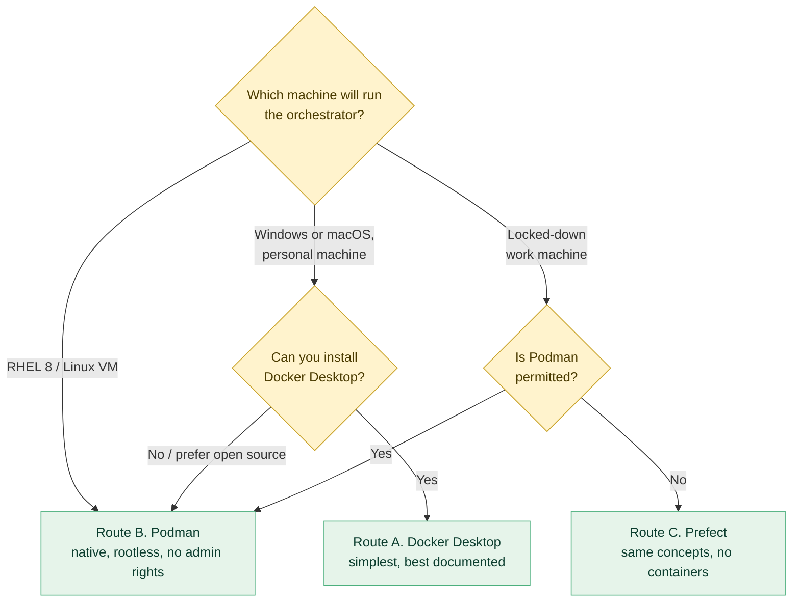

[← Handbook](HANDBOOK.md) · [README](../README.md) · [Glossary](GLOSSARY.md) · [Containerization](CONTAINERIZATION.md) · [Roadmap](ROADMAP.md)

# Containers: Docker, Podman, or neither

**Prerequisites:** [`01-setup.md`](01-setup.md). You won't need anything here until
Phase 9b (packaging the app, optional) or Phase 12 (Airflow), but I'd read it
before then, because the choice you make affects how those phases feel.

This document is about *choosing and installing a runtime*. Building
MicrobeGraph's own images (Containerfiles, layers, volumes, networks, compose) is
covered in [`CONTAINERIZATION.md`](CONTAINERIZATION.md). You pick your engine here
and build with it there.

**Learning goal:** understand what a container is, which of the three routes
suits your machine, and how to set up the one you choose. Along the way you'll
see why "it works on my machine" is a real engineering problem, and that it has a
real solution.

**Time:** 15 minutes reading; 20-40 minutes setup when you reach Phase 12.

> Every term here is also in [`GLOSSARY.md`](GLOSSARY.md).

---

## Contents

1. [What a container is](#1-what-a-container-is-and-the-problem-it-solves)
2. [Where containers appear in this project](#2-where-containers-appear-in-this-project)
3. [The three routes, compared](#3-the-three-routes-compared)
4. [Route A. Docker Desktop](#4-route-a-docker-desktop)
5. [Route B. Podman](#5-route-b-podman-rootless-daemonless-rhel-native)
6. [Route C. Prefect, no containers at all](#6-route-c-prefect-no-containers-at-all)
7. [Which should you pick?](#7-which-should-you-pick)
8. [Troubleshooting](#8-troubleshooting)

---

## 1. What a container is, and the problem it solves

### The problem, in everyday terms

You've built something that works perfectly on your laptop. You send it to a
colleague and it fails straight away, because their machine has a different
operating system, a different Python version, a library at a different version,
or a missing system tool. Hours can disappear into "it works on my machine."

Cooking has the same problem. You write a recipe that works in your kitchen, a
friend tries it, and it fails: their oven runs hot, their flour is different,
they don't own a stand mixer. The recipe was never the whole story, because your
kitchen was part of it.

### The idea

A **container** ships the kitchen along with the recipe.

It's a sealed, lightweight box holding your program *plus* everything it needs to
run: the correct Python version, its libraries, the system tools and the
configuration. That box runs the same way on your Windows laptop, your
colleague's Mac and a RHEL 8 server, because the environment travels inside it.

**Container vs virtual machine.** A virtual machine ships an entire operating
system, so it's heavy, slow to start and measured in gigabytes. A container
shares the host's operating system kernel and ships only what sits above it, so
it's light, starts in seconds and is measured in megabytes. If a VM is a whole
separate house, a container is a locked room in a shared building.

You'll see two words constantly:

- **Image**: the recipe and ingredients, packaged up. It's a static blueprint.
- **Container**: a running instance of an image. You can start several from one
  image, like baking several cakes from one recipe.

### How this relates to `.venv`

You've already met a smaller version of this idea. A virtual environment seals
your *Python packages*, while a container seals *everything*: the OS libraries,
the system tools and Python itself. It's the same instinct with a wider scope.

For this project's Python code, `.venv` is enough. Airflow is different. It's
made of several cooperating services (a scheduler, a web server, a database),
and that's exactly the situation containers were made for.

---

## 2. Where containers appear in this project

Containers show up three times, each for a different reason, and none of them
is required:

| Phase | What it is | Which way round |
|---|---|---|
| **9b** *(optional)* | Package the Streamlit app as one image | You **build** an image, the gentle version, one service |
| **12** | Run Airflow locally via the Astro CLI | You **consume** images someone else built |
| **18** | The whole stack via `compose.yaml` | You **build and orchestrate** four services together |

**Release 1.0 never requires containers.** The plain `.venv` path stays
supported for good, so a fresh clone works for someone who has no interest in
installing a container engine. Everything containerized is an *additional* way
to run the project.

Phases 1-9 need no containers at all. I kept it that way on purpose: introducing
containers before there's a multi-service system to manage would mean teaching a
solution before you've met its problem.

By Phase 12, the pipeline has grown into something that really needs an
orchestrator: five independent sources, a strict dependency order, a monthly
schedule, retries for transient failures, and alerts when something breaks.
Airflow was built for exactly that.

Airflow itself is several services that must find each other and start in the
right order. You can install them by hand, but it's unpleasant, and containers
turn it into one command.

So containers arrive once the project has a use for them. If you'd rather not use
them at all, Route C teaches the same orchestration concepts without them.

---

## 3. The three routes, compared

| | **A · Docker Desktop** | **B · Podman** | **C · Prefect** |
|---|---|---|---|
| **What you run** | Airflow via Astro CLI | Airflow via Astro CLI | Prefect, plain Python |
| **Containers needed** | Yes | Yes | **No** |
| **Admin rights** | Required to install | **Not required** (rootless) | Not required |
| **Background daemon** | Yes, always running | **No daemon** | No |
| **Windows** | ✅ Best supported | ✅ Works (needs WSL2) | ✅ |
| **macOS** | ✅ Best supported | ✅ Well supported | ✅ |
| **RHEL 8 / Rocky** | ⚠️ Possible, not native | ✅ **Native, ships with RHEL** | ✅ |
| **Licence cost** | Free for personal use; **paid for larger companies** | **Fully open source, always free** | Open source |
| **Corporate-friendly** | Often blocked or licensed | Usually permitted | Always |
| **RAM needed** | ~4 GB | ~4 GB | ~1 GB |
| **What you learn** | Containers + Airflow | Containers + Airflow + rootless security | Orchestration concepts only |

All three routes teach the concepts that carry over from one tool to another:
DAGs, dependencies, scheduling, retries and idempotency work the same way in each.
Routes A and B also teach containers.

### A note on Docker's licence

Docker Desktop is free for personal use, education, and small businesses, but
requires a paid subscription in larger commercial organisations. This is a common
reason it's unavailable on work machines, and a large part of why Podman exists
and why Red Hat ships it by default. It's useful to know, because if you ever
wonder why you can't install Docker at work, the reason is often the licence.

---

## 4. Route A. Docker Desktop

Docker Desktop works best on personal Windows and macOS machines. Most tutorials
assume it, so search results will match what you see on screen.

### Install

<details open>
<summary><b>🪟 Windows</b></summary>

1. Enable WSL2 (Windows Subsystem for Linux), open PowerShell **as
   Administrator**:
   ```powershell
   wsl --install
   ```
   Restart when prompted.

   WSL2 is a real Linux kernel running inside Windows. Containers are a Linux
   technology, so Windows runs them in there.
2. Download Docker Desktop: <https://www.docker.com/products/docker-desktop/>
3. Install with the defaults, and make sure "Use WSL 2 based engine" is ticked.
4. Launch Docker Desktop and wait for the whale icon to stop animating.

</details>

<details open>
<summary><b>🍎 macOS</b></summary>

1. Download from <https://www.docker.com/products/docker-desktop/>, pick **Apple
   Silicon** for M-series Macs, **Intel** for older ones.
2. Drag to Applications, launch, grant the permissions it asks for.

</details>

<details open>
<summary><b>🐧 RHEL 8</b></summary>

Docker Desktop isn't a natural fit here, because RHEL ships Podman instead, so
use **Route B**. If you specifically need Docker Engine, it installs from Docker's
own repository, but you'll be working against the grain of the distribution.

</details>

### Verify

```bash
docker --version
docker run hello-world
```

Expected:

```
Docker version 27.3.1, build ce12230
...
Hello from Docker!
This message shows that your installation appears to be working correctly.
```

✅ **Checkpoint.** You see the "Hello from Docker!" message.

---

## 5. Route B. Podman (rootless, daemonless, RHEL-native)

Podman is the strongest choice on RHEL 8, and often the only one allowed on
locked-down work machines. There are three reasons for that:

1. **No daemon.** Docker runs a permanent background service with root privileges.
   Podman runs containers as ordinary child processes of your shell, which means
   fewer moving parts and a smaller attack surface.
2. **Rootless by default.** Containers run as *you* rather than as root. If
   something in a container misbehaves, it has your permissions and not the
   machine's, and on a shared VM that matters a great deal.
3. **No admin rights.** You don't need them to run it, and it's already installed
   on RHEL 8.

Podman copies Docker's command-line interface on purpose. Nearly every `docker`
command works as `podman`, and a `Dockerfile` and a `Containerfile` use the same
format, so most Docker tutorials translate by swapping one word.

The Astro CLI supports it too (I verified this is current). It auto-detects the
container runtime, checking for `docker` then `podman`, and recent Homebrew and
Winget installs of the Astro CLI even ship with Podman preconfigured. If
auto-detection picks the wrong one, you can force the choice.

### Install

<details open>
<summary><b>🐧 RHEL 8 / Rocky / AlmaLinux</b></summary>

It's often already installed, so check first:

```bash
podman --version
```

If it isn't:

```bash
sudo dnf install -y podman
```

Rootless containers may need user namespace ranges configured. To check:

```bash
cat /etc/subuid | grep $USER
```

If nothing prints, ask your administrator to run:

```bash
sudo usermod --add-subuids 100000-165535 --add-subgids 100000-165535 $USER
```

That command gives your account a private block of user IDs that containers map
into, so a process running as "root" inside a container is a harmless
unprivileged ID outside it. This mapping is what makes rootless containers safe.

</details>

<details open>
<summary><b>🍎 macOS</b></summary>

```bash
brew install podman
podman machine init
podman machine start
```

The extra step is there because containers need a Linux kernel. On macOS,
`podman machine` runs a small Linux VM for them (Docker Desktop does the same
thing behind the scenes).

</details>

<details open>
<summary><b>🪟 Windows</b></summary>

1. Enable WSL2: `wsl --install` in an Administrator PowerShell, then restart.
2. Install Podman Desktop: <https://podman-desktop.io/> (or
   `winget install RedHat.Podman`).
3. Initialise the machine:
   ```powershell
   podman machine init
   podman machine start
   ```

</details>

### Verify

```bash
podman --version
podman run hello-world
```

```
podman version 4.9.4
...
Hello from Docker!
```

*(Yes, the image says "Docker". It's the standard test image, and Podman running
it without complaint shows that the two engines share one ecosystem.)*

### Point the Astro CLI at Podman

Auto-detection usually handles this, but you can set it explicitly:

```bash
astro config set -g container.binary podman
```

On some setups the CLI also wants to know where Podman's socket lives:

```bash
# macOS / Windows, find the socket path
podman machine inspect --format '{{.ConnectionInfo.PodmanSocket.Path}}'

# then export it (add to your shell profile to make it permanent)
export DOCKER_HOST='unix:///path/from/the/command/above'
```

✅ **Checkpoint.** `podman run hello-world` succeeds and `astro config get -g
container.binary` returns `podman`.

### The one wrinkle worth knowing

Some Astro CLI subcommands have historically assumed a `docker` binary even when
configured for Podman. If you hit one, the usual workaround is the compatibility
shim:

```bash
sudo dnf install -y podman-docker    # RHEL: provides a 'docker' command that calls podman
```

This is the kind of small friction that comes with the less-travelled path. It's
manageable, and I think the security and licence benefits make it worth it, but
I'd rather tell you about it now than have you discover it at 11pm.

---

## 6. Route C. Prefect, no containers at all

If containers are blocked, unavailable, or just more than you want to take on
right now, you can do **Phase 12 in Prefect instead**, and you lose less than you
might think.

Prefect is a Python orchestration library. You write ordinary Python functions,
decorate them, and Prefect handles scheduling, dependency order, retries,
logging, and a monitoring dashboard.

With Prefect you still learn DAGs, dependencies, scheduling, retries,
idempotency, failure handling and observability, which are the concepts that
carry over between orchestrators. What you miss is container experience and
Airflow's specific vocabulary (operators, sensors, hooks, XComs).

To install it:

```bash
pip install prefect
prefect server start        # dashboard at http://localhost:4200
```

That's all. It needs no containers and no daemon, and it runs in ~1 GB of RAM.

How do the two compare? Airflow is the more widely deployed orchestrator and has
more name recognition. Prefect is noticeably friendlier to learn, and its
concepts map onto Airflow closely enough that moving between them comes down to
vocabulary.

There's also a middle path, which is what I'd suggest if you're unsure: do
Phase 12 in Prefect now, and come back to Airflow later when a container runtime
becomes available. The DAG logic transfers almost directly, because what you're
really learning is orchestration, and the specific tool can be swapped out.

---

## 7. Which should you pick?



In short:

- **RHEL 8 VM?** → Podman. It's already there, it's rootless, it needs no admin
  rights, and it's what Red Hat expects you to use.
- **Personal Windows or Mac, want the smoothest path?** → Docker Desktop.
- **Work machine with restrictions?** → Try Podman; fall back to Prefect.
- **Not sure, want to start now?** → Prefect. Learn the concepts, add containers
  later. Nothing is wasted.

You can also change your mind later. The Phase 12 guide will document all three,
and the DAG logic is nearly identical across them.

---

## 8. Troubleshooting

### "Cannot connect to the Docker daemon"

Docker Desktop isn't running. Start it and wait for the whale icon to settle. On
Linux with Docker Engine, run `sudo systemctl start docker`.

### Podman: "short-name resolution enforced but cannot prompt without a TTY"

Podman requires fully-qualified image names in non-interactive contexts. Use
`docker.io/library/hello-world` rather than `hello-world`, or add `docker.io` to
`unqualified-search-registries` in `/etc/containers/registries.conf`.

### Podman on macOS/Windows: "machine not running"

```bash
podman machine start
```

The Linux VM stops when your computer sleeps or restarts. Starting it is part of
the routine, like activating `.venv`.

### Astro CLI can't find the container engine

```bash
astro config get -g container.binary      # what does it think it should use?
which docker || which podman              # what is actually installed?
astro config set -g container.binary podman   # tell it explicitly
```

### Astro CLI errors mentioning `docker` while you're using Podman

The compatibility shim usually resolves it:

```bash
sudo dnf install -y podman-docker      # RHEL
brew install docker                     # macOS: the CLI only, no Desktop
```

### "no space left on device"

Container images accumulate over time. To clean up:

```bash
docker system prune -a      # or: podman system prune -a
```

⚠️ This removes all unused images and stopped containers. It's safe here, since
everything can be rebuilt from the project files, but read the confirmation
prompt before agreeing.

### RHEL 8: rootless containers fail with a permissions error

This is usually caused by missing user-namespace ranges. Check with
`cat /etc/subuid | grep $USER`. If it prints nothing, see the `usermod` command
in [Route B](#5-route-b-podman-rootless-daemonless-rhel-native). It needs an
administrator once, and never again.

### Not enough memory

Airflow wants ~4 GB. In Docker Desktop, go to Settings → Resources and raise the
memory limit. With Podman, run `podman machine set --memory 4096` (stop the
machine first). On a small VM, **Route C (Prefect)** is the better choice, at
roughly 1 GB.

---

## Checkpoint

Before Phase 12 you should be able to say:

- [ ] What a container is, and how it differs from a virtual machine
- [ ] The difference between an image and a container
- [ ] Why containers arrive at Phase 12 and not earlier
- [ ] Which of the three routes suits your machine, and why
- [ ] Your chosen runtime is installed and its verification command passes *(or
      you've chosen Route C and installed Prefect)*

**What you learned:** the "works on my machine" problem and its solution; images
versus containers; why Podman's rootless, daemonless design matters on shared and
restricted machines; that Docker's licence is often the reason it's unavailable
at work; and that orchestration concepts transfer between tools, so picking the
tool matters less than it first seems.

---

## Committing this phase

```bash
git switch develop
git add -A                    # stage first, so the gate can see the new files

./check-public-safe.sh        # must print "SAFE TO PUSH"

git commit -m "docs: choose and document the container runtime"
git push origin develop develop:beta develop:master

## --tags is optional, and only when cutting a new version
## then switch back to local master and pull in the changes from the remote

git switch master
git pull --ff-only origin master
git switch develop
```

---

**Next:** [`CONTAINERIZATION.md`](CONTAINERIZATION.md), building MicrobeGraph's
own images with whichever engine you chose ·
**Plan:** [`ROADMAP.md`](ROADMAP.md) · **Setup:** [`01-setup.md`](01-setup.md)
