[← README](../README.md) · [Glossary](GLOSSARY.md) · [Architecture](00-architecture.md) · [Roadmap](ROADMAP.md) · [Git workflow](GIT-WORKFLOW.md) · [Changelog](../CHANGELOG.md)

# The MicrobeGraph Handbook: from day 0 to the finished product

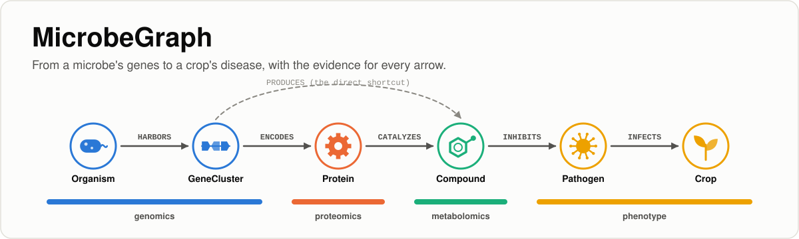

**Handbook version:** 1.11 · **Last updated:** 2026-10-18 · **Repository state it
describes:** Phase 0 (design and setup), Phase 1 (MIBiG ingestion), Phase 2
(PubChem, NCBI Taxonomy, KEGG and the cited bridge), Phase 3 (the proteomics
layer: MIBiG's gene records and UniProt), Phase 3b (every cluster's proteins,
from MIBiG's protein file), Phase 4 (entity resolution with its ledger, the
graph in DuckDB and NetworkX, and the query cookbook) and Phase 4b (closing the
gaps: MIBiG's GenBank file, PubChem's name search in PubChem's names file, a
review file, and the four follow-ups after its real run), Phase 4c (the 3D
check of same-structure joins, with RDKit) and Phase 5 (graph analytics:
evidence paths, hubs, bridges and communities) built, run and tested; Phase 6
(statistical validation in R) next.

**Read this document first, and come back to it whenever you lose your place.**
It follows the whole journey in order: understanding the project, setting up a
blank computer, building every phase, cutting each release, and running the
finished product. For each step it tells you what you are about to do, why that
step exists, which document has the detail, roughly how long it takes, and how
you'll know you are done. I wrote it so that nobody should have to hunt through
the repository to work out what comes next; if you ever find yourself doing that,
I count it as a defect in this handbook.

The intended reader is someone with no background in microbiology, chemistry,
databases, Python, Git or the command line who wants to end up able to build,
run, explain and extend the whole application. Every term is defined in
[`GLOSSARY.md`](GLOSSARY.md), and I'd keep that open in a second tab.

The stages are numbered and meant to be done in order. Each one ends with a
checkpoint, and you should pass it before moving on. In the tables, ✅ means built
and tested, ⏳ means next, and ⬜ means planned; the status column below describes
the repository exactly as it stood on the date at the top.

---

## Contents

- [The project in one minute](#the-project-in-one-minute)
- [The journey at a glance](#the-journey-at-a-glance)
- [Stage 0. Understand what you are building and why](#stage-0-understand-what-you-are-building-and-why)
- [Stage 1. Set up your workshop, once per computer](#stage-1-set-up-your-workshop-once-per-computer)
- [Stage 2. Version control and the end-of-phase ritual](#stage-2-version-control-and-the-end-of-phase-ritual)
- [Stage 3. The rulebook (Phase 0)](#stage-3-the-rulebook-phase-0)
- [Stage 4. Ingestion: the MIBiG backbone (Phase 1)](#stage-4-ingestion-the-mibig-backbone-phase-1)
- [Stages 5-12. Release 1.0, the science (Phases 2-9)](#release-10-the-science)
- [Stages 13-16. Release 2.0, the platform (Phases 10-13)](#release-20-the-platform)
- [Stages 17-22. Release 3.0, the product (Phases 14-19)](#release-30-the-product)
- [Stage 23. Running it as a product](#stage-23-running-it-as-a-product)
- [Every session, after setup](#every-session-after-setup)
- [When something goes wrong](#when-something-goes-wrong)
- [Where everything lives: the document map](#where-everything-lives-the-document-map)
- [How this handbook is maintained](#how-this-handbook-is-maintained)

---

## The project in one minute

**The scenario.** Picture a jujube grower who is losing harvested fruit to grey
mould, a fungus called *Botrytis cinerea*, and who would rather not spray more
synthetic fungicide. Some soil bacteria make natural molecules that suppress fungi, so the
grower's question is: which bacteria, making which molecules, have evidence behind
them for *this* disease?

**The problem.** The answer exists, but it's scattered. One public database knows
which bacterium carries which gene cluster and what molecule it makes, another
knows the molecule's chemistry, and another knows how organisms are related. The
last link, "this molecule suppresses that fungus", lives mostly in the text of
scientific papers, so there is no single place where you can walk from the
jujube back to the bacterium.

**The idea.** MicrobeGraph puts every piece into one **knowledge graph**, with dots
for things (microbes, gene clusters, enzymes, molecules, diseases, crops) and
arrows for relationships (*harbors*, *encodes*, *produces*, *inhibits*, *infects*),
and answers questions by walking the arrows. Once drawn, a fact checked by a
curator looks exactly like a fact guessed by software, so **every arrow carries its
evidence**: where it came from and how strongly it is known.

If that sounds abstract, think of a city transport map. It draws stations and
lines instead of writing facts out in sentences, and you find a route by following
the lines. MicrobeGraph is a transport map from microbes to crops in which every
line also says who surveyed it.

**What you end up with.** By the last stage you have a tested pipeline that
rebuilds the graph from public sources with one command, statistical checks that
the patterns are not chance, machine learning that suggests missing links (clearly
labelled as hypotheses), a public app, an API, a modern web frontend, an AI
assistant connection, and the whole thing runnable in containers with one command.
Since the repository is also the tutorial, you should come out of it able to
explain every one of those parts.

---

## The journey at a glance

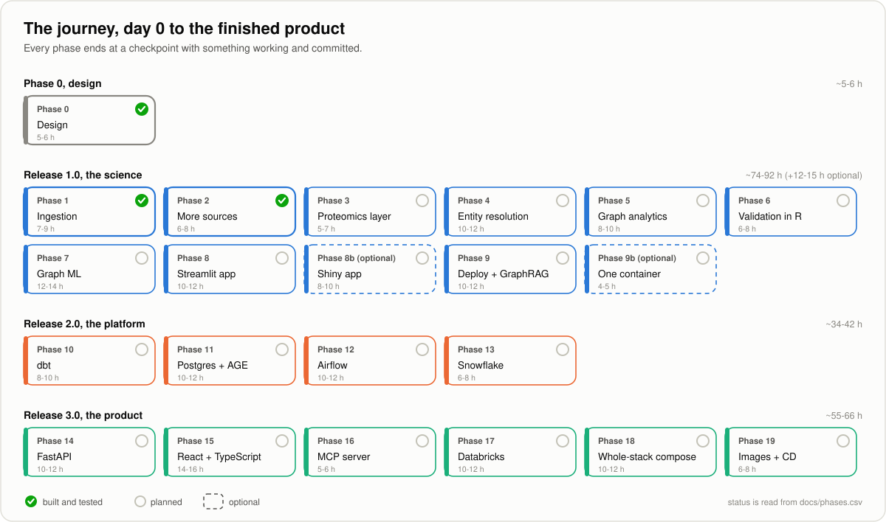

If you prefer a timeline you can hover over, open
[`interactive/roadmap_timeline.html`](interactive/roadmap_timeline.html) in a browser
for the same plan.

| Stage | What | Phase | Hands-on time | Status | Guide |
|---|---|---|---|---|---|
| 0 | Understand what you are building and why | 0 | 1.5 h reading | ✅ | [README](../README.md), [architecture](00-architecture.md), [roadmap](ROADMAP.md) |
| 1 | Set up your workshop, once per computer | 0 | 2-3 h | ✅ | [`01-setup.md`](01-setup.md) |
| 2 | Version control and the end-of-phase ritual | 0 | 30 min | ✅ | [`GIT-WORKFLOW.md`](GIT-WORKFLOW.md) |
| 3 | The rulebook: ontology and data model | 0 | 1 h | ✅ | [`02-ontology-and-data-model.md`](02-ontology-and-data-model.md) |
| 4 | Ingestion: the MIBiG backbone | 1 | 7-9 h | ✅ | [`03-ingestion-mibig.md`](03-ingestion-mibig.md) |
| 5 | More sources: PubChem, NCBI Taxonomy, KEGG, the curated bridge | 2 | 6-8 h | ✅ | [`04-more-sources-secrets.md`](04-more-sources-secrets.md) |
| 6 | The proteomics layer: MIBiG's gene records and UniProt | 3 | 5-7 h | ✅ | [`05-proteomics-uniprot.md`](05-proteomics-uniprot.md) |
| 6b | Every cluster's proteins: MIBiG's protein file | 3b | 4-5 h | ✅ | [`05b-all-cluster-proteins.md`](05b-all-cluster-proteins.md) |
| 7 | Entity resolution and the graph build | 4 | 10-12 h | ✅ | [`06-entity-resolution-graph-build.md`](06-entity-resolution-graph-build.md), [`QUERY_COOKBOOK.md`](QUERY_COOKBOOK.md) |
| 7b | Closing the gaps: names, GenBank and a review file | 4b | 6-8 h | ✅ | [`06b-closing-the-gaps.md`](06b-closing-the-gaps.md) |
| 7c | The 3D check of same-structure joins | 4c | 3-4 h | ✅ | [`06c-checking-3d-detail.md`](06c-checking-3d-detail.md) |
| 8 | Graph analytics | 5 | 8-10 h | ✅ | [`07-graph-analytics.md`](07-graph-analytics.md), [`QUERY_COOKBOOK.md`](QUERY_COOKBOOK.md) |
| 9 | Statistical validation in R | 6 | 6-8 h | ⏳ next | `08-statistical-validation-r.md` |
| 10 | Graph machine learning | 7 | 12-14 h | ⬜ | `09-graph-machine-learning.md` |
| 11 | The Streamlit app (+ 11b, the same app in Shiny, optional) | 8, 8b | 10-12 h (+8-10 h) | ⬜ | `10-app-streamlit.md`, `10b-app-shiny.md` |
| 12 | Deployment, GraphRAG and **release 1.0** (+ 12b, one container, optional) | 9, 9b | 10-12 h (+4-5 h) | ⬜ | `11-deployment-graphrag.md`, `11b-one-container.md` |
| 13 | dbt: the ontology becomes tested SQL | 10 | 8-10 h | ⬜ | `12-dbt-transformations.md` |
| 14 | PostgreSQL + Apache AGE + pgvector | 11 | 10-12 h | ⬜ | `13-postgres-age-pgvector.md` |
| 15 | Airflow orchestration | 12 | 10-12 h | ⬜ | `14-airflow-orchestration.md` |
| 16 | Snowflake portability and **release 2.0** | 13 | 6-8 h | ⬜ | `15-snowflake-portability.md` |
| 17 | FastAPI service layer | 14 | 10-12 h | ⬜ | `16-fastapi-service-layer.md` |
| 18 | React + TypeScript frontend | 15 | 14-16 h | ⬜ | `17-react-frontend.md` |
| 19 | MCP server | 16 | 5-6 h | ⬜ | `18-mcp-server.md` |
| 20 | Databricks: literature mining at scale | 17 | 10-12 h | ⬜ | `19-databricks-literature-mining.md` |
| 21 | Containerize the whole application | 18 | 10-12 h | ⬜ | `20-containerize-the-stack.md` |
| 22 | Published images, CD and **release 3.0** | 19 | 6-8 h | ⬜ | `21-cicd-packaging.md` |
| 23 | Running it as a product | after 19 | reading + ongoing | ⬜ | this handbook, [roadmap](ROADMAP.md#what-finished-means-the-product-checklist) |

Guides listed without a link arrive with their phase, and I add the link here as
each one is written. The times are hands-on estimates for a beginner following the
guides. At four to five hours a week, Release 1.0 takes four to six months and
the whole product roughly a part-time year. Every stage ends at a natural stopping
point with everything committed, and **each release is complete on its own**, so
stopping after any of them still leaves you with something whole.

---

## Stage 0. Understand what you are building and why

**What.** Read, in this order:

1. [`README.md`](../README.md), *What is a knowledge graph?* and *The problem this
   project tackles*. Two everyday pictures (a transport map, and a contact list
   compared with a social network) show why the project uses a graph instead of a
   spreadsheet.
2. [`00-architecture.md`](00-architecture.md), every box of the system, what it
   does, why it exists, and the design decisions behind it.
3. [`ROADMAP.md`](ROADMAP.md), the phases you are about to follow, why each tool
   is there, and what I left out on purpose.
4. [`PRIOR-ART.md`](PRIOR-ART.md), what already exists, how this differs, and what
   the project does **not** claim.

After that, open [`interactive/ontology_explorer.html`](interactive/ontology_explorer.html)
in a browser and hover over the dots and arrows.

**Why.** Everything you type later makes more sense once you can say in one
sentence what the project is for: *an open, reproducible map from microbes' genes
to crop diseases, where every arrow says how it is known.* If you skip this stage,
the later ones tend to turn into copying commands without knowing why they are
there.

**Checkpoint.** You're ready to move on when you can explain to a friend, without
notes, what a node and an edge are, why the same molecule can have three names,
why a curated fact and a guessed fact must be kept apart, and what the three
releases are.

---

## Stage 1. Set up your workshop, once per computer

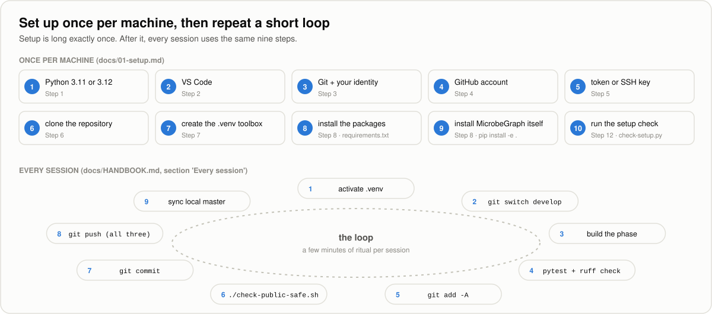

**What.** Work through [`01-setup.md`](01-setup.md) from Step 0 to the end. Every
step shows the commands for Windows, macOS and Linux / RHEL 8 side by side. Along
the way you install Python 3.11 or 3.12, VS Code and Git, create a GitHub account
and connect your computer to it, clone the repository, create the `.venv` toolbox,
install the packages and the project itself, and protect your secrets before you
have any.

**Why.** Setup is the long part, and you only do it once; after that, every session
is the same short loop (see [Every session](#every-session-after-setup)). The guide
has you prove each tool works before adding the next one, so if something breaks,
the problem is in the last thing you did.

**Platform note.** I wanted the project to behave the same on every system, so file
paths are built with Python's `pathlib` and every tool is cross-platform. From
Phase 1 onwards the tests also run automatically on Windows, macOS, Linux and
RHEL 8 at every push, which means a difference between systems can't go unnoticed.

Later in the journey you'll also set up R and RStudio
([`R-SETUP.md`](R-SETUP.md), at Stage 9) and, if you want one, a container engine
([`CONTAINERS.md`](CONTAINERS.md), at Stage 12b or 15).

**Checkpoint.** Your prompt shows `(.venv)`, and running `python check-setup.py`
ends with `All checks passed. Your workshop is ready.`

---

## Stage 2. Version control and the end-of-phase ritual

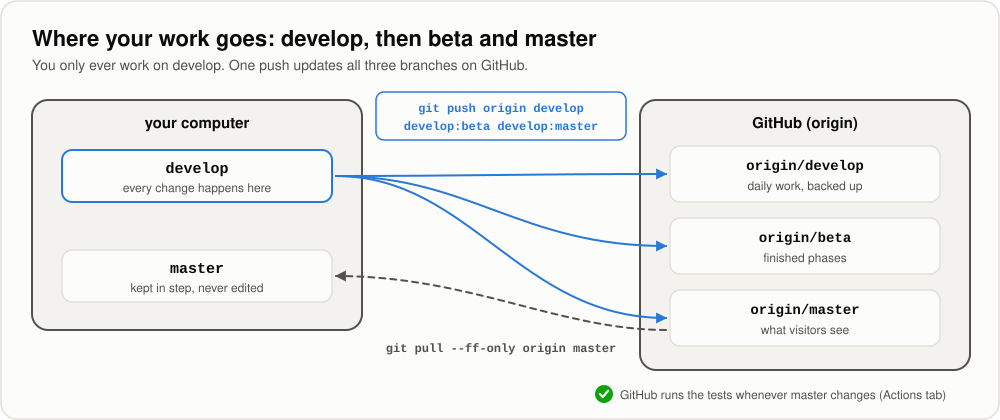

**What.** Read [`GIT-WORKFLOW.md`](GIT-WORKFLOW.md). You already created the
branches in [`01-setup.md`, Step 10](01-setup.md#12-step-10-the-three-branch-model).

**Why.** Git works like a save-game system for your work. With three branches,
anyone can find a working version while you are busy building the next phase:

| Branch | Holds | You... |
|---|---|---|
| `develop` | Daily work | work here, always |
| `beta` | Finished phases | never edit; the push updates it |
| `master` | What visitors see | never edit; the push updates it, then you sync your copy |

From here on you finish every stage with the **end-of-phase ritual** below. Each
stage tells you which commit message to use.

```bash
git switch develop
git add -A                    # stage first, so the gate sees the new files

pytest                        # from Phase 1 on: must end with "passed"
ruff check .                  # from Phase 1 on: must say "All checks passed!"
./check-public-safe.sh        # must print "SAFE TO PUSH" (Windows: bash check-public-safe.sh)

git commit -m "<the stage's commit message>"
git push origin develop develop:beta develop:master
## --tags is optional, only when a release tag was created in this stage

# bring local master in step with the remote master just updated
git switch master
git pull --ff-only origin master
git switch develop
```

Three stages (12, 16 and 22) also cut a release. For those, add a tag right after
the commit and **replace** the push line with one that sends the tag as well:

```bash
git tag -a v1.0.0 -m "Release 1.0, the science"            # after git commit
git push origin develop develop:beta develop:master --tags  # instead of the plain push
```

You need `--tags` because Git doesn't push tags unless you ask it to. Afterwards,
open **Releases** on GitHub and turn the tag into a release page by pasting in that
version's section of [`CHANGELOG.md`](../CHANGELOG.md).

**Checkpoint.** Running `git branch -a` lists `develop` and `master` locally, and
`origin/master`, `origin/beta` and `origin/develop` remotely.

---

## Stage 3. The rulebook (Phase 0)


**What.** Read [`02-ontology-and-data-model.md`](02-ontology-and-data-model.md):
nine kinds of node, ten kinds of edge, identifiers written as `prefix:number`
(CURIEs), four evidence levels, and the twelve rules every row must obey. The same
rulebook, written as code, lives in [`src/microbegraph/ontology.py`](../src/microbegraph/ontology.py).


**Why.** A graph assembled without a written contract turns into a tangle within
a week. Deciding its shape first is cheap, whereas changing it after thousands of
rows are loaded is expensive. It's the same as agreeing the rules of a board game
before anyone moves a piece.


**Checkpoint.** Make sure you can name the four-arrow chain from a microbe to a
crop, say which evidence level is a hypothesis, and explain why `326423` is a bad
identifier and `ncbitaxon:326423` a good one. The answers are at the end of the
guide.
**Commit message:** `feat: add the ontology and data model (nodes, edges, evidence)`
*(already done)*.

---

## Stage 4. Ingestion: the MIBiG backbone (Phase 1)

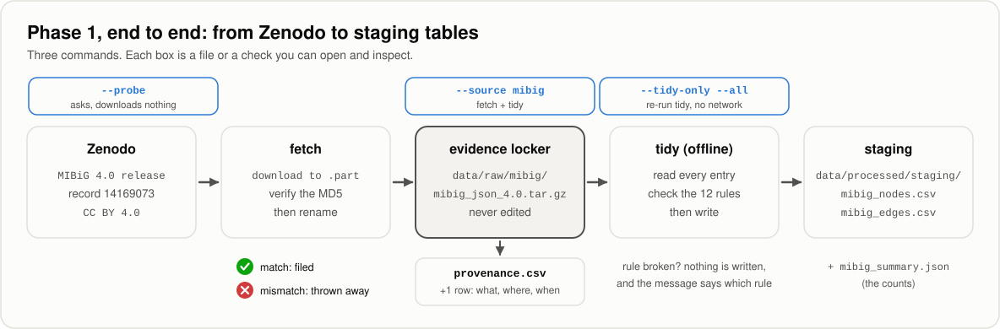

**What.** Follow [`03-ingestion-mibig.md`](03-ingestion-mibig.md). In that guide
you make the project an installable package, build the "socket" every data source
plugs into, turn the twelve rules into code, write the MIBiG adapter, test
everything offline with labelled sample records and a fake server, switch on
automatic testing on four operating systems, and then download the real MIBiG 4.0
release.

```bash
pip install -e .                                   # once
python -m microbegraph.fetch --probe               # what is out there? (no download)
python -m microbegraph.fetch --source mibig        # download, verify, file, log, tidy
python -m microbegraph.fetch --tidy-only --all     # rebuild tables, offline
pytest                                             # the promises, checked
```

**Why.** Everything downstream needs data, and *how* the data arrives decides how
painful every later phase will be. This stage sets four habits that stay for the
rest of the project: ask servers politely, prove that a download is the file that
was published (checksums), never edit the original (the evidence locker), and
write down every fetch (provenance). It also adds a safety net in the form of
tests that run on every push.

**New ideas in this stage:** APIs and HTTP status codes, timeouts, retries with
backoff, tarballs, JSON, checksums, the evidence locker, provenance, staging tables,
abstract base classes, editable installs, tests and fixtures, continuous
integration.

**Checkpoint.** `pytest` passes; the locker holds `mibig_json_4.0.tar.gz`;
`data/raw/provenance.csv` has a `downloaded` row with MD5
`ce1736f4fac7168d85dae3b37c77d3d2`; `data/processed/staging/` holds the MIBiG
node and edge tables; the **Actions** tab on GitHub is green.
**What you should get:** 3,013 records read, 2,437 of them active, and 10,023
arrows (the counts are explained in
[`03-ingestion-mibig.md`, Step 8](03-ingestion-mibig.md#12-step-8-run-it-for-real)).
From Phase 3 the same tidy also reads gene records, and from Phase 3b MIBiG's
protein file (the fetch then downloads that file too), so it prints more counts
and writes more arrows; Stages 6 and 6b have those numbers.
**Commit message:** `feat: add MIBiG source adapter with evidence locker and provenance log`.
**Estimated time:** 7-9 hours.

**Looking after the automatic tests.** From this stage on, every change to
`master` is tested on seven borrowed machines, following
`.github/workflows/ci.yml`:

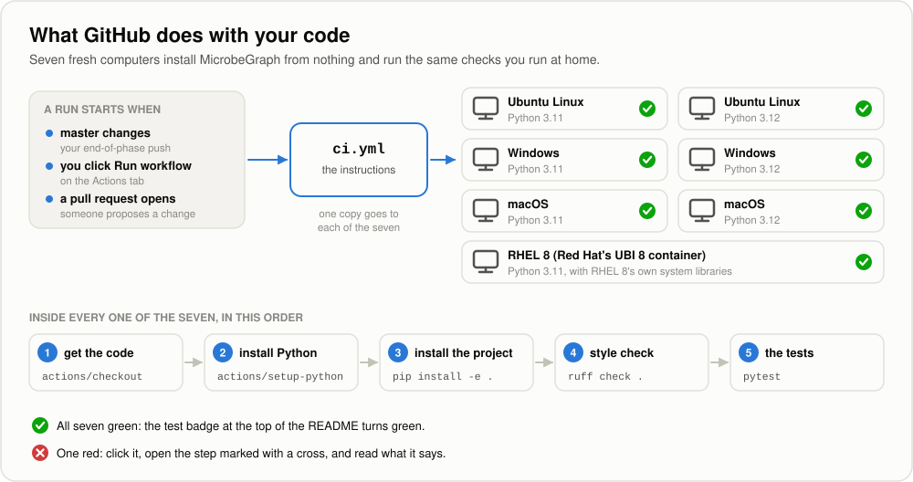

Between phases, two things can need a moment of attention, and neither means
your code is broken:

* **No run appears after a push.** Start one by hand from the Actions tab
  ([`03-ingestion-mibig.md`, *Starting a run by hand*](03-ingestion-mibig.md#starting-a-run-by-hand)).
* **A finished run lists yellow warnings that an action is being retired.** Move
  `ci.yml` to the newer version
  ([*Keeping the workflow current*](03-ingestion-mibig.md#keeping-the-workflow-current)).
  This happened once already, straight after Phase 1, and the fix was one small
  commit: `ci: move checkout and setup-python to v7`. From Phase 19, GitHub
  proposes these updates by itself.

---

<a id="release-10-the-science"></a>
# Release 1.0, the science (Stages 5-12)

*A working knowledge graph built from real public data, statistically validated,
with machine learning and a public app. This release is complete on its own.*

---

## Stage 5. More sources (Phase 2)


**What.** Follow [`04-more-sources-secrets.md`](04-more-sources-secrets.md). Four
more sources plug into the socket from Phase 1:

* **PubChem** gives each compound MIBiG numbered a precise chemical identity:
  formula, weight, structure, its other names, and its numbers in KEGG and ChEBI.
* **NCBI Taxonomy** gives every organism its family tree, as `MEMBER_OF` arrows
  from strain to species to genus and on up.
* **KEGG** places compounds on its maps of metabolism (`PARTICIPATES_IN`).
* **The curated bridge**, [`curation/compound_pathogen_crop.csv`](../curation/compound_pathogen_crop.csv),
  holds the cited findings no database publishes: which compound acts against
  which crop pathogen. Its first eight rows, from six papers, add the
  `INHIBITS` and `INFECTS` arrows, so the chain finally reaches a crop.

This is also where the project meets its first **API key**: NCBI's free, optional
key, which lives in `.env` on your computer and never in the repository.

```bash
python -m microbegraph.fetch --list                # every source, each with its licence
python -m microbegraph.fetch --probe               # what is out there? (no download)
python -m microbegraph.fetch --all                 # fetch and tidy all five, in order
python -m microbegraph.fetch --tidy-only --all     # rebuild every table, offline
pytest                                             # 144 promises, checked
```

**Why.** The socket gets its first real test: four sources arrive and nothing
written in Phase 1 has to change. Three new habits join the four from Phase 1.
An answer from an API changes from day to day, so each fetch is kept as a dated
**snapshot**, with its own provenance rows. A key is a secret, so it is read from
`.env`, shown only as "set", and sent only inside a request's body. And a
licence is part of the data: KEGG is for academic use only, so its rows stay on
your machine and out of anything published.


**New ideas in this stage:** web APIs, GET and POST, speed limits, API keys,
environment variables and `.env`, snapshots and manifests, sources that build on
each other, licence terms, taxonomy ranks and lineages, synonyms, test records
captured from real answers.

**Open:** [`04-more-sources-secrets.md`](04-more-sources-secrets.md);
[`curation/README.md`](../curation/README.md) for adding a bridge row;
[`01-setup.md`, Step 9](01-setup.md#11-step-9-protect-your-secrets-before-you-have-any) for how `.env` was protected.
**Checkpoint:** `pytest` passes; `data/raw/` holds one finished snapshot each
for PubChem, NCBI Taxonomy and KEGG; `data/processed/staging/` holds the tables of
all five sources; `git status` never lists `.env`; the **Actions** tab is green.
**What you should get:** on the first run (2026-10-12), PubChem knew 1,171 of
the 1,176 compounds asked about; NCBI answered for all 1,485 taxids, giving
2,441 organism nodes and 2,433 `MEMBER_OF` arrows; KEGG gave 85
`PARTICIPATES_IN` arrows to 39 maps. The bridge gives exactly 8 rows, 7
`INHIBITS` and 7 `INFECTS` arrows from 6 papers, every row confirmed against
NCBI. The live sources may give slightly different counts on another day; the
sanity checks are in
[`04-more-sources-secrets.md`, Step 10](04-more-sources-secrets.md#14-step-10-run-it-for-real).
**Commit message:** `feat: add PubChem, NCBI Taxonomy and KEGG adapters and the cited bridge`.
**Estimated time:** 6-8 hours.

---

## Stage 6. The proteomics layer (Phase 3)

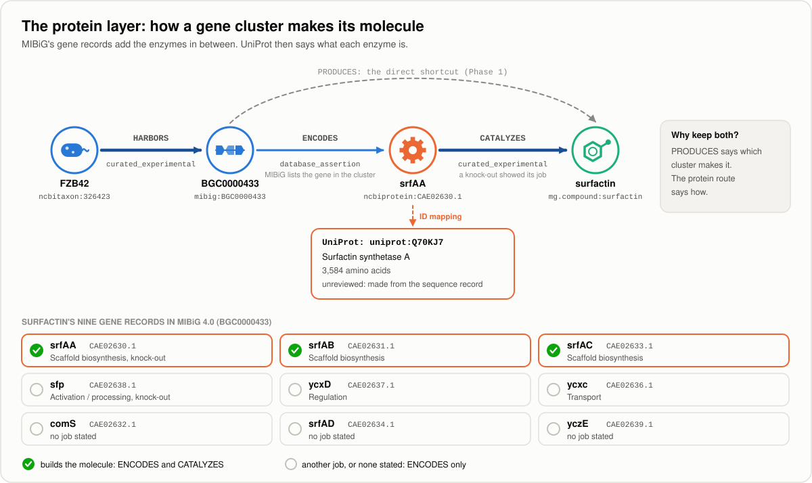

**What.** Follow [`05-proteomics-uniprot.md`](05-proteomics-uniprot.md). The
enzymes each gene cluster codes for join the graph as `Protein` nodes, in two
steps:

* **MIBiG's gene records.** Some MIBiG entries list the cluster's genes, each
  with the number of the protein it makes and the job it does. The MIBiG adapter
  now reads them: every gene gives a `Protein` node and an `ENCODES` arrow from
  its cluster, and a gene whose job builds the molecule (scaffold, precursor or
  tailoring) also gives a `CATALYZES` arrow to the molecule.
* **UniProt**, the catalogue of proteins, says what each one is (names, organism,
  length, EC number, function). A sixth adapter asks it through its **ID
  mapping** service: hand in the protein numbers, get a job number, ask until the
  job is finished, collect the results.

```bash
python -m microbegraph.fetch --list                         # six sources now
python -m microbegraph.fetch --tidy-only --source mibig     # MIBiG's tables, now with proteins (offline)
python -m microbegraph.fetch --probe --source uniprot       # UniProt's release, proteins to ask about
python -m microbegraph.fetch --source mibig --source uniprot
pytest                                                      # 183 promises, checked
```

**Why.** The graph goes from two molecular layers to three (genes → proteins →
molecules → disease), so a single walk can now cross genomics, proteomics and
metabolomics. I kept MIBiG's direct `PRODUCES` shortcut because it answers a
different question: the shortcut says which cluster makes a molecule, and the
protein route shows how.

This stage also changed its own plan. A short survey of the real data, run before
any adapter code, showed that UniProt doesn't cross-reference MIBiG at all, so
the join goes through the protein's sequence number instead, and that only 452 of
the 2,437 active MIBiG entries have gene records. The second finding is why Stage
6b exists, and Stage 6b gives every cluster its proteins.

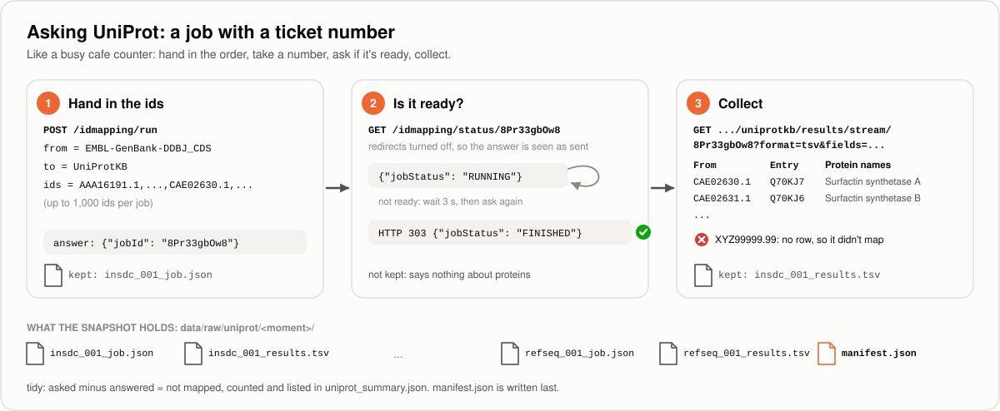

**New ideas in this stage:** genes, proteins and enzymes; the jobs genes do in a
cluster; joining two databases through a shared identifier; background jobs,
polling and HTTP redirects; identifiers that only mean something inside one
genome; reporting what a join didn't match.

**Open:** [`05-proteomics-uniprot.md`](05-proteomics-uniprot.md);
[`tests/fixtures/README.md`](../tests/fixtures/README.md) for the captured
UniProt answers.
**Checkpoint:** `pytest` passes; MIBiG's tables include `Protein` nodes with
`ENCODES` and `CATALYZES` arrows, passing the twelve rules; `data/raw/uniprot/`
holds one finished snapshot; surfactin's cluster encodes nine proteins, three of
which catalyze surfactin; the **Actions** tab is green.
**What you should get:** on the first run (2026-10-12), MIBiG's 452 entries
with gene records gave 4,737 `Protein` nodes and `ENCODES` arrows, and 4,492
`CATALYZES` arrows from the 1,991 genes whose job builds the molecule (1,482 of
them backed by an experiment). UniProt (release `2026_03`) found 2,449 of the
4,089 protein numbers asked about, giving 2,442 entries, 360 of them reviewed; the
1,640 it didn't find are listed in `uniprot_summary.json`. The MIBiG counts are
fixed by the pinned release; UniProt's may move a little with each release. The
sanity checks are in
[`05-proteomics-uniprot.md`, Step 7](05-proteomics-uniprot.md#11-step-7-run-it-for-real).

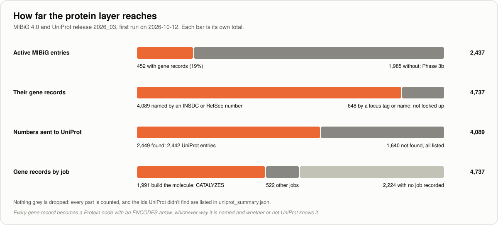

**Commit message:** `feat: add UniProt adapter and the protein layer`.
**Estimated time:** 5-7 hours.

---

## Stage 6b. Every cluster's proteins (Phase 3b)

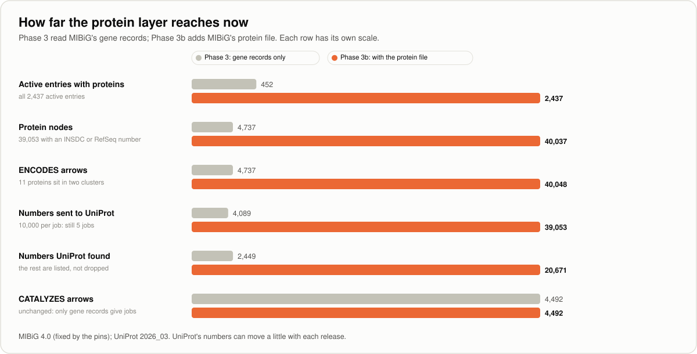

**What.** Follow [`05b-all-cluster-proteins.md`](05b-all-cluster-proteins.md).
MIBiG's own download server publishes every protein of every cluster in one file,
`mibig_prot_seqs_4.0.fasta` (30.4 MB, in the FASTA format). You look at it first,
with a small capture script, the way Stage 6 looked at the JSON. The file has no
published checksum, so it's pinned by a SHA-256 measured on its first download.
Then the MIBiG adapter reads it: every protein of every active entry becomes a
`Protein` node with an `ENCODES` arrow, the curators' removals are left out and
listed, and each gene record is matched to its protein in the file. The protein
numbers, about 39,000 now, go through the same UniProt adapter, 10,000 per job.

```bash
python tests/fixtures/capture_mibig_protein_samples.py    # look at the real file first
python -m microbegraph.fetch --probe --source mibig        # both files, nothing downloaded
python -m microbegraph.fetch --source mibig                # downloads the protein file, rebuilds the tables
python -m microbegraph.fetch --source uniprot              # 39,053 numbers, 5 jobs
pytest                                                     # 213 promises, checked
```

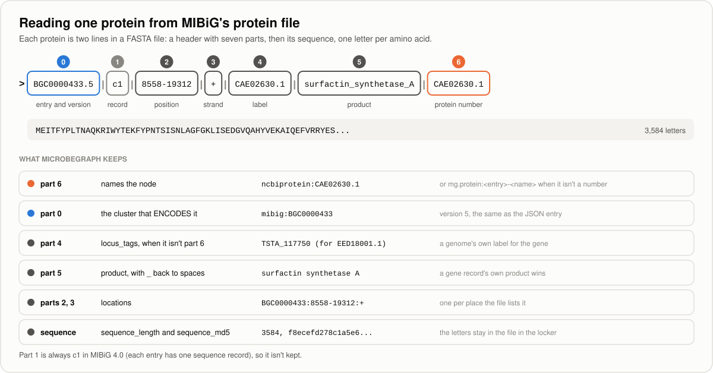

**Why.** A graph where four clusters in five have no proteins can't answer "which
enzymes do these clusters share?" fairly. The analytics in Stage 8 count and
label the proteins, and the machine learning in Stage 10 leans on them, so the
layer is complete before them. The stage also teaches how to trust a file nobody gave you a
fingerprint for, and how to line up two lists that name the same things
differently without guessing.

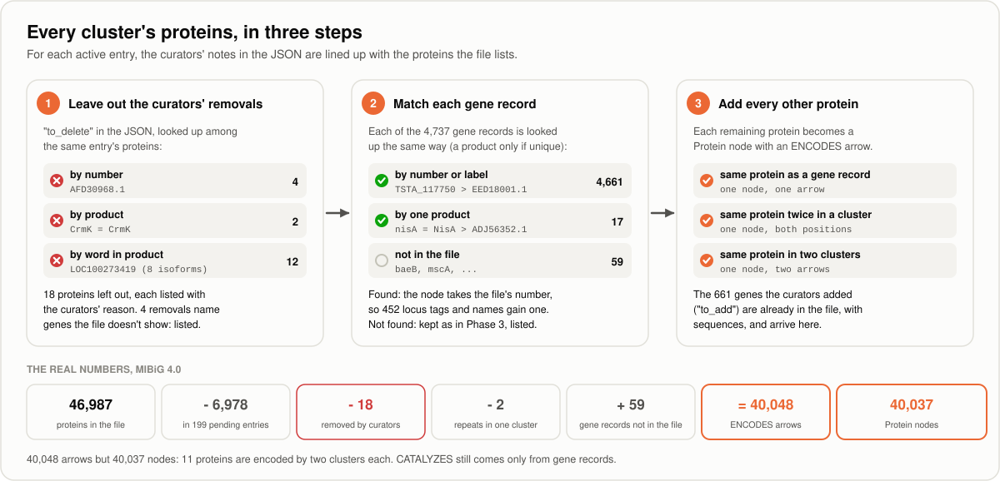

**New ideas in this stage:** protein sequences and the FASTA format; isoforms;
pending entries; pinning a file by your own fingerprint; checking a remote file
by its headers; curators' corrections (`to_add`, `to_delete`); matching names
without guessing; keeping a fingerprint instead of the data; ID mapping at scale.

**Open:** [`05b-all-cluster-proteins.md`](05b-all-cluster-proteins.md);
[`tests/fixtures/README.md`](../tests/fixtures/README.md) for the protein file
sample.
**Checkpoint:** `pytest` passes; `data/raw/mibig/` holds the protein file, its
SHA-256 matching the pinned one; every active entry has `ENCODES` arrows;
`mibig_summary.json` lists every removal and every gene record the file doesn't
name; a new UniProt snapshot is in `data/raw/uniprot/`; the **Actions** tab is
green.
**What you should get:** on the first run (2026-10-12), the file held 46,987
proteins, 40,009 of them in the 2,437 active entries (the rest belong to 199
pending entries). After 18 removals by MIBiG's curators, MIBiG's tables hold
40,037 `Protein` nodes and 40,048 `ENCODES` arrows (from 4,737 each), and 452
gene records named only by a locus tag or gene name gained a protein number.
`CATALYZES` stays at 4,492. UniProt (release `2026_03`) found 20,671 of the
39,053 numbers asked about, giving 20,507 entries, 2,692 of them reviewed; the
18,382 it didn't find are listed. The MIBiG counts are fixed by the two pins;
UniProt's may move a little with each release. The sanity checks are in
[`05b-all-cluster-proteins.md`, Step 8](05b-all-cluster-proteins.md#12-step-8-run-it-for-real).
**Commit message:** `feat: add every cluster's proteins from MIBiG's protein file`.
**Estimated time:** 4-5 hours.

---

## Stage 7. Entity resolution and the graph build (Phase 4)

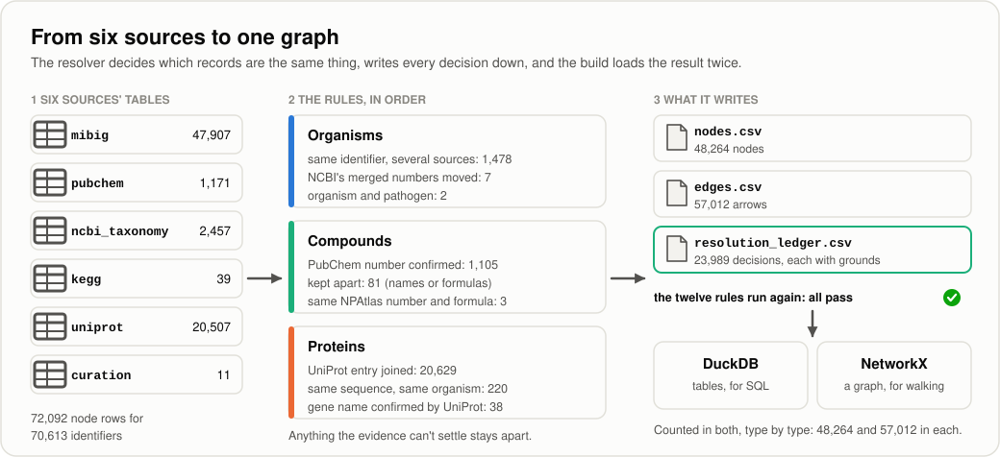

**What.** Follow [`06-entity-resolution-graph-build.md`](06-entity-resolution-graph-build.md).
Until now each source has had its own tables, and several of their records
describe the same real thing: MIBiG's "erythromycin A" and PubChem's compound
12560, MIBiG's protein number CAE02630.1 and UniProt's entry Q70KJ7. You look at
the real tables first with a survey, then build a **resolver** that decides which
records are the same thing, joins them into one node each, re-points every arrow
and writes every decision into a **resolution ledger** with its grounds. The
twelve rules run on the merged tables, and nothing is written if any fails.
Then the **graph build** loads the result into DuckDB, a database in one file,
with the ontology as database rules, and rebuilds the same facts as a NetworkX
graph, checking that the two agree type by type. On the way, the rulebook gains
one idea: a Pathogen is a kind of Organism, so an organism that also causes a crop
disease is one node.

```bash
python tests/fixtures/capture_resolution_samples.py --survey   # look at the real tables first
python -m microbegraph.fetch --tidy-only --source ncbi_taxonomy # pathogens join the family tree
python -m microbegraph.resolve                                  # six sources -> one graph + ledger
python -m microbegraph.build_graph                              # DuckDB + NetworkX, compared
python -m microbegraph.query --recipe 9                         # microbe -> crop, weakest link named
pytest                                                          # 296 promises, every recipe included
```

Nothing in this stage downloads anything.

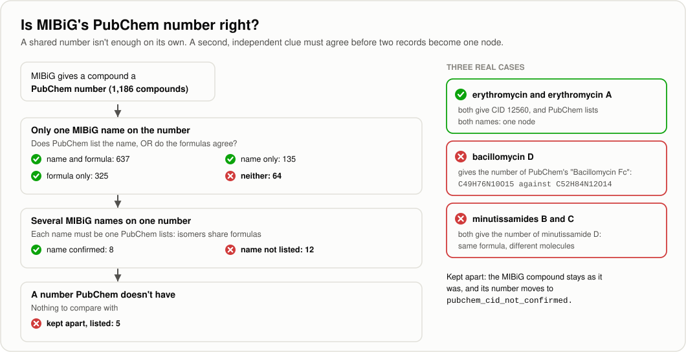

**Why.** This step decides whether you end up with a graph you can trust or one
that looks fine while being quietly wrong. A wrong merge does more harm than a
missed one, so every rule needs evidence beyond a shared number or a shared name,
and what the evidence can't settle stays apart, listed. The survey is why: 34 of
MIBiG's PubChem numbers that PubChem knows give a different formula, mostly
because the number belongs to another molecule (MIBiG's "bacillomycin D" carries
the number of PubChem's "Bacillomycin Fc"), and isomers share numbers and
formulas (minutissamides B and C both carry minutissamide D's). Joining on the
number alone would have moved the cited claim that bacillomycin D inhibits
*Fusarium graminearum* onto a different molecule.

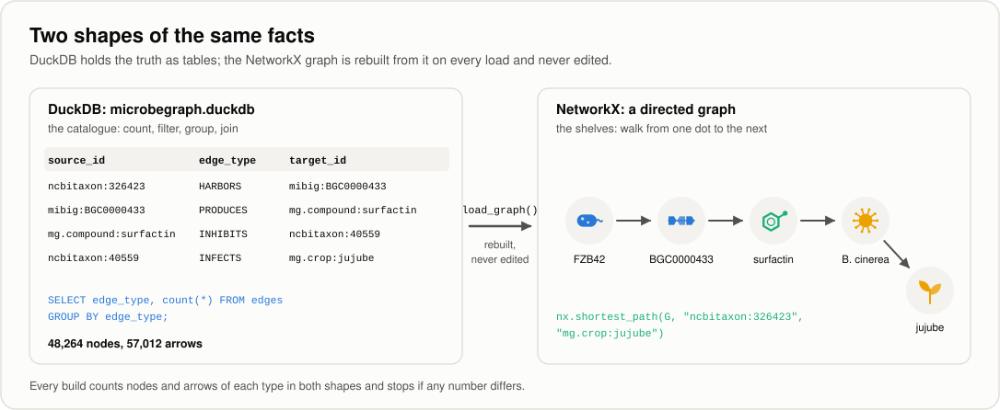

**New ideas in this stage:** entity resolution; a second, independent clue;
molecular formulas and isomers; name keys; union-find; a naming identifier and
aliases; a subtype in an ontology; databases, SQL, primary and foreign keys,
CHECK constraints and views; one source of truth; building into a temporary file;
asking the database questions with tested recipes.

**Open:** [`06-entity-resolution-graph-build.md`](06-entity-resolution-graph-build.md);
[`QUERY_COOKBOOK.md`](QUERY_COOKBOOK.md) for the 19 SQL and 5 graph recipes (22 SQL
recipes since Stage 7b, 24 since Stage 7c, 25 SQL and 9 graph recipes since Stage 8); the rules in [`02-ontology-and-data-model.md`, section 9](02-ontology-and-data-model.md#9-validation-rules-the-loader-enforces);
[`tests/fixtures/README.md`](../tests/fixtures/README.md) for the real slice the
tests use.
**Checkpoint:** `pytest` passes; `python -m microbegraph.build_graph` ends with
`every count matches`; recipe R9 shows surfactin against grey mould on jujube;
you can find in the ledger why bacillomycin D wasn't joined to PubChem; the
**Actions** tab is green.
**What you should get:** on the first run (2026-10-12), 70,613 identifiers from
the six sources became 48,264 nodes (3,836 compounds, 39,379 proteins, 2,451
organisms, 6 pathogens and the rest), and 57,111 arrows became 57,012 (96
combined, 3 dropped with entries nothing was joined to). The ledger has 23,989
rows: 1,105 PubChem numbers confirmed (325 of them by the formula alone, which
Stage 7b checks again) and 81 refused, 20,629 protein numbers
joined to UniProt and 42 left with tied entries, 220 identical sequences joined,
38 gene records joined through UniProt's gene names, 7 old organism numbers moved
and 347 entries left out. The sanity checks are in
[`06-entity-resolution-graph-build.md`, Step 10](06-entity-resolution-graph-build.md#14-step-10-run-it-for-real).
**Commit message:** `feat: add entity resolution, resolution ledger, and graph build`.
**Estimated time:** 10-12 hours.

---

## Stage 7b. Closing the gaps (Phase 4b)

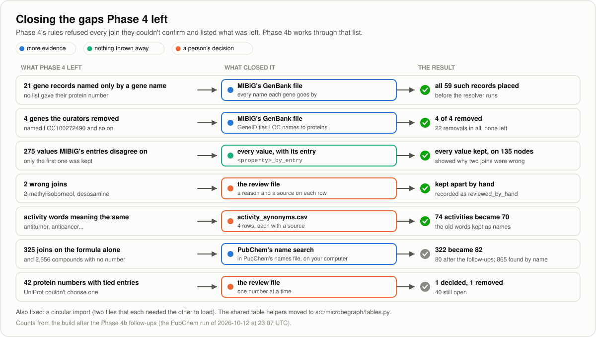

**What.** Follow [`06b-closing-the-gaps.md`](06b-closing-the-gaps.md). Stage 7's
rules refused every join they couldn't confirm and listed what they left over.
This stage works through that list. MIBiG's **GenBank file**
(`mibig_gbk_4.0.tar.gz`, 79.8 MB, pinned by its own fingerprint like the protein
file) lists every name a gene goes by next to its protein's number, which places
the last gene records and the curators' removals no list named. When two MIBiG
entries describe one compound differently, the node now keeps **every value with
the entry that gave it**, which showed why two of Stage 7's joins were wrong.
PubChem is asked in **three rounds**, with a **name search** in the middle,
done in **PubChem's names file** (931 MB, downloaded once) because PubChem
refuses a computer after about 400 name searches on the web. A compound is
then judged on four clues instead of two. A **review file**
(`curation/resolution_decisions.csv`) holds decisions a person made, each with a
reason and a source, and a short list folds **activity words** that mean the
same thing. A small structural fault, a circular import, is fixed on the way.

```bash
python tests/fixtures/capture_gap_samples.py     # look first (optional on a rebuild, Step 2)
python -m microbegraph.fetch --source mibig      # downloads only the GenBank file
python -m microbegraph.fetch --source pubchem    # three rounds and a 931 MB download
python -m microbegraph.fetch --tidy-only --source kegg --source curation
python -m microbegraph.resolve                   # now with the two curated files
python -m microbegraph.build_graph               # every count must match
python -m microbegraph.query --recipe 20         # the decisions a person made
pytest                                           # 361 promises
```

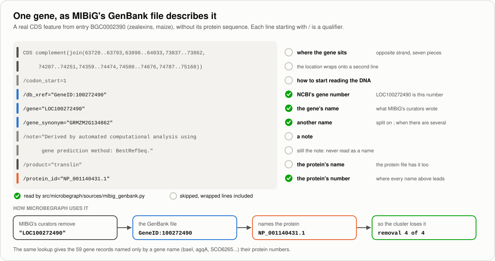

**Why.** Refusing to guess leaves a queue, and a queue needs a way to be worked.
Some gaps close with more evidence from sources the project already uses; the
rest need a person's judgement, and the graph needs a proper, visible place for
it, in the ledger beside the rules' own decisions. A decision by hand always
wins over a rule, and the ledger says which is which, so anyone can check it.

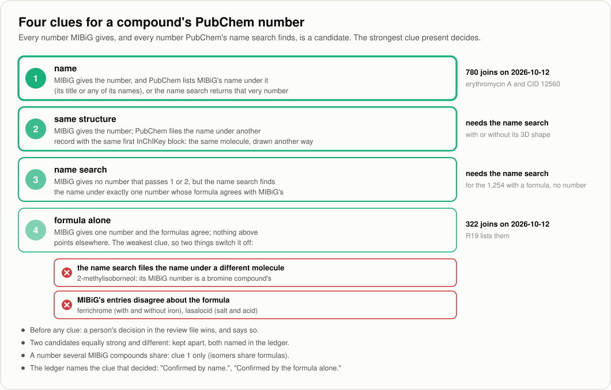

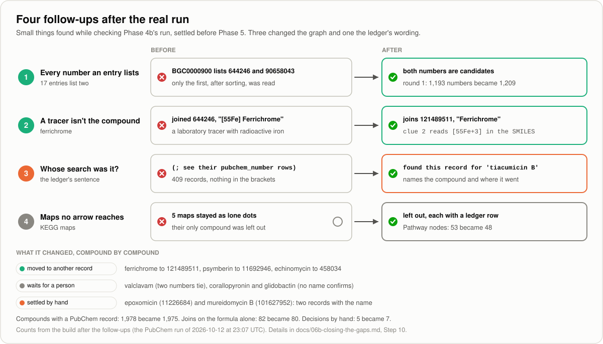

**After the run: four follow-ups.** Checking the real run turned up four small
things, settled before Stage 8. MIBiG entries that list two PubChem numbers for
one compound now have both judged (17 of them), a record built with
radioactive iron no longer counts as ferrichrome itself, the ledger names whose
name search found a record nobody joined, and KEGG maps left with no arrow
leave the graph with a ledger row. Two ties the first change revealed,
epoxomicin and mureidomycin B, are settled in the review file.
[Step 10's last part](06b-closing-the-gaps.md#the-follow-ups-after-the-run)
explains each one, with the five commands to run if you built this stage
before them.

**New ideas in this stage:** GenBank records, CDS features and qualifiers; gene
names, locus tags and NCBI gene numbers; stereochemistry, chiral centres and
the first block of an InChIKey; isotope-labelled tracers; keeping every value
with its source; rate limits, HTTP 429 and a resumable download; searching a
bulk download instead of asking a web service; human-in-the-loop review and
overrides; isolated nodes; circular imports.

**Open:** [`06b-closing-the-gaps.md`](06b-closing-the-gaps.md); recipes R19 to
R22 in [`QUERY_COOKBOOK.md`](QUERY_COOKBOOK.md#7-decisions-by-hand-and-disagreements-r20-to-r24);
[`curation/README.md`](../curation/README.md) for adding a row to either
curated file; [`interactive/resolution_cases.html`](interactive/resolution_cases.html)
for real cases, clue by clue, in your browser (the first seven are this
stage's).
**Checkpoint:** `pytest` passes; `mibig_summary.json` lists no gene record
without a protein number and no removal not found; recipe R20 lists the seven
decisions by hand; `build_graph` ends with `every count matches`; the
**Actions** tab is green.
**What you should get:** after the follow-ups (the PubChem run of 2026-10-12 at
23:07 UTC), PubChem knew 2,522 compounds: 1,204 of the 1,209 numbers asked
about, and 1,318 more its name search found (1,248 of 1,653 names found).
71,915 identifiers became 48,234 nodes (3,826 compounds, 39,354 proteins, 70
activities, 48 KEGG maps) and 57,105 arrows became 57,014. 1,975 of MIBiG's
3,842 compounds now share a node with a PubChem record (1,102 before the name
search), and only 80 joins still rest on the formula alone (322 before). The
GenBank file placed 59 gene records and 4 removals; 135 nodes keep the values
MIBiG's entries disagree on; the review file keeps 2-methylisoborneol and
desosamine apart from the records they were wrongly joined to, and settles two
ties; the ledger has 25,775 rows. The sanity checks against Stage 7 are in
[`06b-closing-the-gaps.md`, Step 10](06b-closing-the-gaps.md#14-step-10-run-it-for-real).
If PubChem refuses your computer, wait a few hours and run the same command:
the adapter says so in plain words, keeps what arrived, and nothing breaks.
Stage 7c's 3D check moves a few of these numbers (1,967 compounds with a
PubChem record afterwards, eight decisions by hand, ledger 25,789).
**Commit message:** `feat: close resolution gaps with GenBank, PubChem names and a review file`.
**Estimated time:** 6-8 hours, plus one unattended PubChem run, mostly the 931 MB download.

---

## Stage 7c. The 3D check of same-structure joins (Phase 4c)

![Echinomycin's two PubChem records share a skeleton but differ at 2 of the 8 chiral centres both describe, the two alanines; MIBiG's own structure matches CID 458034, but the literature gives L-alanine as in CID 6857732, so a decision by hand joins that record. For each of the 183 pairs clue 2 looks at, the resolver compares the 3D detail: 118 agree, and for the 65 that differ MIBiG's own structure keeps the number (38), moves the compound to the record PubChem names (17) or can't decide (10, leaving 9 compounds for a person)](img/three_d_check.svg)

**What.** Follow [`06c-checking-3d-detail.md`](06c-checking-3d-detail.md).
Stage 7b's second clue confirms the PubChem number MIBiG gives when PubChem
files MIBiG's name under another record whose InChIKey starts alike, which
means the same atoms connected the same way. That says nothing about how the
atoms sit in space, and in 137 of its 180 joins the two records describe that
differently. This stage
installs **RDKit**, a free chemistry library, and adds a module,
`resolution/stereo.py`, that compares two drawings **place by place**: every
**chiral centre** (named R or S) and every **double bond** (E or Z) both
describe. Clue 2 now counts only when nothing differs. When the two records
differ, **MIBiG's own structure** (the SMILES in its entry) decides which one
is the compound; when it can't, neither record joins and the ledger asks a
person. Echinomycin, the compound that started the stage, is settled by hand:
MIBiG's structure matches the record its number points at, and a review in the
literature gives the other record's 3D detail.

```bash
pip install -r requirements.txt                 # RDKit 2025.9.3, about 30 MB
python tests/fixtures/survey_3d_detail.py       # look first: the pairs, compared two ways
python -m microbegraph.resolve                  # now with the 3D check
python -m microbegraph.build_graph              # every count must match
python -m microbegraph.query --recipe 24        # the compounds left for a person
pytest                                          # 398 promises
```

**Why.** Paths through the graph are only as good as its joins. A compound
joined to the wrong stereoisomer carries that molecule's synonyms, database
numbers and pathways under its own name, and nothing downstream would notice.
Nothing new is fetched for the check: MIBiG's SMILES have been in the staging
tables since Stage 4, and PubChem's since Stage 5.

**New ideas in this stage:** stereoisomers, enantiomers, diastereomers and
epimers; the CIP names R and S, and E and Z; how a SMILES writes 3D (`@`, `@@`,
`/`, `\`); tautomers; RDKit; comparing two descriptions where a blank agrees
with anything; symmetry and canonical numbering; a third witness, why its answer
can still be wrong, and handing a question to a person; pinning one package to
an exact version.

**Open:** [`06c-checking-3d-detail.md`](06c-checking-3d-detail.md); recipes R23
and R24 in [`QUERY_COOKBOOK.md`](QUERY_COOKBOOK.md#7-decisions-by-hand-and-disagreements-r20-to-r24);
the last three cases in [`interactive/resolution_cases.html`](interactive/resolution_cases.html)
(echinomycin, macbecin II and nocardicin A).
**Checkpoint:** `python -c "import rdkit; print(rdkit.__version__)"` prints
`2025.09.3`; `pytest` passes; the resolver prints three lines about the 3D
check; recipe R24 lists the compounds left for a person and R20 eight decisions
by hand; `build_graph` ends with `every count matches`; the **Actions** tab is
green.
**What you should get:** on the run of 2026-10-13, the check looked at 183
pairs (the 180 joins and 4 inside two ties, less echinomycin, now decided by
hand): 118 agree and 65 differ. MIBiG's own structure kept the number in 38,
moved 17 compounds to the record PubChem names (macbecin II among them) and
couldn't decide 10, which leaves 9 compounds without a PubChem record for a
person; kosinostatin's tie is settled on the way, and echinomycin joins
6857732. The graph keeps its 48,234 nodes and 57,014 arrows; 1,967 of MIBiG's
3,842 compounds have a PubChem record (1,975 before), and the ledger has 25,789
rows. The sanity checks are in
[`06c-checking-3d-detail.md`, Step 6](06c-checking-3d-detail.md#10-step-6-run-it-on-your-data).
**Commit message:** `feat: check the 3D detail of same-structure joins`.
**Estimated time:** 3-4 hours.

---

## Stage 8. Graph analytics (Phase 5)


**What.** Follow [`07-graph-analytics.md`](07-graph-analytics.md). Until now
every stage built the graph; this one asks it questions, with one new command,
`python -m microbegraph.analyze`. It walks back from any crop to candidate
microbes along a **typed route** (organism, cluster, compound, pathogen, crop),
ranks the **evidence paths** by their weakest arrow and then by how much an
experiment backs them, and lists the **single points of failure**: facts that
some lead rests on entirely, so that the lead would go if one were wrong (for
a few, a crop would have no lead left). It finds **hubs** (degree) and
**bridges** (betweenness on the production layer), and **communities** with
the Louvain method. Proteins get readable labels from MIBiG's GenBank file
(`genbank_gene`), and the results are CSV files and offline pages in
`data/processed/analytics/`, beside the database.

```bash
python tests/fixtures/survey_graph_shape.py               # look first: the shape of the graph
python -m microbegraph.fetch --tidy-only --source mibig   # keep each protein's GenBank gene name
python -m microbegraph.resolve                            # the same decisions as Stage 7c
python -m microbegraph.build_graph                        # every count must match
python -m microbegraph.analyze --paths jujube             # one crop, every arrow's evidence
python -m microbegraph.analyze                            # everything, files and pages
pytest                                                    # 439 promises
```

**Why.** This is where the graph starts answering. Every path comes with its
evidence chain, and the look at the data first (Step 2 of the guide) showed why
the questions need care: the shortest path from jujube to most microbes runs
through a general label such as "antibacterial", and on the whole graph the
labels also come out as the biggest "bridges". Choosing which arrows count is
part of the answer.

**Before you start:** Stage 7c ran the last check Stage 7b handed on, so every
same-structure join now agrees in 3D or is backed by MIBiG's own structure.
Nothing needs installing: NetworkX, plotly and pyvis have been in
`requirements.txt` since Stage 1.

**New ideas in this stage:** shortest paths and why they mislead in a
knowledge graph; typed routes (metapaths); ranking paths when their weakest
links tie; leads; degree, betweenness and centrality; the production layer;
single points of failure; communities, the Louvain method and modularity;
random seeds and reproducible results; results beside the database; pages that
work offline (pyvis, plotly).

**Open:** [`07-graph-analytics.md`](07-graph-analytics.md); recipes R25 and N6
to N9 in [`QUERY_COOKBOOK.md`](QUERY_COOKBOOK.md#9-the-same-facts-as-a-graph-networkx-recipes-n1-to-n9);
[`interactive/hubs_bridges_groups.html`](interactive/hubs_bridges_groups.html)
to try every measure on a small network, and
[`interactive/evidence_chain.html`](interactive/evidence_chain.html) if the
weakest-link idea is new.
**Checkpoint:** you can print a path from a crop back to candidate microbes,
with every arrow's evidence shown (`--paths jujube`); `pytest` passes;
`data/processed/analytics/` holds the full run's nine files and `crop_paths.html`
opens without an internet connection; the **Actions** tab is green.
**What you should get:** on the real data (the same downloads as Stage 7c), 10 paths and 9 leads to 5
crops, every weakest link `curated_literature`; *Bacillus velezensis* FZB42
carries 4 of the 9 leads, and without it jujube and maize would have none. The
busiest nodes are the labels antibacterial (936 arrows) and cytotoxic (627);
the production layer has 7,750 nodes, 6,733 arrows and 1,183 pieces, with
"*Streptomyces* sp.", *Allostigmatella aurantiaca* Sg a15 and carotenoid as
its top bridges; Louvain finds 63 communities without the proteins, modularity
0.778 (a randomly rewired copy of the same graph scores 0.700). 18,289 proteins
carry a GenBank gene name, 15,812 of them with none from MIBiG's curators, and
6,668 with none from UniProt either. The graph itself is unchanged: 48,234 nodes, 57,014 arrows,
ledger 25,789.
**Commit message:** `feat: add path finding, centrality, and community detection`.
**Estimated time:** 8-10 hours.

---

## Stage 9. Statistical validation in R (Phase 6)

**What.** Set up R ([`R-SETUP.md`](R-SETUP.md)), read the same DuckDB file from R,
re-compute the main results with `igraph` as an independent cross-check, and run
**permutation tests**, which ask whether the structure is stronger than in
thousands of randomly rewired versions of the graph.

**Before you start:** Stage 8 wrote `data/processed/analytics/node_measures.csv`
(every node's degree, its betweenness on the production layer and its
community) and `analytics_summary.json` (63 communities, modularity 0.778, and
the NetworkX version). Those are the Python results this stage checks from R.
Stage 8's survey also rewired one copy of the graph at random, and Louvain
scored 0.700 on it, so the permutation test has a real question to answer.

**Why.** Every network has hubs and clusters, even a random one, so "we found three
communities" means nothing until you compare it against a null model. Getting the
same answer from two different languages is a piece of evidence in its own right.

**Open:** `08-statistical-validation-r.md`, [`R-SETUP.md`](R-SETUP.md).
**Checkpoint:** Python and R agree on centrality, and the permutation results are
reported with their p-values. **Commit message:** `feat: add R null-model validation and igraph cross-check`.

---

## Stage 10. Graph machine learning (Phase 7)

**What.** Install the extras (`pip install -r requirements-ml.txt`), turn each node
into numbers (node2vec embeddings), and train a model that scores **missing**
arrows. The evaluation is the part to get right: proper negative sampling, a split
made *before* the embeddings (to avoid leakage), precision-recall, and a written
error analysis.

**Why.** The earlier phases describe what is already known, and this one suggests
where to look next. Because of that, every predicted arrow is stored as
`inferred`, drawn differently, and left out of evidence chains by default. Treat a
prediction as a reason to go and look, never as a finding.

**Open:** `09-graph-machine-learning.md`. **Checkpoint:** you have a ranked list of
candidate links and evaluation numbers you can defend.
**Commit message:** `feat: add node embeddings and link prediction with honest evaluation`.

---

## Stage 11. The Streamlit app (Phase 8), and 11b, the Shiny app (Phase 8b, optional)

**What.** Build a web app with four areas: **Explore** (filter by type, source,
evidence), **Trace** (evidence chains with every arrow's provenance), **Rank** (candidate
microbes for a pathogen), **Query** (a read-only SQL console, locked twice:
validated queries *and* a read-only connection). The optional 11b rebuilds the
core in R Shiny over the same database.

**Why.** In my view Streamlit is the quickest way to turn an analysis into something
a person can click on. The app reads small precomputed files, so it stays fast and
free to host.

**Open:** `10-app-streamlit.md`, `10b-app-shiny.md`.
**Checkpoint:** `streamlit run app/streamlit_app.py` serves all four areas locally.
**Commit messages:** `feat: add the Streamlit app with a read-only SQL console`;
`feat: add the Shiny frontend over the same database`.

---

## Stage 12. Deployment, GraphRAG and release 1.0 (Phase 9), and 12b, one container (Phase 9b, optional)

**What.** Deploy the app publicly for free and add the **GraphRAG** answer layer,
which walks the graph and then lets a language model phrase only those facts, with
citations (it hides itself when no API key is set). Then make the project easy to
pick up and put down: one-command setup scripts (`scripts/setup.sh` for macOS,
Linux and RHEL 8; `scripts/setup.ps1` for Windows), `docs/UNINSTALL.md`,
`docs/HOSTING.md`, `CONTRIBUTING.md`, `CITATION.cff`, and a versioned data release
of `nodes.csv` and `edges.csv` with its own DOI. The optional 12b packages the app
in one container image ([`CONTAINERS.md`](CONTAINERS.md), [`CONTAINERIZATION.md`](CONTAINERIZATION.md)).

**Why.** I don't consider a project finished while it only works on my own laptop.
Release 1.0 is meant to be complete, citable and public.

**Open:** `11-deployment-graphrag.md`, `11b-one-container.md`.
**Checkpoint:** the public link works, a fresh clone set up with the setup script
passes `check-setup.py` and `pytest`, and the v1.0.0 release page exists.
**Commit messages:** `feat: add the GraphRAG answer layer and deploy the app`;
then `chore: release v1.0.0` with
`git tag -a v1.0.0 -m "Release 1.0, the science"` and `--tags` (see Stage 2).

---

<a id="release-20-the-platform"></a>
# Release 2.0, the platform (Stages 13-16)

*The same system rebuilt on the tools a data team uses, each one introduced only
once the project has grown a need for it.*

---

## Stage 13. dbt: the ontology becomes tested SQL (Phase 10)

**What.** Move the transformations into **dbt** models, where the twelve rules
become dbt tests (`unique`, `relationships`, `accepted_values`, `not_null`).
**Why.** The rulebook turns into an actual `schema.yml` file that anyone who reads
SQL can follow, and dbt generates the lineage documentation for free.
**Open:** `12-dbt-transformations.md`. **Commit message:** `feat: move transformations into dbt with the ontology as tests`.

## Stage 14. PostgreSQL + Apache AGE + pgvector (Phase 11)

**What.** Add a server database that holds the graph (queried in Cypher through
AGE) and the GraphRAG embeddings (pgvector). DuckDB stays as the zero-setup local
option.
**Why.** PostgreSQL does three jobs here, and switching between local and server
comes down to a configuration change. Making that switch cleanly is the
portability skill this stage teaches.
**Open:** `13-postgres-age-pgvector.md`. **Commit message:** `feat: add PostgreSQL backend with Apache AGE and pgvector`.

## Stage 15. Airflow orchestration (Phase 12)

**What.** The whole pipeline becomes a scheduled Airflow DAG that runs monthly:
fetches in parallel, then resolve, build, dbt tests and artifact export, with
retries and alerts. A scheduled `--probe` notices when a source publishes a new
release. The container engine choices (Docker, Podman, or Prefect without
containers) are compared in [`CONTAINERS.md`](CONTAINERS.md).
**Why.** Five interdependent sources on a monthly refresh is exactly the kind of
problem Airflow was made for, and the exit codes from Phase 1 are how it tells
whether each step succeeded.
**Open:** `14-airflow-orchestration.md`. **Commit message:** `feat: orchestrate the pipeline with Airflow`.

## Stage 16. Snowflake portability and release 2.0 (Phase 13)

**What.** Point the same dbt models at a Snowflake trial warehouse, following
explicit steps to avoid costs, and document how to switch back to DuckDB.
**Why.** This stage shows one project running on two very different engines with
the same tests passing. At this size the warehouse itself is overkill, and the
guide says so.
**Open:** `15-snowflake-portability.md`.
**Commit messages:** `feat: add Snowflake as an alternative dbt target`; then
`chore: release v2.0.0` with `git tag -a v2.0.0 -m "Release 2.0, the platform"` and `--tags`.

---

<a id="release-30-the-product"></a>
# Release 3.0, the product (Stages 17-22)

*Turning a working system into something other people and other software can use.*

---

## Stage 17. FastAPI service layer (Phase 14)

**What.** Build a REST API for the core operations (paths, rankings, neighbourhoods,
validated read-only queries) with automatic interactive documentation, optional API
keys and rate limits for public use, structured logging, a health endpoint, and a
`SECURITY.md` saying how to report a problem.
**Why.** Streamlit, React and MCP all need the same logic. If it's written once,
behind an API, the three clients can't drift apart.
**Open:** `16-fastapi-service-layer.md`. **Commit message:** `feat: add the FastAPI service layer`.

## Stage 18. React + TypeScript frontend (Phase 15)

**What.** This is the public product: an interactive graph canvas, an
evidence-chain viewer and a ranking table, built against the API,
keyboard-accessible, and never using colour alone to show evidence.
**Why.** Streamlit remains the analyst's workbench, and the React app is the
polished version you share with other people. TypeScript's types act like
seatbelts, catching mistakes while you type.
**Open:** `17-react-frontend.md`. **Commit message:** `feat: add the React and TypeScript frontend`.

## Stage 19. MCP server (Phase 16)

**What.** Wrap the API in a Model Context Protocol server, so an AI assistant can
query the graph directly, read-only, with fixed, validated inputs.
**Why.** With the API already in place this is only a few hours of extra work. I
kept the scope narrow and read-only on purpose, and that restriction is the main
design decision of the stage.
**Open:** `18-mcp-server.md`. **Commit message:** `feat: add an MCP server over the graph`.

## Stage 20. Databricks: literature mining at scale (Phase 17)

**What.** A batch job reads thousands of abstracts and proposes candidate
compound → pathogen statements for **human review**; the accepted ones enter the
bridge with a citation at `curated_literature`. The guide also documents a local
Spark fallback.
**Why.** It goes after the same gap that the hand-curated bridge papers over. The
software only proposes, and a person decides what goes in. Of all the tools in the
plan this one has the weakest justification, so it's the first to cut if time is
short.
**Open:** `19-databricks-literature-mining.md`. **Commit message:** `feat: add literature mining with human review`.

## Stage 21. Containerize the whole application (Phase 18)

**What.** A single `compose.yaml` runs PostgreSQL, the API, Streamlit and React,
with health checks, named volumes, an internal network, secrets read at run time,
and a documented backup and restore of the database. It behaves identically under
Docker and Podman.
**Why.** Four cooperating services start with one command, even on a machine that
has no Python, R or PostgreSQL installed.
**Open:** `20-containerize-the-stack.md`, [`CONTAINERIZATION.md`](CONTAINERIZATION.md).
**Commit message:** `feat: containerize the full stack with compose`.

## Stage 22. Published images, CD and release 3.0 (Phase 19)

**What.** The tests have been running on every push since Phase 1, and this stage
adds **continuous delivery**: multi-platform images built and published to the GitHub
Container Registry, image vulnerability scanning, automatic dependency update
proposals, and release notes generated from the changelog.
**Why.** Once it's done, anyone can run the application with a single `docker run`
(or `podman run`), without cloning the repository or installing Python.
**Open:** `21-cicd-packaging.md`.
**Commit messages:** `ci: publish multi-platform images and automate releases`; then
`chore: release v3.0.0` with `git tag -a v3.0.0 -m "Release 3.0, the product"` and `--tags`.

---

## Stage 23. Running it as a product

**What.** A few habits keep a finished product alive: read the monthly refresh
results, upgrade a pinned source release only when you decide to (the MIBiG
procedure is in [`03-ingestion-mibig.md`, section 16](03-ingestion-mibig.md#16-upgrading-mibig-later),
and the releases already noticed are in
[`ROADMAP.md`, *Watching the sources*](ROADMAP.md#watching-the-sources)),
answer issues, keep the changelog, cut patch releases for fixes, and review the
product checklist in [`ROADMAP.md`](ROADMAP.md#what-finished-means-the-product-checklist),
which lists every piece of a finished product and the phase that delivers it.

**Why.** Software that nobody maintains decays as sources move, packages change and
links break. A small, regular routine costs far less than a rescue later on.

---

## Every session, after setup

macOS, Linux and RHEL 8:

```bash
cd ~/projects/microbegraph                    # or wherever you cloned it
source .venv/bin/activate
git switch develop
git pull --ff-only origin develop
python check-setup.py                         # quick health check
# ... work on the current stage ...
pytest && ruff check .
```

Windows PowerShell:

```powershell
cd $HOME\projects\microbegraph                 # or wherever you cloned it
.\.venv\Scripts\Activate.ps1
git switch develop
git pull --ff-only origin develop
python check-setup.py
# ... work on the current stage ...
pytest; ruff check .
```

When a stage (or a small tested change) is complete, finish with the end-of-phase
ritual from [Stage 2](#stage-2-version-control-and-the-end-of-phase-ritual).

---

## When something goes wrong

| Symptom | Look in |
|---|---|
| A command is "not found" | [`01-setup.md`](01-setup.md), Troubleshooting T1 and T3; is `.venv` active? |
| `ModuleNotFoundError: microbegraph` | [`03-ingestion-mibig.md`, section 17](03-ingestion-mibig.md#17-what-could-go-wrong). If `pip install -e .` itself prints it, `src/microbegraph/__init__.py` is missing; otherwise run `pip install -e .` |
| `pip` fails with compiler errors | [`01-setup.md`, T11](01-setup.md#t11-pip-fails-to-build-a-package-with-c-compiler-errors) (usually a too-new Python) |
| Behind a company proxy or firewall | [`01-setup.md`, T12](01-setup.md#t12-corporate-proxy--firewall-blocks-pip) |
| A download fails or a checksum does not match | [`03-ingestion-mibig.md`, section 17](03-ingestion-mibig.md#17-what-could-go-wrong) |
| "... is missing, and ... builds on it" | A source ran before the one it needs; [`04-more-sources-secrets.md`, section 17](04-more-sources-secrets.md#17-what-could-go-wrong) |
| PubChem, NCBI or KEGG refuses, is busy, or sends something odd | [`04-more-sources-secrets.md`, section 17](04-more-sources-secrets.md#17-what-could-go-wrong) |
| The probe says `API key : not set` although you made `.env` | [`04-more-sources-secrets.md`, Step 3](04-more-sources-secrets.md#7-step-3-your-first-api-key-optional) |
| A key was published by mistake | Replace it at the service first: [`04-more-sources-secrets.md`, Step 3](04-more-sources-secrets.md#7-step-3-your-first-api-key-optional) |
| The bridge refuses a row ("check ...") | [`curation/README.md`](../curation/README.md); the check numbers are in [`04-more-sources-secrets.md`, Step 8](04-more-sources-secrets.md#12-step-8-the-curated-bridge) |
| UniProt: "no proteins with an INSDC or RefSeq id", a job that fails or never finishes, an identifier type that disappeared | [`05-proteomics-uniprot.md`, section 15](05-proteomics-uniprot.md#15-what-could-go-wrong) |
| MIBiG's protein file: "not in the evidence locker yet", a SHA-256 that doesn't match the pinned one, a probe warning about its size, a header in another shape | [`05b-all-cluster-proteins.md`, section 16](05b-all-cluster-proteins.md#16-what-could-go-wrong) |
| The resolver or the build refuses ("break the rulebook", "open in another program", "DuckDB refused", "disagree") | [`06-entity-resolution-graph-build.md`, section 18](06-entity-resolution-graph-build.md#18-what-could-go-wrong) |
| MIBiG's GenBank file is "not in the evidence locker yet", or its SHA-256 or size differs from the pinned one | [`06b-closing-the-gaps.md`, section 18](06b-closing-the-gaps.md#18-what-could-go-wrong) |
| PubChem "is refusing requests from this computer for now (HTTP 429 ...)", "stopped answering after N of M names" or "stopped answering in round 3" | Wait a few hours, then run the same command; what arrived is kept. [`06b-closing-the-gaps.md`, section 18](06b-closing-the-gaps.md#18-what-could-go-wrong) |
| PubChem's names file: no space left while it downloads, "isn't a number, a tab and a name", or an "unfinished fetch folder" warning after a fetch you stopped by hand | [`06b-closing-the-gaps.md`, section 18](06b-closing-the-gaps.md#18-what-could-go-wrong) |
| The resolver says `... 5 of them maps no arrow reaches`, or the PubChem fetch searches the names file again although it hasn't changed | Both are expected; [`06b-closing-the-gaps.md`, section 18](06b-closing-the-gaps.md#18-what-could-go-wrong) says why |
| `No module named 'rdkit'`, pip can't find `rdkit==2025.9.3`, or `[FAIL]  package: rdkit` | [`06c-checking-3d-detail.md`, section 15](06c-checking-3d-detail.md#15-what-could-go-wrong) (usually `.venv` not active, or a Python outside 3.11 to 3.13) |
| The resolver's 3D check prints other numbers than Stage 7c, says some pairs "couldn't be compared in 3D", or a compound lost its PubChem record | [`06c-checking-3d-detail.md`, section 15](06c-checking-3d-detail.md#15-what-could-go-wrong); recipe R24 lists the compounds left for a person |
| The review file or the activity synonyms are refused ("has N problem(s)", "names records the graph doesn't have", "can't be joined") | [`curation/README.md`](../curation/README.md); [`06b-closing-the-gaps.md`, section 18](06b-closing-the-gaps.md#18-what-could-go-wrong) |
| A query fails, finds nothing, or says the database doesn't exist | [`QUERY_COOKBOOK.md`, section 11](QUERY_COOKBOOK.md#11-what-could-go-wrong) |
| `analyze` says "There's no crop called ...", "N nodes are called ...", or the database doesn't exist | [`07-graph-analytics.md`, section 16](07-graph-analytics.md#16-what-could-go-wrong) |
| Your communities or modularity differ from Stage 8, a page opens blank, or `hubs_and_bridges.html` shows no chart | [`07-graph-analytics.md`, section 16](07-graph-analytics.md#16-what-could-go-wrong) (another NetworkX version; a page copied without `plotly.min.js`) |
| Recipe R25 says `Referenced column "genbank_gene" not found`, or the survey still says `none yet` after the MIBiG tidy | The database or the staging table predates Stage 8: [`07-graph-analytics.md`, section 16](07-graph-analytics.md#16-what-could-go-wrong) |
| Why two records were (or weren't) joined | The ledger: [`QUERY_COOKBOOK.md`, recipes R5 to R8](QUERY_COOKBOOK.md#4-following-the-resolvers-decisions-r5-to-r8), R20 for decisions made by hand, and R23 and R24 for the 3D check |
| The probe names a newer MIBiG release | Expected; [`ROADMAP.md`, *Watching the sources*](ROADMAP.md#watching-the-sources) says what the plan does about it |
| A test fails | The test's name says which promise broke; the phase guide's *What could go wrong* table |
| `$'\r': command not found` from the safety gate (Windows) | [`01-setup.md`, T14](01-setup.md#t14-bash-check-public-safesh-fails-with-r-command-not-found-windows) |
| The Actions tab shows no run after a push | [`03-ingestion-mibig.md`, *Starting a run by hand*](03-ingestion-mibig.md#starting-a-run-by-hand) |
| A run lists yellow warnings about Node.js or an action version | [`03-ingestion-mibig.md`, *Keeping the workflow current*](03-ingestion-mibig.md#keeping-the-workflow-current) |
| The Actions tab is red but your laptop is green | Click the red run, read the failing step; [`03-ingestion-mibig.md`, section 13](03-ingestion-mibig.md#13-step-9-continuous-integration-tests-on-four-systems) |
| Push refused about a "workflow" | [`01-setup.md`, T13](01-setup.md#t13-push-refused-refusing-to-allow-a-personal-access-token-to-create-or-update-workflow) |
| Push rejected, or `--ff-only` refuses | [`GIT-WORKFLOW.md`, section 9](GIT-WORKFLOW.md#9-when-something-goes-wrong) |
| The safety gate says NOT SAFE | [`GIT-WORKFLOW.md`, section 9](GIT-WORKFLOW.md#the-safety-gate-says-not-safe) |
| A word you don't know | [`GLOSSARY.md`](GLOSSARY.md) |
| Why a design choice was made | [`00-architecture.md`](00-architecture.md), *Design decisions*; each phase guide's reasoning |
| A figure looks wrong or out of date | `python docs/img/make_illustrations.py` and `python docs/interactive/make_interactive.py` |
| R does not find the database | [`R-SETUP.md`](R-SETUP.md) |
| Containers misbehave | [`CONTAINERS.md`](CONTAINERS.md), [`CONTAINERIZATION.md`](CONTAINERIZATION.md) |

---

## Where everything lives: the document map

| Document | What it is for | Read it |
|---|---|---|
| [`README.md`](../README.md) | The front page: what, why, results, how to run | Stage 0 |
| **[`HANDBOOK.md`](HANDBOOK.md)** | **This document: the whole journey, in order** | **First, and whenever unsure** |
| [`00-architecture.md`](00-architecture.md) | Every layer of the system and why it exists | Stage 0 |
| [`01-setup.md`](01-setup.md) | Blank computer to working workshop, three operating systems | Stage 1 |
| [`02-ontology-and-data-model.md`](02-ontology-and-data-model.md) | The rulebook: nodes, edges, identifiers, evidence, twelve rules | Stage 3 |
| [`03-ingestion-mibig.md`](03-ingestion-mibig.md) | Phase 1: the evidence locker, provenance, tests, CI | Stage 4 |
| [`04-more-sources-secrets.md`](04-more-sources-secrets.md) | Phase 2: web APIs, snapshots, the first API key, licences, the curated bridge | Stage 5 |
| [`05-proteomics-uniprot.md`](05-proteomics-uniprot.md) | Phase 3: genes, proteins and enzymes, MIBiG's gene records, UniProt's ID mapping, what didn't match | Stage 6 |
| [`05b-all-cluster-proteins.md`](05b-all-cluster-proteins.md) | Phase 3b: the FASTA format, pinning a file by your own fingerprint, curators' corrections, matching names without guessing, ID mapping at scale | Stage 6b |
| [`06-entity-resolution-graph-build.md`](06-entity-resolution-graph-build.md) | Phase 4: entity resolution, the ledger, a Pathogen as a kind of Organism, DuckDB and NetworkX | Stage 7 |
| [`QUERY_COOKBOOK.md`](QUERY_COOKBOOK.md) | Tested recipes for asking the database questions, SQL in ten minutes, and graph recipes in Python | Stage 7, and whenever you have a question for the graph |
| [`06b-closing-the-gaps.md`](06b-closing-the-gaps.md) | Phase 4b: GenBank records, keeping every value with its source, PubChem's name search and its rate limits, four clues for a compound, decisions by hand, and the follow-ups after the real run | Stage 7b |
| [`06c-checking-3d-detail.md`](06c-checking-3d-detail.md) | Phase 4c: stereoisomers, how a SMILES writes 3D, R/S and E/Z, RDKit, comparing two drawings place by place, and a third witness when two sources disagree | Stage 7c |
| [`07-graph-analytics.md`](07-graph-analytics.md) | Phase 5: typed routes and evidence paths, ranking leads, degree and betweenness, single points of failure, Louvain communities and modularity, offline pages with pyvis and plotly | Stage 8 |
| `08-...` to `21-...` | One guide per later phase | As each stage arrives |
| [`curation/README.md`](../curation/README.md) | The three hand-written files (the bridge, the review file and the activity synonyms): their columns, the confidence scale, how to add a row | Stages 5 and 7b, and whenever you add a finding or a decision |
| [`tests/fixtures/README.md`](../tests/fixtures/README.md) | Where every test record came from, with fingerprints, and the scripts that look at the real data before each phase | Stages 5-8, and when a source changes its format |
| [`ROADMAP.md`](ROADMAP.md) | The plan, the reasons for every tool, the product checklist, the source changes being watched | Stage 0, per release, and when a probe names something new |
| [`GIT-WORKFLOW.md`](GIT-WORKFLOW.md) | Commit messages, the branch flow, fixing git mistakes | Stage 2, and when stuck |
| [`PRIOR-ART.md`](PRIOR-ART.md) | Related work and what this project does not claim | Stage 0 |
| [`R-SETUP.md`](R-SETUP.md) | R, RStudio and renv beside Python | Stage 9 |
| [`CONTAINERS.md`](CONTAINERS.md) | Docker vs Podman vs Prefect | Stages 12b, 15 |
| [`CONTAINERIZATION.md`](CONTAINERIZATION.md) | The whole application in containers, from zero | Stages 12b, 21 |
| [`GLOSSARY.md`](GLOSSARY.md) | Every term, explained for a beginner | Always open |
| [`phases.csv`](phases.csv) | The plan as data: hours and status per phase | When updating status |
| [`CHANGELOG.md`](../CHANGELOG.md) | What changed in each version | Each release |
| [`img/`](img/) and [`interactive/`](interactive/) | The diagrams and open-in-browser explorers (the journey, the ontology, an evidence chain, real resolution cases clue by clue, and hubs, bridges and groups on a small network), plus the scripts that make them | Throughout |

---

## How this handbook is maintained

This handbook is a living document, and it's the first thing I update when the
project changes. If it ever falls behind the code, **treat that as a bug**.

**At the end of every phase**, do the following in this order, as part of the same
commit as the phase itself:

1. Flip the stage's status mark here (✅ for the finished stage, ⏳ for the next)
   and replace the estimated time with the measured one.
2. Link the phase guide that now exists, in the stage, the journey table and the
   document map.
3. Update the version, date and "repository state" line at the top, and add a line
   to the change log below.
4. Set the phase's `status` to `done` in [`phases.csv`](phases.csv) (edit it in VS
   Code, not a spreadsheet program, which may re-save it in another format) and re-run
   `python docs/img/make_illustrations.py` and `python docs/interactive/make_interactive.py`.
5. Make the same status change in the README build log and in
   [`ROADMAP.md`](ROADMAP.md).
6. Add the phase to [`CHANGELOG.md`](../CHANGELOG.md).

**Between phases**, when a small change is tested and committed (a fix, a renamed
command, a new troubleshooting answer), update every place in this handbook that
mentions it in that same commit, and add a change-log line.

### Handbook change log

| Version | Date | Change |
|---|---|---|
| 1.11 | 2026-10-18 | Phase 5 built and run: Stage 8 rewritten around the new guide, with two new pictures (the three questions, and what each crop's leads rest on) and a new interactive page (hubs, bridges and groups on a small made-up network). A new command, `python -m microbegraph.analyze`, ranks evidence paths along the typed route, lists single points of failure, finds hubs, bridges on the production layer and Louvain communities, and writes CSV files and offline pages to `data/processed/analytics/`. Proteins carry their GenBank gene name as `genbank_gene` (15,812 had none from MIBiG), shown in labels and never used by the resolver. On the real data: 10 paths and 9 leads to 5 crops, FZB42 behind 4 of them; 63 communities, modularity 0.778 (0.700 on a rewired copy); the graph unchanged (439 tests). Stage 9 starts from `node_measures.csv`; three troubleshooting rows for the analytics; the document map lists the Phase 5 guide; the cookbook has 25 SQL and 9 graph recipes, and its last three sections are renumbered (the graph recipes are section 9, *What could go wrong* section 11); the logo's two words no longer touch |
| 1.10 | 2026-10-13 | Phase 4c built and run: Stage 7c added, with a new picture (the eight centres echinomycin's two records both describe, and what the resolver does with each pair). Clue 2 now compares the two records' chiral centres and double bonds with RDKit, pinned to 2025.9.3 because newer versions have no Intel-Mac install, and counts only when they agree; when they differ, MIBiG's own structure decides. On the real data: 183 pairs, 118 agree, 65 differ; 38 keep MIBiG's number, 17 move to the record PubChem names, 9 compounds wait for a person, kosinostatin's tie is settled, and echinomycin is settled by hand against the literature (1,967 compounds with a PubChem record, eight decisions by hand, ledger 25,789, 398 tests). Stage 8's "before you start" now points at the finished check; Stage 7b notes which of its numbers Stage 7c moves; two troubleshooting rows for RDKit and the 3D check; the document map lists the Phase 4c guide; the resolution cases page has ten cases; the cookbook has 24 SQL recipes |
| 1.9 | 2026-10-13 | The four follow-ups from Stage 7b, run on the real data: every PubChem number a MIBiG entry lists is a candidate (17 entries list two; round 1 asks about 1,209 numbers, 54 requests in all); clue 2 no longer confirms a record built with an unusual isotope, so ferrichrome joins its own record instead of "[55Fe] Ferrichrome"; the ledger names whose name search found a record nobody joined; KEGG maps no arrow reaches are left out with a ledger row (53 maps became 48). Two ties the first change revealed are settled in the review file (epoxomicin, mureidomycin B), and three compounds now wait for a person (valclavam, corallopyronin, glidobactin). Stage 7b's numbers are the new real ones (48,234 nodes, 57,014 arrows, 1,975 MIBiG compounds with a PubChem record, 80 joins on the formula alone, ledger 25,775, 361 tests), with a new picture of the follow-ups; Stage 8 starts with one remaining check, same-structure joins with different 3D detail (137 of 180); a troubleshooting row for the maps line and the names file being searched again; the resolution cases page has a seventh case |
| 1.8 | 2026-10-12 | PubChem's name search ran, in PubChem's names file: the web name search was refused after 372 of 1,655 names, so the fetch now downloads `CID-Synonym-filtered.gz` (931 MB) once and searches it on your computer, and round 3 was answered in full on the fourth run that day. Stage 7b's numbers are the real ones now (48,239 nodes, 57,014 arrows, 1,978 MIBiG compounds with a PubChem record, 82 joins on the formula alone, 356 tests); the "still to run" step is gone; Stage 8 starts with the small follow-ups (ferrichrome's record, every PubChem number an entry lists, two small fixes); a troubleshooting row for the names file; the gaps picture, the four-clues picture and the resolution cases page show the real outcomes |
| 1.7 | 2026-10-12 | Phase 4b built and run: Stage 7b rewritten around the new guide, with three of the four new pictures (the gaps and what closed them, a GenBank feature part by part, and the four clues for a compound; the fourth, a decision by hand, is in the guide and `curation/README.md`) and a new interactive page of real resolution cases; Stage 8 is next, after one waiting step, PubChem's name search, which PubChem refused on the day (HTTP 429) and which is now the first thing to run before Stage 8; the survey before the code is marked optional on a rebuild and asks PubChem one name a second; new troubleshooting rows for the GenBank file, PubChem's refusals and the two curated files; the document map lists the Phase 4b guide and describes `curation/README.md` as covering all three hand-written files; the cookbook has 22 SQL recipes |
| 1.6 | 2026-10-12 | Phase 4 built and run: Stage 7 rewritten around the new guide and the query cookbook, with three new pictures (six sources to one graph, the PubChem number check, and DuckDB beside NetworkX); a survey of the real tables showed that MIBiG's PubChem numbers need a second clue (34 give another formula, and isomers share numbers), which shaped the compound rules; the rulebook gains "a Pathogen is a kind of Organism"; Stage 7b (closing the gaps, Phase 4b) is added to the plan and is next; Stage 8 points at the first version of the jujube question; new troubleshooting rows for the resolver, the build and queries; the document map lists the Phase 4 guide and the cookbook. A check of the guide against the code before release tightened four things: the resolver now refuses to write if an identifier disappears without a ledger row (36 did, through the identical-sequence rule, now fixed); the build compares DuckDB with NetworkX before swapping the database in; what an open database does to a build is described per operating system; and the 325 PubChem joins the formula alone confirmed are listed (cookbook R19) and added to Stage 7b |
| 1.5 | 2026-10-12 | Phase 3b built and run: Stage 6b rewritten around the new guide, with three new pictures (one protein record part by part, the three steps for each cluster, and the protein layer before and after); a survey of the real file showed it already includes the genes curators added but not their removals, and that its headers carry the locus tags and products that give 452 gene records a protein number; Stage 7 is next and lists what Stage 6b hands it; Stage 4 notes that the MIBiG fetch now brings two files; new troubleshooting rows for the protein file and for a newer MIBiG release; the document map lists the Phase 3b guide; Stage 23 points at the roadmap's watch list |
| 1.4 | 2026-10-12 | Phase 3 built and run: Stage 6 rewritten around the new guide, with two new pictures (the protein layer, and asking UniProt); a survey of the real data showed UniProt doesn't cross-reference MIBiG and only 452 entries have gene records, so Stage 6b (every cluster's proteins, Phase 3b) is added to the plan and is next; Stage 4 notes that the MIBiG tidy now prints more counts; Stage 7 notes how proteins are joined; a troubleshooting row for UniProt; the document map lists the Phase 3 guide |
| 1.3 | 2026-10-12 | Phase 2 built and run against the live services: Stage 5 rewritten around the new guide, with the first run's counts and two new pictures (the five sources, and where a key lives); the running example now ends at grey mould on jujube, the crop for which a paper tested surfactin; Stage 7 notes what Phase 2 hands to entity resolution; new troubleshooting rows for missing tables, API trouble, keys and bridge checks; the document map lists the Phase 2 guide, `curation/README.md` and `tests/fixtures/README.md` |
| 1.2 | 2026-10-11 | After Phase 1: the test workflow moved to version 7 of `actions/checkout` and `actions/setup-python`, each job now stops after 20 minutes, and the code checkout leaves no login behind. Stage 4 gains "Looking after the automatic tests" with a new picture of what a run does; the troubleshooting map covers a push that starts no run and the version warnings |
| 1.1 | 2026-10-11 | Corrections from the first full run of Phase 1 on a Phase 0 checkout. `src/microbegraph/__init__.py` is new in Phase 1, not carried over from Phase 0. The unused top-level `sources/` and `figures/` folders are removed with `git rm`. New troubleshooting entry for `ModuleNotFoundError` during `pip install -e .`. The Phase 1 guide's probe output is now a real run against Zenodo, with the archive size as the program prints it (9.5 MB). The real MIBiG 4.0 archive is not gzip-compressed despite its name, so archives are now read by their contents, and a fetch logs the file it filed even if it then can't open it. MIBiG 4.0 writes activity names in two styles; both are now read, curators' comments are kept on the compound as `activity_notes`, and the surfactin test record is a cut-down copy of the real one. The Phase 1 checkpoint now gives the expected counts |
| 1.0 | 2026-10-10 | First edition: Stages 0-4 complete (design, setup, rulebook, MIBiG ingestion); Stages 5-23 described from the roadmap; journey map, setup loop, branch model, ontology and evidence pictures added |
