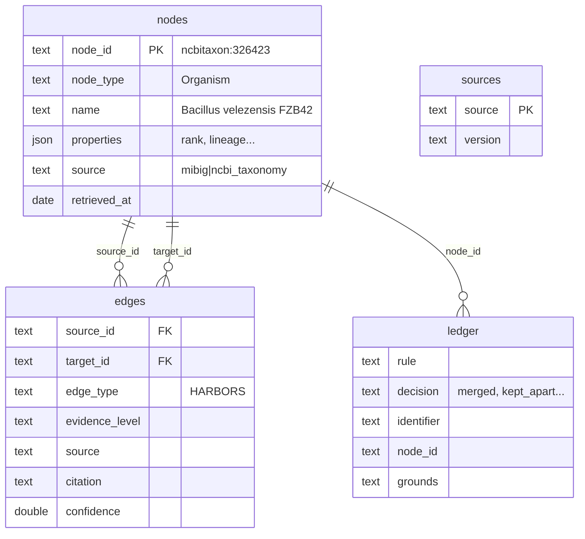

[← Handbook](HANDBOOK.md) · [README](../README.md) · [Glossary](GLOSSARY.md) · [Roadmap](ROADMAP.md) · [Phase 4 guide](06-entity-resolution-graph-build.md) · [Phase 4b guide](06b-closing-the-gaps.md)

# Query cookbook

Questions you can ask the MicrobeGraph database, each with a recipe that
answers it, the answer it gave on the real data, and an explanation of how the
recipe works.

**Prerequisites:** Phase 4 finished, so `data/processed/microbegraph.duckdb`
exists ([`06-entity-resolution-graph-build.md`](06-entity-resolution-graph-build.md#14-step-10-run-it-for-real),
Step 10). No SQL knowledge is needed: section 2 teaches the little you need, and
each recipe explains its own new piece.

**What's here:** 22 SQL recipes (R1 to R22) and 5 graph recipes in Python
(N1 to N5). R20 to R22 arrived with Phase 4b
([`06b-closing-the-gaps.md`](06b-closing-the-gaps.md)). Recipes in Cypher, the query language of graph databases, join them
in Phase 11, when the graph also moves into PostgreSQL with Apache AGE
([`ROADMAP.md`](ROADMAP.md#phase-11-postgresql--apache-age--pgvector)).

**How the recipes stay correct:** [`tests/test_query.py`](../tests/test_query.py)
runs every recipe in this file, SQL and Python, on a small real slice of the
graph each time the tests run, locally and on GitHub. A recipe that stops
working fails the build. The answers shown below come from the full build of
2026-10-12 after Phase 4b (MIBiG 4.0 with its GenBank file, UniProt 2026_03,
and the PubChem snapshot with the name search,
[`06b-closing-the-gaps.md`, Step 10](06b-closing-the-gaps.md#14-step-10-run-it-for-real));
yours match if you built from the same downloads.

> Every term here is also in [`GLOSSARY.md`](GLOSSARY.md). How the database is
> built is in [`06-entity-resolution-graph-build.md`](06-entity-resolution-graph-build.md).

---

## Contents

1. [Three ways to run a recipe](#1-three-ways-to-run-a-recipe)
2. [SQL in ten minutes](#2-sql-in-ten-minutes)
3. [What's in the database (R1 to R4)](#3-whats-in-the-database-r1-to-r4)
4. [Following the resolver's decisions (R5 to R8)](#4-following-the-resolvers-decisions-r5-to-r8)
5. [Questions about the science (R9 to R16)](#5-questions-about-the-science-r9-to-r16)
6. [Housekeeping (R17 to R19)](#6-housekeeping-r17-to-r19)
7. [Decisions by hand and disagreements (R20 to R22)](#7-decisions-by-hand-and-disagreements-r20-to-r22)
8. [The same facts as a graph: NetworkX recipes (N1 to N5)](#8-the-same-facts-as-a-graph-networkx-recipes-n1-to-n5)
9. [Writing a recipe of your own](#9-writing-a-recipe-of-your-own)
10. [What could go wrong](#10-what-could-go-wrong)

---

## 1. Three ways to run a recipe

All three read the same file, `data/processed/microbegraph.duckdb`, and each
opens it read-only, so asking a question can never change it.

**The query command** is the quickest while you learn. From the project folder,
with `.venv` active:

```bash
python -m microbegraph.query --list          # every recipe, by number
python -m microbegraph.query --recipe 9      # run recipe R9
python -m microbegraph.query "SELECT count(*) AS nodes FROM nodes"
```

The same commands work in PowerShell, Command Prompt, the macOS Terminal and a
RHEL 8 shell. Put your own SQL inside double quotes, and any text inside the SQL
inside single quotes (`WHERE node_id = 'mibig:BGC0000433'`).

**Python** is what you'll use in notebooks and in the app later:

```python
import duckdb

con = duckdb.connect("data/processed/microbegraph.duckdb", read_only=True)
con.sql("SELECT node_type, count(*) AS nodes FROM nodes GROUP BY node_type").show()
table = con.sql("SELECT * FROM compounds").df()     # as a pandas table
con.close()
```

**R** reads the same file through the `duckdb` package for R, also read-only
(`read_only = TRUE`). Setting that up is in [`R-SETUP.md`](R-SETUP.md), Step 7.

> **Close connections you open yourself.** On Windows, while a Python or R
> session holds the database open, `python -m microbegraph.build_graph` can't
> replace the file and stops with a message saying so. On macOS and Linux the
> build goes ahead, but the open session keeps seeing the old version until it
> connects again. Either way, `con.close()` (Python) or
> `dbDisconnect(con, shutdown = TRUE)` (R) releases it.

---

## 2. SQL in ten minutes

SQL (Structured Query Language) is the language databases understand. You
describe the answer you want, and the database works out how to find it.
Ordering at a café works the same way: you say "a flat white", not which shelf
the milk is on.

### Tables, rows and columns

A table is a grid, like one sheet of a spreadsheet. Each row is one thing (one
node, one arrow) and each column is one fact about it. The database has these
tables and views (a view is a saved question that looks like a table):



| Name | Kind | One row is |
|---|---|---|
| `nodes` | table | a dot of the graph |
| `edges` | table | an arrow between two dots |
| `ledger` | table | one decision the resolver made, with its grounds |
| `sources` | table | one source, and the version the graph was built from |
| `build_info` | table | one fact about the build (when, how many) |
| `organisms`, `clusters`, `compounds`, `proteins`, `pathogens`, `crops`, `pathways` | views | a node of that type, with its most-used properties as columns |
| `aliases` | view | an old identifier and the node it became |

### The shape of a question

Almost every query has the same skeleton, read top to bottom:

```sql
SELECT node_type, count(*) AS nodes   -- which columns to show
FROM nodes                            -- which table to read
WHERE source = 'mibig'                -- which rows to keep
GROUP BY node_type                    -- put rows into piles, one per node_type
ORDER BY nodes DESC                   -- biggest pile first
LIMIT 5;                              -- only the first five
```

`--` starts a comment that the database ignores. `count(*)` counts the rows in
each pile, and `AS nodes` names that column. Text goes in single quotes. Only
`SELECT` and `FROM` are required; the other lines are optional and come in this
order when used.

### Joining tables

The interesting questions need more than one table. An arrow in `edges` stores
only identifiers (`mibig:BGC0000433`), so to show names you JOIN it to `nodes`:

```sql
SELECT e.edge_type, n.name
FROM edges AS e
JOIN nodes AS n ON n.node_id = e.target_id
WHERE e.source_id = 'mibig:BGC0000433';
```

`AS e` and `AS n` are short nicknames. `ON` says how rows pair up: each arrow
with the node its `target_id` names. A join works like matching a receipt's
product codes against the price list to see what was bought. To follow a chain
of arrows (microbe to cluster to compound), you join `edges` to itself once per
step, as R9 does.

### Two more pieces

`properties->>'rank'` reads one property out of the JSON `properties` column as
text. The views do this for the common properties, so `organisms.rank` and
`nodes.properties->>'rank'` give the same thing. When you compare it with
something, put it in brackets: `(properties->>'rank') = 'species'`. On its own
the comparison works either way, but after an `AND`
(`node_type = 'Organism' AND properties->>'rank' = 'species'`) DuckDB groups
the line differently from what you meant and stops with a `Conversion Error`.
Brackets never hurt, so the habit is to always use them.

`WITH` names a small query so the main query can use it, and `WITH RECURSIVE`
lets that small query use itself, which is how SQL walks a family tree of any
depth (R12).

`NULL` means "no value". It isn't zero and it isn't empty text, so it's tested
with `IS NULL` or `IS NOT NULL`, never with `=`.

---

## 3. What's in the database (R1 to R4)

### R1. Which tables and views are there?

The first thing to ask any database.

```sql
SHOW TABLES;
```

You should see:

```
name
----------
aliases
build_info
clusters
compounds
crops
edges
ledger
nodes
organisms
pathogens
pathways
proteins
sources
(13 rows)
```

Section 2 lists what each one holds.

### R2. How many nodes of each type?

```sql
SELECT node_type, count(*) AS nodes
FROM nodes
GROUP BY node_type
ORDER BY nodes DESC;
```

You should see:

```
node_type      nodes
-------------  -----
Protein        39354
Compound       3826
Organism       2451
GeneCluster    2437
Activity       70
Pathway        48
CompoundClass  37
Pathogen       6
Crop           5
(9 rows)
```

`GROUP BY node_type` makes one pile per type and `count(*)` counts each pile.
The same numbers appear in NetworkX: `build_graph` checks that on every build.

### R3. What kinds of arrows are there, and how strong is their evidence?

Every arrow carries one of four evidence levels
([`02-ontology-and-data-model.md`, section 6](02-ontology-and-data-model.md#6-evidence-the-column-that-makes-the-graph-honest)).
This shows how the graph's facts divide between them.

```sql
SELECT edge_type, evidence_level, count(*) AS arrows
FROM edges
GROUP BY edge_type, evidence_level
ORDER BY edge_type, arrows DESC;
```

You should see:

```
edge_type        evidence_level        arrows
---------------  --------------------  ------
BELONGS_TO       database_assertion    528
CATALYZES        database_assertion    3010
CATALYZES        curated_experimental  1482
ENCODES          database_assertion    39930
HARBORS          database_assertion    1629
HARBORS          curated_experimental  808
HAS_ACTIVITY     database_assertion    2034
HAS_ACTIVITY     curated_experimental  731
INFECTS          curated_literature    7
INHIBITS         curated_literature    7
MEMBER_OF        database_assertion    2449
PARTICIPATES_IN  database_assertion    117
PRODUCES         database_assertion    2604
PRODUCES         curated_experimental  1678
(14 rows)
```

Grouping by two columns makes one pile per combination. Only the curated
bridge's arrows (`INFECTS`, `INHIBITS`) are `curated_literature`, each with a
citation; MIBiG's are split between experiments its curators recorded and plain
database statements.

### R4. Which versions of the sources is the graph built from?

```sql
SELECT source, version, retrieved_at, nodes_read
FROM sources;
```

You should see:

```
source         version                                  retrieved_at  nodes_read
-------------  ---------------------------------------  ------------  ----------
mibig          4.0                                      2026-10-10    47844
pubchem        live                                     2026-10-12    2522
ncbi_taxonomy  Build261011-2030.1                       2026-10-12    2457
kegg           pathway 2026/10/09, compound 2026/10/09  2026-10-12    53
uniprot        2026_03                                  2026-10-12    20507
curation       repository file                          2026-10-12    11
(6 rows)
```

Anyone reading a result can see exactly which release it came from. PubChem has
no release numbers, so its version is `live`, and the date says when it was asked.

---

## 4. Following the resolver's decisions (R5 to R8)

The resolver joined records from different sources into single nodes
([`06-entity-resolution-graph-build.md`](06-entity-resolution-graph-build.md)).
These recipes show what it decided, and why.

### R5. What did an old identifier become?

Phase 3 knew surfactin synthetase A as `ncbiprotein:CAE02630.1`. Phase 4 joined
it to its UniProt entry. The `aliases` view finds the node from any identifier
the graph has ever used.

```sql
SELECT alias, node_id, rule
FROM aliases
WHERE alias = 'ncbiprotein:CAE02630.1';
```

You should see:

```
alias                   node_id         rule
----------------------  --------------  -----------------------
ncbiprotein:CAE02630.1  uniprot:Q70KJ7  uniprot_cross_reference
(1 row)
```

Change the identifier in the `WHERE` line to look up any other.

### R6. Why is this one node?

PubChem's compound 12560 now holds what MIBiG recorded under two names. The
ledger says which rule joined each one, and on what grounds.

```sql
SELECT rule, decision, identifier, grounds
FROM ledger
WHERE node_id = 'pubchem.compound:12560';
```

You should see:

```
rule                   decision  identifier                  grounds
---------------------  --------  --------------------------  ------------------------------------------------------------
pubchem_number_shared  merged    mg.compound:erythromycin    MIBiG gives CID 12560 to 'erythromycin' and also to 'eryt...
pubchem_number_shared  merged    mg.compound:erythromycin-a  MIBiG gives CID 12560 to 'erythromycin A' and also to 'er...
(2 rows)
```

Long text is cut at 60 characters, with `...`, by the query command. Python's
`.show()` and `.df()` give the whole sentence.

### R7. What did the resolver refuse, rule by rule?

Refusals matter as much as merges: each one is a place where the evidence
wasn't strong enough to join two records.

```sql
SELECT rule, decision, count(*) AS rows
FROM ledger
WHERE decision IN ('kept_apart', 'left_out')
GROUP BY rule, decision
ORDER BY rows DESC, rule;
```

You should see:

```
rule                      decision    rows
------------------------  ----------  ----
not_used                  left_out    849
pubchem_name_search       kept_apart  384
pubchem_number_confirmed  kept_apart  113
uniprot_cross_reference   kept_apart  40
pubchem_numbers_differ    kept_apart  38
pubchem_number_shared     kept_apart  13
identical_sequence        kept_apart  9
npatlas_and_formula       kept_apart  7
pubchem_number_unknown    kept_apart  5
reviewed_by_hand          kept_apart  5
(10 rows)
```

`IN (...)` keeps rows whose value is any of the listed ones, and the second
column in `ORDER BY` puts rows with the same count in alphabetical order, so the
answer is the same every time. Since Phase 4b,
`reviewed_by_hand` rows are decisions a person made, with a source (R20), and
`gene_name_in_uniprot` has no refusals left: MIBiG's GenBank file gives every
gene record its protein number before the resolver runs. The
`pubchem_name_search` refusals are numbers PubChem's name search found that the
clues didn't accept, and about half of the `not_used` entries (410 of 849)
are records the name search found: PubChem records no compound was joined to,
so they describe nothing in the graph. Five more `not_used` rows are KEGG maps
that no arrow reaches any more (since the Phase 4b follow-ups); their
`identifier` starts with `kegg.pathway:`.

### R8. Why was a PubChem number refused?

```sql
SELECT identifier, compared_with, grounds
FROM ledger
WHERE rule = 'pubchem_number_confirmed' AND decision = 'kept_apart'
ORDER BY identifier
LIMIT 3;
```

You should see:

```
identifier                   compared_with               grounds
---------------------------  --------------------------  ------------------------------------------------------------
mg.compound:3-decalonectrin  pubchem.compound:54473389   MIBiG gives CID 54473389; PubChem doesn't list the name '...
mg.compound:a-74528          pubchem.compound:16037488   MIBiG gives CID 16037488; PubChem doesn't list the name '...
mg.compound:aborycin         pubchem.compound:136150874  MIBiG gives CID 136150874; PubChem doesn't list the name ...
(3 rows)
```

The first row is a number nothing can check: PubChem doesn't list the name
under it, and MIBiG gives no formula to compare. The other two lost to a
better record: PubChem's name search finds "A-74528" and "aborycin" under
other numbers, with formulas that agree, so the compounds joined those
(`pubchem_name_search`) and MIBiG's numbers stayed out
([`06b-closing-the-gaps.md`, Step 6](06b-closing-the-gaps.md#10-step-6-the-compound-rules-now-with-four-clues)).

Until Phase 4b this list started with 1233A, a missed join rather than a wrong
number: 1233A and hymeglusin are the same compound, but PubChem's short list of
names doesn't include "1233A". The name search finds "1233A" under another
record, 54144091, whose InChIKey starts like hymeglusin's, so 1233A is now
part of hymeglusin's record, 6440895, through clue 2.

---

## 5. Questions about the science (R9 to R16)

### R9. Which microbes might help against which crop disease?

The question the whole project is built for. It follows four arrows: a microbe
HARBORS a cluster, the cluster PRODUCES a compound, the compound INHIBITS a
pathogen, the pathogen INFECTS a crop. For each chain it reports the weakest
link, because a chain of evidence is only as strong as its weakest arrow.

```sql
WITH levels AS (
    SELECT ['curated_experimental', 'database_assertion',
            'curated_literature', 'inferred'] AS strongest_first
)
SELECT DISTINCT crop.name AS crop, pth.name AS pathogen, cmp.name AS compound,
       o.name AS microbe,
       strongest_first[greatest(list_position(strongest_first, has.evidence_level),
                                list_position(strongest_first, made.evidence_level),
                                list_position(strongest_first, inh.evidence_level),
                                list_position(strongest_first, inf.evidence_level))]
           AS weakest_link,
       inh.citation
FROM levels, edges AS has
JOIN edges AS made ON made.source_id = has.target_id AND made.edge_type = 'PRODUCES'
JOIN edges AS inh  ON inh.source_id  = made.target_id AND inh.edge_type = 'INHIBITS'
JOIN edges AS inf  ON inf.source_id  = inh.target_id  AND inf.edge_type = 'INFECTS'
JOIN nodes AS o    ON o.node_id    = has.source_id
JOIN nodes AS cmp  ON cmp.node_id  = made.target_id
JOIN nodes AS pth  ON pth.node_id  = inh.target_id
JOIN nodes AS crop ON crop.node_id = inf.target_id
WHERE has.edge_type = 'HARBORS'
ORDER BY crop, pathogen, compound, microbe;
```

You should see:

```
crop    pathogen                 compound                    microbe                     weakest_link        citation
------  -----------------------  --------------------------  --------------------------  ------------------  -------------------------------
cotton  Globisporangium ultimum  pyoluteorin                 Pseudomonas protegens Pf-5  curated_literature  doi:10.1094/Phyto-70-712
cotton  Globisporangium ultimum  pyoluteorin                 Pseudomonas sp. M18         curated_literature  doi:10.1094/Phyto-70-712
cotton  Rhizoctonia solani       pyrrolnitrin                Pseudomonas chlororaphis    curated_literature  doi:10.1128/aem.60.1.78-85.1994
jujube  Botrytis cinerea         surfactin                   Bacillus velezensis FZB42   curated_literature  doi:10.1186/s13568-023-01543-w
maize   Fusarium graminearum     bacillomycin D              Bacillus velezensis FZB42   curated_literature  doi:10.1128/AEM.01075-17
melon   Podosphaera fusca        fengycin                    Bacillus velezensis FZB42   curated_literature  doi:10.1094/MPMI-20-4-0430
melon   Podosphaera fusca        iturin                      Bacillus subtilis           curated_literature  doi:10.1094/MPMI-20-4-0430
wheat   Fusarium graminearum     bacillomycin D              Bacillus velezensis FZB42   curated_literature  doi:10.1128/AEM.01075-17
wheat   Gaeumannomyces tritici   2,4-diacetylphloroglucinol  Pseudomonas fluorescens     curated_literature  doi:10.1094/MPMI-5-004
(9 rows)
```

How it works, piece by piece:

* `edges AS has`, `edges AS made`, `edges AS inh` and `edges AS inf` are four
  copies of the arrows table, one per step of the chain. Each `JOIN ... ON`
  line says "the next arrow starts where the last one ended".
* `levels` holds the four evidence levels, strongest first. `list_position`
  finds where a level sits in that list (1 to 4), `greatest` takes the largest
  of the four positions, which is the weakest arrow, and `strongest_first[...]`
  turns the position back into its name.
* `DISTINCT` shows each combination once. *Pseudomonas fluorescens* carries two
  clusters that make 2,4-diacetylphloroglucinol, and without `DISTINCT` it would
  appear twice.

Every weakest link is `curated_literature`: the last two steps come from this
project's own reading of a paper, with the citation shown. That is the most
useful thing the table says. These are leads worth testing, with their sources,
rather than proven treatments.

### R10. Which organisms make surfactin?

```sql
SELECT o.name AS organism, made.source_id AS cluster
FROM edges AS made
JOIN edges AS has ON has.target_id = made.source_id AND has.edge_type = 'HARBORS'
JOIN nodes AS o ON o.node_id = has.source_id
WHERE made.edge_type = 'PRODUCES' AND made.target_id = 'mg.compound:surfactin';
```

You should see:

```
organism                   cluster
-------------------------  ----------------
Bacillus velezensis FZB42  mibig:BGC0000433
(1 row)
```

Two steps backwards: from the compound to the cluster that PRODUCES it, then to
the organism that HARBORS the cluster. Surfactin keeps its MIBiG identifier,
`mg.compound:surfactin`, because MIBiG gives it no PubChem number.

### R11. Which enzymes build surfactin?

```sql
SELECT p.name AS gene, p.uniprot_accession, p.uniprot_name, p.sequence_length
FROM edges AS e
JOIN proteins AS p ON p.node_id = e.target_id
WHERE e.source_id = 'mibig:BGC0000433'
  AND e.edge_type = 'ENCODES'
  AND p.name LIKE 'srf%'
ORDER BY p.name;
```

You should see:

```
gene   uniprot_accession  uniprot_name            sequence_length
-----  -----------------  ----------------------  ---------------
srfAA  Q70KJ7             Surfactin synthetase A  3584
srfAB  Q70KJ6             Surfactin synthetase B  3586
srfAC  Q70KJ4             Surfactin synthetase C  1278
srfAD  Q70KJ3             SrfAD protein           243
(4 rows)
```

`LIKE 'srf%'` keeps names starting with "srf": `%` stands for "anything
after". Each protein shows MIBiG's gene name and UniProt's entry together,
because Phase 4 joined the two records into one node.

### R12. How many clusters come from the genus *Bacillus*?

MIBiG files each cluster under a strain. The family tree (`MEMBER_OF` arrows)
connects strains to species and species to genus, so finding every cluster
under a genus means walking down the tree as far as it goes.

```sql
WITH RECURSIVE below(node_id) AS (
    SELECT 'ncbitaxon:1386'                      -- the genus Bacillus
    UNION
    SELECT e.source_id
    FROM edges AS e JOIN below AS b ON e.target_id = b.node_id
    WHERE e.edge_type = 'MEMBER_OF'
)
SELECT count(DISTINCT b.node_id) AS organisms, count(h.target_id) AS clusters
FROM below AS b
LEFT JOIN edges AS h ON h.source_id = b.node_id AND h.edge_type = 'HARBORS';
```

You should see:

```
organisms  clusters
---------  --------
36         58
(1 row)
```

`below` starts with the genus, then keeps adding every organism whose
`MEMBER_OF` arrow points at something already in `below`: species first, then
their strains. It stops when nothing new turns up. Change `1386` to another
taxid to ask about any group; `ncbitaxon:2` is all bacteria.

`LEFT JOIN` keeps the organisms that harbour no cluster (the species and the
genus itself), so they're counted too.

### R13. Which organisms have the most clusters?

```sql
SELECT o.name AS organism, count(*) AS clusters
FROM edges AS h
JOIN organisms AS o ON o.node_id = h.source_id
WHERE h.edge_type = 'HARBORS'
GROUP BY o.name
ORDER BY clusters DESC, organism
LIMIT 5;
```

You should see:

```
organism                      clusters
----------------------------  --------
Streptomyces sp.              53
uncultured bacterium          24
Aspergillus nidulans FGSC A4  20
Aspergillus terreus NIH2624   18
Escherichia coli              18
(5 rows)
```

"Streptomyces sp." is a single NCBI number (taxid 1931) for *Streptomyces*
strains nobody has assigned to a species yet, so 53 clusters from such strains
share one node. "uncultured bacterium" (taxid 77133) is DNA read straight from
soil or sea water, from microbes nobody has grown in a lab.

### R14. Which proteins are encoded by more than one cluster?

```sql
SELECT p.node_id, p.name, count(*) AS clusters
FROM edges AS e
JOIN proteins AS p ON p.node_id = e.target_id
WHERE e.edge_type = 'ENCODES'
GROUP BY p.node_id, p.name
HAVING count(*) > 1
ORDER BY clusters DESC, p.node_id
LIMIT 5;
```

You should see:

```
node_id         name                  clusters
--------------  --------------------  --------
uniprot:Q8VL38  CpsJ                  7
uniprot:Q9RPC6  CpsF                  7
uniprot:Q6L725  dehydrogenase         5
uniprot:Q6L727  hypothetical protein  5
uniprot:Q8VLI5  CpsD                  5
(5 rows)
```

`HAVING` filters the piles after counting (`WHERE` filters rows before). The
top two are capsular polysaccharide genes (`Cps`, for the sugar coat some
bacteria wear) that seven of MIBiG's capsular polysaccharide entries share.

### R15. Which pathways do the erythromycins take part in?

```sql
SELECT c.name AS compound, w.name AS pathway, w.category
FROM edges AS e
JOIN compounds AS c ON c.node_id = e.source_id
JOIN pathways AS w ON w.node_id = e.target_id
WHERE e.edge_type = 'PARTICIPATES_IN' AND c.name ILIKE 'erythromycin%'
ORDER BY compound, pathway;
```

You should see:

```
compound        pathway                                              category
--------------  ---------------------------------------------------  ----------
erythromycin    Biosynthesis of 12-, 14- and 16-membered macrolides  Metabolism
erythromycin    Type I polyketide structures                         Metabolism
erythromycin D  Biosynthesis of 12-, 14- and 16-membered macrolides  Metabolism
(3 rows)
```

`ILIKE` is `LIKE` that ignores capitals. Pathway links come from KEGG through
PubChem numbers, so only compounds joined to PubChem can have them.

### R16. Which crop pathogens are in the graph?

```sql
SELECT name, pathogen_type, diseases
FROM pathogens
ORDER BY name;
```

You should see:

```
name                     pathogen_type  diseases
-----------------------  -------------  -------------------------------------------------------
Botrytis cinerea         fungus         grey mould (jujube)
Fusarium graminearum     fungus         Fusarium head blight (wheat)|Gibberella ear rot (maize)
Gaeumannomyces tritici   fungus         take-all (wheat)
Globisporangium ultimum  oomycete       damping-off (cotton)
Podosphaera fusca        fungus         powdery mildew (melon)
Rhizoctonia solani       fungus         damping-off (cotton)
(6 rows)
```

*Botrytis cinerea* and *Fusarium graminearum* are also organisms with clusters
of their own: since Phase 4 a Pathogen is a kind of Organism, so one node holds
both roles.

---

## 6. Housekeeping (R17 to R19)

### R17. Which organisms does NCBI now name differently from MIBiG?

```sql
SELECT name, other_names
FROM organisms
WHERE source LIKE 'mibig%' AND other_names IS NOT NULL
ORDER BY name
LIMIT 5;
```

You should see:

```
name                            other_names
------------------------------  ------------------------------------
Acanthopleuribacter pedis       Acanthopleuribacter pedis KCTC 12899
Achaetomiella virescens         Collariella virescens
Acinetobacter baylyi ADP1       Acinetobacter sp. ADP1
Actinacidiphila reveromycinica  Streptomyces sp. SN-593
Actinacidiphila yanglinensis    Streptomyces yanglinensis
(5 rows)
```

The node takes NCBI's current name, and MIBiG's name stays in `other_names`, so
a search for either finds it. Species get renamed when they are reclassified,
which is why the graph follows NCBI for names.

### R18. How many proteins did UniProt describe?

```sql
SELECT count(*) FILTER (WHERE node_id LIKE 'uniprot:%')     AS joined_to_uniprot,
       count(*) FILTER (WHERE node_id LIKE 'ncbiprotein:%') AS numbered_only,
       count(*) FILTER (WHERE node_id LIKE 'mg.protein:%')  AS named_only
FROM proteins;
```

You should see:

```
joined_to_uniprot  numbered_only  named_only
-----------------  -------------  ----------
20226              18205          923
(1 row)
```

`FILTER (WHERE ...)` counts only the rows that pass its test, so one query gives
three counts. A protein's identifier says how much is known about it: a UniProt
entry, only a sequence record number, or only a name inside its MIBiG entry.
Phase 4b took 21 off `named_only`: those gene records now carry the protein
number MIBiG's GenBank file gives them, and they are one node with that protein.

### R19. Which PubChem joins rest on the formula alone?

```sql
SELECT identifier, node_id
FROM ledger
WHERE rule = 'pubchem_number_confirmed'
  AND decision = 'merged'
  AND grounds LIKE '%Confirmed by the formula alone.'
ORDER BY identifier
LIMIT 5;
```

You should see:

```
identifier                                                    node_id
------------------------------------------------------------  --------------------------
mg.compound:10-11-dihydro-8-deoxy-12-13-deepoxy-12-13-dih...  pubchem.compound:102274629
mg.compound:10-oxodepressin                                   pubchem.compound:46186115
mg.compound:5-isoprenylindole-3-carboxylate-beta-d-glycos...  pubchem.compound:123132247
mg.compound:6-methylsalicyclic-acid                           pubchem.compound:11279
mg.compound:67-121c                                           pubchem.compound:132512204
(5 rows)
```

These are joins where PubChem's names didn't include MIBiG's, and only the
formula confirmed the number. Without the `LIMIT` line there are 80. In Phase 4
this list had 325 rows, and 2-methylisoborneol was fourth: one of its three
MIBiG entries carries a bromine compound's number, formula and structure, so
the formulas agreed for the wrong reason. Phase 4b keeps it apart by hand
(R20), and PubChem's name search reviewed the rest: 161 joins are now
confirmed by name through a record of the same structure, 43 moved to the
record PubChem files the name under, and 36 came apart; the Phase 4b
follow-ups took two more apart (corallopyronin and glidobactin, whose entries
give a second number). PubChem's names file doesn't have the names of the 80
left at all, so they wait for a second, independent witness
([`06b-closing-the-gaps.md`, Step 10](06b-closing-the-gaps.md#14-step-10-run-it-for-real)).

The new piece is `LIKE` with `%` at the start only: it finds text that **ends**
with the words given. Since Phase 4b, the ledger names the clue that decided
every PubChem join ("Confirmed by name.", "Confirmed by the formula alone." and
so on), and a join on the formula alone always ends with it, so the ending is
the reliable thing to search for. One more
tip for your own searches: inside single quotes, an apostrophe is written twice
(`'%doesn''t list the name%'`), so SQL doesn't take it for the closing quote.

---

## 7. Decisions by hand and disagreements (R20 to R22)

Phase 4b gave a person's decisions a place of their own, kept every value when
MIBiG's entries disagree, and folded activity words that mean the same thing
([`06b-closing-the-gaps.md`](06b-closing-the-gaps.md)). These recipes follow
each of the three.

### R20. Which decisions did a person make?

```sql
SELECT identifier, compared_with, decision
FROM ledger
WHERE rule = 'reviewed_by_hand'
ORDER BY identifier, compared_with;
```

You should see:

```
identifier                      compared_with               decision
------------------------------  --------------------------  ----------
mg.compound:2-methylisoborneol  pubchem.compound:9237955    kept_apart
mg.compound:desosamine          mg.compound:methymycin      kept_apart
mg.compound:desosamine          pubchem.compound:5282034    kept_apart
mg.compound:epoxomicin          pubchem.compound:11226684   merged
mg.compound:mureidomycin-b      pubchem.compound:101627952  merged
ncbiprotein:CBF82293.1          uniprot:P0CU77              kept_apart
ncbiprotein:CBF82293.1          uniprot:P0CU78              kept_apart
(7 rows)
```

Each row comes from one line of `curation/resolution_decisions.csv`. A `join`
in the file shows here as `merged`, and a `keep_apart` as `kept_apart`, the
words every other rule's rows use. Add
`grounds` to the `SELECT` line to read the reason and the source, which the
ledger copies from the file. `ORDER BY` with two columns sorts by the first,
and by the second where the first is the same.

### R21. Which compounds does MIBiG give more than one PubChem number to?

```sql
SELECT name, properties->>'pubchem_cid_by_entry' AS numbers_by_entry
FROM nodes
WHERE node_type = 'Compound' AND (properties->>'pubchem_cid_by_entry') IS NOT NULL
ORDER BY name
LIMIT 5;
```

You should see:

```
name                numbers_by_entry
------------------  -------------------------------------------------------
2-methylisoborneol  BGC0000657: 9237955|BGC0000658: 16913|BGC0000659: 16913
WS9326A             BGC0001297: 6918144|BGC0002377: 6441210
alginate            BGC0000725: 131704328|BGC0000725: 25202446
bacillaene          BGC0001089: 25144999|BGC0001089: 44227768
betaenone C         BGC0001264: 71308160|BGC0002165: 23244602
(5 rows)
```

Every value comes with the MIBiG entry that gave it, separated by `|`. Without
the `LIMIT` there are 33. In 16 of them two entries disagree, like
2-methylisoborneol's; in 16 more a single entry lists two numbers, like
alginate's BGC0000725 (the Phase 4b follow-ups added those). Heme D1 is the
33rd: its entry BGC0000905 lists two numbers, and BGC0000906 one of them. Change `pubchem_cid_by_entry` to `formula_by_entry`
(16 compounds), `mass_by_entry` (49) or `smiles_by_entry` (109, the structure
written as text) to see the other disagreements. `IS NOT NULL` keeps the rows
that have the property at all. Capital letters sort before small ones, which is
why `WS9326A` comes before `betaenone C`.

### R22. Which activity words were folded into another?

```sql
SELECT identifier AS folded, node_id AS into
FROM ledger
WHERE rule = 'activity_synonym'
ORDER BY identifier;
```

You should see:

```
folded                                         into
---------------------------------------------  ------------------------------
mg.activity:antibacterial-gram-negative        mg.activity:anti-gram-negative
mg.activity:antineoplastic                     mg.activity:anticancer
mg.activity:antitumor                          mg.activity:anticancer
mg.activity:antitumor-duplicate-of-anticancer  mg.activity:anticancer
(4 rows)
```

`AS` gives a column a name of your own for the answer. The old words aren't
lost: they stay in the `other_names` of the node they were folded into, and R5
finds that node from an old identifier such as `mg.activity:antitumor`.

---

## 8. The same facts as a graph: NetworkX recipes (N1 to N5)

SQL is good at counting and filtering. Walking from dot to dot is easier in a
graph library, and NetworkX is the one this project uses. `load_graph()` builds
the graph from the database each time; it is never saved or edited on its own.

Run these in Python from the project folder, with `.venv` active: type `python`,
paste a recipe, and press Enter once more if nothing happens (the prompt waits
for a blank line after an indented block). `exit()` leaves. Keep the blank lines
inside a recipe when you copy it; they tell the prompt where a loop ends.

### N1. Load the graph and count it

```python
from microbegraph.build_graph import load_graph

G = load_graph()
print(G.number_of_nodes(), "nodes and", G.number_of_edges(), "arrows")
```

You should see:

```
48234 nodes and 57014 arrows
```

The same numbers as R2 and R3 add up to: the build checks this every time.

### N2. What does surfactin connect to?

```python
from microbegraph.build_graph import load_graph

G = load_graph()
for start, _, arrow in G.in_edges("mg.compound:surfactin", data=True):
    print("in ", arrow["edge_type"], "from", G.nodes[start]["name"])

for _, end, arrow in G.out_edges("mg.compound:surfactin", data=True):
    print("out", arrow["edge_type"], "to", G.nodes[end]["name"])
```

You should see:

```
in  PRODUCES from surfactin BGC
in  CATALYZES from srfAC
in  CATALYZES from srfAB
in  CATALYZES from srfAA
out HAS_ACTIVITY to antibacterial
out HAS_ACTIVITY to surfactant
out INHIBITS to Botrytis cinerea
```

`in_edges` are the arrows that end at a node and `out_edges` the ones that start
there. `data=True` hands over each arrow's details too.

### N3. A path from a microbe to a crop

```python
import networkx as nx
from microbegraph.build_graph import load_graph

G = load_graph()
path = nx.shortest_path(G, "ncbitaxon:326423", "mg.crop:jujube")
for here, there in zip(path, path[1:]):
    arrow = G.edges[here, there]
    print(f"{G.nodes[here]['name']} --{arrow['edge_type']}--> {G.nodes[there]['name']}"
          f"   ({arrow['evidence_level']})")
```

You should see:

```
Bacillus velezensis FZB42 --HARBORS--> surfactin BGC   (curated_experimental)
surfactin BGC --PRODUCES--> surfactin   (curated_experimental)
surfactin --INHIBITS--> Botrytis cinerea   (curated_literature)
Botrytis cinerea --INFECTS--> jujube   (curated_literature)
```

`shortest_path` follows arrows in their direction and finds the fewest steps
from the first node to the second. This is R9 for one microbe and one crop,
without writing a join.

### N4. The weakest link on that path

```python
import networkx as nx
from microbegraph.build_graph import load_graph
from microbegraph.ontology import EVIDENCE_LEVELS, evidence_rank

G = load_graph()
path = nx.shortest_path(G, "ncbitaxon:326423", "mg.crop:jujube")
levels = [G.edges[a, b]["evidence_level"] for a, b in zip(path, path[1:])]
print("weakest link:", EVIDENCE_LEVELS[max(evidence_rank(level) for level in levels)])
```

You should see:

```
weakest link: curated_literature
```

`evidence_rank` gives a level's position, strongest first (0 is
`curated_experimental`), so the largest rank on the path is its weakest arrow:
the same rule as R9, in Python.

### N5. Everything one microbe leads to

```python
from collections import Counter

import networkx as nx
from microbegraph.build_graph import load_graph

G = load_graph()
reached = nx.descendants(G, "ncbitaxon:326423")
counts = Counter(G.nodes[n]["node_type"] for n in reached)
print(sorted(counts.items(), key=lambda kv: (-kv[1], kv[0])))
```

You should see:

```
[('Protein', 174), ('Compound', 30), ('Organism', 21), ('GeneCluster', 15), ('Activity', 6), ('Crop', 4), ('Pathogen', 3), ('CompoundClass', 1), ('Pathway', 1)]
```

`descendants` collects every node you can reach by following arrows forwards.
The `sorted` line puts the biggest counts first and breaks ties
alphabetically, so the answer is the same on every run (the SQL recipes do the
same with a second `ORDER BY` column).
From *Bacillus velezensis* FZB42 that is:

* its eleven clusters, with their proteins, compounds and activities;
* through surfactin, bacillomycin D and fengycin, three pathogens and the four
  crops they infect;
* the four clusters of *Fusarium graminearum*, because that pathogen is also a
  producer;
* through bacilysin, one KEGG map, "Biosynthesis of various antibiotics"
  (map00998);
* through `MEMBER_OF`, the family trees above the strain and above the pathogens.

Before Phase 4b this said 175 proteins. One of them was MIBiG's gene record
`baeI`, from the bacillaene cluster, which no list linked to its protein number;
MIBiG's GenBank file does (CAG23956.1), so the record and UniProt's Q1RS74 are
one node now, named `baeI`. The map arrived with PubChem's name search: it
moved bacilysin to the record PubChem files its name under, 86583338, and KEGG
places that record on map00998.

---

## 9. Writing a recipe of your own

1. **Start from the recipe closest to your question.** Copy its SQL into
   `python -m microbegraph.query "..."`, or into Python.
2. **Change one thing at a time** (an identifier in `WHERE`, one more `JOIN`) and
   run it again. Small steps make mistakes easy to find.
3. **Use `LIMIT 5` while exploring.** A join that goes wrong can produce
   millions of rows.
4. **Check the answer against something you already know.** R10 should find
   FZB42 for surfactin, because the guides say so; a recipe that disagrees with
   a known fact has a bug.
5. **Add it here.** A new recipe gets the next number, a `### R<number>. ` heading
   that asks its question, the SQL in a ```` ```sql ```` block, and what you saw.
   `tests/test_query.py` then runs it from the next `pytest` on.

---

## 10. What could go wrong

| Symptom | Cause | Fix |
|---|---|---|
| `data/processed/microbegraph.duckdb doesn't exist yet` | Phase 4's two commands haven't run | `python -m microbegraph.resolve`, then `python -m microbegraph.build_graph` |
| `Catalog Error: Table with name ... does not exist` | A typo in a table name, or a database built before Phase 4 | Check R1's list; rebuild with the two commands above |
| `Binder Error: Referenced column ... not found` | A column name that isn't in that table or view | `DESCRIBE proteins;` lists a view's columns |
| `Parser Error: syntax error at or near` | A missing comma, an unclosed quote, or double quotes around text | Text values take single quotes: `'mibig:BGC0000433'` |
| `IO Error: Could not set lock on file` | Another program has the database open for writing (in R, a `dbConnect()` without `read_only = TRUE`) | Close that program's connection, or reopen it read-only. Your own `read_only=True` doesn't help while another program writes |
| `Conversion Error: Failed to cast value to numerical` | A `->>` comparison after `AND` without brackets: `node_type = 'Organism' AND properties->>'rank' = 'species'` | Add brackets: `(properties->>'rank') = 'species'` |
| `IndentationError` or `SyntaxError` after pasting a recipe | The blank line between two loops was lost on the way | Paste again with the blank lines, or press Enter on an empty line after each loop |
| A query returns nothing | An identifier spelled differently, or an old one | Look it up with R5, or search names with `ILIKE '%part%'` |
| A query runs for a long time | A join without its `ON` condition multiplies every row by every row | Stop it (Ctrl+C), add the missing `ON`, and use `LIMIT` while testing |
