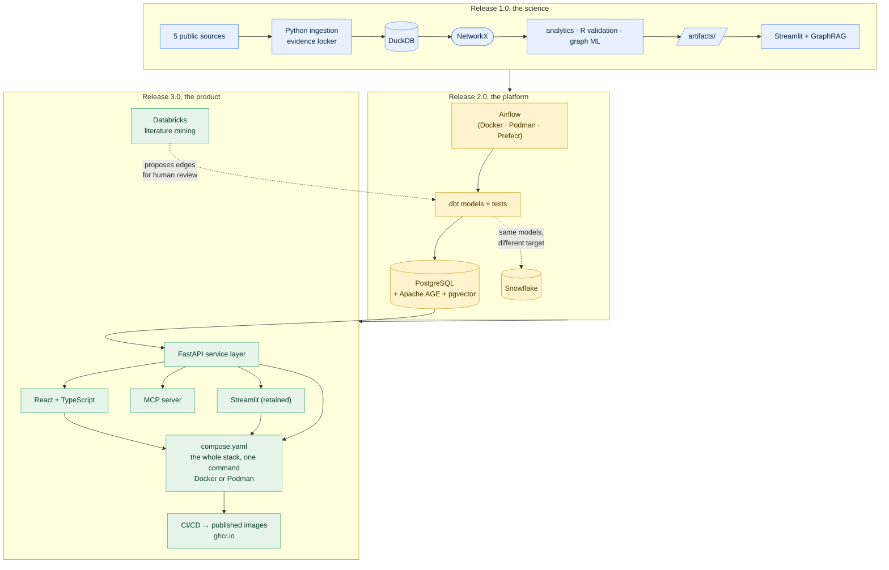

[← Handbook](HANDBOOK.md) · [README](../README.md) · [Glossary](GLOSSARY.md) · [Architecture](00-architecture.md) · [Git workflow](GIT-WORKFLOW.md)

# Roadmap, the full build, in three releases

**Prerequisites:** [`00-architecture.md`](00-architecture.md). There are no
commands in this document. It's the plan; the phase guides hold the steps.

**Learning goal:** understand what gets built, in what order, and, more
importantly, why each tool is there. I've added each technology at the point
where the project first needs it, rather than because it's fashionable. Where a
tool is a weaker fit, I say so.

**Why publish a roadmap at all?** A project that stops at "it works on my
laptop" and one with a credible path to production are different things, and
you can see the difference in the plan. A list of deferrals with the reasons
attached tells a reader more than a list of promises does.

---

## Contents

- [The shape of the plan](#the-shape-of-the-plan)
- [The rule every tool must pass](#the-rule-every-tool-must-pass)
- [Release 1.0, the science](#release-10-the-science-phases-1-9-plus-optional-8b-and-9b)
- [Release 2.0, the platform](#release-20-the-platform-phases-10-13)
- [Release 3.0, the product](#release-30-the-product-phases-14-19)
- [What "finished" means: the product checklist](#what-finished-means-the-product-checklist)
- [The architecture, in three stages](#the-architecture-in-three-stages)
- [Effort and scheduling](#effort-and-scheduling)
- [Deliberately not in the plan](#deliberately-not-in-the-plan)

---

## The shape of the plan

There are nineteen numbered phases (1-19) plus two optional sub-phases (8b and
9b), so twenty-one pieces of work in total, grouped into three releases. The
design work you have already read (architecture, setup, ontology, this roadmap)
is Phase 0.

The main design constraint is that **each release is complete, usable and
publishable on its own**. If the project stopped at 1.0, it would still
count as finished.


The step-by-step route through all of it, with the status of every phase, is the
[Handbook](HANDBOOK.md). An interactive version of the picture above is in
[`interactive/roadmap_timeline.html`](interactive/roadmap_timeline.html).

| Release | What it is | Phases | The question it answers |
|---|---|---|---|
| **1.0, the science** | A working knowledge graph, statistically validated, with machine learning and a public app | 1-9 (+8b, 9b) | *Does the idea work, and can I prove it properly?* |
| **2.0, the platform** | The same thing, rebuilt on production data infrastructure | 10-13 | *Would this survive contact with a real data team?* |
| **3.0, the product** | A real API, a real frontend, AI integrations, and the whole stack containerized | 14-19 | *Can other people and other systems actually use it?* |

The order is intentional. A common mistake is to start with the platform
(orchestration, warehouses, containers) before there's anything worth
orchestrating. Building the science first means every infrastructure decision in
2.0 gets made against a real workload with real requirements, which makes those
decisions easier to get right and easier to justify.

---

## The rule every tool must pass

Before a technology enters this plan, it has to answer one question: **what
does this project need that this tool provides?**

What would look impressive doesn't count, and anyone reading the repository can
tell when a tool is doing real work and when it's only there for show. A Spark
cluster processing four thousand rows would be there for show, whereas an
orchestrator managing five interdependent data sources on a monthly refresh has
a real job to do.

Each phase below gives its reason. Where a tool fits less well than the others,
I say so in that phase.

---

# Release 1.0, the science (Phases 1-9, plus optional 8b and 9b)

*The complete data-science project: real public data, an ontology-governed graph,
statistical validation, machine learning, and a deployed app.*

---

## Phase 1. Ingestion: the MIBiG backbone ✅

**Status:** built and tested. Guide: [`03-ingestion-mibig.md`](03-ingestion-mibig.md).

**What gets built:** the source-adapter framework (`probe → fetch → tidy`), the
evidence locker (`data/raw/`), the provenance log, the twelve rules of the
ontology as code, and the first real records, organism → gene cluster →
compound → activity, from MIBiG 4.0. Also the foundations every later phase
stands on: the project becomes an installable package (`pyproject.toml`), and
automated tests run on Windows, macOS, Linux and RHEL 8 at every push
(continuous integration), so the cross-platform promise is checked from the
first line of pipeline code rather than at the end.

**Why this first:** everything downstream needs data, and the *shape* of how data
arrives determines how painful the next five phases are. If the contract is
right the first time, sources 2 through 6 cost very little to add.

**Why MIBiG:** it is the only public source that reliably supplies the two arrows
at the start of every chain, each signed off by a human curator against a
published experiment. It's CC-BY licensed and has a permanent Zenodo DOI, so
the exact version used can be cited.

**New concepts:** APIs, JSON, HTTP status codes, rate limits and politeness,
retry-with-backoff, checksums, the never-edit-the-original rule, provenance,
staging tables, tests and fixtures, continuous integration.

**New tools:** `requests`, `tenacity`, `pytest` (first real use), GitHub Actions.

**Checkpoint:** `data/raw/mibig/` holds the untouched MIBiG 4.0 archive, its MD5
matching the publisher's; `provenance.csv` has one row per fetch; the staging
tables pass all twelve rules; `pytest` passes offline; the Actions tab is green.

**Effort:** ~7-9 hours.

---

## Phase 2. More sources: PubChem · NCBI Taxonomy · KEGG

**What gets built:** three more adapters plugged into the same socket, the
**curated bridge** loader (`curation/compound_pathogen_crop.csv`, every row cited,
entering at `curated_literature`), the first real use of the secrets setup from
[`01-setup.md`](01-setup.md) (an optional NCBI key in `.env`, never the
repository), and a *data sources and licences* section in the README listing each
source's terms.

**Why:** this phase is the first real test of the framework. Three new sources
arrive and nothing downstream has to change, which is what the contract from
Phase 1 was for.

**Why these three:** PubChem gives every compound a stable identity and a synonym
list (the raw material Phase 4 needs); NCBI Taxonomy gives the lineage ladder that
makes "all *Bacillus*" a single query; KEGG adds pathway context, so chemically
unrelated compounds that share a biological process become connected.

**New concepts:** API keys and why they're secrets, the environment as a place to
store configuration, licence terms as a real constraint (KEGG is academic-use with
attribution and must not be bulk-scraped).

**Effort:** ~6-8 hours.

---

## Phase 3. The proteomics layer: UniProt

**What gets built:** a fifth adapter fetching the **enzymes** encoded by each gene
cluster, adding `Protein` nodes and the `ENCODES` / `CATALYZES` edges.

**Why this matters more than it looks:** it turns the graph from two molecular
layers into three. The chain becomes:

```
Organism → GeneCluster → Protein → Compound → Pathogen → Crop
   (genomics)    (proteomics)   (metabolomics)   (phenotype)
```

This is what **multi-omics integration** means here: three measurement layers
joined into one connected structure, so a single walk through the graph can
cross all of them. Three tables sitting side by side couldn't do that. Most
projects of this kind stop at one layer.

**A note on the shortcut:** MIBiG already gives a direct `GeneCluster → PRODUCES →
Compound` edge. I keep it *and* add the detailed protein path, because the two
answer different questions (the shortcut is for fast traversal; the protein path
is for mechanism). The data model documents that both exist and why.

**Why UniProt:** it's free and public, it's comprehensive, and it's the standard
reference for protein sequence and function. It cross-references MIBiG accessions
directly, so the join is exact rather than fuzzy.

**New concepts:** proteins as the working machinery between DNA and chemistry;
enzyme function; cross-referencing between databases.

**Effort:** ~5-7 hours.

---

## Phase 4. Entity resolution and the graph build

**What gets built:** the resolution engine and its **ledger**, the graph build
(which runs the twelve rules from `validate.py`, written in Phase 1, on every
source merged), the first real graph in DuckDB + NetworkX, and the first
`docs/QUERY_COOKBOOK.md` of tested SQL recipes.

**Why this is the hardest phase:** deciding that `surfactin`, `surfactin A`, and
`npatlas:NPA018495` are one thing, and refusing to guess when you can't confirm it, is
what separates a graph you can trust from one that looks fine but is quietly
wrong. Most tutorials skip it entirely.

**What "the ledger" means:** every merge decision is written down with its
grounds. The ledger answers "how do you know these are the same thing?", and
trusting anything else the graph says depends on being able to answer that.

**A case it must handle on purpose:** an organism that is both a producer (from
MIBiG) and a crop pathogen (from the bridge). Some *Fusarium* species are both.
If both sources use the same identifier, rule 1 (unique `node_id`) stops the
build, and the ledger records how the two roles were reconciled.

**New concepts:** entity resolution, normalisation before comparison, why a wrong
merge is worse than a missed one, validation that *refuses* rather than warns,
SQL basics, `SELECT` / `WHERE` / `GROUP BY` / `JOIN`.

**New tools:** `duckdb`, `networkx`.

**Checkpoint:** `nodes.csv` and `edges.csv` pass all validation rules; the same
row counts appear in DuckDB and in the NetworkX graph; the ledger explains every
merge.

**Effort:** ~10-12 hours. It's the biggest phase in 1.0, and the time is well
spent.

---

## Phase 5. Graph analytics

**What gets built:** evidence-path finding, degree and betweenness centrality,
community detection, and the first interactive network visualisations.

**Why:** this is where the graph starts *answering* questions. The strawberry
question (walk backwards from a crop to candidate microbes) works for the first
time here, and every path comes with its own evidence chain attached.

**The interesting output:** betweenness centrality tends to find *bridges*,
compounds that are the only known link between a group of microbes and a group of
diseases. Bridges are where knowledge is thinnest and where one missing fact
does the most damage, so finding them is useful in its own right.

**New concepts:** shortest paths, centrality (and why "important" has several
meanings), community detection, why a path is only as strong as its weakest
evidence link.

**New tools:** `plotly`, `pyvis`.

**Effort:** ~8-10 hours.

---

## Phase 6. Statistical validation in R

**What gets built:** an R script using `igraph` that (a) reproduces the main
centrality results as an independent cross-check and (b) runs **permutation
tests** asking whether the observed structure is more than chance.

**Why this phase exists (most projects skip it):** a graph built from real data
will show communities and hubs *even if the underlying relationships are random*,
because any network has some structure. Without a null model, "we found three
communities" doesn't mean anything on its own. A permutation test rewires the
graph thousands of times, keeping the degree distribution fixed, and asks whether
the real clustering is stronger than the shuffled versions.

Asking *could this have happened by chance?* is what separates statistics from
data analysis, and the answer is what lets the rest of the project stand up to
scrutiny.

**Why R specifically:** R was built by statisticians, and `igraph`'s R interface
is mature and well documented for this kind of work. It also gives the project a
fair "same task, two languages" comparison: the same centrality computed in
Python/NetworkX and R/igraph, with commentary on what each is best at. When two
independent implementations agree, that agreement is a check in its own right.

**New concepts:** null models, permutation testing, p-values in a network context,
degree-preserving rewiring, cross-implementation validation.

**New tools:** R, RStudio, `igraph`, `DBI` + `duckdb` (reading the project
database from R), `dplyr`, `ggplot2` (the publication-quality figures in
`docs/img/`), and `renv`, R's sealed toolbox and the direct counterpart of
`.venv`, with `renv.lock` playing the role of `requirements.lock.txt`.

**Effort:** ~6-8 hours.

---

## Phase 7. Graph machine learning

**What gets built:** node embeddings (node2vec), a supervised link-prediction
model with proper negative sampling, cross-validated evaluation, feature
importance, and an error analysis.

**Why this is the technical heart of Release 1.0:** everything before it describes
what's already known. This phase *predicts*: it scores arrows that don't exist yet
and asks which ones probably should.

**What a node embedding is, briefly:** a way of turning each node's position in
the graph into a list of numbers, such that nodes with similar connection patterns
end up with similar numbers. Once every node is a vector, ordinary machine learning
applies. It's a bit like describing a person by the social circles they move in,
then looking for people with similar descriptions.

**Three things make this rigorous:**

1. **Negative sampling done properly.** Link prediction has a trap: there are vastly
   more absent arrows than present ones, so a model that always says "no link"
   scores brilliantly and is useless. The training set has to be built with
   care, and the class imbalance handled explicitly.
2. **The right split.** You can't split edges at random when the features are
   *derived from the graph those edges are in*, because the model would see the
   answer. Edges must be held out **before** embeddings are computed. It's a
   subtle leakage trap, and I think documenting it is worth as much as the model.
3. **Evaluation that fits the problem.** That means precision-recall rather than
   accuracy (because of the imbalance), cross-validation, and a written error
   analysis of what the model gets wrong and why.

**Predictions stay separate:** every predicted edge is stored as
`evidence_level = inferred`, kept in its own layer, drawn differently in the app,
and excluded from evidence chains by default. A prediction tells you where to
look; it isn't a finding.

**New concepts:** embeddings, negative sampling, data leakage in graphs,
train/test splitting for relational data, precision-recall, class imbalance,
cross-validation, error analysis.

**New tools:** `scikit-learn`, `node2vec` (or `gensim`).

**Effort:** ~12-14 hours. It's the most demanding phase and, I think, the most
valuable.

---

## Phase 8. The Streamlit app

**What gets built:** four areas: Explore (filter the graph by type, source, and
evidence level), Trace (evidence chains with every arrow's provenance), Rank
(candidate microbes for a chosen pathogen), and Query (a read-only SQL console).

**Why Streamlit first, not React:** it's the fastest path I know from analysis
to something a person can click. React comes in Phase 15, when there'll be a real
API to build against, and that's the better order.

**Why "read-only by construction" matters:** the code enforces the SQL console's
read-only status with two independent locks (a validated query parser *and* a
read-only connection), so it doesn't depend on anyone reading the documentation.
Anything a user can type into has to be designed against misuse.

**New concepts:** frontend vs backend in practice, reactivity, state, why the app
reads precomputed artifacts rather than recomputing.

**Effort:** ~10-12 hours.

---

## Phase 8b. The same app in R Shiny (optional)

**What gets built:** the core of the Streamlit app rebuilt in R Shiny (pick a
pathogen, see candidate microbes, trace the evidence chain), reading the *same*
DuckDB file and producing the *same* answers in a different language.

### What Shiny is, in plain words

**Shiny** is R's equivalent of Streamlit: a library that turns R code into a web
application with dropdowns, sliders, tables and plots, without writing any web
code yourself.

Think of Streamlit and Shiny as two brands of flat-pack furniture. Both give you
a wardrobe from a box and an Allen key. They assemble differently and the
finished pieces have different strengths, but neither asks you to be a
carpenter.

### Why build the same thing twice? That sounds like waste

I don't think it is, and I have three reasons.

**1. It's the clearest comparison you can make.** Reading about two languages
teaches you very little. Building *the identical thing* in both, with the same
data and the same requirements, shows you where each one is comfortable and
where it fights you. Everything except the language is held constant, which
happens to be how a controlled experiment works.

You learn far more about two knives by chopping the same onion with each than by
reading two knife reviews.

**2. It checks that the architecture was right.** Remember the design decision
from [`00-architecture.md`](00-architecture.md): the *app* is a thin frontend,
and all the real work lives in the backend and the database. If that separation
really holds, a second frontend in a completely different language should be
straightforward. It just reads the same tables and draws them.

If it turns out to be hard, that tells you something too: logic that belonged in
the shared layer has leaked into the Streamlit app. So building the second app
doubles as a *test of the first one's design*, and it's a test you can't fake.

**3. It settles a real argument.** Teams disagree about "Streamlit or Shiny?",
usually without either side having built the same thing in both. Once you've
done it, you can answer from evidence instead of preference.

### The two models of how an app updates

This part of the comparison explains almost every difference you'll notice, so
it's worth taking slowly.

**Streamlit re-runs the whole script.** Every time you touch a control, Streamlit
executes your script from the first line to the last, with the new value in
place. That's simple to reason about, because there's only one path through the
code, and occasionally wasteful, because it redoes work that didn't need redoing.

Picture a chef who, whenever an order changes, throws out the dish and cooks it
again from raw ingredients. It's never confusing, though it's sometimes slow.

**Shiny recalculates only what changed.** Shiny builds a dependency map of your
outputs: this chart depends on that dropdown, that table depends on this slider.
Change one input and only the outputs downstream of it recompute. This is called
**reactive programming**.

A spreadsheet works the same way. Change cell B2 and only the formulas that
reference B2 update, while the rest of the sheet sits still. You've probably used
reactive programming for years without calling it that.

**The trade-off:** Shiny's model is more efficient and scales better to complex
applications. It's also harder to learn, because the code no longer runs top to
bottom and you have to think in terms of dependencies rather than sequence.
Streamlit's model is easier to hold in your head and does more work than strictly
necessary.

Neither model is the right one in general. They're different answers to the same
question, and knowing *why* each was chosen is worth more than knowing either
syntax.

### The other structural difference: `ui` and `server`

Every Shiny app has exactly two halves, and this catches Streamlit users out:

- **`ui`**: *what the page looks like.* Which controls exist, where they sit.
- **`server`**: *what the app does.* How inputs become outputs.

Streamlit mixes these freely: you write a slider and then immediately use its
value, on the next line.

If Shiny were a place to eat, it would be a restaurant with a printed menu (the
`ui`) and a kitchen (the `server`), designed separately and connected by order
numbers. Streamlit would be a food truck where you point at what you want and
watch it being made. Both feed you; the restaurant separates concerns, and the
food truck keeps everything in view.

Which is better? For a small app, Streamlit's directness wins. As an app grows,
Shiny's separation keeps it from becoming a tangle. Separating presentation from
logic is a well-established engineering pattern, and a small app you already
understand is the easiest place to learn it.

### What gets built, concretely

| Piece | Streamlit (Phase 8) | Shiny (Phase 8b) |
|---|---|---|
| Read the database | `duckdb.connect()` | `DBI::dbConnect(duckdb::duckdb())` |
| Dropdown | `st.selectbox()` | `selectInput()` in `ui` |
| Table | `st.dataframe()` | `renderDT()` in `server` |
| Chart | `plotly` | `ggplot2` + `renderPlot()` |
| Network view | `pyvis` | `visNetwork` |
| Run it | `streamlit run app.py` | `shiny::runApp("shiny/")` |

The file is `shiny/app.R`. Shiny's convention is one file with `ui` and `server`
in it, which keeps a small app in one place.

### Deploying it

shinyapps.io, from the same company that makes RStudio, has a free tier: a
handful of applications and a monthly quota of active hours, which is plenty for a
project of this size. Publishing takes one command from RStudio. The free tier's
limits and signup steps change, so I'll check them and write them out when this
phase is built.

### Honest costs

- ~8-10 hours, most of it spent learning reactivity rather than writing code.
- A second app to keep in step when the shared layer changes. That's a real
  cost, but a manageable one, because both apps are thin.
- A second deployment to maintain, if you publish both.

### What it teaches

It teaches the difference between R and Python through one application built
twice, in Streamlit and in Shiny, over one shared database, with notes on where
each one was better and why. That comparison is written up in the phase guide for
the next person who has to choose between the two.

**Effort:** ~8-10 hours. **Prerequisites:** Phase 8 (the Streamlit app) and
[`R-SETUP.md`](R-SETUP.md).

---

## Phase 9. Deployment, GraphRAG, and release 1.0

**What gets built:** the app deployed free and public; the GraphRAG answer layer;
and everything that turns a working repository into something a stranger can pick
up and put down: one-command setup scripts (`scripts/setup.sh` for macOS, Linux
and RHEL 8, `scripts/setup.ps1` for Windows), `docs/HOSTING.md` (how and where the
app is hosted), `docs/UNINSTALL.md` (how to remove everything cleanly),
`CONTRIBUTING.md`, `CITATION.cff` (how to cite the project), a versioned data
release of `nodes.csv` and `edges.csv` with its own DOI, release notes from
`CHANGELOG.md`, and the `v1.0.0` tag.

**GraphRAG in one line:** answer a question by *walking the graph* to collect the
relevant facts, then hand only those facts to a language model to phrase the
answer, so every sentence is grounded in a real, cited chain rather than the
model's memory.

**Why it fits this project particularly well:** in most RAG systems you retrieve
paragraphs and hope they contain the connection. Here the connections *are* the
data, so retrieval returns an assembled evidence chain with provenance on every
link, and the answer comes with its own footnotes.

**Graceful degradation:** if no API key is configured, the feature hides itself
and everything else keeps working. A project that needs a paid service before it
can demonstrate anything is fragile, and I wanted to avoid that.

**New concepts:** deployment, secrets in a hosted environment, LLMs,
hallucination, RAG, GraphRAG, prompt grounding, semantic versioning, data
citation.

**Effort:** ~10-12 hours.

## Phase 9b. One container (optional)

**What gets built:** a `Containerfile` and a `.dockerignore` that package the
Streamlit app into a single image, runnable with one command under **either
Docker or Podman**.

```bash
docker build -t microbegraph-app .   # or: podman build ...
docker run -p 8501:8501 microbegraph-app
```

**Why optional, and why here:** Release 1.0 must stay runnable with nothing but
`.venv`. A fresh clone should work for someone who has no interest in installing
a container engine, so this is an *additional* way to run the project, never a
replacement.

It sits at this point on purpose, because this is the easiest place to learn
containers: there's one service, one image and one port, with no inter-service
networking, no start-order problems and no database volumes. You learn the ideas
where there's only one thing to get wrong, and then meet the complicated version
in Phase 18 already knowing what an image and a layer are.

**The payoff:** anyone can run your app with one command on a machine that has no
Python, no pandas and no NetworkX. That's a real step from "here is my code"
toward "here is my application".

**New concepts:** images vs containers, base images, layers and build caching (and
why copying `requirements.txt` before your code makes rebuilds 90× faster),
`.dockerignore`, publishing ports, running as a non-root user, health checks,
why a server must bind `0.0.0.0` rather than `localhost` inside a container.

**New tools:** Docker or Podman (one set of files works with both). The full
guide is [`CONTAINERIZATION.md`](CONTAINERIZATION.md).

**Checkpoint:** `docker run -p 8501:8501 microbegraph-app` serves the app at
`http://localhost:8501` on a machine where Python was never installed.

**Effort:** ~4-5 hours.

---

### Release 1.0 is a complete project

At this point the repository contains: five real public data sources, an
ontology-governed multi-omics knowledge graph, entity resolution with a ledger,
statistical validation against a null model, machine learning with a careful
evaluation, a deployed public app, an AI answer layer, optionally the same app
rebuilt in R Shiny and a runnable container image, and a full beginner tutorial.
That's a finished project. Everything after this point improves it; none of it
is needed to complete it.

```bash
git tag -a v1.0.0 -m "Release 1.0, the science"
git push origin develop develop:beta develop:master --tags
```

---

# Release 2.0, the platform (Phases 10-13)

*Rebuilding the same system on the infrastructure a real data team would use,
each piece introduced because the project has grown a need for it.*

---

## Phase 10, dbt: the ontology becomes tested SQL

**What gets built:** the transform from raw source tables → `nodes` / `edges`
moved out of Python and into **dbt** models, with the ontology's validation rules
expressed as dbt tests.

**Why this is the best fit in the entire plan:** look at what the loader does
now. It enforces uniqueness of `node_id`, checks that every `source_id` exists in
`nodes`, and checks that `edge_type` is one of ten allowed values and
`evidence_level` one of four. Those map onto dbt's four built-in tests with no
adaptation at all: `unique`, `relationships`, `accepted_values`, `not_null`.

Your ontology document becomes `schema.yml`, which is the kind of job dbt was
built for, so the teaching example here comes straight from the project.

**What dbt is:** a tool that turns a folder of SQL files into a tested,
documented, version-controlled transformation pipeline. It works out which model
depends on which, runs them in the right order, tests the results, and generates
browsable documentation with a dependency graph.

**What you gain:** the transformations become SQL that anyone can read (rather
than Python only you can read), data quality checks become automated tests that
run on every build, and the pipeline gets auto-generated documentation.

**Cost:** nothing. dbt Core is free and runs against your existing DuckDB.

**New concepts:** ELT vs ETL, staging / intermediate / mart layering, model
materialisation (view vs table), data tests, lineage, `dbt docs`.

**Effort:** ~8-10 hours.

---

## Phase 11. PostgreSQL + Apache AGE + pgvector

**What gets built:** the graph migrated to PostgreSQL, with **Apache AGE** for
graph storage and Cypher queries, and **pgvector** for the RAG layer's embeddings.

**Why Postgres, and why now:** three separate needs point to the same engine:

1. **A real graph database.** NetworkX holds the graph in memory, which is fine at
   this size but isn't how production graphs run. Apache AGE is a Postgres
   extension that adds graph storage and **Cypher**, the standard graph query
   language. You get graph-database skills without running a second server.
2. **A vector store.** The GraphRAG layer needs to find semantically similar nodes.
   `pgvector` adds vector similarity search to the same database.
3. **An application database.** FastAPI and React (Release 3.0) need a proper
   server database anyway.

That's the reason for choosing it: one engine covers three jobs. Postgres being
popular doesn't come into it.

**Why not Neo4j:** it's excellent, and it's the better-known graph database. But
adding it would mean a second server, a second data copy and a second thing to
keep in sync, purely to get Cypher, which AGE already provides inside a database
the project needs anyway. I've recorded it here as a decision I considered.

**The portability lesson stays:** DuckDB remains the zero-setup local path. The
project runs either way, and switching is a config change. Environment
portability is the transferable skill here, and I'd rank it above knowing any one
database.

**New concepts:** client-server databases vs embedded, connection strings,
migrations, extensions, Cypher, vector embeddings and similarity search, indexes.

**Effort:** ~10-12 hours.

---

## Phase 12. Airflow orchestration

**What gets built:** the whole pipeline as an Airflow DAG, five source fetches
running in parallel, then resolve, then build, then dbt tests, then artifact
export, on a monthly schedule with retries and failure alerts.

**Why Airflow belongs here:** by Phase 12 the pipeline has five
independent sources, a strict dependency order (resolve cannot start until all
fetches finish; build cannot start until resolve succeeds), a need to re-run
monthly, a need to retry transient network failures without redoing successful
work, and a need to be told when something breaks. That list describes what
Airflow is for: running all of it by hand and remembering the order is the
problem Airflow was built to solve.

**Cost:** free. Apache Airflow runs locally through the Astro CLI.

**Container runtime, all three paths supported:** the Astro CLI needs a container
engine, and there are three routes depending on your machine. **Docker Desktop**
(Windows/macOS, simplest), **Podman** (rootless, daemonless, no admin rights
required, and the native choice on RHEL 8, the Astro CLI auto-detects it and
recent installers bundle it), or **Prefect** as a container-free fallback that
teaches the same orchestration concepts in pure Python. The full comparison and
setup steps for each are in [`CONTAINERS.md`](CONTAINERS.md).

**New concepts:** DAGs, tasks and dependencies, scheduling, idempotency,
backfills, retries and exponential backoff, sensors, containers, images vs
containers, volumes.

**Effort:** ~10-12 hours (add ~4 if containers are new to you).

---

## Phase 13. Snowflake portability and release 2.0

**What gets built:** the same dbt models pointed at a **Snowflake** warehouse
instead of DuckDB, plus a documented, small procedure for switching between them.

**Why this is worth a phase:** because so *little* has to change. dbt separates
what a transformation says from where it runs, so moving from a laptop database
to a cloud warehouse takes a change of profile target rather than a rewrite.
Running one project against two completely different engines, with the same tests
passing on both, shows more than either engine would on its own.

**Cost** (verified as current): Snowflake offers a 30-day trial with $400 of
credits and no credit card. The trial **expires**, which is why the project is
built local-first: when it ends, everything still works on DuckDB. The phase
includes explicit cost-avoidance steps (warehouse auto-suspend, the smallest
warehouse size, and how to check credit consumption).

**A caveat:** at this data volume Snowflake is enormous overkill, and the docs
will say so. The phase is there to show portability as a skill; the project
itself has no need for a warehouse.

**New concepts:** cloud data warehouses, separation of storage and compute,
virtual warehouses, credits and cost control, dbt profiles and targets.

**Effort:** ~6-8 hours. *(Trial terms change; check Snowflake's current offer when
you reach this phase.)*

### Release 2.0 is a complete platform

The same graph, the same twelve rules and the same tests, now as dbt models on a
server database, refreshed monthly by Airflow, portable to a cloud warehouse.

```bash
git tag -a v2.0.0 -m "Release 2.0, the platform"
git push origin develop develop:beta develop:master --tags
```

---

# Release 3.0, the product (Phases 14-19)

*Turning a working system into something other people and other software can use.*

---

## Phase 14. FastAPI service layer

**What gets built:** a REST API exposing the graph's core operations (find paths,
rank candidates, fetch a node's neighbourhood, run a validated read-only query),
with automatic interactive documentation. Since it will be public, it also gets
optional API keys and rate limits, structured logging, a health endpoint for
monitoring, and a `SECURITY.md` saying how to report a problem.

**Why it's necessary:** by Release 3.0, three separate things
need the same query logic: the Streamlit app, the React frontend, and the MCP
server. Without a service layer you write that logic three times and it drifts
apart. With one, all three become thin clients.

It's also the usual way real teams split the work: data scientists ship a model
behind an API and software engineers build against it, instead of embedding the
science inside the application.

**Why FastAPI:** it generates interactive documentation from your code
automatically, validates every request against declared types before your function
runs, and is fast. Its type-based validation is the same idea as the ontology's
validation rules, applied to API traffic.

**New concepts:** REST, endpoints, HTTP verbs, request/response models, automatic
validation, OpenAPI, async, API documentation, error handling and status codes.

**Effort:** ~10-12 hours.

---

## Phase 15. React + TypeScript frontend

**What gets built:** a proper web frontend (an interactive graph canvas, an
evidence-chain viewer and a candidate ranking table) talking to the FastAPI
backend. It's accessible by design: everything can be reached from the keyboard,
and evidence levels are shown by line style and label as well as colour.

**Why now and not earlier:** because now there's an API to build against. Building
a frontend before the backend exists means inventing the contract twice.

**Why both this and Streamlit:** they're different products for different users.
The Streamlit app is the analyst's workbench: quick to change and dense with
controls. The React app is the public product, polished, responsive and easy to
share. Neither one replaces the other, so the project keeps both.

**What TypeScript adds over JavaScript:** types work like seatbelts. In
JavaScript, passing a number where text was expected fails silently at runtime,
possibly in front of a user. TypeScript catches it while you type. For anything
beyond a trivial script, it's worth the small extra effort.

**New concepts:** JavaScript and TypeScript, components, props and state, the
build step, npm, calling an API from a browser, CORS, responsive layout, deploying
a static frontend.

**Effort:** ~14-16 hours. It's the largest single phase, because it means
learning a new language and a new ecosystem.

---

## Phase 16. MCP server

**What gets built:** a Model Context Protocol server wrapping the FastAPI
endpoints, so an AI assistant can query the graph directly: find a path, rank
candidates for a pathogen, retrieve evidence.

**Why it's small but worthwhile:** the hard work was already done in Phase 14,
and MCP is a thin, standardised wrapper over an API that exists. It takes a few
hours and lets an AI assistant use the graph directly.

**What MCP is:** an open standard for letting AI assistants plug into external
tools and data. It's the same idea as USB: one agreed shape, so any device works
with any computer.

**Security by design:** every tool is read-only, with validated, fixed inputs.
The server can look things up, but it can't alter, delete or fetch anything. The
narrow scope is intentional.

**New concepts:** MCP, tool schemas, tool-calling, why scoping an AI's permissions
is a design decision rather than an afterthought.

**Effort:** ~5-6 hours.

---

## Phase 17. Databricks: literature mining at scale

**What gets built:** a batch job that reads thousands of paper abstracts, uses a
language model to extract candidate *compound → inhibits → pathogen* statements,
and proposes them for human review.

**Why this is the one justified use of Spark in this project:** at four thousand
nodes, distributed compute would be for show, and a phase that used Databricks to
run a `GROUP BY` would obviously be unnecessary. This job is different: reading
tens of thousands of documents and running a model over them is real batch
compute, and it's awkward on a laptop.

**Why it's also the most valuable extension:** it goes after the gap that the
curated bridge layer covers over. Those compound → pathogen links are curated by
hand because they live in prose. This phase starts extracting them at scale.
Every proposal goes to human review, and it enters as `curated_literature` with a
citation only after a person accepts it: the machine proposes and a human
decides. The rest of the phase is built around that boundary.

**Cost** (verified as current): Databricks Free Edition is perpetually free (it
replaced Community Edition, which was retired in January 2026). It's serverless
and includes notebooks, GPUs and agent tooling. For anyone who'd rather not sign
up, a local Spark fallback is documented.

**Where it ranks:** this is the *weakest-justified* tool in the plan, which is
why it's placed last in the release. If effort has to be cut, cut here first.

**New concepts:** distributed compute, Spark, lakehouse, notebooks at scale,
named-entity recognition, LLM-assisted extraction, human-in-the-loop review.

**Effort:** ~10-12 hours.

---

## Phase 18. Containerize the whole application

**What gets built:** a `Containerfile` for every service and one `compose.yaml`
describing the complete system, **PostgreSQL + FastAPI + Streamlit + React**,
with health checks, named volumes, an internal network, secrets read from
`.env` at run time, and a documented backup and restore of the database volume.
It works identically under Docker and Podman.

The end state:

```bash
git clone https://github.com/akannan2987/microbegraph.git
cd microbegraph
cp .env.example .env          # set a database password
docker compose up             # or: podman compose up
```

After two commands, the entire system runs on a machine with no Python, no R,
no PostgreSQL and no configuration.

**Why this gets a whole phase:** by Release 3.0 the project is four cooperating
services. Each needs its own setup, they must start in the right order, and each
must know where the others live. Running that by hand means four terminal windows
and a page of notes that goes stale. This phase turns it all into one command,
and that's the difference between *"here is my code"* and *"here is my
application"*.

**Why after Phase 15, not before:** you containerize something once it's
finished. Doing it earlier means rebuilding every image each time the shape
changes.

The phase teaches you to solve the following problems, each a real trap with a
known fix:

- **"Started" is not "ready".** The database container starts in a second; the
  database *program* takes fifteen. An API that connects immediately gets
  *connection refused*. The fix is health checks plus
  `condition: service_healthy`, which amounts to waiting for the kettle to click
  off rather than trusting the switch.
- **`localhost` means something different inside a container.** There it means
  *this container*, rather than your machine. Services address each other by
  service name (`postgres:5432`), which works like an internal phone directory
  and isn't affected by the IP changes that happen on every restart.
- **Containers are disposable.** Everything written inside one vanishes when it's
  removed. That's useful, right up until it's your database. Volumes are the
  suitcase that leaves the hotel room with you.
- **A secret baked into an image is public forever.** Layers keep everything;
  deleting a file in a later layer does not remove it from the earlier one.
  Secrets arrive at run time, never build time.
- **Not everything should be reachable.** The database gets no published port at
  all, so the other services can see it on the internal network and nothing
  outside can. That default is intentional.

One set of files serves both engines. Three decisions make Docker and Podman
interchangeable with no duplicated configuration: name recipe files
`Containerfile` (both engines read it), publish only ports above 1024 (rootless
Podman cannot bind lower ones), and put `:Z` on every volume mount (Docker ignores
it; Podman on RHEL 8 requires it for SELinux). As a result, there's no separate
Podman version of anything.

**New concepts:** compose files, service discovery by name, internal networks,
published vs internal ports, named volumes vs bind mounts, health checks and start
conditions, multi-stage builds (the React image goes from ~1.2 GB to ~25 MB by not
shipping the build tools), non-root containers, SELinux labelling, systemd/Quadlet
autostart on Linux servers.

**Full guide:** [`CONTAINERIZATION.md`](CONTAINERIZATION.md), written from zero,
with the Containerfile explained line by line.

**Effort:** ~10-12 hours (~6 if you did Phase 9b, which front-loads half the
concepts).

---

## Phase 19. Published images, CD, and release 3.0

**What gets built:** the test suite has run on every push across Windows, macOS,
Linux and RHEL 8 since Phase 1 (continuous integration). This phase adds
**continuous delivery**: automated multi-platform image builds published to the
GitHub Container Registry; image vulnerability scanning; automatic proposals when a
dependency has an update or a security fix; release notes generated from
`CHANGELOG.md`; and the `v3.0.0` tag.

**Why last:** you automate the building of images that already exist and are
known-good. Automating a moving target wastes the effort twice.

**What automated builds give you:** after this phase, anyone can run the
application with no clone, no build, and no Python at all:

```bash
docker run -p 8501:8501 ghcr.io/akannan2987/microbegraph-app:latest
```

**Why CI mattered from Phase 1, even on a solo project:** a "tests passing" badge
on a README only means something if a machine keeps checking it. Since Phase 1,
every push has run the full suite automatically on Windows, macOS, Linux and a
RHEL 8 container, so the project's cross-platform claim is *verified* on every
push. This phase builds on that same workflow.

**Multi-platform builds, and why they matter:** Apple Silicon Macs are ARM; most
servers are x86. `docker buildx` builds both architectures from one command, so
one tag works everywhere. Without it, a Mac-built image fails on a server with a
baffling `exec format error`.

**New concepts:** continuous integration, workflow files, build matrices, container
registries, image tagging strategies (version, commit, `latest`), multi-platform
builds, automated vulnerability scanning, release automation.

**Effort:** ~6-8 hours (the test workflow already exists from Phase 1).

### Release 3.0 is the finished product

```bash
git tag -a v3.0.0 -m "Release 3.0, the product"
git push origin develop develop:beta develop:master --tags
```

---

## What "finished" means: the product checklist

A product needs more than features. The table lists every piece the finished
MicrobeGraph includes and the phase that delivers it, so nothing is left for
"someday".
✅ = in the repository now.

| Area | Piece | Lands in |
|---|---|---|
| **Learning** | The Handbook, one document from day 0 to the finished product | ✅ Phase 1, then every phase |
| | A tutorial guide per phase, with checkpoints and troubleshooting | ✅ Phases 0-1, then each phase |
| | The glossary, every term in plain language | ✅ Phase 0, grows each phase |
| | Teaching diagrams and interactive explorers, regenerated by script | ✅ Phase 1, grows each phase |
| | Query cookbook: tested SQL, then Cypher, recipes | Phase 4, extended in Phase 11 |
| **Trust** | Evidence level, source, record and date on every arrow | ✅ Phase 0 design, Phase 1 code |
| | Checksums and an append-only provenance log for every download | ✅ Phase 1 |
| | The twelve rules enforced in code, then as dbt tests | ✅ Phase 1, Phase 10 |
| | A resolution ledger explaining every merge | Phase 4 |
| | Null-model statistics and a second-language cross-check | Phase 6 |
| | Predictions stored as `inferred`, never mixed with evidence | Phase 7 |
| | Data sources and licences listed, attribution in the app | Phase 2, Phase 8 |
| **Engineering** | Installable package, bounded dependencies, lockfile | ✅ Phase 0-1 |
| | Automated tests on Windows, macOS, Linux and RHEL 8 at every push | ✅ Phase 1 |
| | One-command setup scripts per operating system | Phase 9 |
| | Monthly scheduled refresh with retries and alerts | Phase 12 |
| | Containers: the app (optional), then the whole stack | Phase 9b, Phase 18 |
| | Published multi-platform images, vulnerability scanning, dependency updates | Phase 19 |
| **Using it** | Public app (Streamlit), then the React product | Phase 9, Phase 15 |
| | API with documentation, keys, rate limits, logging and a health endpoint | Phase 14 |
| | AI access: GraphRAG answers, an MCP server | Phase 9, Phase 16 |
| | Accessibility: keyboard use, never colour alone | Phase 8, Phase 15 |
| **Looking after it** | `CHANGELOG.md` and tagged releases with notes | ✅ Phase 1, each release |
| | `HOSTING.md`, `UNINSTALL.md`, `CONTRIBUTING.md`, `CITATION.cff` | Phase 9 |
| | A citable data release (DOI) of the graph itself | Phase 9, refreshed per release |
| | `SECURITY.md`: how to report a problem | Phase 14 |
| | Database backup and restore | Phase 18 |
| | Controlled upgrades of pinned source releases | ✅ procedure in Phase 1, checked monthly from Phase 12 |

---

## The architecture, in three stages

How the picture changes with each release:



Release 1.0's components don't get thrown away. DuckDB stays as the local path,
Streamlit stays as the analyst tool, and NetworkX stays for in-memory algorithms.
Each release *adds a production tier* alongside what exists. That's how real
systems evolve, and it's also what keeps the project runnable on a laptop, with
no accounts, at every stage.

---

## Effort and scheduling

The plan is realistic at **4-5.5 hours per week**, allowing for some missed
weeks:

| Release | Phases | Hours | Calendar |
|---|---|---|---|
| 0, design and setup | 0 | ~5-6 | ~1 week |
| 1.0, the science | 1-9 | ~74-92 | ~16-20 weeks |
| 1.0, the same app in Shiny *(optional)* | 8b | ~8-10 | ~2 weeks |
| 1.0, one container *(optional)* | 9b | ~4-5 | ~1 week |
| 2.0, the platform | 10-13 | ~34-42 | ~8-9 weeks |
| 3.0, the product | 14-19 | ~55-66 | ~12-15 weeks |
| **Total** | **0-19 (+8b, 9b)** | **~180-221** | **~40-49 weeks** |

*The per-phase hours live in [`phases.csv`](phases.csv); the weeks assume about
4.5 hours a week.*

That's a substantial commitment, roughly a part-time year. Three things make it
manageable:

1. **Every phase ends at a checkpoint** with something working and committed. You
   can stop after any phase and the repository is coherent.
2. **Every release is a finished product.** 1.0 alone is complete and publishable.
   Don't let Release 2.0 hold Release 1.0 hostage.
3. **The roadmap itself is a deliverable.** A README that lays out phases 10-19
   with reasons attached, marked as planned, shows the thinking behind them before
   the code exists, and that's more useful than a promise.

If I could give only one piece of scheduling advice, it would be to ship 1.0
before starting 2.0. A small finished thing is worth considerably more than a
large unfinished one.

---

## Deliberately not in the plan

I considered these and rejected them. The reasons are listed, because knowing
why *not* to use a tool is as informative as knowing how to use one:

- **Neo4j**: Apache AGE gives Cypher and graph storage inside a Postgres instance
  the project needs anyway. Adding a second graph server would mean a second data
  copy and a sync problem, purely for a query language we already have.
- **Kubernetes**: solves scaling and orchestration problems for *many* services
  under real load, across many machines. This project has four services on one
  machine, and `compose` (Phase 18) handles that completely. Kubernetes here would
  add ceremony and nothing else. To be clear, containers themselves are firmly
  *in* the plan; it's the cluster orchestrator that isn't, because the problem it
  solves doesn't exist here yet.
- **Kafka / streaming**: the data sources update on a scale of *months*, so a
  monthly batch is the correct design here, with nothing given up. Streaming
  would solve a problem this project doesn't have.
- **Deep learning for the core prediction**: the graph is small, and the aim is
  explainable, evidence-backed suggestions. At this size, classical ML with
  feature importance is both stronger and more transparent. Node embeddings (Phase 7) already
  bring in the representation-learning ideas that matter.
- **A second cloud (AWS/GCP/Azure) beyond the free tiers named**: no capability
  gained, real cost risk added.

---

*This roadmap is a plan, and plans change. Phases will shift as the earlier ones
teach things the later ones need, and when they do, I'll update this document with
the reason. A plan that never changes was probably never being followed.*
